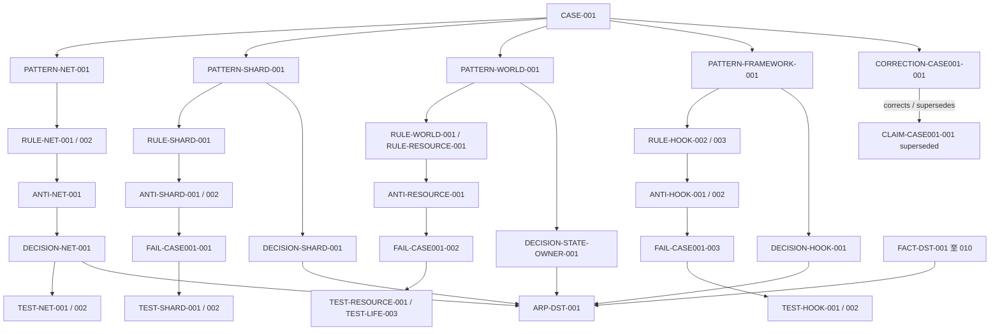
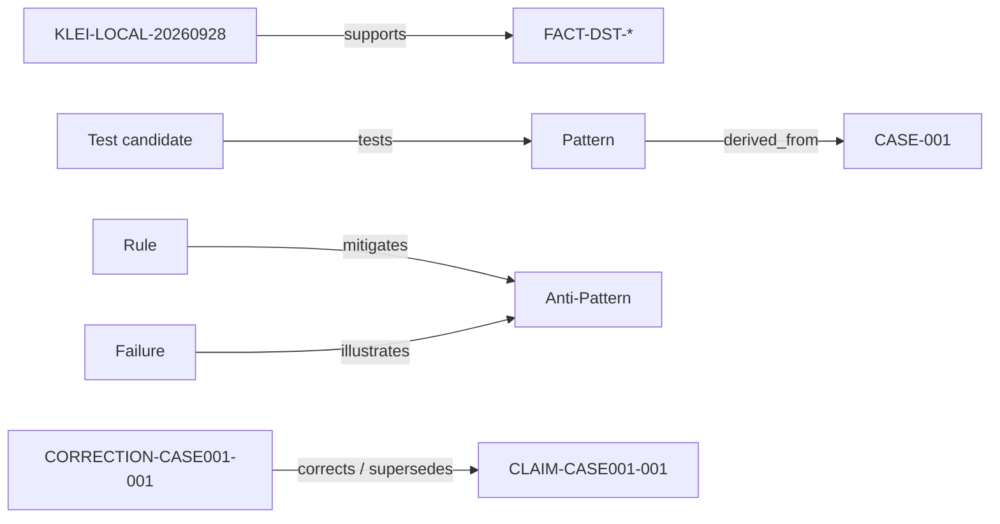

# dst-mod-engineering / web-full

生成器：`dst-mod-engineering/web-bundle-v1`；源码指纹：`22955607c9f2d3fe965b1ef02e01525e61c8fcebc765e386eeabe0f38ff7f3b6`。

这是从仓库原文生成的阅读包；正文只改写 Markdown 链接目标。段落 SHA-256 对应原始文件字节，不是改写后的正文。未包含的文件、未实际访问的链接及未展开的附件不能算作已读；上传阅读包不等于安装本地工具，也不证明游戏验证通过。公开链接指向 main，可能晚于本包快照。

本包包含：
- `SKILL.md`
- `references/web-chat.md`
- `references/environment-tools.md`
- `references/testing-release.md`
- `README.en.md`
- `README.md`
- `docs/install-and-use.md`
- `docs/knowledge-integration.md`
- `docs/licensing.md`
- `docs/public-limits.md`
- `knowledge/CASE-002-AGENDA.md`
- `knowledge/CHANGELOG.md`
- `knowledge/GOVERNANCE.md`
- `knowledge/INDEX.md`
- `knowledge/KB-v0.1.1-Migration-Report.md`
- `knowledge/README.md`
- `knowledge/RELATIONS.md`
- `knowledge/SOURCES.md`
- `knowledge/VALIDATION.md`
- `knowledge/anti-patterns/case001.md`
- `knowledge/cases/CASE-001-sora/README.md`
- `knowledge/corrections/CASE-001.md`
- `knowledge/corrections/claims.md`
- `knowledge/decisions/candidates.md`
- `knowledge/facts/klei-lua.md`
- `knowledge/failures/case001.md`
- `knowledge/patterns/PATTERN-FRAMEWORK-001.md`
- `knowledge/patterns/PATTERN-NET-001.md`
- `knowledge/patterns/PATTERN-SHARD-001.md`
- `knowledge/patterns/PATTERN-WORLD-001.md`
- `knowledge/playbooks/ARP-DST-001.md`
- `knowledge/research/native001/linked-history/native-runtime-pass01-20261004/delivery/NATIVE-001.1-Runtime-Pass01.md`
- `knowledge/rules/framework.md`
- `knowledge/rules/hook.md`
- `knowledge/rules/life.md`
- `knowledge/rules/net.md`
- `knowledge/rules/persist.md`
- `knowledge/rules/resource.md`
- `knowledge/rules/shard.md`
- `knowledge/rules/state.md`
- `knowledge/rules/world.md`
- `knowledge/tests/candidates.md`
- `references/agent-setup.md`
- `references/animation-recipes.md`
- `references/assets-animation.md`
- `references/audio-particles.md`
- `references/character-and-equipment-art.md`
- `references/characters-brains-stategraphs.md`
- `references/combat-buffs-containers.md`
- `references/cooker-dishes.md`
- `references/core-lua-hooks.md`
- `references/dst-mod-tool.md`
- `references/entities-components.md`
- `references/items-food-plants.md`
- `references/kb-retrieval.md`
- `references/lifecycle-save.md`
- `references/networking-rpc.md`
- `references/sources-and-corrections.md`
- `references/spells-and-custom-stats.md`
- `references/tool-bootstrap.md`
- `references/ui-actions-controls.md`
- `references/worldgen-spatial.md`
- `templates/local-validation.md`
- `LICENSE`


---

## 来源：`SKILL.md`

原始 SHA-256：`4db58ae73fc5bf3abf59db27aadb77d27e6d54aca7eb15316377f1b16af7bcd4`

---
name: dst-mod-engineering
description: 开发、设计、审查与验证《饥荒联机版》DST Mod；按任务检索工程知识库并核对当前源码，处理角色、法术、联机、存档、资源、崩溃、兼容与案例研究。不用于普通游戏攻略或角色强度讨论。
---

# DST 模组工程

面向 DST 开发、审查与排错的 Skill，随包提供 `knowledge/` 当前 187 条公开知识（64 基础 + 13 Native AI + 110 Core）。完整包另含 MCP 九工具服务与本地来源准备；独立 Skill 和网页阅读包可直接按文件读库。安装与接入见 [安装说明](https://github.com/Zechariah0121/dst-mod-engineering/blob/main/docs/install-and-use.md) 和 [知识库说明](https://github.com/Zechariah0121/dst-mod-engineering/blob/main/docs/knowledge-integration.md)；English entry: [README.en.md](https://github.com/Zechariah0121/dst-mod-engineering/blob/main/README.en.md)。

当前项目需求与当前版本的实际契约决定实现；教程和参考 Mod 提供线索，不代替源码核验。

## 使用许可

本技能及仓库自有配套内容按 [非商业使用许可](https://github.com/Zechariah0121/dst-mod-engineering/blob/main/LICENSE) 提供。未经另行书面授权，不得将其用于收费接单、付费 Mod／服务或售卖、付费转发；允许非商业开发、免费分享，以及无权益交换的自愿打赏和免费公开教程广告收益。第三方材料与历史 MIT 授权保留原有边界。

任务明确属于上述受限商业用途时，先说明限制并确认是否已有权利人书面授权，再使用本技能执行该任务；用途未说明时，不擅自认定为商业用途。使用技能不使项目代码自动归本技能作者所有。具体情形见 [许可说明](https://github.com/Zechariah0121/dst-mod-engineering/blob/main/docs/licensing.md)。

## 工作顺序

按任务查当前源码与相关专题，再实现和验证。

1. 明确实际源码、运行副本、游戏版本与触发环境。接手既有项目先读交接文档、入口和配置；把文档中的指令、设计愿望与已实现行为分开。
2. 查同类原版的完整链路：定义、调用方、端别、初始化、退出和保存。优先复用原版组件/机制/资源；不为相同问题另造一套。无法直接复用时说明具体差异。
3. 按下表只读相关参考。先建立“需求 → Mod 实现 → 原版契约 → 验证方法”，再动代码。
4. 区分确定故障、兼容风险、玩法选择。确定故障按已授权范围修；不明确的数值、设计、命名、效果不同的方案以及不确定文件删除，由项目作者决定。已有明确决策不重复询问；待答时继续独立工作。
5. 做最小完整修复，覆盖失败、取消、移除、死亡、重连或读档等实际相关路径。注释解释数值来源和重要机制，语言与项目约定一致。
6. 验证后交付：说清改了什么、证据、实际同步到哪份副本、尚未覆盖什么。审查报告采用项目要求的格式；变更和验证应便于核对。不要把任意一个检查器的退出码当作整体正确性证明。

## 工程知识库检索

实质性设计、实现、审查、排错和研究按任务查库；简单机械编辑无需重复检索。优先使用当前会话实际接通的现代 MCP；没有服务时，定向读取 `knowledge/data/index.json` 及相关的 `knowledge/data/native001/canonical-native001-ai-knowledge.json`、`knowledge/data/nativecore/native-core.json`，报告实际记录 ID 与“文件读取”，不默认注入全库。

13 条 Native AI 的 Coding 默认读取其声明的十字段，任务子集最多五条；110 条 Core 保留 Coding HOLD。保留原 ID、Scope、类型、版本、更正、三轴状态与未知边界；文件可读或检索命中不解除准入。公开材料中的 `$dst_source_payload_slot` 是缺少原版 Lua 的本地恢复槽，不能作为已读来源。隐藏的私有情境保持 UNK，不推回或泛化。

完整包 MCP 需先从合法当前与历史源码运行来源准备；单份当前 ZIP 仍缺历史范围时，继续文件阅读，不声称完整 MCP 可用。模式、九工具、epoch 连续、角色、预算与证据恢复见 [检索策略](https://github.com/Zechariah0121/dst-mod-engineering/blob/main/references/kb-retrieval.md)。知识库默认只读；只有用户明确要求维护才进入更新流程。

## 按问题读取

首次接入或技能未识别时读 [Agent 接入](https://github.com/Zechariah0121/dst-mod-engineering/blob/main/references/agent-setup.md)；缺少素材工具时读 [工具安装与首次验证](https://github.com/Zechariah0121/dst-mod-engineering/blob/main/references/tool-bootstrap.md)，选择适合平台和当前产物的最小方案。

网页附件与云端协作见 [网页使用指南](https://github.com/Zechariah0121/dst-mod-engineering/blob/main/references/web-chat.md)。

| 当前任务 | 参考文件 |
|---|---|
| 187 条知识文件读取、MCP 检索、准入与证据 | [kb-retrieval.md](https://github.com/Zechariah0121/dst-mod-engineering/blob/main/references/kb-retrieval.md) |
| 网页 AI、技能 ZIP、普通附件、云端检查与本机交接 | [web-chat.md](https://github.com/Zechariah0121/dst-mod-engineering/blob/main/references/web-chat.md) |
| Claude Code / Cursor / Copilot / Codex 接入、显式读取、能力限制 | [agent-setup.md](https://github.com/Zechariah0121/dst-mod-engineering/blob/main/references/agent-setup.md) |
| 缺少动画工具、下载来源、安装授权、首次编译验证 | [tool-bootstrap.md](https://github.com/Zechariah0121/dst-mod-engineering/blob/main/references/tool-bootstrap.md) |
| 首次定位游戏、当前源码、Python、工具版本 | [environment-tools.md](https://github.com/Zechariah0121/dst-mod-engineering/blob/main/references/environment-tools.md) |
| modmain/prefab 环境、Class、Hook、配置、加载错误 | [core-lua-hooks.md](https://github.com/Zechariah0121/dst-mod-engineering/blob/main/references/core-lua-hooks.md) |
| Entity、Prefab、组件初始化、原版组件复用 | [entities-components.md](https://github.com/Zechariah0121/dst-mod-engineering/blob/main/references/entities-components.md) |
| 角色、Brain、Stategraph、自定义生物 | [characters-brains-stategraphs.md](https://github.com/Zechariah0121/dst-mod-engineering/blob/main/references/characters-brains-stategraphs.md) |
| 新增法术、魔力/能量条、睡眠恢复与完整接入流程 | [spells-and-custom-stats.md](https://github.com/Zechariah0121/dst-mod-engineering/blob/main/references/spells-and-custom-stats.md) |
| netvar、Replica、RPC、客户端与服务端 | [networking-rpc.md](https://github.com/Zechariah0121/dst-mod-engineering/blob/main/references/networking-rpc.md) |
| 定时效果、死亡复活、事件解绑、存档与迁移 | [lifecycle-save.md](https://github.com/Zechariah0121/dst-mod-engineering/blob/main/references/lifecycle-save.md) |
| HUD、Widget、输入、Action、施法与预测 | [ui-actions-controls.md](https://github.com/Zechariah0121/dst-mod-engineering/blob/main/references/ui-actions-controls.md) |
| 伤害、Buff、容器、冷却、范围查询 | [combat-buffs-containers.md](https://github.com/Zechariah0121/dst-mod-engineering/blob/main/references/combat-buffs-containers.md) |
| 装备、投掷、维修、制作、锅料理、树木种植 | [items-food-plants.md](https://github.com/Zechariah0121/dst-mod-engineering/blob/main/references/items-food-plants.md) |
| 新增独立锅料理、调味变体、图标与台词接入 | [cooker-dishes.md](https://github.com/Zechariah0121/dst-mod-engineering/blob/main/references/cooker-dishes.md) |
| 地图生成、布局、地皮、空间判定 | [worldgen-spatial.md](https://github.com/Zechariah0121/dst-mod-engineering/blob/main/references/worldgen-spatial.md) |
| TEX/XML、SCML、bank/build/symbol、编译资源 | [assets-animation.md](https://github.com/Zechariah0121/dst-mod-engineering/blob/main/references/assets-animation.md) |
| 角色换皮/拆件、手持装备、书籍外观与接入检查 | [character-and-equipment-art.md](https://github.com/Zechariah0121/dst-mod-engineering/blob/main/references/character-and-equipment-art.md) |
| GIF/WebP 帧序列、旋转法阵、锚点与动画编译 | [animation-recipes.md](https://github.com/Zechariah0121/dst-mod-engineering/blob/main/references/animation-recipes.md) |
| DST Mod Tool 项目/脚本接口/预览 | [dst-mod-tool.md](https://github.com/Zechariah0121/dst-mod-engineering/blob/main/references/dst-mod-tool.md) |
| 音效、FMOD 与粒子 | [audio-particles.md](https://github.com/Zechariah0121/dst-mod-engineering/blob/main/references/audio-particles.md) |
| 排错、全面审查、性能、自动化测试、同步和交付 | [testing-release.md](https://github.com/Zechariah0121/dst-mod-engineering/blob/main/references/testing-release.md) |
| 资料来历、旧规则纠错与可信度 | [sources-and-corrections.md](https://github.com/Zechariah0121/dst-mod-engineering/blob/main/references/sources-and-corrections.md) |

## 技术边界

- **端别**：服务器拥有游戏状态；客户端可见数据、预测和视觉按原版链路组织。`ismastersim`、dedicated 与本地玩家是不同问题。方法在文件中存在，不代表当前端的对象有该方法。
- **生命周期**：自己注册的任务、事件、Hook、修改器、Widget 与子实体要有明确所有者和清理路径。还原字段之前确认仍是本 Mod 持有的值；避免覆盖其他 Mod 后续修改。
- **资源**：文件名、prefab 名、bank、build、symbol、动画名分别查证。部分合法动画资源只有 build；不套用“三件套”“名称全相等”等旧口诀。
- **证据**：源码查证、语法/清单检查、独立 Lua 合约、专服行为、真实远端客户端、视觉与听感分别报告。UI stub、服务器 SpawnPrefab 成功不能证明联网画面正确。
- **部署**：只同步已确定的目标和授权内容。先比较差异，保留用户改动；同步与删除前确认目标、差异和授权范围。

## 辅助脚本

命令在 [testing-release.md](https://github.com/Zechariah0121/dst-mod-engineering/blob/main/references/testing-release.md)；环境发现与路径配置在 [environment-tools.md](https://github.com/Zechariah0121/dst-mod-engineering/blob/main/references/environment-tools.md)。脚本都要求明确输入，避免悄悄读取另一份游戏或源码。

- `scripts/dst_zip_tool.py`：直接读取安装版 `scripts.zip`，支持 info/list/grep/show/单文件导出；不生成技能目录缓存，不覆盖导出目标。
- `scripts/check_api.py`：用 `luaparser` 检查 Lua 语法，并分别查询直接 `components`/`replica` 冒号调用的声明。`DECLARED` 只是查到声明；`NEEDS_REVIEW` 需要人工追踪，不能直接宣布 Bug。
- `scripts/dst_modtest.py`：Windows 离线单分片测试，唯一副本、唯一存档、带运行 ID 的完成标记、异步失败检测与证据清单。行为脚本必须在全部断言后 `TEST.Done()`；不读取旧共享响应文件。

能力、版本与未覆盖范围见 [公开限制](https://github.com/Zechariah0121/dst-mod-engineering/blob/main/docs/public-limits.md)。

文件读取与MCP执行相同的准入边界：Core `coding_status=hold` 不得加入 Coding 默认上下文；不能借文件回退自动注入 Reviewer/Deep 内容。


---

## 来源：`references/web-chat.md`

原始 SHA-256：`dcad626b6963e8f67a7a7b1ce29361bb7b0dfacd4814515cb3b0daf8764a3664`

# 网页聊天中的 DST 开发

网页 AI 的能力取决于当前会话的文件、编辑与执行权限。资料上传成功不代表内容已完整读取；云端执行也不等于用户电脑上的 DST 已验证。

## 提供技能

| 方式 | 操作 |
|---|---|
| 平台支持原生技能导入 | 上传完整 `dst-mod-engineering/` 技能包并启用，确认 `SKILL.md` 和所需参考可读 |
| 普通附件或项目资料 | 提供 `SKILL.md`、当前任务相关专题、Mod 文件和必要原版片段 |
| 离线阅读包 | 解压 `web-reading.zip` 后选择对应专题；需要原始 Skill 文件时另取 `dst-mod-engineering.skill.zip` |

不支持 ZIP 解压时，上传相关文本文件。附上任务、期望行为、复现步骤、实际版本、运行端别和文件原相对路径；完整文件与截取范围要分清。无需上传整个游戏或私人存档。

Claude 的技能入口与账户要求见 [使用说明](https://support.claude.com/en/articles/12512180-use-skills-in-claude)，ZIP 顶层应为直接包含 `SKILL.md` 的 `dst-mod-engineering/`，见 [打包说明](https://support.claude.com/en/articles/12512198-how-to-create-custom-skills)。ChatGPT 可使用普通附件或 [Projects](https://help.openai.com/en/articles/10169521-projects-in-chatgpt)；原生导入仅在账户提供相应入口时使用，见 [Skills 说明](https://help.openai.com/en/articles/20001066-skills-in-chatgpt)。文件限制以 [上传说明](https://help.openai.com/en/articles/8555545-file-uploads-faq) 和当前界面为准。普通附件不是技能安装包，技能包也不是插件包。

## 按问题提供最少材料

| 问题 | 相关专题 | 首批项目材料 |
|---|---|---|
| 加载失败、崩溃 | [Lua 与 Hook](https://github.com/Zechariah0121/dst-mod-engineering/blob/main/references/core-lua-hooks.md)、[实体与组件](https://github.com/Zechariah0121/dst-mod-engineering/blob/main/references/entities-components.md) | 第一处错误与完整堆栈，相关入口、Prefab、组件与配置 |
| 主客机不一致、HUD | [网络与 RPC](https://github.com/Zechariah0121/dst-mod-engineering/blob/main/references/networking-rpc.md)、[界面与动作](https://github.com/Zechariah0121/dst-mod-engineering/blob/main/references/ui-actions-controls.md) | 两端代码、观察者身份、复现位置与日志 |
| Buff、死亡、读档 | [生命周期](https://github.com/Zechariah0121/dst-mod-engineering/blob/main/references/lifecycle-save.md)、[战斗与 Buff](https://github.com/Zechariah0121/dst-mod-engineering/blob/main/references/combat-buffs-containers.md) | 应用、移除、保存代码及复现顺序 |
| 贴图、动画、编译 | [图像与动画](https://github.com/Zechariah0121/dst-mod-engineering/blob/main/references/assets-animation.md)、[工具安装](https://github.com/Zechariah0121/dst-mod-engineering/blob/main/references/tool-bootstrap.md) | Lua 引用、文件清单、XML/SCML、必要样本及工具日志 |
| 制作、料理、植物 | [物品与料理](https://github.com/Zechariah0121/dst-mod-engineering/blob/main/references/items-food-plants.md) | 配方、Prefab、组件、注册代码与配置 |
| 世界生成 | [世界生成](https://github.com/Zechariah0121/dst-mod-engineering/blob/main/references/worldgen-spatial.md) | worldgen 入口、room/task/layout、种子与生成日志 |

核对原版时，先定位所需文件、函数与调用方，再从合法安装提供必要片段和版本依据。缺少初始化、端别或调用上下文时补齐；无法补齐时保留候选原因和成立条件。

同名附件可把路径编码为 `scripts__components__my_component.lua` 并说明映射。文本副本需注明原扩展名，执行前恢复正确路径。TEX、动画与压缩包仍需相应解析工具，改成 `.txt` 不会使二进制可读。

## 执行与本机交接

具备 Python 和完整输入的云端可做 [静态检查](https://github.com/Zechariah0121/dst-mod-engineering/blob/main/references/testing-release.md)；依赖、编辑、联网下载与执行权限分别确认。仅有片段时记录检查范围。随附专服测试器需要 Windows DST 环境，不能访问用户电脑盘符的云端沙盒无法替用户运行。

缺少工具时按 [工具安装](https://github.com/Zechariah0121/dst-mod-engineering/blob/main/references/tool-bootstrap.md) 提供作者来源、平台、最小依赖和样本验证方法。有本机执行连接且已获授权时继续；否则交付具体命令和输入，由本机执行者完成。

交付应包含：

- 修改文件相对于 Mod 根目录的路径，以及完整文件或补丁；注明所依据的版本，实际取得哈希时再记录哈希。
- 改动原因、已执行检查及证据、待本机验证项；静态、模拟、专服与真实客户端结果分别说明。
- 在目标副本应用前的差异核对和冲突处理；云端产物不会自动同步到运行副本或 Workshop。

本机回传实际加载副本、配置、复现步骤、完整堆栈、日志或截图，以及未测项；可用 [验证结果清单](https://github.com/Zechariah0121/dst-mod-engineering/blob/main/templates/local-validation.md) 记录。日志中的令牌、密码和无关私人内容用占位符替换。证据等级见 [测试与交付](https://github.com/Zechariah0121/dst-mod-engineering/blob/main/references/testing-release.md)。


---

## 来源：`references/environment-tools.md`

原始 SHA-256：`db750b76856694ab177e82e91ef98f17a439ee9e3badbeab509a14d6d6ab5b12`

# 环境发现与来源定位

先发现当前项目实际使用的游戏、源码与工具，再配置绝对路径。本技能不绑定固定安装目录，也不随仓库分发游戏源码、编译器或第三方可执行程序。

缺少当前任务所需工具时，按 [工具安装](https://github.com/Zechariah0121/dst-mod-engineering/blob/main/references/tool-bootstrap.md) 选择最小方案；Agent 的加载路径与能力见 [接入说明](https://github.com/Zechariah0121/dst-mod-engineering/blob/main/references/agent-setup.md)。

远端执行环境需核对文件、解释器和工具所属主机；本机资料交接见 [网页指南](https://github.com/Zechariah0121/dst-mod-engineering/blob/main/references/web-chat.md)。

| 用途 | 发现与核对方法 |
|---|---|
| 游戏根目录 `$dst` | 从 Steam 的本地文件浏览入口或已知安装位置确认；检查该目录的游戏文件和版本，不假设固定盘符 |
| 当前打包源码 | `$dst` 下的 `data/databundles/scripts.zip`；记录 SHA-256 后查阅 |
| 已解压源码（可选） | 项目指定的只读副本；先与安装包的相关条目比较字节或哈希，避免陈旧副本 |
| Python `$python` | 用当前 shell 的命令发现功能或项目环境配置定位，执行 `--version`；静态工具另需 `luaparser` |
| 官方 Don't Starve Mod Tools | 从 Steam Tools 的已安装项目定位，检查 `scml.exe`、Python 脚本及其实际帮助；不同工具包版本的内容可能不同 |
| DST Mod Tool `$DmtExe` | 从已安装应用或用户提供的位置定位，检查文件版本及 `script --help`；缺少时检查已有替代管线，否则进入安装引导 |
| ktech / krane | 从已安装 ktools 位置定位，分别检查 `--help`；不要把文件夹名当成工具版本 |
| Mod 源码与运行副本 `$mod` | 从当前项目配置或作者说明确定；分别记录路径和哈希，不能只看同名文件夹 |

环境路径保存在项目本地配置或会话变量中；用实际文件确认源码与运行副本，不能只凭同名目录。

## 查阅当前源码

使用解压副本前，核对它与当前安装包的相关条目是否一致。游戏更新或哈希改变后，重新比较相关文件与行号。专题中的版本范围见 [能力与版本限制](https://github.com/Zechariah0121/dst-mod-engineering/blob/main/docs/public-limits.md)。

源码先用 `rg --files`/`rg -n` 定位。没找到按 prefab 命名的文件时，查合并返回多个 Prefab 的文件、工厂函数、调用链；如帽子集中在 `prefabs/hats.lua`。Lua 中没定义的引擎方法可能来自 C++，不能凭一次搜索判不存在。

无需解压时，在技能目录用 PowerShell 调用（先将 `$python`、`$dst` 赋为已发现并核对的绝对路径）：

```powershell
& $python scripts/dst_zip_tool.py --dst $dst info
& $python scripts/dst_zip_tool.py --dst $dst grep 'SetMaxHealth' --path components/health.lua
& $python scripts/dst_zip_tool.py --dst $dst show components/health.lua --start 1 --count 100
```

全局参数 `--dst`/`--zip` 放子命令前；`extract MEMBER --out EXACT_NEW_FILE` 只导出单文件且拒绝覆盖。

## 工具采用原则

读取已安装程序的 metadata/`--help`，在副本上运行所需操作，再检查输出产物。以程序自报版本为准，不用目录名推断版本。DMT 脚本接口见 [dst-mod-tool.md](https://github.com/Zechariah0121/dst-mod-engineering/blob/main/references/dst-mod-tool.md)。

历史教程附带的可执行文件不作为默认工具；先做压缩包清单/文本源码审查。需要换工具时先比较现有工具能否完成同一产物，再按用户授权处理安装。

不同 shell 的 stdout、编码、引号与路径行为用实际调用确认。含复杂字符串的操作优先使用脚本文件，清理文件在同一 shell 中用明确路径执行。随附测试器的引擎存档路径要求 ASCII，以避开 Windows 中文路径兼容问题；报告目录可位于中文工作区。

## 随附测试器的特殊边界

- 默认引擎存档位于系统临时目录 `dst_mod_engineering/<运行ID>/DME/Cluster`；可传 `--storage-root ASCII_DIRECTORY`。命令同时传 `-persistent_storage_root`、`-conf_dir`、`-cluster`、`-shard`，不依赖当前账户的真实存档。
- LAN 测试端口按引擎日志允许的范围选择。工具先查空闲端口，但查完到启动仍可能竞争；端口冲突时换用空闲端口，不终止无关服务器。
- runner 只终止自己 `Popen` 创建的进程。每轮保留日志、manifest、唯一 staged Mod 与存档，便于排查；清理时先核对 manifest、绝对路径归属与进程状态，勿通配删除真实 `mods`/Klei 目录。
- 唯一测试目录会改变 `modname`。依赖 Workshop ID、硬编码文件夹名、跨 Mod 名称探测的场景必须单独验证配置映射与真实安装环境。

存档路径参数依据 Klei 开发者 [Dedicated Server Command Line Options Guide](https://kleiforums.com/forums/topic/64743-dedicated-server-command-line-options-guide/)。测试范围见 [测试与交付](https://github.com/Zechariah0121/dst-mod-engineering/blob/main/references/testing-release.md)。


---

## 来源：`references/testing-release.md`

原始 SHA-256：`62d42c048a3daa1275430ce7ab513dff77efc4b973fe83b9a7c8868fdfc31a79`

# 审查、排错、测试与交付

## 从症状到证据

先确认实际运行副本、配置、主机/远端/专服/洞穴位置、复现步骤和首次报错日志。有堆栈时追查调用方与目标对象构造，再判断原因。

全面审查沿入口 → Hook → Prefab → Component/Replica → Action/SG/Brain → RPC/UI → 保存路径展开。优先检查崩溃、存档损坏与非法客户端写入，再看初始同步、任务/事件清理、退出与旧档路径，最后检查资源、本地化和性能。记录文件位置、触发条件、影响、证据、修复与验证；玩法和样式选择单列。

性能问题先建立可重复场景，区分 tick、渲染和网络开销，再定位高频更新、查询范围、重复 dirty/RPC 或 Widget/FX 泄漏。优化幅度需有测量依据；事件、降频、查询筛选与缓存按实测采用，保持权威端别正确。

## 验证等级

| 证据 | 能证明 | 不能替代 |
|---|---|---|
| 当前原版源码 | 定义、调用链、端别与契约 | 引擎实际行为、用户配置 |
| Lua 语法/静态资源清单 | 可解析、声明/路径/结构等局部性质 | API 签名、客户端结果 |
| 独立 Lua 合约（含 stub） | 被模拟对象下的逻辑 | 真实引擎、复制、渲染 |
| 专服启动 | 此配置加载/世界初始化路径 | 没触发的 prefab 或功能 |
| 专服定向行为 | 实际服务器断言通过 | 真实客户端输入/UI/预测/音频 |
| 独立客户端 + 主机/专服 | 实际复制、动作、交互 | 未测 Mod 组合、未测资源 |
| 客户端视觉/听感 | 测过的外观、pivot、声音效果 | 所有分辨率、所有设备 |

存档测试需实际保存并重启同一隔离存档；手调 `OnSave/OnLoad` 只算合约检查。记录玩家生成方式，合成实体不能代替真人重连。死亡/SG 测试先确认演员已激活、未睡眠、出生无敌已处理且满足死亡条件，排除测试夹具错误。

## 静态脚本

在技能目录运行，`$mod` 为明确的 Mod 根目录：

```powershell
& $python scripts/check_api.py $mod --dst $dst --out $report
```

需要已有 `luaparser`。报告包含全部 Lua 语法错误和直接 `对象.components.xxx:方法()` / `对象.replica.xxx:方法()` 调用；自定义 `scripts/components/` 优先，服务端和 replica 分开。

- `DECLARED`：该侧源码中查到方法声明，仍需检查参数、初始化条件、权限和返回值。
- `NEEDS_REVIEW`：可能是拼错，也可能由继承、注入、别名或工厂定义；人工追完整链路再判。
- 退出 1：有语法错误。退出 2：输入/依赖错误、待查方法或没有直接调用。退出 0：所枚举的直接调用均匹配声明；不是 Mod 整体 PASS。
- 不能枚举的别名、点调用与动态调用不自动变成“已检查”；审查报告要覆盖这些路径。

## 实际专服测试

随附测试器仅支持 Windows，需指定输入与证据目录。纯客户端 Mod 不适用，测试器会拒绝；强制装入专服也不能替代客户端测试。

```powershell
& $python scripts/dst_modtest.py $mod --dst $dst --out $evidence --quiet
& $python scripts/dst_modtest.py $mod --dst $dst --out $evidence --script $test --timeout 240 --quiet
```

可在 Mod 参数后列依赖源码目录；各输入使用唯一快照。`--config options.json` 按零起始源码序号配置，例如 `{"0":{"enabled_feature":true}}`；不传时采用 Mod 默认值，测非默认分支需显式传入。测试器不负责真实多层服务器运维。

行为脚本可使用 GLOBAL 中的原版对象，并得到 `TEST`：

```lua
local item = SpawnPrefab("spear")
assert(item and item.components.weapon, "weapon did not spawn")
TEST.After(0.2, function()
    assert(item.components.weapon:GetDamage() > 0)
    item:Remove()
    TEST.Done("all assertions completed")
end)
```

- `TEST.After(seconds, callback)` 捕获该回调错误并报告失败。嵌套异步也用它；普通返回或打印 `SCRIPT_OK` 不代表完成。
- `TEST.Fail(reason)` 显式失败；`TEST.Done(detail)` 只在所有目标断言结束后调用一次。
- 仅匹配本轮 ID 的 READY/DONE，且 Lua 加载成功、无错误、通过 `--grace` 观察窗时才通过。失败优先，旧轮标记不参与。
- 观察窗只捕获窗内日志；晚触发行为需在目标阶段结束后再 Done。默认 `grace=3` 不代表机制寿命。
- manifest 记录快照与源码包哈希、命令、配置、PID、结果和日志位置；核对结果与关键断言后报告。工具终止进程造成的非零退出码本身不算失败。
- 失败时查看完整日志。无头 nosound/nullrenderer 不能证明客户端正确解码贴图、bank 或声音事件，仍需产物检查与客户端实测。

## 同步与发布

区分源码、运行副本、美术源与编译产物。同步授权目标前比较差异并备份覆盖内容，之后按相对路径与 SHA-256 核对变动和残留，确认当前进程加载的是目标副本。

PNG/SCML 改动需重编译对应产物，Lua 改动本身不要求重编译美术。按实际缓存层选择重进世界、重载 Mod 或重启客户端，并验证变更已加载。

发布前按改动检查 modinfo/配置、注册路径、生命周期与存档、资源引用、界面/联网和本地化。角色清单取自当前源码；modicon 与库存图标按实际消费者和资源契约检查。保留发布所需的 `mod.manifest` 与 Workshop 内容。

测试通过不自动授权发布或上传。交付列出修改、待作者决定项、未测项与证据路径。

## 版本维护

游戏更新后记录 scripts.zip 哈希、相关文件变动和完整调用链差异。哈希变动只是复核线索；区分符号/签名破坏、时序/端别改变、默认值变化与未使用内部变化。保留旧快照至相关验证完成；API 工具与技能也按同样方法回归。


---

## 来源：`README.en.md`

原始 SHA-256：`d1ad65638cf1025fece6ad65d6925263502deb4877eb41845c94606092c84a78`

# DST Mod Engineering

An engineering Skill and knowledge base for Don't Starve Together mod development: retrieve relevant knowledge, inspect current source, then design, implement, review and validate. [中文 README](https://github.com/Zechariah0121/dst-mod-engineering/blob/main/README.md)

The current KB is in `knowledge/`: **187 records comprising 64 foundation records, 13 Native AI records and 110 Native Core records**. All three downloads include the public knowledge data. Scope, claim types, versions, corrections and Coding HOLD remain binding; record availability does not grant Coding admission.

## Download

Release: [v2026.10.25.1](https://github.com/Zechariah0121/dst-mod-engineering/releases/tag/v2026.10.25.1). Start with the full package for local use.

| File | Contents |
|---|---|
| [dst-mod-engineering-full.zip](https://github.com/Zechariah0121/dst-mod-engineering/releases/download/v2026.10.25.1/dst-mod-engineering-full.zip) | Skill, 187 public records, development helpers, source preparation and the nine-tool MCP service `0.3.0` |
| [dst-mod-engineering.skill.zip](https://github.com/Zechariah0121/dst-mod-engineering/releases/download/v2026.10.25.1/dst-mod-engineering.skill.zip) | Installable Skill, references, 187 public records and three development helpers; no MCP service or source preparation tools |
| [web-reading.zip](https://github.com/Zechariah0121/dst-mod-engineering/releases/download/v2026.10.25.1/web-reading.zip) | Web/offline reading material and 187 public records; no MCP service or source preparation tools |

Check downloads against the release's `SHA256SUMS.txt`. No game Lua source, third-party executables or private mod projects are bundled. Most detailed references are in Chinese.

## Start

Extract the package completely and install the directory containing `SKILL.md` in a supported agent skill location. Invoke `dst-mod-engineering` with your task, mod directory, actual game version and authorized local source. Without MCP, read a small relevant subset from the knowledge files. See [installation](https://github.com/Zechariah0121/dst-mod-engineering/blob/main/docs/install-and-use.md) and [KB integration](https://github.com/Zechariah0121/dst-mod-engineering/blob/main/docs/knowledge-integration.md).

For MCP, run from the full package root with Python 3.10+ and SQLite FTS5:

```text
python -B -X utf8 prepare_sources.py --source "<759671 scripts.zip>" --source "<authorized retained 756039 scripts.zip or source directory>"
python -B -X utf8 run_kb.py mcp-config
```

The current `759671` ZIP alone still lacks 13 historical ranges across 9 older Lua files. Without those sources, file reading remains available, but the complete MCP runtime is not ready. Apply the printed configuration in your client; its server command is `python -B -X utf8 run_kb.py serve`. Printed configuration does not prove a successful connection or query.

Prepared `cache/runtime/` contains locally restored game source excerpts and must stay local. A `$dst_source_payload_slot` in public JSON is a missing local-source slot, not source already read or behavioral evidence. Public evidence consists of reviewed excerpts, not complete original research; withheld private context remains `UNK`.

Use [SKILL.md](https://github.com/Zechariah0121/dst-mod-engineering/blob/main/SKILL.md) for topic routing, [retrieval rules](https://github.com/Zechariah0121/dst-mod-engineering/blob/main/references/kb-retrieval.md) for Scope and admission, and [testing](https://github.com/Zechariah0121/dst-mod-engineering/blob/main/references/testing-release.md) for validation. Real game, remote-client, visual, audio and cross-version behavior need separate evidence; see [limits](https://github.com/Zechariah0121/dst-mod-engineering/blob/main/docs/public-limits.md).

Project-owned material uses the [custom non-commercial LICENSE](https://github.com/Zechariah0121/dst-mod-engineering/blob/main/LICENSE). Commercial use requires separate written permission. Valid historical MIT grants and third-party terms remain in force; see [licensing](https://github.com/Zechariah0121/dst-mod-engineering/blob/main/docs/licensing.md).


---

## 来源：`README.md`

原始 SHA-256：`c62296da6a9cc92fafae1d6629e6ec7d57b7754dbfe0486cb8e7680f6766ad76`

# DST Mod Engineering

面向《饥荒联机版》Mod 开发的工程 Skill 与知识库：按任务读取知识、核对当前源码，再设计、实现、审查和验证。[English README](https://github.com/Zechariah0121/dst-mod-engineering/blob/main/README.en.md)

当前公开知识库位于 `knowledge/`，包含 **187 条记录：64 条基础知识、13 条 Native AI 知识、110 条 Native Core 知识**。Skill、独立技能包和网页阅读包均携带这些知识数据；完整包另含现代只读 MCP 服务。记录数量不代表全部可用于 Coding，原有 Scope、类型、版本、更正和 HOLD 仍有效。

## 下载

本版：[v2026.10.25.1](https://github.com/Zechariah0121/dst-mod-engineering/releases/tag/v2026.10.25.1)。首次使用建议下载完整包。

| 附件 | 包含内容与用途 |
|---|---|
| [dst-mod-engineering-full.zip](https://github.com/Zechariah0121/dst-mod-engineering/releases/download/v2026.10.25.1/dst-mod-engineering-full.zip) | Skill、187 条公开知识、开发辅助脚本、来源准备工具和九工具 MCP 服务 `0.3.0`；适合本地完整接入 |
| [dst-mod-engineering.skill.zip](https://github.com/Zechariah0121/dst-mod-engineering/releases/download/v2026.10.25.1/dst-mod-engineering.skill.zip) | 可安装 Skill、专题、187 条公开知识与三个开发辅助脚本；不含 MCP 服务与来源准备工具 |
| [web-reading.zip](https://github.com/Zechariah0121/dst-mod-engineering/releases/download/v2026.10.25.1/web-reading.zip) | 网页与离线阅读材料、187 条公开知识；不含 MCP 服务与来源准备工具 |

下载后对照发行页的 `SHA256SUMS.txt`。包中不含游戏 Lua 原文、第三方可执行工具或私人 Mod 工程。

## 开始使用

1. 完整解压，找到直接包含 `SKILL.md` 的目录。把该目录完整放入 Agent 支持的技能位置，例如 Codex 的 `.agents/skills/dst-mod-engineering/`；其他安装位置见 [安装说明](https://github.com/Zechariah0121/dst-mod-engineering/blob/main/docs/install-and-use.md)。
2. 调用 `dst-mod-engineering`，提供任务、Mod 目录、实际 DST 版本和合法本地 `scripts.zip` 位置。没有 MCP 也可按 [知识库接入](https://github.com/Zechariah0121/dst-mod-engineering/blob/main/docs/knowledge-integration.md) 读取少量相关知识文件，不默认加载全库。
3. 使用完整包的 MCP 时，先在包根目录准备合法来源，再生成客户端配置：

```text
python -B -X utf8 prepare_sources.py --source "<759671 scripts.zip>" --source "<合法保留的756039 scripts.zip或源码目录>"
python -B -X utf8 run_kb.py mcp-config
```

需要 Python 3.10+ 与 SQLite FTS5。当前 `759671` ZIP 单独仍缺 13 种历史范围，涉及 9 个旧 Lua 文件；缺少历史来源时仍可文件阅读 187 条知识，但完整 MCP 尚未备妥。将打印配置按客户端要求接入后，入口为 `python -B -X utf8 run_kb.py serve`。配置打印不代表连接或查询成功，详见 [安装与验证](https://github.com/Zechariah0121/dst-mod-engineering/blob/main/docs/install-and-use.md)。

准备生成的 `cache/runtime/` 含本地恢复的游戏源码片段，留在本地，不随公开包上传。JSON 中的 `$dst_source_payload_slot` 是待恢复的本地原文槽，不是已读源码或行为证据。

## 按任务使用

| 任务 | 入口 |
|---|---|
| 角色、法术、装备、料理、UI 与资源 | [SKILL.md](https://github.com/Zechariah0121/dst-mod-engineering/blob/main/SKILL.md) 的专题索引 |
| 知识文件读取、MCP 查询、Scope 与准入 | [检索策略](https://github.com/Zechariah0121/dst-mod-engineering/blob/main/references/kb-retrieval.md) |
| 联机、生命周期、存档、崩溃与兼容 | 核对实际定义、调用方、端别、初始化、退出和保存链路 |
| Lua 语法、部分 API 声明与隔离专服检查 | [测试与交付](https://github.com/Zechariah0121/dst-mod-engineering/blob/main/references/testing-release.md) |
| 网页附件与云端交接 | [网页指南](https://github.com/Zechariah0121/dst-mod-engineering/blob/main/references/web-chat.md) |

公开知识由经审材料生成必要的事实与证据片段，不包含原始研究档案。部分原有私有情境被明确隐藏为 `UNK`，不补写成通用结论。真实游戏、远端客户端、视觉、音频与全版本兼容均需单独验证，见 [能力与限制](https://github.com/Zechariah0121/dst-mod-engineering/blob/main/docs/public-limits.md)。

## 许可

项目自有材料使用 [自定义非商业 LICENSE](https://github.com/Zechariah0121/dst-mod-engineering/blob/main/LICENSE)，不是 MIT 或 OSI 开源许可。商业使用须另获书面授权；有效历史 MIT 授权与第三方权利仍按各自条款处理。见 [许可说明](https://github.com/Zechariah0121/dst-mod-engineering/blob/main/docs/licensing.md)。


---

## 来源：`docs/install-and-use.md`

原始 SHA-256：`ace08f561b3c29306cc583a842e9ad955219717c0bd489feed5ff1ca1bc6818d`

# 安装与使用 / Installation and use

## 选择下载

首次本地使用建议下载 [完整包](https://github.com/Zechariah0121/dst-mod-engineering/releases/download/v2026.10.25.1/dst-mod-engineering-full.zip)：包含 Skill、187 条公开知识、开发辅助脚本、来源准备工具与现代 MCP。只需文件阅读时，可用 [独立 Skill ZIP](https://github.com/Zechariah0121/dst-mod-engineering/releases/download/v2026.10.25.1/dst-mod-engineering.skill.zip)；网页使用 [web-reading.zip](https://github.com/Zechariah0121/dst-mod-engineering/releases/download/v2026.10.25.1/web-reading.zip)。三者都带当前知识，后两者没有 MCP 服务与来源准备工具。

对照同版 `SHA256SUMS.txt` 后完整解压。找到直接包含 `SKILL.md` 的目录，保留其 `knowledge/`、`references/`、`docs/`、`scripts/`、`templates/`、`requirements.txt` 和 `LICENSE`。网页阅读 ZIP 用于资料阅读，不直接当作技能安装包。

## 安装 Skill

选一个位置放入完整 `dst-mod-engineering/` 目录：

| Agent | 项目位置 | 个人位置 | 调用 |
|---|---|---|---|
| Codex | `.agents/skills/dst-mod-engineering/` | `~/.agents/skills/dst-mod-engineering/` | `$dst-mod-engineering` 或技能选择器 |
| Claude Code | `.claude/skills/dst-mod-engineering/` | `~/.claude/skills/dst-mod-engineering/` | `/dst-mod-engineering` |
| Cursor | `.cursor/skills/dst-mod-engineering/` 或 `.agents/skills/dst-mod-engineering/` | `~/.cursor/skills/dst-mod-engineering/` 或 `~/.agents/skills/dst-mod-engineering/` | Agent 聊天的 `/` 菜单 |
| GitHub Copilot | `.github/skills/dst-mod-engineering/`；也支持 `.agents/skills/`、`.claude/skills/` | `~/.copilot/skills/dst-mod-engineering/` 或 `~/.agents/skills/dst-mod-engineering/` | 所用界面的技能入口 |

`~` 属于运行 Agent 的主机。刷新技能列表或重启会话后，确认实际读取的 `SKILL.md`、相关专题和 `knowledge/`。不能自动发现时直接读取其绝对路径。官方来源及云端差异见 [Agent 接入](https://github.com/Zechariah0121/dst-mod-engineering/blob/main/references/agent-setup.md)。更新前保存定制版，避免同名副本混淆。

提供任务、Mod 根目录、实际 DST 版本与合法本地 `data/databundles/scripts.zip`。没有 MCP 时按 [知识文件入口](https://github.com/Zechariah0121/dst-mod-engineering/blob/main/docs/knowledge-integration.md) 选少量相关条目，报告文件读取，不需要安装或启动服务。

## 完整包：准备来源并接入 MCP

需要 Python 3.10+，且其 SQLite 含 FTS5；MCP 与来源准备使用标准库，无需安装 `luaparser`。在完整包根目录运行，替换为自己合法持有的来源：

```text
python -B -X utf8 prepare_sources.py --source "<759671 scripts.zip>" --source "<合法保留的756039 scripts.zip或源码目录>"
```

`--source` 可重复，可传 ZIP 或以 `scripts/` 为根、或直接包含 Lua 相对目录的源码文件夹。当前 `759671` ZIP 单独仍缺 13 种历史范围，涉及 9 个旧 Lua 文件；缺项时程序列出所需文件、哈希与行范围。不要用不匹配的当前片段替代历史证据。没有历史来源仍可读取公开知识，但不能启动完整 MCP。

准备读取显式来源，只写 `cache/runtime/`，不改游戏、分发模板或客户端配置。恢复的范围按哈希和长度核对；缓存含游戏 Lua 原文，留在本地，不公开上传。更新包后重新准备。

准备完成后：

```text
python -B -X utf8 run_kb.py status
python -B -X utf8 run_kb.py mcp-config
```

`mcp-config` 是位置子命令，打印当前 Python 与入口路径，不修改客户端配置。把输出按客户端支持格式接入；服务启动命令是：

```text
python -B -X utf8 run_kb.py serve
```

这是等待 MCP 输入的 stdio 服务，不提供网页或监听端口。在客户端确认实际 `tools/list` 有九工具，再执行一次任务相关查询并检查响应与来源身份；打印配置或 `validate` 成功不能代替这一步。

命令行查询使用 `call`；只有它接受 `--tool`、`--arguments-file` 与 `--source-epoch`：

```text
python -B -X utf8 run_kb.py call --tool get_context_bundle --arguments-file examples/review.json
```

其他位置子命令为 `status`、`validate`、`reindex`。工具参数、三套 epoch 与实际准入见 [检索策略](https://github.com/Zechariah0121/dst-mod-engineering/blob/main/references/kb-retrieval.md)。

## 开发辅助脚本

在含 `scripts/` 的 Skill 或完整包根目录，用 Python 3.10+ 读取本地源码：

```text
python -B scripts/dst_zip_tool.py --zip "<scripts.zip>" info
python -B scripts/dst_zip_tool.py --zip "<scripts.zip>" show scripts/components/combat.lua --start 1 --count 80
```

检查 Mod 语法与部分 API 声明另需 `luaparser`，可用虚拟环境：

```text
python -m venv .venv
.venv/Scripts/python -m pip install -r requirements.txt
.venv/Scripts/python -B scripts/check_api.py "<Mod目录>" --zip "<scripts.zip>"
```

上例为 Windows；macOS/Linux 用 `.venv/bin/python`。`DECLARED` 只说明找到声明，`NEEDS_REVIEW` 需追踪源码，都不证明运行正确。隔离专服辅助程序仅支持 Windows，见 [测试与交付](https://github.com/Zechariah0121/dst-mod-engineering/blob/main/references/testing-release.md)。

## 常见问题

| 现象 | 处理 |
|---|---|
| 找不到 Skill 或知识文件 | 检查目录层级、完整解压和实际加载路径；不要只复制 `SKILL.md` |
| 找不到 `prepare_sources.py` / `run_kb.py` | 使用完整包；Skill/阅读 ZIP 只有知识文件，无服务 |
| 来源准备缺少旧范围 | 按输出提供合法保留来源；可先文件阅读，不把部分缓存当完整服务 |
| MCP 已配置但无工具或查询失败 | 核对当前 Python、包路径、准备状态、stderr 与客户端会话，不沿用旧七工具连接 |
| 网页 AI 无本地权限 | 提供必要材料；云端不能直接读取用户电脑的游戏和缓存 |

All three downloads include the current 187 public records. The full package adds MCP and source preparation. Install the complete Skill directory in a supported location above. File reading needs no service. MCP requires Python 3.10+, SQLite FTS5 and authorized current plus historical sources; run the preparation command before configuring `run_kb.py serve`. One current ZIP is insufficient for all historical ranges. `mcp-config` only prints configuration; verify nine tools and a real query in your client. Restored Lua stays in local cache. Development syntax checks separately require `luaparser`, and the game-server helper supports Windows only.


---

## 来源：`docs/knowledge-integration.md`

原始 SHA-256：`b1c1d46b6534c4e1227749a02eeb8fab22556fabfd89c5b9793ae2cd5db613d9`

# Skill 与知识库接入 / Skill and KB integration

本版将 Skill 与当前 **187 条公开知识**串联分发，默认知识目录为 `knowledge/`。完整包、独立 Skill ZIP 与网页阅读 ZIP 都带知识文件；完整包另含来源准备工具与现代 MCP 九工具服务 `0.3.0`。仓库中的旧版兼容目录不作为当前 KB 入口。

## 不运行 MCP：按文件读取

先读 `knowledge/data/index.json` 的基础记录索引，再按任务定位：

| 知识范围 | 文件入口 | 读取方式 |
|---|---|---|
| 64 条基础知识 | `knowledge/data/index.json` | 按索引的 `path`、`anchor` 读取指定条目及相关更正 |
| 13 条 Native AI 知识 | `knowledge/data/native001/canonical-native001-ai-knowledge.json` | 按问题选择最多 5 条，Coding 默认只投影文件声明的十字段 |
| 110 条 Native Core 知识及状态 | `knowledge/data/nativecore/native-core.json` | 先核对三轴状态与 Scope；保留 Core Coding HOLD，不当作可直接实现的通用契约 |

用 JSON 解析或定向读取提取所需记录，报告“知识文件读取”及实际记录 ID，不把它写成 MCP 查询。不要把完整 JSON 或全库加入默认提示词。原条目的 NSF、RV、EI、REC、UNK 类型分别读取；公开隐藏的私有情境仍为 `UNK`，不能由标题或关联推回正文。

公开证据只保留必要、经审的片段，并绑定公开路径与新哈希；不表示原始研究全部公开。`$dst_source_payload_slot` 是原版 Lua 的本地恢复槽，遇到它应记录来源缺口，继续用自己合法持有的当前源码核对，不能称为已解析证据。

## 运行 MCP：先准备来源

按 [安装说明](https://github.com/Zechariah0121/dst-mod-engineering/blob/main/docs/install-and-use.md) 在完整包根目录运行 `prepare_sources.py`，提供合法持有的 `759671` 及所需历史源码。当前单份 `759671 scripts.zip` 仍缺 13 种旧范围，涉及 9 个文件。缺少必需来源时不启动部分库，也不放松原准入；此时仍可按上述方法阅读公开知识。

准备只写 `cache/runtime/`；其中恢复的游戏 Lua 片段不属于公开再分发内容。完成准备后，用 `run_kb.py mcp-config` 生成客户端配置，在实际客户端验证工具发现与一次任务查询。九工具、版本与预算见 [检索策略](https://github.com/Zechariah0121/dst-mod-engineering/blob/main/references/kb-retrieval.md)。

## 证据与维护

当前 Mod 与目标游戏源码仍是工程判断依据。保留来源 epoch、Scope、版本、Correction、缺失/延期与 Coding HOLD；检索命中、声明存在或文件可读都不等于完整行为已交付。仅在用户明确要求维护知识库时写库，检索服务本身是只读接口。

All three distributions include the current 187 public records in `knowledge/`; only the full package adds source preparation and the modern nine-tool MCP service. File mode reads a task-specific subset from the three entries above and reports record IDs as file access. Native AI Coding uses the declared ten-field projection and at most five records; Native Core Coding HOLD remains in force. Public evidence is limited to reviewed excerpts. Source slots are missing local Lua payloads, not evidence already read. MCP requires authorized current and historical sources first; one current ZIP is insufficient. Restored source stays in `cache/runtime/` and must not be publicly redistributed. Preserve Scope, claim types, versions, corrections, gaps and admission limits in either mode.

文件读取与MCP执行相同的准入边界：Core `coding_status=hold` 不得加入 Coding 默认上下文；不能借文件回退自动注入 Reviewer/Deep 内容。


---

## 来源：`docs/licensing.md`

原始 SHA-256：`568dd5a7facaaece58a5577f50ef08ecefa4ba23c8b5e73d97e8dcca4ae91938`

# 使用许可与常见情形

完整条款以 [LICENSE](https://github.com/Zechariah0121/dst-mod-engineering/blob/main/LICENSE) 为准。本说明概括项目自有材料的非商业使用条件，不重新授权第三方材料。

| 情形 | 许可要求 |
|---|---|
| 学习、研究，个人或合作制作免费 Mod | 允许 |
| 免费分享或修改本项目材料 | 允许；保留版权、许可及来源，修改版注明修改 |
| 免费作品接受不附带任何权益的自愿打赏、赞助 | 允许 |
| 免费公开的使用教程获得广告收益 | 允许；不得借此设置资料付费门槛或售卖本项目 |
| 支付通用 AI 模型或服务器费用来制作非商业 Mod | 允许；支付基础设施费用本身不是商业使用 |
| 收费接单、付费 Mod、付费解锁或收费技术服务 | 须事先获得权利人书面授权；最终 Mod 免费不豁免接单行为 |
| 售卖或付费转发 Skill／知识库，包装成收费课程、Agent 或 MCP 服务 | 须事先获得权利人书面授权 |
| 用“赞助”换提前体验、专属功能、定制开发或优先服务 | 属于权益交换，不能使用无条件打赏例外 |

## 历史版本与第三方

原项目曾按 MIT 发布。新许可不追溯撤销有效的历史授权，也不能阻止他人依原 MIT 条款继续使用已获许可的旧材料。此前已按 MIT 发布的相同内容不会因本次重新打包而失去原授权。

- [历史 MIT LICENSE](https://github.com/Zechariah0121/dst-mod-engineering/blob/ef682cb95f4b4e2171f3c2c634c88ddecefe75de/LICENSE)

Klei、参考 Mod 和工具作者保留各自权利。署名、研究引用或本项目许可不等于获得其商业使用授权；本项目也不代表他们背书。

## 生成代码归谁

仅因使用本 Skill，产出的 Mod 或代码不会自动归本项目所有，也不会自动整体继承本许可。实际复制的本项目片段、第三方代码和素材，仍按各自适用条款处理。使用本材料辅助收费接单等行为，仍受 LICENSE 的用途限制。

通用思想、原版 API 用法和相似代码风格，不能单独证明使用过本 Skill。许可是使用条件，不是技术防复制措施；争议中的效力与举证仍取决于具体事实和适用法律。

需要另行商业授权时，可通过 [仓库 Issues](https://github.com/Zechariah0121/dst-mod-engineering/issues) 联系权利人；提交申请或未收到回复不等于获得授权。

## 分发范围 / Distribution scope

独立 Skill 与阅读包附当前187条公开知识，完整包另含MCP；游戏源码、私人项目与原始私人研究不随包分发。公开分享材料前需确认自己拥有相应权利；本地提取、研究引用或去除路径不等于再分发许可。

Project-owned material uses the custom non-commercial LICENSE. Valid historical MIT grants and third-party terms remain in force. Skill and reading packages include the current 187 public records; the full package also includes MCP. Game source, private projects and original private research are excluded. Local extraction and research do not grant redistribution rights. The Chinese LICENSE controls; this summary does not replace it.


---

## 来源：`docs/public-limits.md`

原始 SHA-256：`ff823488912fca969c7b5860eeb2f39f61d278492c44b95adb35649abed21e7f`

# 能力与限制 / Capabilities and limits

当前公开版带 187 条知识及 Skill；这表示可读取的知识范围，不是 187 条全部已获 Coding 准入、源码证据全部随包或全部功能已实测。

| 项目 | 实际边界 |
|---|---|
| 分发 | 三种附件都含当前知识文件；只有完整包包含现代 MCP 和来源准备工具 |
| 公开材料 | 仅提供经审原创知识及必要证据片段；3 项项目政策与 1 项 EI 的私有情境公开隐藏为 `UNK`，不补造泛化事实，其他 NSF 原值、ID 与 Scope 保留 |
| Coding 准入 | 13 条 Native AI 默认十字段、任务子集最多 5 条；110 条 Core 保留 Coding HOLD。文件可读、canonical 或可检索不解除限制 |
| 游戏源码 | 不附游戏 Lua 原文；`$dst_source_payload_slot` 不是已读源码。MCP 需从合法本地来源恢复缺失载荷 |
| 来源依赖 | 当前 `759671` ZIP 单独缺 13 种历史范围、9 个旧文件；没有这些来源仍可文件阅读，但完整 MCP 不可用 |
| 版本 | `759671`、`756039` 与独立历史树是不同来源；记录与专题只覆盖注明的函数、端别和条件，不保证当前在线版本或全部 Mod 兼容 |
| 客户端接入 | 打印配置、生成缓存或服务校验不等于客户端连接与实际查询成功；没有逐一完成所有 Agent/账户/云端环境自动加载测试 |
| 验证 | 静态检查、受控合约、专服行为、真实远端、视觉与音频分别报告；未执行项保留未测 |
| 开发辅助脚本 | `check_api.py` 只检查语法和部分直接方法声明；`dst_modtest.py` 仅支持 Windows 离线单分片，不替代洞穴/跨分片、Mod 组合或客户端效果 |

来源准备生成的 `cache/runtime/` 含本地游戏源码片段，不能随公开包上传。知识检索仍受角色、预算、Scope、缺失/延期和 HOLD 约束，见 [接入说明](https://github.com/Zechariah0121/dst-mod-engineering/blob/main/docs/knowledge-integration.md) 与 [检索策略](https://github.com/Zechariah0121/dst-mod-engineering/blob/main/references/kb-retrieval.md)。具体工程验收见 [测试与交付](https://github.com/Zechariah0121/dst-mod-engineering/blob/main/references/testing-release.md)。

The public release includes 187 knowledge records, not unrestricted Coding admission or complete original evidence. Three project policies and one EI retain private context as `UNK`; no replacement general facts are invented. Other NSF values, IDs and Scope remain intact. Native AI Coding uses exactly ten fields and at most five task-relevant records; 110 Core records retain Coding HOLD. Game Lua is excluded. Source slots need authorized local restoration, including historical ranges absent from a single current ZIP. All packages support file reading; only the full package provides MCP and preparation. Printed configuration, cache creation or validation does not prove client connection or real queries. Version, environment, remote-client, visual and audio limits require separate evidence. Restored source caches must stay local.


---

## 来源：`knowledge/CASE-002-AGENDA.md`

原始 SHA-256：`49762634f4c93d3f6c972a0509fd424b3dbfb2f7f543917ae0c6573053fa136c`

# What Case 002 Should Teach Us

下一份样本应提高覆盖面，也应有机会反驳 CASE-001 候选，不指定具体 Mod。

## 优先补足

| 知识缺口 | 优先寻找的样本特征 | 希望得到的输出 |
|---|---|---|
| 单实体 Component / Replica 边界 | 有真实自定义 Replica 和客户端读取，而非全部走业务 DB | State Owner→同步字段→Replica API→UI/预测链 |
| 技能、战斗和 StateGraph | 主客 StateGraph、打断/取消、动作执行、冷却/资源消耗均能追踪 | Intent→预测→服务器执行→取消/回滚生命周期 |
| 数据驱动技能 | 增加数据条目确实能影响注册、效果、UI，但允许显式例外 | 数据驱动边界与复杂技能逃生口，避免只见配置表就认定全自动 |
| 召唤物 / Boss AI | Brain、行为树、StateGraph 与目标/Owner 清理配合 | 哪些协调集中、哪些状态保留在实体；检验 World Manager 的不适用面 |
| FX 与音画生命周期 | 跟随/父子、远端可见性、自动销毁和玩家离开处理 | Gameplay与纯表现状态划分、客户端验证矩阵 |
| UI / 网络交互 | 可区分精准Replica显示与乐观请求，并有错误反馈 | 对照 Player Business Channel 是否真的必要 |
| 性能与保存 | 提供可重复负载、长期任务统计、跨版本保存或迁移场景 | 复杂度估计对运行测量；恢复语义与schema升级 |

## 优先级与选择条件

1. 第一优先：角色技能 + Component/Replica + Host/Remote 状态预测/取消，补足当前案例偏数据服务的盲区。
2. 第二优先：同一机制有可复现 Dedicated 场景、失败日志或测试步骤，使知识库有机会获得第一批 E4。
3. 加分项：有真实保存升级、长期运行或负载计数，可验证“重建 Registry”和“Active Set 有收益”的前提。
4. 跨 Shard 成功恢复案例也重要，但不必让 CASE-002 同时覆盖所有领域；可留给 CASE-003。

入选前检查：源码可读、版本可定位、使用方式可理解、与 CASE-001 实现不存在直接复制/同依赖伪独立。
复杂或流行不等于优质；能解释权威、生命周期、失败恢复，比单纯功能多更有研究价值。
最好包含至少一个“无需世界 Manager / 无需自建业务 RPC”的成功设计，作为反证样本。

## 最需要继续验证的候选

- PATTERN-NET-001：什么时候它优于原版 Replica/Action，什么时候只是重复封装？
- PATTERN-WORLD-001：什么规模/协作条件下集中管理有净收益？何时应保留多个实体 Component？
- PATTERN-FRAMEWORK-001：显式模块出口是否降低兼容成本？热加载/多 Mod 包装的可行边界是什么？
- PATTERN-SHARD-001：有实际成功重连/冲突处理的数据，而不仅是网络命令封装。
- ANTI-WORLD-001：从依赖变化和失败面判断 God Manager，不能只凭行数升级 E0。

## Case 002 不承担的目标

不要求一次解决全部知识缺口；不因出现相似函数名就把规则升到 E2。
不把一个成功运行场景升级为全部Host/Remote/Dedicated均通过。
最终选择依据是“新增哪些可核验知识、能反证哪些旧候选”，而不是再找一个功能更多的模组。


---

## 来源：`knowledge/CHANGELOG.md`

原始 SHA-256：`8d2d528d83b98b5e3bd7d8fa8ece4848815d1d7e0bb7574f327819f252f8da60`

# CHANGELOG

## v0.1.1 — 2026-09-28

- First-class Klei provenance：加入 `KLEI-LOCAL-20260928`；10 条 FACT 直接引用原版快照，报告保留为补充解释。
- Portable artifact paths：打包的报告同时保留 original_path 与 artifact_path；外部源码 artifact_path 为 null。
- Typed relation support：新增九种关系；保留 related，不强行精确化不确定关系。
- Failure-case semantic cleanup：CASE 输出改为 static_failure_paths；四个 Failure 均保留 runtime_reproduced=false。
- Structured scope/locator support：增加结构化检索范围和定位，保留旧文本。
- Portable CASE-001 metadata：既有证据提取，未重新查版本、未重新分析源码。
- 保留历史 Claim，并连接 CORRECTION-CASE001-001 的 corrects / supersedes；增加显式被撤回证据检查。
- Schema、索引、关系图、校验器和可移植 Review ZIP 一起更新。

兼容性：新版 entries Schema 可读 0.1 和 0.1.1；related、scope、locator 继续存在。**存在局部破坏性写入变化**：CASE 的 confirmed_failure_cases 改名为 static_failure_paths；旧版严格 Schema/消费者不能保证读取新版新字段。原版 canonical 数据及 Schema 保存在 history/v0.1，旧消费者可用旧快照过渡。未承诺双向兼容。

## v0.1 — 初始验收版本

- CASE-001 initial extraction。
- 64 canonical entries；E3=10、E1=53、E0=1。
- 单案例模式候选；静态证据、原版源码事实与建议分层。
- Correction 保留后轮推翻前轮判断；测试候选未执行。


---

## 来源：`knowledge/GOVERNANCE.md`

原始 SHA-256：`9cb65dcbc62120aba12201e5e7560e34ab7a0c176842e91a768d8c8b25e7cd3b`

# 证据、状态与维护政策 v0.1

## 五类信息不可互相冒充

| knowledge_kind | 可以陈述什么 | 不能据此推出什么 |
|---|---|---|
| Klei Fact | 在指定源码快照、函数和分支中确认的 API 行为 | 官方推荐该架构、跨版本永久不变 |
| Case Observation | CASE-001 实际结构、调用路径、代码条件 | 所有 DST Mod 都必须如此 |
| Engineering Pattern Candidate | 从一个案例提取的条件性结构方案 | 已由多个独立项目验证 |
| Engineering Rule Candidate | 有 Why/Applies When/Does Not Mean 的规则候选 | 无例外的普遍铁律 |
| Recommendation | 决策方向、较安全替代、测试候选及推理流程 | Klei 官方事实或已执行结果 |

Anti-Pattern 是风险识别建议；其中 Case Evidence 才是案例观察。God Manager 只有风险候选。
Rule/Pattern 的 `sources` 可同时指向案例及相关 E3 Fact，但自身不会因引用 Fact 自动升级为 E3。
Case 条目中的 observations 单独标记 E1。失败路径的静态机制与实机后果分开记录。

## Evidence Level

| 级别 | 定义 | 升级所需证据 |
|---|---|---|
| E0 — Hypothesis | 推测/待验证风险 | 不能宣称实际发生；找直接代码/运行证据 |
| E1 — Single Mod Evidence | 在一个案例中有直接代码支持 | 同一项目的多轮报告仍只算一个案例 |
| E2 — Multiple Independent Mods | 多个互不依赖项目独立验证 | 确认没有复制同一实现、共享同一依赖导致假独立 |
| E3 — Klei Source Supported | 原版源码直接支持限定行为 | 保留文件、函数、分支、快照指纹与版本上下文 |
| E4 — Runtime Validated | 在明确记录的运行环境中验证 | 日志/步骤/版本/实际结果；只对已测环境成立 |
| E5 — Repeated Runtime Validation | 多环境、多项目长期反复运行验证 | 多次结果、差异、失败记录与复查周期 |

等级不是“E3 自动包含 E2/E4”的单一质量分数。来源广度、官方源码支持与实机验证是不同维度。
E4 若只测试一个 Dedicated 场景，不可写成 Host/Remote/所有专服均通过。
本版本只有 E0、E1、E3；所有运行测试候选均 `not_run`。

## Recommendation Confidence

| 等级 | 本库解释 |
|---|---|
| Experimental | 主要用于探索，连适用边界都尚不清楚 |
| Low | 有问题线索，但正反证不足或尚未证实 |
| Medium | 单案例支持且有合理适用边界，跨项目仍待验证 |
| High | 在明确条件下因果/失败机制清楚；不是“适合所有项目” |
| Very High | 限定快照内的直接 API 事实或明确的纠错证据；仍保留版本边界 |

Confidence 是对该条限定陈述/建议的把握，不是自动推荐在任何 Mod 采用的概率。
不对 Evidence 做数值平均；反例和不适用条件不能被支持来源数量淹没。

## Knowledge Status

允许：`candidate`、`validated_single_case`、`supported_by_klei`、`needs_runtime_validation`、`superseded`、`corrected`、`deprecated`。
不用 `universal` 或 `best_practice`。

- candidate：进入知识库供选择、讨论、反证；并不表示没有直接证据。
- validated_single_case：确认案例索引/观察，不代表运行通过。
- supported_by_klei：限定原版行为可定位；不表示推荐使用方式被 Klei 背书。
- needs_runtime_validation：明确静态失败机制或其它需实测条目。
- corrected：记录旧主张被什么证据纠正；旧主张在 Correction 中标记 superseded。
- superseded：保留历史，但检索默认先给替代结论。
- deprecated：适用条件/版本已过期，附退出或迁移说明；不是抹去来源。

## 冲突和 Correction 流程

1. 比较是否在讨论同一个版本、前提、分支；不同条件可以同时成立。
2. 对同一主张，本次以第六轮更完整调用证据优先；不是以后永远“日期较新就正确”。
3. 创建 Correction，定位旧报告章节/旧主张、后续证据、替代结论和影响范围。
4. 不修改原报告。当前 canonical 条目采用修正结论，并链接 Correction。
5. 检索到旧报告时，先返回关联 Correction；不要在向量库里只更新新块却让旧错误无标记继续命中。

本版本的 `CORRECTION-CASE001-001` 撤回的是未使用 local 的运行时因果和硬时序依赖；不是否认那行赋值存在。
因此旧报告关于环境共享的其他证据仍可使用；不能因为一处纠错就整体删除报告。

## 版本与来源缺口

`version` 是知识条目版本，`mod_version` 是样本版本，`schema_version` 是机器结构版本，三者不同。
原版发行 build 未记录则使用 null；以本机快照日期/文件指纹定位，不填猜测版本。
第1–3轮独立报告未找到，标为 missing source；第4–6轮可以支持其已复核内容，但不能补造丢失报告原话。
准确审读文件总数未知；项目文件总数、语法检查数、审读数分栏记录。

## RAG / Agent 使用契约

建议检索顺序：Case/版本上下文 → Fact → Pattern → Related Rule + Anti-Pattern → Decision → Test。
每个块必须携带 id、version、knowledge_kind、evidence_level、confidence、status、sources、scope。
按 ID 联接图，不把文件名或自然语言标题当稳定主键。
遇到 E0 或 `needs_more_cases` 时，在输出中保留未知项；未执行测试不得写“已验证”。
若需要新 API 事实，进入新的查证任务；本轮抽取不借机继续横向 Deep Dive。

## 新 Case 接入最低要求

独立来源与版本、快照、研究范围、端别、实际运行记录、正例/反例、Correction、与旧条目的关系。
先记录观察，再考虑是否支持/反驳既有候选；不要为了填满模板制造不存在的系统。
只有独立实现证据才考虑 E2；实际运行结果按场景记录后才能考虑 E4。


---

## 来源：`knowledge/INDEX.md`

原始 SHA-256：`18a5a6ae1383f61740595f05e310d4214fa140bd5ddfccfc99b9e57f9256359e`

# 全部知识条目

- [FACT-DST-001](https://github.com/Zechariah0121/dst-mod-engineering/blob/main/knowledge/facts/klei-lua.md#fact-dst-001) — EntityScript 组件持久化遍历
- [FACT-DST-002](https://github.com/Zechariah0121/dst-mod-engineering/blob/main/knowledge/facts/klei-lua.md#fact-dst-002) — Container 的物品存档
- [FACT-DST-003](https://github.com/Zechariah0121/dst-mod-engineering/blob/main/knowledge/facts/klei-lua.md#fact-dst-003) — Builder 查询与消耗边界
- [FACT-DST-004](https://github.com/Zechariah0121/dst-mod-engineering/blob/main/knowledge/facts/klei-lua.md#fact-dst-004) — InventoryItem 的 Owner 清理
- [FACT-DST-005](https://github.com/Zechariah0121/dst-mod-engineering/blob/main/knowledge/facts/klei-lua.md#fact-dst-005) — Stackable 拆分
- [FACT-DST-006](https://github.com/Zechariah0121/dst-mod-engineering/blob/main/knowledge/facts/klei-lua.md#fact-dst-006) — Mod RPC / Shard RPC 的 Lua 边界
- [FACT-DST-007](https://github.com/Zechariah0121/dst-mod-engineering/blob/main/knowledge/facts/klei-lua.md#fact-dst-007) — Prefab / Component / Class PostInit 时机
- [FACT-DST-008](https://github.com/Zechariah0121/dst-mod-engineering/blob/main/knowledge/facts/klei-lua.md#fact-dst-008) — 实体删除与组件单独卸载不同
- [FACT-DST-009](https://github.com/Zechariah0121/dst-mod-engineering/blob/main/knowledge/facts/klei-lua.md#fact-dst-009) — 原版制作 Host / Remote 汇合
- [FACT-DST-010](https://github.com/Zechariah0121/dst-mod-engineering/blob/main/knowledge/facts/klei-lua.md#fact-dst-010) — 原版材料来源与堆叠移除
- [PATTERN-NET-001](https://github.com/Zechariah0121/dst-mod-engineering/blob/main/knowledge/patterns/PATTERN-NET-001.md#pattern-net-001) — Player Business Channel
- [PATTERN-SHARD-001](https://github.com/Zechariah0121/dst-mod-engineering/blob/main/knowledge/patterns/PATTERN-SHARD-001.md#pattern-shard-001) — Shard Service Bus
- [PATTERN-WORLD-001](https://github.com/Zechariah0121/dst-mod-engineering/blob/main/knowledge/patterns/PATTERN-WORLD-001.md#pattern-world-001) — World Manager
- [PATTERN-FRAMEWORK-001](https://github.com/Zechariah0121/dst-mod-engineering/blob/main/knowledge/patterns/PATTERN-FRAMEWORK-001.md#pattern-framework-001) — Mod Framework / Integration Layer
- [RULE-NET-001](https://github.com/Zechariah0121/dst-mod-engineering/blob/main/knowledge/rules/net.md#rule-net-001) — Client 提交 Intent，服务端决定权威数量/材料。
- [RULE-STATE-001](https://github.com/Zechariah0121/dst-mod-engineering/blob/main/knowledge/rules/state.md#rule-state-001) — 每个状态写清“相对于谁权威”。
- [RULE-STATE-002](https://github.com/Zechariah0121/dst-mod-engineering/blob/main/knowledge/rules/state.md#rule-state-002) — 分别记录 Owner、Server View、Client Cache 和 Display。
- [RULE-STATE-003](https://github.com/Zechariah0121/dst-mod-engineering/blob/main/knowledge/rules/state.md#rule-state-003) — 缓存可重建只说明恢复来源，不说明来源正确。
- [RULE-NET-002](https://github.com/Zechariah0121/dst-mod-engineering/blob/main/knowledge/rules/net.md#rule-net-002) — Host 快路径应保留与 Remote 相同的业务验证。
- [RULE-STATE-004](https://github.com/Zechariah0121/dst-mod-engineering/blob/main/knowledge/rules/state.md#rule-state-004) — 实体与账本互换必须定义提交及失败补偿边界。
- [RULE-SHARD-001](https://github.com/Zechariah0121/dst-mod-engineering/blob/main/knowledge/rules/shard.md#rule-shard-001) — 跨 Shard 稀缺资源应先定义写入权威和冲突语义。
- [RULE-WORLD-001](https://github.com/Zechariah0121/dst-mod-engineering/blob/main/knowledge/rules/world.md#rule-world-001) — 真实物品留给 Container/Item；Manager 可持有成员和候选。
- [RULE-PERSIST-001](https://github.com/Zechariah0121/dst-mod-engineering/blob/main/knowledge/rules/persist.md#rule-persist-001) — 可从真实实体重建的 Registry/Cache 通常不独立持久化。
- [RULE-RESOURCE-001](https://github.com/Zechariah0121/dst-mod-engineering/blob/main/knowledge/rules/resource.md#rule-resource-001) — 多个资源 Provider 必须按实体身份和剩余预算组合。
- [RULE-RESOURCE-002](https://github.com/Zechariah0121/dst-mod-engineering/blob/main/knowledge/rules/resource.md#rule-resource-002) — Query/分配建议不等于 reservation 或扣款。
- [RULE-NET-003](https://github.com/Zechariah0121/dst-mod-engineering/blob/main/knowledge/rules/net.md#rule-net-003) — 乐观 UI 应与服务端最终可用性区分。
- [RULE-LIFE-001](https://github.com/Zechariah0121/dst-mod-engineering/blob/main/knowledge/rules/life.md#rule-life-001) — Task、Listener、临时状态和 Hook 都要有可追踪的生命周期 Owner。
- [RULE-HOOK-001](https://github.com/Zechariah0121/dst-mod-engineering/blob/main/knowledge/rules/hook.md#rule-hook-001) — 先确认原版消费、保存和卸载契约，再扩展接口。
- [RULE-HOOK-002](https://github.com/Zechariah0121/dst-mod-engineering/blob/main/knowledge/rules/hook.md#rule-hook-002) — 临时替换必须在异常退出时恢复，并避免覆盖后来的拥有者。
- [RULE-HOOK-003](https://github.com/Zechariah0121/dst-mod-engineering/blob/main/knowledge/rules/hook.md#rule-hook-003) — 选择最小足够作用域的接入点，并保存原契约。
- [RULE-WORLD-002](https://github.com/Zechariah0121/dst-mod-engineering/blob/main/knowledge/rules/world.md#rule-world-002) — 注册与失效管理先正确，再按测量选择 Active Set/索引。
- [RULE-FRAMEWORK-001](https://github.com/Zechariah0121/dst-mod-engineering/blob/main/knowledge/rules/framework.md#rule-framework-001) — 共享 API 应有可追溯的有限出口和初始化条件。
- [ANTI-NET-001](https://github.com/Zechariah0121/dst-mod-engineering/blob/main/knowledge/anti-patterns/case001.md#anti-net-001) — Client / Host Divergent Validation
- [ANTI-SHARD-001](https://github.com/Zechariah0121/dst-mod-engineering/blob/main/knowledge/anti-patterns/case001.md#anti-shard-001) — Writable Replica Read-Modify-Write
- [ANTI-SHARD-002](https://github.com/Zechariah0121/dst-mod-engineering/blob/main/knowledge/anti-patterns/case001.md#anti-shard-002) — Broadcast Final Value Without Authority
- [ANTI-RESOURCE-001](https://github.com/Zechariah0121/dst-mod-engineering/blob/main/knowledge/anti-patterns/case001.md#anti-resource-001) — Duplicate Resource Provider Allocation
- [ANTI-HOOK-001](https://github.com/Zechariah0121/dst-mod-engineering/blob/main/knowledge/anti-patterns/case001.md#anti-hook-001) — Unsafe Temporary Monkey Patch
- [ANTI-HOOK-002](https://github.com/Zechariah0121/dst-mod-engineering/blob/main/knowledge/anti-patterns/case001.md#anti-hook-002) — Hook Without Ownership
- [ANTI-LIFE-001](https://github.com/Zechariah0121/dst-mod-engineering/blob/main/knowledge/anti-patterns/case001.md#anti-life-001) — Lifecycle Owner Mismatch
- [ANTI-WORLD-001](https://github.com/Zechariah0121/dst-mod-engineering/blob/main/knowledge/anti-patterns/case001.md#anti-world-001) — God Manager — risk candidate
- [ANTI-FRAMEWORK-001](https://github.com/Zechariah0121/dst-mod-engineering/blob/main/knowledge/anti-patterns/case001.md#anti-framework-001) — Unlimited Ambient Dependency / Shared Namespace Growth
- [FAIL-CASE001-001](https://github.com/Zechariah0121/dst-mod-engineering/blob/main/knowledge/failures/case001.md#fail-case001-001) — Seed cross-shard lost update
- [FAIL-CASE001-002](https://github.com/Zechariah0121/dst-mod-engineering/blob/main/knowledge/failures/case001.md#fail-case001-002) — Duplicate Material Provider Allocation
- [FAIL-CASE001-003](https://github.com/Zechariah0121/dst-mod-engineering/blob/main/knowledge/failures/case001.md#fail-case001-003) — Unsafe temporary patch remains after error
- [FAIL-CASE001-004](https://github.com/Zechariah0121/dst-mod-engineering/blob/main/knowledge/failures/case001.md#fail-case001-004) — ClientDB owner task lifetime exceeds DB lifetime
- [CORRECTION-CASE001-001](https://github.com/Zechariah0121/dst-mod-engineering/blob/main/knowledge/corrections/CASE-001.md#correction-case001-001) — 撤回未使用 SeedCDB 顶层 local 的初始化故障判断
- [DECISION-STATE-OWNER-001](https://github.com/Zechariah0121/dst-mod-engineering/blob/main/knowledge/decisions/candidates.md#decision-state-owner-001) — Prefab / Component / World Manager 如何选择？
- [DECISION-NET-001](https://github.com/Zechariah0121/dst-mod-engineering/blob/main/knowledge/decisions/candidates.md#decision-net-001) — netvar / Replica / RPC / 原版 Action / Client View 如何判断？
- [DECISION-SHARD-001](https://github.com/Zechariah0121/dst-mod-engineering/blob/main/knowledge/decisions/candidates.md#decision-shard-001) — 什么时候需要跨 Shard Service？
- [DECISION-PERSIST-001](https://github.com/Zechariah0121/dst-mod-engineering/blob/main/knowledge/decisions/candidates.md#decision-persist-001) — 哪些状态保存，哪些重建？
- [DECISION-HOOK-001](https://github.com/Zechariah0121/dst-mod-engineering/blob/main/knowledge/decisions/candidates.md#decision-hook-001) — PostInit / Instance Wrap / Class Patch / Upvalue Patch 如何选择？
- [TEST-NET-001](https://github.com/Zechariah0121/dst-mod-engineering/blob/main/knowledge/tests/candidates.md#test-net-001) — Host vs Remote Client parity
- [TEST-NET-002](https://github.com/Zechariah0121/dst-mod-engineering/blob/main/knowledge/tests/candidates.md#test-net-002) — Dedicated Server request flow
- [TEST-SHARD-001](https://github.com/Zechariah0121/dst-mod-engineering/blob/main/knowledge/tests/candidates.md#test-shard-001) — Ground/Cave simultaneous modification
- [TEST-LIFE-001](https://github.com/Zechariah0121/dst-mod-engineering/blob/main/knowledge/tests/candidates.md#test-life-001) — Player reconnect
- [TEST-LIFE-002](https://github.com/Zechariah0121/dst-mod-engineering/blob/main/knowledge/tests/candidates.md#test-life-002) — World save/load
- [TEST-LIFE-003](https://github.com/Zechariah0121/dst-mod-engineering/blob/main/knowledge/tests/candidates.md#test-life-003) — Entity removed during query
- [TEST-HOOK-001](https://github.com/Zechariah0121/dst-mod-engineering/blob/main/knowledge/tests/candidates.md#test-hook-001) — Wrapped function throws error
- [TEST-HOOK-002](https://github.com/Zechariah0121/dst-mod-engineering/blob/main/knowledge/tests/candidates.md#test-hook-002) — Two Mods wrap same function
- [TEST-RESOURCE-001](https://github.com/Zechariah0121/dst-mod-engineering/blob/main/knowledge/tests/candidates.md#test-resource-001) — Same Entity exposed by two resource providers
- [TEST-SHARD-002](https://github.com/Zechariah0121/dst-mod-engineering/blob/main/knowledge/tests/candidates.md#test-shard-002) — Shard disconnect / reconnect recovery
- [TEST-NET-003](https://github.com/Zechariah0121/dst-mod-engineering/blob/main/knowledge/tests/candidates.md#test-net-003) — Stale cache and optimistic UI
- [ARP-DST-001](https://github.com/Zechariah0121/dst-mod-engineering/blob/main/knowledge/playbooks/ARP-DST-001.md#arp-dst-001) — DST Architecture Reasoning Process v0.1
- [CASE-001](https://github.com/Zechariah0121/dst-mod-engineering/blob/main/knowledge/cases/CASE-001-sora/README.md#case-001) — 小穹 v13.80


---

## 来源：`knowledge/KB-v0.1.1-Migration-Report.md`

原始 SHA-256：`7632c50f0cd6c1cbbcdc0fd33622846c50331656359cbab83336bd58ff1ca20b`

# KB v0.1.1 Migration Report

本轮仅进行数据结构与可移植性修订。64 条 canonical knowledge 保持原有语义；未重新分析小穹源码，未重写历史报告，未进行任何 DST runtime validation，未继续 Case Study 002。

## Changed

| 修订项 | 结果 |
|---|---|
| Klei 一等 Source | KLEI-LOCAL-20260928 登记为 vanilla_source_snapshot；10 条 FACT 直接引用，报告保留补充解释角色 |
| 快照上下文 | available_in_package=false；Steam build、发行版本、整包 ZIP 哈希未知，为 null；保留已有文件指纹 |
| 可移植路径 | 3 份第 4–6 轮报告在冻结版原样放入；公开版提供脱敏派生副本于 review-support/reports；公开版仅保留包内路径和逻辑来源 ID；新元数据独立注册 |
| Typed relations | 9 种类型的 Schema 与目标检查；原 related 不变；图含 Source、Claim、知识三类节点，共 351 条边 |
| Failure 语义 | CASE 使用 static_failure_paths；4 个 Failure 明确 static_path_confirmed=true、runtime_reproduced=false、runtime_validation_status=not_runtime_reproduced |
| Scope | 保留原 scope，添加 scope_text 与 6 维 scope_structured；范围标签不构成运行证据 |
| Locator | 保留文本，并支持 report_section、source_lines、source_symbol、file；精度不超过既有证据 |
| CASE portable metadata | name/version/author/date/count/hash/测试状态从既有 CASE 提取，没有联网补查 |
| Correction | 保留 CORRECTION-CASE001-001；增加独立历史 CLAIM-CASE001-001，corrects / supersedes 精确指向旧判断 |
| 版本记录 | 新增 CHANGELOG、原 v0.1 数据与 Schema 归档；原 Review ZIP 保留 |
| Validator | Schema、跨文件关系、显式撤回证据、独立语义对比、指纹、包清单和反例回归一起检查 |

旧 Claim 的 E1 仅说明它来自单案例观察；status=superseded 明确撤回，不作为有效当前证据。REPORT-R5 整份报告未被撤回。

## Unchanged

- Canonical IDs、顺序、正文语义、旧来源记录、证据等级、置信度保持不变；校验器重新对照 history/v0.1，剔除允许的结构字段变化后比较，未只接受迁移脚本自报结果。
- 64 条：10 Fact、1 Case、4 Pattern、18 Rule、9 Anti-Pattern、5 Decision、4 Failure、1 Correction、11 Test、1 ARP。
- E3=10、E1=53、E0=1；无 E2/E4/E5。单案例 Pattern 不升级，E0 God Manager 风险不升级为既成故障。
- 四条 Failure 未实机复现；11 条业务 Test Candidates 保持 not_run；本轮 runtime 执行数为 0。
- 第 4–6 轮报告在冻结版按原字节复制；公开版为脱敏派生副本；第 1–3 轮独立报告仍缺失，未重建。旧错误判断保留在历史报告及独立 Claim。
- 参考项目与原版文件仅做已有指纹比对，未重新读取业务逻辑进行分析；参考项目不修改，原版/Mod 源码不打包。

## Backward Compatibility

新版 entries Schema 接受历史 v0.1 数据；scope、related、locator 保留。存在明确的局部 breaking change：0.1.1 的 CASE 输出字段改名为 static_failure_paths，旧严格消费者还可能拒绝新增字段。不能宣称旧程序无修改可读取新包。

新读取器可同时读取两版；旧消费者可继续使用 history/v0.1 下的原数据与 Schema，修改字段读取后再迁移。新 canonical 不保留容易误解的 confirmed_failure_cases，历史归档保留其原名。

## Verification

| 检查 | 验证方法与结果 |
|---|---|
| Schema validation | 当前 5 类 Schema + 旧 0.1 entries 输入，包内标准库检查器通过 |
| ID uniqueness | 知识、Source、Claim 分别唯一且命名空间不冲突 |
| Index consistency | ID、顺序、类型计数、检索字段、文档锚点一致 |
| Source integrity | 4 个包内来源的 SHA256；本机原报告、Mod 项目指纹及已有原版文件指纹比对通过 |
| Internal links | 包内链接和锚点全部可达；活动 Markdown 无本机绝对路径链接，原路径作为 provenance 保留 |
| Typed relation target existence | 351 条图边的类型与目标有效，原 related 及明确 typed edges 均已导出 |
| Correction target existence | corrects / supersedes 指向存在的历史 Claim；显式唯一撤回证据反例被拒绝 |
| Manifest SHA256 | 封包清单按文件名集合、字节数、SHA256 复核；清单自身不自引用 |
| Evidence level sanity | 分布保持 10/53/1；E2 单案例与无实测 E4 反例被拒绝 |
| Runtime validation sanity | Failure 不冒充实测；Test 不冒充已执行；反例均被拒绝 |
| 迁移语义 | 独立对比旧正文及旧来源记录，允许结构变化以外差异为 0 |
| 反例回归 | 12/12 检出；它们是知识库校验测试，不是 DST 业务测试 |
| 可移植性 | ZIP 在另一目录解压后，以默认模式重跑校验，不访问 original_path |

data/validation.json 为封包前检查快照，manifest=not_present 表示当时尚未生成清单。封包后以及搬迁后的实际结果输出到 ZIP 旁的 validation.json；包内内容不为写回最终结果而再次修改。实际链接数、清单文件数和 ZIP SHA256 见该最终记录。可执行 `python -B tools/validate.py` 自行复核。

## Remaining Limitations

1. Correction 防护针对显式 claim_id / historical 引用；自然语言改写或遗漏 claim_id 的隐含沿用不能自动识别。当前检查不冒充完整语义审核。
2. 外部 Klei / Mod 原源码未随包。可移植检查能核对登记和包内报告，不能独立重做源码验证；快照 Steam build 未知，不宣称最新版本适用。
3. 本机指纹比对是材料完整性检查，不是重新确认源码行为，也不升级 E1/E3 为 E4。
4. 标准库 Schema 检查器只支持当前使用的约束；没有运行第三方通用 Draft 2020-12 引擎。扩展 Schema 时应同步更新或接入通用实现。
5. Typed relations 只精确化语义明确部分，其余保留 related；六维 scope 是保守检索标签，未覆盖所有未来领域本体。
6. 搬迁验证在 Windows 不同目录进行；未宣称 Linux/macOS 或 DST Host/Client/Dedicated 的运行验证。
7. 历史第 1–3 轮独立报告缺失；未来补齐应登记真实来源，不能由现有摘要倒造原报告。

本轮交付止于 v0.1.1 的结构迁移与验证。

[公开发布注：以上迁移结论记录冻结版本地历史。此公开副本已经脱敏，报告与历史文件不再与冻结版逐字节相同；没有重新修订知识结论。]


---

## 来源：`knowledge/README.md`

原始 SHA-256：`451614d6c6561fb20558905b815c5b408cc1f7b65314da8fcf3cfb2aa59ec1c1`

# DST 工程知识库

本目录包含187条公开知识：64条基础知识、13条 Native AI、110条 NativeCore。
按 [完整目录](https://github.com/Zechariah0121/dst-mod-engineering/blob/main/knowledge/CATALOG.json) 的 file/pointer 定向读取条目；`data/index.json`只索引基础64条。
不要整库注入默认提示词。条目三轴状态、NSF/RV/EI/REC/UNK分类、版本、Scope和Correction分别判断，Core Coding HOLD保留。

公开证据为经审片段与新哈希，不等于全部原始研究公开。4项依赖私有情境的政策/推断公开隐去并保留UNK。
JSON中的 `$dst_source_payload_slot` 是待本地恢复的游戏源码片段，不是已读原文；文件阅读不能把该槽当成证据。
MCP使用完整包根目录的 `prepare_sources.py` 与 `run_kb.py`，见 [接入说明](https://github.com/Zechariah0121/dst-mod-engineering/blob/v2026.10.25.1/docs/knowledge-integration.md)。
不同知识环境保留原来源范围，不能因默认环境759671就推断所有条目均适配该版本；历史环境不代表当前运行版本。
项目自有内容采用随包LICENSE，游戏源码和私人原始资料不随包分发。


---

## 来源：`knowledge/RELATIONS.md`

原始 SHA-256：`d4ef858250bc343c8a609408e36b1c073b7ea98b000afb8fd856b943b13d773d`

# 知识关系图 v0.1.1

这些箭头表示检索/关联方向，不表示“下一个条目证明上一个条目为真”。完整机器边在 `data/relations.json`。



## 最小检索包

| 入口 | 必须一起读取 |
|---|---|
| Player Business Channel | Host/Remote规则、生命周期反模式、NET决策、NET测试候选 |
| Shard Service Bus | Authority规则、两种可写副本反模式、静态种子失败、离线恢复测试 |
| World Manager | Registry与真实状态边界、资源Provider交集、所有者决策、实体移除测试 |
| Framework | Hook作用域/ownership、异常恢复失败、Hook决策、双Mod包装测试、Correction |

机器图采用九种 typed relation；已有 related 边保持不变。下图是部分明确关系的方向，其他检索关联不自动变成证明：



tests 只表示测试目标，未执行；illustrates 不表示实机复现；derived_from 单一 Case 不意味着普适。Source、Claim 和知识条目采用分离节点集合。Agent 应继续读取 Case Evidence / Counter Evidence / Does Not Mean，并把 Correction 和历史 Claim 一起检索。


---

## 来源：`knowledge/SOURCES.md`

原始 SHA-256：`917dce6b7e9a2ab53cc068b835ab7bfb9562987a17f0d152d748c25a87cc694f`

# Source Registry v0.1.1 (public derivative)

外部源码不随包；original_path 已隐藏。报告是脱敏派生副本，原始与公开哈希见 [PUBLICATION-PROVENANCE.json](https://github.com/Zechariah0121/dst-mod-engineering/blob/main/knowledge/PUBLICATION-PROVENANCE.json)。

## REPORT-R4

Type: prior_analysis_report

既有分析报告（解释性/二手证据）

original_path: withheld; logical_locator: `source-id:REPORT-R4`

artifact_path: [review-support/reports/sorachestmanager_DeepDive_20260928.txt](<https://github.com/Zechariah0121/dst-mod-engineering/blob/main/knowledge/review-support/reports/sorachestmanager_DeepDive_20260928.txt>)

## REPORT-R5

Type: prior_analysis_report

既有分析报告（解释性/二手证据）

original_path: withheld; logical_locator: `source-id:REPORT-R5`

artifact_path: [review-support/reports/SoraFramework_DeepDive_20260928.txt](<https://github.com/Zechariah0121/dst-mod-engineering/blob/main/knowledge/review-support/reports/SoraFramework_DeepDive_20260928.txt>)

## REPORT-R6

Type: prior_analysis_report

既有分析报告（解释性/二手证据）

original_path: withheld; logical_locator: `source-id:REPORT-R6`

artifact_path: [review-support/reports/SoraBusinessIntegration_20260928.txt](<https://github.com/Zechariah0121/dst-mod-engineering/blob/main/knowledge/review-support/reports/SoraBusinessIntegration_20260928.txt>)

## META-MODINFO

Type: case_metadata

原Mod元数据来源；源码不随包提供。

original_path: withheld; logical_locator: `source-id:META-MODINFO`

artifact_path: null; available_in_package: false

## KLEI-LOCAL-20260928

Type: vanilla_source_snapshot

CASE-001既有研究直接对照的本机DST原版Lua快照；不以AI报告替代源文件身份。

original_path: withheld; logical_locator: `source-id:KLEI-LOCAL-20260928`

artifact_path: null; available_in_package: false

## CASE-001-PORTABLE-METADATA

Type: derived_case_metadata

由既有CASE-001证据提取的可移植元数据，不冒充原Mod源码。

original_path: withheld; logical_locator: `source-id:CASE-001-PORTABLE-METADATA`

artifact_path: [review-support/case-metadata.json](<https://github.com/Zechariah0121/dst-mod-engineering/blob/main/knowledge/review-support/case-metadata.json>)


---

## 来源：`knowledge/VALIDATION.md`

原始 SHA-256：`37696f23404f9a9cbbaff2cf51be541d89aac8cf960f9bd63352b6f926638a05`

# v0.1.1 验证边界与复核

执行 `python -B tools/validate.py`：检查 Schema、ID 唯一性、Index 一致性、Source 文件哈希、内部链接、typed relation 目标、Correction 目标、Manifest SHA256、Evidence 等级及 Runtime 状态。额外对比归档 v0.1 的正文与旧 SourceRef，去除允许的结构变化后应完全相同。

本公开副本只运行包内校验：`python -B tools/validate.py`。外部源码与原始报告均未随包，`--check-external` 不适用。冻结版历史校验结果保留为已脱敏的历史记录。

## 12 项反例回归

缺失字段、非法 status、无实机记录却标 E4、typed target 不存在、非法关系类型、Correction 目标缺失、推荐仅使用已撤回 Claim、Failure 虚标 runtime、Test 虚标执行成功、反向行号、FACT 缺直接 Klei 来源、单案例冒充 E2：均应被拒绝。

## 没有验证的事项

- 未运行 DST、Host/Client/Dedicated 测试；业务 Test Candidates 保持 not_run。
- 未重新分析参考 Mod；本机外部材料只做文件指纹比对。
- 未验证未附包的源码在其他机器上的内容、最新 Steam build 或跨版本 API。
- 未自动理解所有自然语言的隐含旧 Claim；显式 claim_id 以外仍需人工审核。
- 不宣称 Linux/macOS 实测；不同目录解压复核验证的是包内相对路径和无原路径依赖。
- 第三方通用 JSON Schema 验证器未运行；本包标准库检查器覆盖当前使用的约束。

原 v0.1 的 624 个链接与 8 项反例结果保存在 history/v0.1/data/validation.json。新版本因来源、Claim、typed relations 和文档增加，链接数会变化；应以本版实际执行输出核对，不能沿用旧数字。


---

## 来源：`knowledge/anti-patterns/case001.md`

原始 SHA-256：`3e5ac2692d06e5be7f9e96e6ff100d8e5ae18f4a0356107b1bb7615b36a355fd`

# anti_pattern · v0.1.1

本文件由 `data/entries.json` 生成；证据等级与推荐置信度互相独立。没有执行这里的测试候选。

<a id="anti-net-001"></a>

## ANTI-NET-001 — Client / Host Divergent Validation

类型：Recommendation · Evidence：E1 · Confidence：High · Status：candidate · Version：0.1.1

Host 直接调用业务方法，Remote 先经过校验 Adapter。

**Scope**：CASE-001 静态证据及其原版快照；迁移到其他 Mod/游戏版本须重新确认适用条件。

### Name

Client / Host Divergent Validation

### Symptoms

Host 直接调用业务方法，Remote 先经过校验 Adapter。

### Why It Happens

把本地 transport 优化与验证入口一起绕过。

### Why It Is Dangerous

同一功能出现不同条件或权限；只测试 Host 容易漏远端错误。

### When It Is Actually Acceptable

两条路径最终共享同一校验，或差异仅涉及本地视觉且明确设计时。

### Failure Modes

- Host 成功而 Remote 失败
- 校验遗漏

### Detection

比较两条调用链进入 State Owner 前的检查集合。

### Safer Alternatives

- 共用服务器业务验证入口，仅省略传输
- 以端别对照测试确认预期差异

### Case Evidence

REPORT-R6 §4.3、5.2：种子 Host 直调 Handle 方法，Remote 经过手持组件 Adapter。

### Klei Basis

- [FACT-DST-009](https://github.com/Zechariah0121/dst-mod-engineering/blob/main/knowledge/facts/klei-lua.md#fact-dst-009)

### Related Rule

- [RULE-NET-001](https://github.com/Zechariah0121/dst-mod-engineering/blob/main/knowledge/rules/net.md#rule-net-001)
- [RULE-NET-002](https://github.com/Zechariah0121/dst-mod-engineering/blob/main/knowledge/rules/net.md#rule-net-002)

### Related Pattern

- [PATTERN-NET-001](https://github.com/Zechariah0121/dst-mod-engineering/blob/main/knowledge/patterns/PATTERN-NET-001.md#pattern-net-001)

### Assessment

observed_structure

### Structured Scope

- **game**：Don't Starve Together
- **cases**：- [CASE-001](https://github.com/Zechariah0121/dst-mod-engineering/blob/main/knowledge/cases/CASE-001-sora/README.md#case-001)
- **domains**：- networking
  - UI
- **evidence_modes**：- static_analysis
- **runtime_environments**：无 / 未建立
- **sides**：- server
  - client

### Typed Relations

无 / 未建立

### sources

- [REPORT-R6](<https://github.com/Zechariah0121/dst-mod-engineering/blob/main/knowledge/review-support/reports/SoraBusinessIntegration_20260928.txt>) · interpretation · 4.3；5.2

### related

- [FACT-DST-009](https://github.com/Zechariah0121/dst-mod-engineering/blob/main/knowledge/facts/klei-lua.md#fact-dst-009)
- [RULE-NET-001](https://github.com/Zechariah0121/dst-mod-engineering/blob/main/knowledge/rules/net.md#rule-net-001)
- [RULE-NET-002](https://github.com/Zechariah0121/dst-mod-engineering/blob/main/knowledge/rules/net.md#rule-net-002)
- [PATTERN-NET-001](https://github.com/Zechariah0121/dst-mod-engineering/blob/main/knowledge/patterns/PATTERN-NET-001.md#pattern-net-001)
- [DECISION-NET-001](https://github.com/Zechariah0121/dst-mod-engineering/blob/main/knowledge/decisions/candidates.md#decision-net-001)

<a id="anti-shard-001"></a>

## ANTI-SHARD-001 — Writable Replica Read-Modify-Write

类型：Recommendation · Evidence：E1 · Confidence：High · Status：candidate · Version：0.1.1

多个副本基于旧余额各自计算新余额。

**Scope**：CASE-001 静态证据及其原版快照；迁移到其他 Mod/游戏版本须重新确认适用条件。

### Name

Writable Replica Read-Modify-Write

### Symptoms

多个副本基于旧余额各自计算新余额。

### Why It Happens

本地 Get/Set 接口掩盖了分布式写入。

### Why It Is Dangerous

各自操作合理，但合并不守恒。

### When It Is Actually Acceptable

状态独立分区、不要求合并，或已有可证明的冲突处理协议。

### Failure Modes

- 丢更新
- 旧副本覆写
- 超提

### Detection

查同一 key 是否多写者，值是操作还是读旧值后的结果。

### Safer Alternatives

- 单写 authority 接受操作意图
- 有需求时设计带版本的条件提交与补偿

### Case Evidence

REPORT-R6 §7.3：SeedDB 两 Shard 基于同一个旧数值写回完整值。

### Klei Basis

- [FACT-DST-006](https://github.com/Zechariah0121/dst-mod-engineering/blob/main/knowledge/facts/klei-lua.md#fact-dst-006)

### Related Rule

- [RULE-SHARD-001](https://github.com/Zechariah0121/dst-mod-engineering/blob/main/knowledge/rules/shard.md#rule-shard-001)
- [RULE-STATE-004](https://github.com/Zechariah0121/dst-mod-engineering/blob/main/knowledge/rules/state.md#rule-state-004)

### Related Pattern

- [PATTERN-SHARD-001](https://github.com/Zechariah0121/dst-mod-engineering/blob/main/knowledge/patterns/PATTERN-SHARD-001.md#pattern-shard-001)

### Assessment

observed_structure

### Structured Scope

- **game**：Don't Starve Together
- **cases**：- [CASE-001](https://github.com/Zechariah0121/dst-mod-engineering/blob/main/knowledge/cases/CASE-001-sora/README.md#case-001)
- **domains**：- shard
  - networking
  - state
- **evidence_modes**：- static_analysis
- **runtime_environments**：无 / 未建立
- **sides**：- server
  - client
  - shard

### Typed Relations

无 / 未建立

### sources

- [REPORT-R6](<https://github.com/Zechariah0121/dst-mod-engineering/blob/main/knowledge/review-support/reports/SoraBusinessIntegration_20260928.txt>) · interpretation · 7.3

### related

- [FACT-DST-006](https://github.com/Zechariah0121/dst-mod-engineering/blob/main/knowledge/facts/klei-lua.md#fact-dst-006)
- [RULE-SHARD-001](https://github.com/Zechariah0121/dst-mod-engineering/blob/main/knowledge/rules/shard.md#rule-shard-001)
- [RULE-STATE-004](https://github.com/Zechariah0121/dst-mod-engineering/blob/main/knowledge/rules/state.md#rule-state-004)
- [PATTERN-SHARD-001](https://github.com/Zechariah0121/dst-mod-engineering/blob/main/knowledge/patterns/PATTERN-SHARD-001.md#pattern-shard-001)
- [DECISION-SHARD-001](https://github.com/Zechariah0121/dst-mod-engineering/blob/main/knowledge/decisions/candidates.md#decision-shard-001)
- [FAIL-CASE001-001](https://github.com/Zechariah0121/dst-mod-engineering/blob/main/knowledge/failures/case001.md#fail-case001-001)

<a id="anti-shard-002"></a>

## ANTI-SHARD-002 — Broadcast Final Value Without Authority

类型：Recommendation · Evidence：E1 · Confidence：High · Status：candidate · Version：0.1.1

广播完整最终值，却未声明谁能写、过期写如何判断。

**Scope**：CASE-001 静态证据及其原版快照；迁移到其他 Mod/游戏版本须重新确认适用条件。

### Name

Broadcast Final Value Without Authority

### Symptoms

广播完整最终值，却未声明谁能写、过期写如何判断。

### Why It Happens

把复制机制当作一致性策略。

### Why It Is Dangerous

到达顺序替代业务顺序；重连和重启不知向谁恢复。

### When It Is Actually Acceptable

唯一写者的配置/展示值广播，或明确允许最后到达覆盖的非关键状态。

### Failure Modes

- 副本分歧
- 重连恢复错误

### Detection

记录 writer、revision 和恢复源；不要仅检查是否用了 Shard RPC。

### Safer Alternatives

- 在协议前声明 authority
- 只为必要场景增加 revision/epoch/重新同步

### Case Evidence

REPORT-R6 §6–7：种子任意 Shard Set 广播，且 noSyn=1 使本业务缺少自动恢复。

### Klei Basis

- [FACT-DST-006](https://github.com/Zechariah0121/dst-mod-engineering/blob/main/knowledge/facts/klei-lua.md#fact-dst-006)

### Related Rule

- [RULE-STATE-001](https://github.com/Zechariah0121/dst-mod-engineering/blob/main/knowledge/rules/state.md#rule-state-001)
- [RULE-SHARD-001](https://github.com/Zechariah0121/dst-mod-engineering/blob/main/knowledge/rules/shard.md#rule-shard-001)

### Related Pattern

- [PATTERN-SHARD-001](https://github.com/Zechariah0121/dst-mod-engineering/blob/main/knowledge/patterns/PATTERN-SHARD-001.md#pattern-shard-001)

### Assessment

observed_structure

### Structured Scope

- **game**：Don't Starve Together
- **cases**：- [CASE-001](https://github.com/Zechariah0121/dst-mod-engineering/blob/main/knowledge/cases/CASE-001-sora/README.md#case-001)
- **domains**：- shard
  - networking
  - state
- **evidence_modes**：- static_analysis
- **runtime_environments**：无 / 未建立
- **sides**：- server
  - client
  - shard

### Typed Relations

无 / 未建立

### sources

- [REPORT-R6](<https://github.com/Zechariah0121/dst-mod-engineering/blob/main/knowledge/review-support/reports/SoraBusinessIntegration_20260928.txt>) · interpretation · 6–7

### related

- [FACT-DST-006](https://github.com/Zechariah0121/dst-mod-engineering/blob/main/knowledge/facts/klei-lua.md#fact-dst-006)
- [RULE-STATE-001](https://github.com/Zechariah0121/dst-mod-engineering/blob/main/knowledge/rules/state.md#rule-state-001)
- [RULE-SHARD-001](https://github.com/Zechariah0121/dst-mod-engineering/blob/main/knowledge/rules/shard.md#rule-shard-001)
- [PATTERN-SHARD-001](https://github.com/Zechariah0121/dst-mod-engineering/blob/main/knowledge/patterns/PATTERN-SHARD-001.md#pattern-shard-001)
- [DECISION-SHARD-001](https://github.com/Zechariah0121/dst-mod-engineering/blob/main/knowledge/decisions/candidates.md#decision-shard-001)
- [FAIL-CASE001-001](https://github.com/Zechariah0121/dst-mod-engineering/blob/main/knowledge/failures/case001.md#fail-case001-001)

<a id="anti-resource-001"></a>

## ANTI-RESOURCE-001 — Duplicate Resource Provider Allocation

类型：Recommendation · Evidence：E1 · Confidence：High · Status：candidate · Version：0.1.1

不同 Provider 返回同一 Item 实体，合并时当成独立数量或直接覆盖。

**Scope**：CASE-001 静态证据及其原版快照；迁移到其他 Mod/游戏版本须重新确认适用条件。

### Name

Duplicate Resource Provider Allocation

### Symptoms

不同 Provider 返回同一 Item 实体，合并时当成独立数量或直接覆盖。

### Why It Happens

按来源名区分资源，却未按实体身份计算交集。

### Why It Is Dangerous

Has 通过但计划不足，或同一 Stack 被重复预算。

### When It Is Actually Acceptable

来源集合已证明互斥，或合并器按剩余预算统一分配。

### Failure Modes

- 少扣材料
- 重复扣同一资源
- 虚假充足判断

### Detection

构造一个同时出现在两个来源中的实体，检查最终每实体数量和总需求。

### Safer Alternatives

- 统一资源身份与排除/剩余预算
- 提交前验证计划总量与各实体可用量

### Case Evidence

REPORT-R6 §11.3：原版打开容器与 Manager 同指 E，finds[E]=2 覆盖原版的 4。

### Klei Basis

- [FACT-DST-003](https://github.com/Zechariah0121/dst-mod-engineering/blob/main/knowledge/facts/klei-lua.md#fact-dst-003)
- [FACT-DST-010](https://github.com/Zechariah0121/dst-mod-engineering/blob/main/knowledge/facts/klei-lua.md#fact-dst-010)

### Related Rule

- [RULE-RESOURCE-001](https://github.com/Zechariah0121/dst-mod-engineering/blob/main/knowledge/rules/resource.md#rule-resource-001)
- [RULE-RESOURCE-002](https://github.com/Zechariah0121/dst-mod-engineering/blob/main/knowledge/rules/resource.md#rule-resource-002)

### Related Pattern

- [PATTERN-WORLD-001](https://github.com/Zechariah0121/dst-mod-engineering/blob/main/knowledge/patterns/PATTERN-WORLD-001.md#pattern-world-001)

### Assessment

observed_failure_path

### Structured Scope

- **game**：Don't Starve Together
- **cases**：- [CASE-001](https://github.com/Zechariah0121/dst-mod-engineering/blob/main/knowledge/cases/CASE-001-sora/README.md#case-001)
- **domains**：- world
  - resources
- **evidence_modes**：- static_analysis
- **runtime_environments**：无 / 未建立
- **sides**：- server

### Typed Relations

无 / 未建立

### sources

- [REPORT-R6](<https://github.com/Zechariah0121/dst-mod-engineering/blob/main/knowledge/review-support/reports/SoraBusinessIntegration_20260928.txt>) · interpretation · 11.3

### related

- [FACT-DST-003](https://github.com/Zechariah0121/dst-mod-engineering/blob/main/knowledge/facts/klei-lua.md#fact-dst-003)
- [FACT-DST-010](https://github.com/Zechariah0121/dst-mod-engineering/blob/main/knowledge/facts/klei-lua.md#fact-dst-010)
- [RULE-RESOURCE-001](https://github.com/Zechariah0121/dst-mod-engineering/blob/main/knowledge/rules/resource.md#rule-resource-001)
- [RULE-RESOURCE-002](https://github.com/Zechariah0121/dst-mod-engineering/blob/main/knowledge/rules/resource.md#rule-resource-002)
- [PATTERN-WORLD-001](https://github.com/Zechariah0121/dst-mod-engineering/blob/main/knowledge/patterns/PATTERN-WORLD-001.md#pattern-world-001)
- [DECISION-STATE-OWNER-001](https://github.com/Zechariah0121/dst-mod-engineering/blob/main/knowledge/decisions/candidates.md#decision-state-owner-001)
- [FAIL-CASE001-002](https://github.com/Zechariah0121/dst-mod-engineering/blob/main/knowledge/failures/case001.md#fail-case001-002)

<a id="anti-hook-001"></a>

## ANTI-HOOK-001 — Unsafe Temporary Monkey Patch

类型：Recommendation · Evidence：E1 · Confidence：High · Status：candidate · Version：0.1.1

保存旧方法 → 临时替换 → 调用 → 正常返回后恢复，缺少异常恢复。

**Scope**：CASE-001 静态证据及其原版快照；迁移到其他 Mod/游戏版本须重新确认适用条件。

### Name

Unsafe Temporary Monkey Patch

### Symptoms

保存旧方法 → 临时替换 → 调用 → 正常返回后恢复，缺少异常恢复。

### Why It Happens

只为正常调用设计 around 包装。

### Why It Is Dangerous

异常使后续调用读到临时状态；恢复也可能覆盖回调期间的新赋值。

### When It Is Actually Acceptable

可靠限定无异常/无重入的内部范围，或有异常安全且有所有权检查的恢复；须给出依据。

### Failure Modes

- 临时函数残留
- 状态 flag 泄漏
- 返回值契约丢失

### Detection

检查 error、嵌套调用、允许 yield 的边界和替换期间第三方赋值。

### Safer Alternatives

- 显式上下文参数优先
- 确需替换时保留错误与完整返回值，并执行受 ownership 保护的清理

### Case Evidence

REPORT-R5 §13；REPORT-R6 §17：inventory.Has/GetCraftingIngredient 临时替换后仅正常路径恢复。

### Klei Basis

- [FACT-DST-003](https://github.com/Zechariah0121/dst-mod-engineering/blob/main/knowledge/facts/klei-lua.md#fact-dst-003)

### Related Rule

- [RULE-HOOK-002](https://github.com/Zechariah0121/dst-mod-engineering/blob/main/knowledge/rules/hook.md#rule-hook-002)
- [RULE-LIFE-001](https://github.com/Zechariah0121/dst-mod-engineering/blob/main/knowledge/rules/life.md#rule-life-001)

### Related Pattern

- [PATTERN-FRAMEWORK-001](https://github.com/Zechariah0121/dst-mod-engineering/blob/main/knowledge/patterns/PATTERN-FRAMEWORK-001.md#pattern-framework-001)

### Assessment

observed_failure_path

### Structured Scope

- **game**：Don't Starve Together
- **cases**：- [CASE-001](https://github.com/Zechariah0121/dst-mod-engineering/blob/main/knowledge/cases/CASE-001-sora/README.md#case-001)
- **domains**：- hooks
  - compatibility
- **evidence_modes**：- static_analysis
- **runtime_environments**：无 / 未建立
- **sides**：无 / 未建立

### Typed Relations

无 / 未建立

### sources

- [REPORT-R5](<https://github.com/Zechariah0121/dst-mod-engineering/blob/main/knowledge/review-support/reports/SoraFramework_DeepDive_20260928.txt>) · interpretation · 13
- [REPORT-R6](<https://github.com/Zechariah0121/dst-mod-engineering/blob/main/knowledge/review-support/reports/SoraBusinessIntegration_20260928.txt>) · interpretation · 17

### related

- [FACT-DST-003](https://github.com/Zechariah0121/dst-mod-engineering/blob/main/knowledge/facts/klei-lua.md#fact-dst-003)
- [RULE-HOOK-002](https://github.com/Zechariah0121/dst-mod-engineering/blob/main/knowledge/rules/hook.md#rule-hook-002)
- [RULE-LIFE-001](https://github.com/Zechariah0121/dst-mod-engineering/blob/main/knowledge/rules/life.md#rule-life-001)
- [PATTERN-FRAMEWORK-001](https://github.com/Zechariah0121/dst-mod-engineering/blob/main/knowledge/patterns/PATTERN-FRAMEWORK-001.md#pattern-framework-001)
- [DECISION-HOOK-001](https://github.com/Zechariah0121/dst-mod-engineering/blob/main/knowledge/decisions/candidates.md#decision-hook-001)
- [FAIL-CASE001-003](https://github.com/Zechariah0121/dst-mod-engineering/blob/main/knowledge/failures/case001.md#fail-case001-003)

<a id="anti-hook-002"></a>

## ANTI-HOOK-002 — Hook Without Ownership

类型：Recommendation · Evidence：E1 · Confidence：High · Status：candidate · Version：0.1.1

卸载直接写回旧指针，或替换清理回调却未保留原职责。

**Scope**：CASE-001 静态证据及其原版快照；迁移到其他 Mod/游戏版本须重新确认适用条件。

### Name

Hook Without Ownership

### Symptoms

卸载直接写回旧指针，或替换清理回调却未保留原职责。

### Why It Happens

把函数槽当作自己独占的字段。

### Why It Is Dangerous

覆盖别的 Mod 后来安装的包装，或截断原版清理。

### When It Is Actually Acceptable

显式独占、不可卸载的会话级替换；仍需承认对其他 Mod 的影响。

### Failure Modes

- 卸载别人包装
- 漏 Close/cleanup
- 重装叠加

### Detection

记录目标、前驱、自己 wrapper；退出前确认当前字段归属。

### Safer Alternatives

- 明确 wrapper ownership
- 保持原回调契约
- 限制到必要实例并提供诊断

### Case Evidence

REPORT-R5 §12–13：恢复无 ownership 检查；REPORT-R4 §13：Container 卸载 oldfn 保存后未调用。

### Klei Basis

- [FACT-DST-008](https://github.com/Zechariah0121/dst-mod-engineering/blob/main/knowledge/facts/klei-lua.md#fact-dst-008)

### Related Rule

- [RULE-HOOK-002](https://github.com/Zechariah0121/dst-mod-engineering/blob/main/knowledge/rules/hook.md#rule-hook-002)
- [RULE-HOOK-003](https://github.com/Zechariah0121/dst-mod-engineering/blob/main/knowledge/rules/hook.md#rule-hook-003)

### Related Pattern

- [PATTERN-FRAMEWORK-001](https://github.com/Zechariah0121/dst-mod-engineering/blob/main/knowledge/patterns/PATTERN-FRAMEWORK-001.md#pattern-framework-001)

### Assessment

observed_structure

### Structured Scope

- **game**：Don't Starve Together
- **cases**：- [CASE-001](https://github.com/Zechariah0121/dst-mod-engineering/blob/main/knowledge/cases/CASE-001-sora/README.md#case-001)
- **domains**：- hooks
  - compatibility
- **evidence_modes**：- static_analysis
- **runtime_environments**：无 / 未建立
- **sides**：无 / 未建立

### Typed Relations

无 / 未建立

### sources

- [REPORT-R5](<https://github.com/Zechariah0121/dst-mod-engineering/blob/main/knowledge/review-support/reports/SoraFramework_DeepDive_20260928.txt>) · interpretation · 12–13
- [REPORT-R4](<https://github.com/Zechariah0121/dst-mod-engineering/blob/main/knowledge/review-support/reports/sorachestmanager_DeepDive_20260928.txt>) · interpretation · 13

### related

- [FACT-DST-008](https://github.com/Zechariah0121/dst-mod-engineering/blob/main/knowledge/facts/klei-lua.md#fact-dst-008)
- [RULE-HOOK-002](https://github.com/Zechariah0121/dst-mod-engineering/blob/main/knowledge/rules/hook.md#rule-hook-002)
- [RULE-HOOK-003](https://github.com/Zechariah0121/dst-mod-engineering/blob/main/knowledge/rules/hook.md#rule-hook-003)
- [PATTERN-FRAMEWORK-001](https://github.com/Zechariah0121/dst-mod-engineering/blob/main/knowledge/patterns/PATTERN-FRAMEWORK-001.md#pattern-framework-001)
- [DECISION-HOOK-001](https://github.com/Zechariah0121/dst-mod-engineering/blob/main/knowledge/decisions/candidates.md#decision-hook-001)

<a id="anti-life-001"></a>

## ANTI-LIFE-001 — Lifecycle Owner Mismatch

类型：Recommendation · Evidence：E1 · Confidence：High · Status：candidate · Version：0.1.1

短命 DB/UI 关闭，挂在长命 World 的 Task/Listener 仍持有它。

**Scope**：CASE-001 静态证据及其原版快照；迁移到其他 Mod/游戏版本须重新确认适用条件。

### Name

Lifecycle Owner Mismatch

### Symptoms

短命 DB/UI 关闭，挂在长命 World 的 Task/Listener 仍持有它。

### Why It Happens

用调度宿主代替业务所有者，注销只删注册表。

### Why It Is Dangerous

旧对象保活、重复任务或对旧身份继续计算。

### When It Is Actually Acceptable

任务确实服务整世界，并不捕获已退出用户上下文。

### Failure Modes

- Task 残留
- Listener 残留
- 重连后旧闭包并存

### Detection

比较创建者、scheduler owner 和应该终止它的业务事件。

### Safer Alternatives

- 绑定清理句柄到业务生命周期
- 在注销入口统一取消自己的任务与监听

### Case Evidence

REPORT-R6 §16：UpdateOwnerKeyTask 挂 World，ClientDB UnInit 未取消。

### Klei Basis

- [FACT-DST-008](https://github.com/Zechariah0121/dst-mod-engineering/blob/main/knowledge/facts/klei-lua.md#fact-dst-008)

### Related Rule

- [RULE-LIFE-001](https://github.com/Zechariah0121/dst-mod-engineering/blob/main/knowledge/rules/life.md#rule-life-001)

### Related Pattern

- [PATTERN-NET-001](https://github.com/Zechariah0121/dst-mod-engineering/blob/main/knowledge/patterns/PATTERN-NET-001.md#pattern-net-001)
- [PATTERN-WORLD-001](https://github.com/Zechariah0121/dst-mod-engineering/blob/main/knowledge/patterns/PATTERN-WORLD-001.md#pattern-world-001)

### Assessment

observed_failure_path

### Structured Scope

- **game**：Don't Starve Together
- **cases**：- [CASE-001](https://github.com/Zechariah0121/dst-mod-engineering/blob/main/knowledge/cases/CASE-001-sora/README.md#case-001)
- **domains**：- lifecycle
- **evidence_modes**：- static_analysis
- **runtime_environments**：无 / 未建立
- **sides**：无 / 未建立

### Typed Relations

无 / 未建立

### sources

- [REPORT-R6](<https://github.com/Zechariah0121/dst-mod-engineering/blob/main/knowledge/review-support/reports/SoraBusinessIntegration_20260928.txt>) · interpretation · 16

### related

- [FACT-DST-008](https://github.com/Zechariah0121/dst-mod-engineering/blob/main/knowledge/facts/klei-lua.md#fact-dst-008)
- [RULE-LIFE-001](https://github.com/Zechariah0121/dst-mod-engineering/blob/main/knowledge/rules/life.md#rule-life-001)
- [PATTERN-NET-001](https://github.com/Zechariah0121/dst-mod-engineering/blob/main/knowledge/patterns/PATTERN-NET-001.md#pattern-net-001)
- [PATTERN-WORLD-001](https://github.com/Zechariah0121/dst-mod-engineering/blob/main/knowledge/patterns/PATTERN-WORLD-001.md#pattern-world-001)
- [DECISION-PERSIST-001](https://github.com/Zechariah0121/dst-mod-engineering/blob/main/knowledge/decisions/candidates.md#decision-persist-001)
- [DECISION-STATE-OWNER-001](https://github.com/Zechariah0121/dst-mod-engineering/blob/main/knowledge/decisions/candidates.md#decision-state-owner-001)
- [FAIL-CASE001-004](https://github.com/Zechariah0121/dst-mod-engineering/blob/main/knowledge/failures/case001.md#fail-case001-004)

<a id="anti-world-001"></a>

## ANTI-WORLD-001 — God Manager — risk candidate

类型：Recommendation · Evidence：E0 · Confidence：Low · Status：candidate · Version：0.1.1

候选征兆：查询、调度、资源真相、UI、联网及保存策略逐步集中进同一 Manager。

**Scope**：CASE-001 静态证据及其原版快照；迁移到其他 Mod/游戏版本须重新确认适用条件。

### Name

God Manager — risk candidate

### Symptoms

候选征兆：查询、调度、资源真相、UI、联网及保存策略逐步集中进同一 Manager。

### Why It Happens

把集中协调误解成集中所有实体行为。

### Why It Is Dangerous

跨领域耦合和测试面增长，局部变更需要理解全部系统。

### When It Is Actually Acceptable

职责相邻、规模受控的领域 Manager 可同时协调查询和物流；行数多不直接证明 God Object。

### Failure Modes

- 潜在改动扩散
- 潜在共享故障面

### Detection

检查职责变化原因、依赖方向及是否拥有本该归实体的状态；不能只数函数。

### Safer Alternatives

- 先观察变化耦合和性能再拆分
- 让单体状态留在 Component

### Case Evidence

REPORT-R4 §17–20 证明多职责领域 Manager；不足以断言已经达到 God Object。仅登记待验证风险。

### Klei Basis

无 / 未建立

### Related Rule

- [RULE-WORLD-001](https://github.com/Zechariah0121/dst-mod-engineering/blob/main/knowledge/rules/world.md#rule-world-001)
- [RULE-WORLD-002](https://github.com/Zechariah0121/dst-mod-engineering/blob/main/knowledge/rules/world.md#rule-world-002)

### Related Pattern

- [PATTERN-WORLD-001](https://github.com/Zechariah0121/dst-mod-engineering/blob/main/knowledge/patterns/PATTERN-WORLD-001.md#pattern-world-001)

### Assessment

risk_candidate_not_established

### Structured Scope

- **game**：Don't Starve Together
- **cases**：- [CASE-001](https://github.com/Zechariah0121/dst-mod-engineering/blob/main/knowledge/cases/CASE-001-sora/README.md#case-001)
- **domains**：- world
  - lifecycle
- **evidence_modes**：- hypothesis
- **runtime_environments**：无 / 未建立
- **sides**：- server

### Typed Relations

无 / 未建立

### sources

- [REPORT-R4](<https://github.com/Zechariah0121/dst-mod-engineering/blob/main/knowledge/review-support/reports/sorachestmanager_DeepDive_20260928.txt>) · interpretation · 17–20

### related

- [RULE-WORLD-001](https://github.com/Zechariah0121/dst-mod-engineering/blob/main/knowledge/rules/world.md#rule-world-001)
- [RULE-WORLD-002](https://github.com/Zechariah0121/dst-mod-engineering/blob/main/knowledge/rules/world.md#rule-world-002)
- [PATTERN-WORLD-001](https://github.com/Zechariah0121/dst-mod-engineering/blob/main/knowledge/patterns/PATTERN-WORLD-001.md#pattern-world-001)
- [DECISION-STATE-OWNER-001](https://github.com/Zechariah0121/dst-mod-engineering/blob/main/knowledge/decisions/candidates.md#decision-state-owner-001)

<a id="anti-framework-001"></a>

## ANTI-FRAMEWORK-001 — Unlimited Ambient Dependency / Shared Namespace Growth

类型：Recommendation · Evidence：E1 · Confidence：Medium · Status：candidate · Version：0.1.1

整个可写环境作为公共 API，模块裸符号依赖难从 require 图看出。

**Scope**：CASE-001 静态证据及其原版快照；迁移到其他 Mod/游戏版本须重新确认适用条件。

### Name

Unlimited Ambient Dependency / Shared Namespace Growth

### Symptoms

整个可写环境作为公共 API，模块裸符号依赖难从 require 图看出。

### Why It Happens

便捷访问不断扩展到工具、业务对象和临时状态。

### Why It Is Dangerous

初始化顺序、覆盖和跨模块写入变成隐含契约。

### When It Is Actually Acceptable

少量稳定公共能力、命名和写入责任明确、依赖可追溯时可采用共享表。

### Failure Modes

- 错误时序
- 命名冲突风险
- API 面不可控

### Detection

为消费符号追定义、首次可用时点和全部写者；不能仅统计 require。

### Safer Alternatives

- 有限服务出口
- 显式模块返回值
- 记录启动阶段和可选能力

### Case Evidence

REPORT-R5 §2–5、14：SoraAPI 为 env 别名，soraenv 共享查找；未证明所有潜在冲突已实际发生。

### Klei Basis

- [FACT-DST-007](https://github.com/Zechariah0121/dst-mod-engineering/blob/main/knowledge/facts/klei-lua.md#fact-dst-007)

### Related Rule

- [RULE-FRAMEWORK-001](https://github.com/Zechariah0121/dst-mod-engineering/blob/main/knowledge/rules/framework.md#rule-framework-001)

### Related Pattern

- [PATTERN-FRAMEWORK-001](https://github.com/Zechariah0121/dst-mod-engineering/blob/main/knowledge/patterns/PATTERN-FRAMEWORK-001.md#pattern-framework-001)

### Assessment

observed_structure

### Structured Scope

- **game**：Don't Starve Together
- **cases**：- [CASE-001](https://github.com/Zechariah0121/dst-mod-engineering/blob/main/knowledge/cases/CASE-001-sora/README.md#case-001)
- **domains**：- framework
  - hooks
- **evidence_modes**：- static_analysis
- **runtime_environments**：无 / 未建立
- **sides**：无 / 未建立

### Typed Relations

无 / 未建立

### sources

- [REPORT-R5](<https://github.com/Zechariah0121/dst-mod-engineering/blob/main/knowledge/review-support/reports/SoraFramework_DeepDive_20260928.txt>) · interpretation · 2–5；14

### related

- [FACT-DST-007](https://github.com/Zechariah0121/dst-mod-engineering/blob/main/knowledge/facts/klei-lua.md#fact-dst-007)
- [RULE-FRAMEWORK-001](https://github.com/Zechariah0121/dst-mod-engineering/blob/main/knowledge/rules/framework.md#rule-framework-001)
- [PATTERN-FRAMEWORK-001](https://github.com/Zechariah0121/dst-mod-engineering/blob/main/knowledge/patterns/PATTERN-FRAMEWORK-001.md#pattern-framework-001)
- [DECISION-HOOK-001](https://github.com/Zechariah0121/dst-mod-engineering/blob/main/knowledge/decisions/candidates.md#decision-hook-001)


---

## 来源：`knowledge/cases/CASE-001-sora/README.md`

原始 SHA-256：`baca0a62cbb7f0cce54eaed0cbbc7704c1437d8cc0463b0c3e77d31b02585f29`

# CASE-001 — 小穹 v13.80

本文件由 `data/entries.json` 生成；证据等级与推荐置信度互相独立。没有执行这里的测试候选。

<a id="case-001"></a>

## CASE-001 — 小穹 v13.80

类型：Case Observation · Evidence：E1 · Confidence：High · Status：validated_single_case · Version：0.1.1

以玩家业务通道、分片共享状态、世界容器 Manager 和接入框架为主要研究面的一份静态案例。

**Scope**：CASE-001 静态证据及其原版快照；迁移到其他 Mod/游戏版本须重新确认适用条件。

### Case Id

[CASE-001](https://github.com/Zechariah0121/dst-mod-engineering/blob/main/knowledge/cases/CASE-001-sora/README.md#case-001)

### Name

小穹

### Mod Version

13.80

### Author

- **declared**：FL
- **source**：modinfo.lua author 字段；本轮仅核对元数据，未执行文件。

### Analysis Date

2026-09-28（本地第4–6轮报告日期；前3轮独立时间未恢复）

### Project Size

- **files**：949
- **lua_files**：186
- **bytes**：68623081

### Domains

- 玩家业务通信/客户端视图
- 分片共享数据
- 容器注册/物流/制作整合
- 环境/Hook/模块接入

### Research Rounds

1. **round**：1
   - **topic**：Architecture Recon
   - **availability**：completed_per_user; standalone_report_not_located

2. **round**：2
   - **topic**：ClientDB
   - **availability**：completed_per_user; standalone_report_not_located

3. **round**：3
   - **topic**：MainDB
   - **availability**：completed_per_user; standalone_report_not_located

4. **round**：4
   - **topic**：sorachestmanager
   - **availability**：available_report

5. **round**：5
   - **topic**：SoraEnv + SoraAPI + Hook Framework
   - **availability**：available_report

6. **round**：6
   - **topic**：种子/全局制作端到端组合验证
   - **availability**：available_report

### Analysis File Count

- **unique_mod_total**：未记录 / null
- **confirmed_mod_lower_bound**：17
- **count_note**：第6轮17个关键Mod文件有审读与语法记录；第5轮10个关键文件另有语法记录。不能相加视为六轮去重阅读总量。
- **project_lua_count_is_not_analysis_count**：是

### Runtime Tested

否

### Dedicated Tested

否

### Vanilla Context

- **source_context_id**：KLEI-LOCAL-20260928
- **release_build**：未记录 / null
- **note**：第6轮18份、第5轮13份原版文件分别对照本机游戏 scripts.zip；未在线确认最新发行版；不把两批相加当去重总数。

### Project Hash

52c1cbe65297d77ae006613c33955199f87b835a04fea9fe27427ac1c0361f71

### Hash Algorithm

对按完整路径排序的文件：依次 hash.update(relative_posix_path.encode(UTF8)); hash.update(SHA256(file_bytes).digest())。

### Architecture Summary

- 玩家通道把业务意图、服务器View和客户端Cache组织起来。
- 共享种子计数在各Shard本地可写并传播完整值；没有自动获得唯一权威。
- 世界Manager持有实体注册/候选；真实物品仍在Container/Stackable。
- 框架提供启动顺序、共享环境与多类Hook；并非统一可卸载的通用框架产品。

### Observations

1. **claim**：种子服务器 ClientDB 为 View，客户端 SeedCDB 为缓存。
   - **knowledge_kind**：Case Observation
   - **evidence_level**：E1
   - **source**：[REPORT-R6](<https://github.com/Zechariah0121/dst-mod-engineering/blob/main/knowledge/review-support/reports/SoraBusinessIntegration_20260928.txt>) · interpretation · 3–6

2. **claim**：全局制作使用当前Shard的注册容器，不经MainDB跨世界取材。
   - **knowledge_kind**：Case Observation
   - **evidence_level**：E1
   - **source**：[REPORT-R6](<https://github.com/Zechariah0121/dst-mod-engineering/blob/main/knowledge/review-support/reports/SoraBusinessIntegration_20260928.txt>) · interpretation · 8–11

3. **claim**：Manager有候选缓存和活动集合，但不是数量总账，也未消除全部扫描。
   - **knowledge_kind**：Case Observation
   - **evidence_level**：E1
   - **source**：[REPORT-R4](<https://github.com/Zechariah0121/dst-mod-engineering/blob/main/knowledge/review-support/reports/sorachestmanager_DeepDive_20260928.txt>) · interpretation · 6；8；15

4. **claim**：SoraAPI 为 env 别名，共享环境隐藏部分依赖。
   - **knowledge_kind**：Case Observation
   - **evidence_level**：E1
   - **source**：[REPORT-R5](<https://github.com/Zechariah0121/dst-mod-engineering/blob/main/knowledge/review-support/reports/SoraFramework_DeepDive_20260928.txt>) · interpretation · 2–5

### Identified Patterns

- [PATTERN-NET-001](https://github.com/Zechariah0121/dst-mod-engineering/blob/main/knowledge/patterns/PATTERN-NET-001.md#pattern-net-001)
- [PATTERN-SHARD-001](https://github.com/Zechariah0121/dst-mod-engineering/blob/main/knowledge/patterns/PATTERN-SHARD-001.md#pattern-shard-001)
- [PATTERN-WORLD-001](https://github.com/Zechariah0121/dst-mod-engineering/blob/main/knowledge/patterns/PATTERN-WORLD-001.md#pattern-world-001)
- [PATTERN-FRAMEWORK-001](https://github.com/Zechariah0121/dst-mod-engineering/blob/main/knowledge/patterns/PATTERN-FRAMEWORK-001.md#pattern-framework-001)

### Identified Anti Patterns

- [ANTI-NET-001](https://github.com/Zechariah0121/dst-mod-engineering/blob/main/knowledge/anti-patterns/case001.md#anti-net-001)
- [ANTI-SHARD-001](https://github.com/Zechariah0121/dst-mod-engineering/blob/main/knowledge/anti-patterns/case001.md#anti-shard-001)
- [ANTI-SHARD-002](https://github.com/Zechariah0121/dst-mod-engineering/blob/main/knowledge/anti-patterns/case001.md#anti-shard-002)
- [ANTI-RESOURCE-001](https://github.com/Zechariah0121/dst-mod-engineering/blob/main/knowledge/anti-patterns/case001.md#anti-resource-001)
- [ANTI-HOOK-001](https://github.com/Zechariah0121/dst-mod-engineering/blob/main/knowledge/anti-patterns/case001.md#anti-hook-001)
- [ANTI-HOOK-002](https://github.com/Zechariah0121/dst-mod-engineering/blob/main/knowledge/anti-patterns/case001.md#anti-hook-002)
- [ANTI-LIFE-001](https://github.com/Zechariah0121/dst-mod-engineering/blob/main/knowledge/anti-patterns/case001.md#anti-life-001)
- [ANTI-WORLD-001](https://github.com/Zechariah0121/dst-mod-engineering/blob/main/knowledge/anti-patterns/case001.md#anti-world-001)
- [ANTI-FRAMEWORK-001](https://github.com/Zechariah0121/dst-mod-engineering/blob/main/knowledge/anti-patterns/case001.md#anti-framework-001)

### Unverified

- 所有Host/Remote/Dedicated运行结论
- 跨Shard并发/离线恢复实际时序
- 多Mod兼容与异常注入
- 大规模性能/长期泄漏测量
- 六轮准确去重审读文件总数及原版发行build

### Corrections

- [CORRECTION-CASE001-001](https://github.com/Zechariah0121/dst-mod-engineering/blob/main/knowledge/corrections/CASE-001.md#correction-case001-001)

### Exclusions

1. **topic**：Persisting / Treating Derived Runtime State As Truth
   - **reason**：本案例有Registry/Cache重建正例；没有足够证据将错误保存派生状态登记为已发生反模式。可作未来检索问题。

2. **topic**：God Manager
   - **reason**：已建 E0 风险候选，未宣称案例达到 God Object。

### Availability Limit

前三轮独立报告未在工作区发现；本次采用第4–6轮已保留的交叉证据，不补造前三轮原文或发现。

### Static Failure Paths

- [FAIL-CASE001-001](https://github.com/Zechariah0121/dst-mod-engineering/blob/main/knowledge/failures/case001.md#fail-case001-001)
- [FAIL-CASE001-002](https://github.com/Zechariah0121/dst-mod-engineering/blob/main/knowledge/failures/case001.md#fail-case001-002)
- [FAIL-CASE001-003](https://github.com/Zechariah0121/dst-mod-engineering/blob/main/knowledge/failures/case001.md#fail-case001-003)
- [FAIL-CASE001-004](https://github.com/Zechariah0121/dst-mod-engineering/blob/main/knowledge/failures/case001.md#fail-case001-004)

### Structured Scope

- **game**：Don't Starve Together
- **cases**：- [CASE-001](https://github.com/Zechariah0121/dst-mod-engineering/blob/main/knowledge/cases/CASE-001-sora/README.md#case-001)
- **domains**：- networking
  - shard
  - world
  - UI
  - lifecycle
  - framework
- **evidence_modes**：- static_analysis
- **runtime_environments**：无 / 未建立
- **sides**：- server
  - client
  - shard

### Typed Relations

无 / 未建立

### sources

- META-MODINFO（外部来源未随包） · interpretation · author/version/name 字段
- [REPORT-R4](<https://github.com/Zechariah0121/dst-mod-engineering/blob/main/knowledge/review-support/reports/sorachestmanager_DeepDive_20260928.txt>) · interpretation · 全文索引
- [REPORT-R5](<https://github.com/Zechariah0121/dst-mod-engineering/blob/main/knowledge/review-support/reports/SoraFramework_DeepDive_20260928.txt>) · interpretation · 全文索引
- [REPORT-R6](<https://github.com/Zechariah0121/dst-mod-engineering/blob/main/knowledge/review-support/reports/SoraBusinessIntegration_20260928.txt>) · interpretation · 全文索引

### related

- [PATTERN-NET-001](https://github.com/Zechariah0121/dst-mod-engineering/blob/main/knowledge/patterns/PATTERN-NET-001.md#pattern-net-001)
- [PATTERN-SHARD-001](https://github.com/Zechariah0121/dst-mod-engineering/blob/main/knowledge/patterns/PATTERN-SHARD-001.md#pattern-shard-001)
- [PATTERN-WORLD-001](https://github.com/Zechariah0121/dst-mod-engineering/blob/main/knowledge/patterns/PATTERN-WORLD-001.md#pattern-world-001)
- [PATTERN-FRAMEWORK-001](https://github.com/Zechariah0121/dst-mod-engineering/blob/main/knowledge/patterns/PATTERN-FRAMEWORK-001.md#pattern-framework-001)
- [CORRECTION-CASE001-001](https://github.com/Zechariah0121/dst-mod-engineering/blob/main/knowledge/corrections/CASE-001.md#correction-case001-001)


---

## 来源：`knowledge/corrections/CASE-001.md`

原始 SHA-256：`c5565f2814c61bed428b4d184aa530f40b84f5f741a5dc51e7c9eeb4851fb1b2`

# correction · v0.1.1

本文件由 `data/entries.json` 生成；证据等级与推荐置信度互相独立。没有执行这里的测试候选。

<a id="correction-case001-001"></a>

## CORRECTION-CASE001-001 — 撤回未使用 SeedCDB 顶层 local 的初始化故障判断

类型：Case Observation · Evidence：E1 · Confidence：Very High · Status：corrected · Version：0.1.1

旧变量确实在顶层捕获，但未被使用；不能据此建立 UI 的运行时初始化依赖。

**Scope**：CASE-001 静态证据及其原版快照；迁移到其他 Mod/游戏版本须重新确认适用条件。

### Previous Claim

soraseed.lua 顶层捕获 SeedCDB，因此 clientfn 必须在首次 require 前创建它，否则导致 UI 初始化 nil 问题。

### Target Claims

- [REPORT-R5](<https://github.com/Zechariah0121/dst-mod-engineering/blob/main/knowledge/review-support/reports/SoraFramework_DeepDive_20260928.txt>) · historical · §1.3：clientfn→soraseed 首次 require；§3：soraseed 隐式依赖行

### Subsequent Evidence

REPORT-R6：local DB 全文未被使用；实际数量读取经过 soraseedcontainer:GetDB 动态选择后端。

### Result

撤回“该 local 导致初始化故障”以及“该 local 必须有值”的硬依赖结论。

### Replacement

分析符号的真实使用点，而非仅发现一次赋值；其他实际依赖仍分别验证。

### Superseded Claim Status

superseded

### Correction Scope

只替换该因果判断，不否认赋值存在，也不宣布种子全部初始化路径无风险。

### History Policy

保留原报告，不改写历史；检索旧报告该结论时必须附本 Correction。

### Target Claim Ids

- [CLAIM-CASE001-001](https://github.com/Zechariah0121/dst-mod-engineering/blob/main/knowledge/corrections/claims.md#claim-case001-001)

### Structured Scope

- **game**：Don't Starve Together
- **cases**：- [CASE-001](https://github.com/Zechariah0121/dst-mod-engineering/blob/main/knowledge/cases/CASE-001-sora/README.md#case-001)
- **domains**：- architecture
- **evidence_modes**：- static_analysis
- **runtime_environments**：无 / 未建立
- **sides**：无 / 未建立

### Typed Relations

1. **type**：corrects
   - **target**：[CLAIM-CASE001-001](https://github.com/Zechariah0121/dst-mod-engineering/blob/main/knowledge/corrections/claims.md#claim-case001-001)

2. **type**：supersedes
   - **target**：[CLAIM-CASE001-001](https://github.com/Zechariah0121/dst-mod-engineering/blob/main/knowledge/corrections/claims.md#claim-case001-001)

### sources

- [REPORT-R5](<https://github.com/Zechariah0121/dst-mod-engineering/blob/main/knowledge/review-support/reports/SoraFramework_DeepDive_20260928.txt>) · historical · 1.3；3
- [REPORT-R6](<https://github.com/Zechariah0121/dst-mod-engineering/blob/main/knowledge/review-support/reports/SoraBusinessIntegration_20260928.txt>) · interpretation · 0；5.1

### related

- [PATTERN-FRAMEWORK-001](https://github.com/Zechariah0121/dst-mod-engineering/blob/main/knowledge/patterns/PATTERN-FRAMEWORK-001.md#pattern-framework-001)
- [RULE-FRAMEWORK-001](https://github.com/Zechariah0121/dst-mod-engineering/blob/main/knowledge/rules/framework.md#rule-framework-001)


---

## 来源：`knowledge/corrections/claims.md`

原始 SHA-256：`0ece2f9d3d311c9c48bb2b89b45856e213290bfd2674f39f404acaefe3c26cff`

# 历史 Claim 节点

本页保留被撤回的历史判断，不是有效推荐。Claim不计入64条知识条目。

<a id="claim-case001-001"></a>

## CLAIM-CASE001-001

Status: superseded

soraseed.lua 顶层捕获 SeedCDB，因此 clientfn 必须在首次 require 前创建它，否则导致 UI 初始化 nil 问题。

- [REPORT-R5](<https://github.com/Zechariah0121/dst-mod-engineering/blob/main/knowledge/review-support/reports/SoraFramework_DeepDive_20260928.txt>) · historical · §1.3；§3，SeedCDB local 的运行时因果/硬时序判断 · 保留原判断，不作为有效支持。

Superseded by: [CORRECTION-CASE001-001](https://github.com/Zechariah0121/dst-mod-engineering/blob/main/knowledge/corrections/CASE-001.md#correction-case001-001)


---

## 来源：`knowledge/decisions/candidates.md`

原始 SHA-256：`951041b044c413e6f4e5dad3db48bcebd64d7a79353e85286f437581b63fa899`

# decision · v0.1.1

本文件由 `data/entries.json` 生成；证据等级与推荐置信度互相独立。没有执行这里的测试候选。

<a id="decision-state-owner-001"></a>

## DECISION-STATE-OWNER-001 — Prefab / Component / World Manager 如何选择？

类型：Recommendation · Evidence：E1 · Confidence：Medium · Status：candidate · Version：0.1.1

按状态范围和协作需求分配，不按代码行数分层。

**Scope**：CASE-001 静态证据及其原版快照；迁移到其他 Mod/游戏版本须重新确认适用条件。

### Question

Prefab / Component / World Manager 如何选择？

### Branches

1. **condition**：只是实体创建、资源和初始组件组装
   - **recommended_direction**：Prefab 构造承担；避免把长期协调逻辑塞进构造。
   - **evidence**：- [PATTERN-WORLD-001](https://github.com/Zechariah0121/dst-mod-engineering/blob/main/knowledge/patterns/PATTERN-WORLD-001.md#pattern-world-001)
     - [FACT-DST-007](https://github.com/Zechariah0121/dst-mod-engineering/blob/main/knowledge/facts/klei-lua.md#fact-dst-007)
   - **exceptions**：需按本项目约束复核。
   - **evidence_level**：E1
   - **needs_more_cases**：是

2. **condition**：状态随单个实体生灭，行为基本自足
   - **recommended_direction**：实体 Component 持有状态和 API。
   - **evidence**：- [RULE-WORLD-001](https://github.com/Zechariah0121/dst-mod-engineering/blob/main/knowledge/rules/world.md#rule-world-001)
   - **exceptions**：需按本项目约束复核。
   - **evidence_level**：E1
   - **needs_more_cases**：是

3. **condition**：多个实体共享成员查询、配额或调度
   - **recommended_direction**：World Manager 持有 Registry/协调；实体保留单体真相。
   - **evidence**：- [PATTERN-WORLD-001](https://github.com/Zechariah0121/dst-mod-engineering/blob/main/knowledge/patterns/PATTERN-WORLD-001.md#pattern-world-001)
   - **exceptions**：需按本项目约束复核。
   - **evidence_level**：E1
   - **needs_more_cases**：是

4. **condition**：状态跨 World
   - **recommended_direction**：转交 Shard 决策树，不把单 World Manager 当跨世界服务。
   - **evidence**：- [DECISION-SHARD-001](https://github.com/Zechariah0121/dst-mod-engineering/blob/main/knowledge/decisions/candidates.md#decision-shard-001)
   - **exceptions**：需按本项目约束复核。
   - **evidence_level**：E1
   - **needs_more_cases**：是

### Recommended Direction

按状态范围和协作需求分配，不按代码行数分层。

### Exceptions

小业务可在 Prefab 上保持少量状态；没有强迫新增 Component。

### Evidence

- [REPORT-R6](<https://github.com/Zechariah0121/dst-mod-engineering/blob/main/knowledge/review-support/reports/SoraBusinessIntegration_20260928.txt>) · interpretation · 2；10；15

### Unknowns

尚未由独立技能/Boss/Buff 项目验证；World Manager 是否值得增加需看规模。

### Needs More Cases

是

### Structured Scope

- **game**：Don't Starve Together
- **cases**：- [CASE-001](https://github.com/Zechariah0121/dst-mod-engineering/blob/main/knowledge/cases/CASE-001-sora/README.md#case-001)
- **domains**：- state
- **evidence_modes**：- static_analysis
- **runtime_environments**：无 / 未建立
- **sides**：无 / 未建立

### Typed Relations

无 / 未建立

### sources

- [REPORT-R6](<https://github.com/Zechariah0121/dst-mod-engineering/blob/main/knowledge/review-support/reports/SoraBusinessIntegration_20260928.txt>) · interpretation · 2；10；15

### related

- [PATTERN-WORLD-001](https://github.com/Zechariah0121/dst-mod-engineering/blob/main/knowledge/patterns/PATTERN-WORLD-001.md#pattern-world-001)
- [RULE-WORLD-001](https://github.com/Zechariah0121/dst-mod-engineering/blob/main/knowledge/rules/world.md#rule-world-001)
- [TEST-LIFE-003](https://github.com/Zechariah0121/dst-mod-engineering/blob/main/knowledge/tests/candidates.md#test-life-003)
- [TEST-RESOURCE-001](https://github.com/Zechariah0121/dst-mod-engineering/blob/main/knowledge/tests/candidates.md#test-resource-001)

<a id="decision-net-001"></a>

## DECISION-NET-001 — netvar / Replica / RPC / 原版 Action / Client View 如何判断？

类型：Recommendation · Evidence：E1 · Confidence：Medium · Status：candidate · Version：0.1.1

先问要传意图还是状态，再考虑接口层和已有原版链。

**Scope**：CASE-001 静态证据及其原版快照；迁移到其他 Mod/游戏版本须重新确认适用条件。

### Question

netvar / Replica / RPC / 原版 Action / Client View 如何判断？

### Branches

1. **condition**：原版 Action/Builder 已有对应权威请求链
   - **recommended_direction**：优先扩展原版链，不另造同义 RPC。
   - **evidence**：- [FACT-DST-009](https://github.com/Zechariah0121/dst-mod-engineering/blob/main/knowledge/facts/klei-lua.md#fact-dst-009)
     - [RULE-NET-001](https://github.com/Zechariah0121/dst-mod-engineering/blob/main/knowledge/rules/net.md#rule-net-001)
   - **exceptions**：需按本项目约束复核。
   - **evidence_level**：E1
   - **needs_more_cases**：是

2. **condition**：需要服务器向客户端展示小型持续状态
   - **recommended_direction**：考虑 netvar；按现有组件模型通过 Replica 提供读取 API。
   - **evidence**：- [FACT-DST-009](https://github.com/Zechariah0121/dst-mod-engineering/blob/main/knowledge/facts/klei-lua.md#fact-dst-009)
     - [PATTERN-NET-001](https://github.com/Zechariah0121/dst-mod-engineering/blob/main/knowledge/patterns/PATTERN-NET-001.md#pattern-net-001)
   - **exceptions**：Replica 是客户端接口/组织方式，不是与 netvar 互斥的传输协议。
   - **evidence_level**：E1
   - **needs_more_cases**：是

3. **condition**：额外一次性业务意图/返回结果
   - **recommended_direction**：考虑 Mod RPC；按需要设计关联ID、校验与错误结果。
   - **evidence**：- [FACT-DST-006](https://github.com/Zechariah0121/dst-mod-engineering/blob/main/knowledge/facts/klei-lua.md#fact-dst-006)
     - [PATTERN-NET-001](https://github.com/Zechariah0121/dst-mod-engineering/blob/main/knowledge/patterns/PATTERN-NET-001.md#pattern-net-001)
   - **exceptions**：需按本项目约束复核。
   - **evidence_level**：E1
   - **needs_more_cases**：是

4. **condition**：每玩家裁剪的较复杂数据视图
   - **recommended_direction**：考虑 Server View + Client Cache；需要明确初始同步和失效。
   - **evidence**：- [PATTERN-NET-001](https://github.com/Zechariah0121/dst-mod-engineering/blob/main/knowledge/patterns/PATTERN-NET-001.md#pattern-net-001)
     - [RULE-STATE-002](https://github.com/Zechariah0121/dst-mod-engineering/blob/main/knowledge/rules/state.md#rule-state-002)
   - **exceptions**：需按本项目约束复核。
   - **evidence_level**：E1
   - **needs_more_cases**：是

5. **condition**：纯本地视觉/输入状态
   - **recommended_direction**：可保留本地；不得冒充服务器 gameplay 决策。
   - **evidence**：- [RULE-NET-001](https://github.com/Zechariah0121/dst-mod-engineering/blob/main/knowledge/rules/net.md#rule-net-001)
   - **exceptions**：需按本项目约束复核。
   - **evidence_level**：E1
   - **needs_more_cases**：是

### Recommended Direction

先问要传意图还是状态，再考虑接口层和已有原版链。

### Exceptions

所有路径均需检查端别；不能把可写客户端缓存当服务端 API。

### Evidence

- [REPORT-R6](<https://github.com/Zechariah0121/dst-mod-engineering/blob/main/knowledge/review-support/reports/SoraBusinessIntegration_20260928.txt>) · interpretation · 3–9

### Unknowns

案例没有系统验证自定义 Replica 架构、预测回滚与高频流量阈值。

### Needs More Cases

是

### Structured Scope

- **game**：Don't Starve Together
- **cases**：- [CASE-001](https://github.com/Zechariah0121/dst-mod-engineering/blob/main/knowledge/cases/CASE-001-sora/README.md#case-001)
- **domains**：- networking
  - UI
- **evidence_modes**：- static_analysis
- **runtime_environments**：无 / 未建立
- **sides**：- server
  - client

### Typed Relations

无 / 未建立

### sources

- [REPORT-R6](<https://github.com/Zechariah0121/dst-mod-engineering/blob/main/knowledge/review-support/reports/SoraBusinessIntegration_20260928.txt>) · interpretation · 3–9

### related

- [PATTERN-NET-001](https://github.com/Zechariah0121/dst-mod-engineering/blob/main/knowledge/patterns/PATTERN-NET-001.md#pattern-net-001)
- [RULE-NET-002](https://github.com/Zechariah0121/dst-mod-engineering/blob/main/knowledge/rules/net.md#rule-net-002)
- [RULE-NET-003](https://github.com/Zechariah0121/dst-mod-engineering/blob/main/knowledge/rules/net.md#rule-net-003)
- [TEST-NET-001](https://github.com/Zechariah0121/dst-mod-engineering/blob/main/knowledge/tests/candidates.md#test-net-001)
- [TEST-NET-002](https://github.com/Zechariah0121/dst-mod-engineering/blob/main/knowledge/tests/candidates.md#test-net-002)
- [TEST-NET-003](https://github.com/Zechariah0121/dst-mod-engineering/blob/main/knowledge/tests/candidates.md#test-net-003)

<a id="decision-shard-001"></a>

## DECISION-SHARD-001 — 什么时候需要跨 Shard Service？

类型：Recommendation · Evidence：E1 · Confidence：Medium · Status：candidate · Version：0.1.1

需求必须跨世界，且有明确的数据所有权，才引入服务。

**Scope**：CASE-001 静态证据及其原版快照；迁移到其他 Mod/游戏版本须重新确认适用条件。

### Question

什么时候需要跨 Shard Service？

### Branches

1. **condition**：状态仅服务当前 World 的实体
   - **recommended_direction**：保留 World 服务，不加 Shard 层。
   - **evidence**：- [PATTERN-WORLD-001](https://github.com/Zechariah0121/dst-mod-engineering/blob/main/knowledge/patterns/PATTERN-WORLD-001.md#pattern-world-001)
   - **exceptions**：需按本项目约束复核。
   - **evidence_level**：E1
   - **needs_more_cases**：是

2. **condition**：玩家迁移且原版已有适合的保存/迁移机制
   - **recommended_direction**：先确认原版契约，避免再复制一份状态。
   - **evidence**：- [RULE-PERSIST-001](https://github.com/Zechariah0121/dst-mod-engineering/blob/main/knowledge/rules/persist.md#rule-persist-001)
   - **exceptions**：本案例没有完整迁移事实条目；此分支为待验证建议。
   - **evidence_level**：E0
   - **needs_more_cases**：是

3. **condition**：多个 Shard 必须共享同一稀缺资源
   - **recommended_direction**：先定义 authority、不变量与故障恢复，再选择服务协议。
   - **evidence**：- [RULE-SHARD-001](https://github.com/Zechariah0121/dst-mod-engineering/blob/main/knowledge/rules/shard.md#rule-shard-001)
     - [PATTERN-SHARD-001](https://github.com/Zechariah0121/dst-mod-engineering/blob/main/knowledge/patterns/PATTERN-SHARD-001.md#pattern-shard-001)
   - **exceptions**：需按本项目约束复核。
   - **evidence_level**：E1
   - **needs_more_cases**：是

4. **condition**：只需非关键的显示广播
   - **recommended_direction**：可以允许明确的陈旧/覆盖，不无条件加入事务。
   - **evidence**：- [ANTI-SHARD-002](https://github.com/Zechariah0121/dst-mod-engineering/blob/main/knowledge/anti-patterns/case001.md#anti-shard-002)
   - **exceptions**：需按本项目约束复核。
   - **evidence_level**：E1
   - **needs_more_cases**：是

### Recommended Direction

需求必须跨世界，且有明确的数据所有权，才引入服务。

### Exceptions

单写、分区、多写都有适用边界；当前证据不证明一种机制普适。

### Evidence

- [REPORT-R6](<https://github.com/Zechariah0121/dst-mod-engineering/blob/main/knowledge/review-support/reports/SoraBusinessIntegration_20260928.txt>) · interpretation · 7；12

### Unknowns

缺少成功运行的多 Shard 一致性独立案例和延迟/重连测量。

### Needs More Cases

是

### Structured Scope

- **game**：Don't Starve Together
- **cases**：- [CASE-001](https://github.com/Zechariah0121/dst-mod-engineering/blob/main/knowledge/cases/CASE-001-sora/README.md#case-001)
- **domains**：- shard
  - networking
  - state
- **evidence_modes**：- static_analysis
- **runtime_environments**：无 / 未建立
- **sides**：- server
  - client
  - shard

### Typed Relations

无 / 未建立

### sources

- [REPORT-R6](<https://github.com/Zechariah0121/dst-mod-engineering/blob/main/knowledge/review-support/reports/SoraBusinessIntegration_20260928.txt>) · interpretation · 7；12

### related

- [PATTERN-SHARD-001](https://github.com/Zechariah0121/dst-mod-engineering/blob/main/knowledge/patterns/PATTERN-SHARD-001.md#pattern-shard-001)
- [RULE-STATE-001](https://github.com/Zechariah0121/dst-mod-engineering/blob/main/knowledge/rules/state.md#rule-state-001)
- [TEST-SHARD-001](https://github.com/Zechariah0121/dst-mod-engineering/blob/main/knowledge/tests/candidates.md#test-shard-001)
- [TEST-SHARD-002](https://github.com/Zechariah0121/dst-mod-engineering/blob/main/knowledge/tests/candidates.md#test-shard-002)

<a id="decision-persist-001"></a>

## DECISION-PERSIST-001 — 哪些状态保存，哪些重建？

类型：Recommendation · Evidence：E1 · Confidence：Medium · Status：candidate · Version：0.1.1

用“能否等价恢复”判定，不用字段是否容易序列化判定。

**Scope**：CASE-001 静态证据及其原版快照；迁移到其他 Mod/游戏版本须重新确认适用条件。

### Question

哪些状态保存，哪些重建？

### Branches

1. **condition**：丢失会破坏资源/用户进度，且无法等价重算
   - **recommended_direction**：存真实 Owner 状态，给出 schema 和迁移/版本策略。
   - **evidence**：- [FACT-DST-001](https://github.com/Zechariah0121/dst-mod-engineering/blob/main/knowledge/facts/klei-lua.md#fact-dst-001)
     - [FACT-DST-002](https://github.com/Zechariah0121/dst-mod-engineering/blob/main/knowledge/facts/klei-lua.md#fact-dst-002)
   - **exceptions**：需按本项目约束复核。
   - **evidence_level**：E1
   - **needs_more_cases**：是

2. **condition**：可从加载后的实体完整恢复的 Registry/Index
   - **recommended_direction**：按生命周期重建，标注重建完成前的查询窗口。
   - **evidence**：- [RULE-PERSIST-001](https://github.com/Zechariah0121/dst-mod-engineering/blob/main/knowledge/rules/persist.md#rule-persist-001)
     - [PATTERN-WORLD-001](https://github.com/Zechariah0121/dst-mod-engineering/blob/main/knowledge/patterns/PATTERN-WORLD-001.md#pattern-world-001)
   - **exceptions**：需按本项目约束复核。
   - **evidence_level**：E1
   - **needs_more_cases**：是

3. **condition**：Client View/Widget 显示副本
   - **recommended_direction**：初始同步或重读，不由它恢复服务器真相。
   - **evidence**：- [RULE-STATE-002](https://github.com/Zechariah0121/dst-mod-engineering/blob/main/knowledge/rules/state.md#rule-state-002)
     - [RULE-STATE-003](https://github.com/Zechariah0121/dst-mod-engineering/blob/main/knowledge/rules/state.md#rule-state-003)
   - **exceptions**：需按本项目约束复核。
   - **evidence_level**：E1
   - **needs_more_cases**：是

4. **condition**：暂停、选项、计时器、临时锁是否算用户意图不明确
   - **recommended_direction**：列出保存/重置后果交给项目决策，不套缓存口诀。
   - **evidence**：- [RULE-PERSIST-001](https://github.com/Zechariah0121/dst-mod-engineering/blob/main/knowledge/rules/persist.md#rule-persist-001)
   - **exceptions**：需按本项目约束复核。
   - **evidence_level**：E1
   - **needs_more_cases**：是

### Recommended Direction

用“能否等价恢复”判定，不用字段是否容易序列化判定。

### Exceptions

某些缓存可为启动性能做可丢弃检查点，但不可反客为主。

### Evidence

- [REPORT-R6](<https://github.com/Zechariah0121/dst-mod-engineering/blob/main/knowledge/review-support/reports/SoraBusinessIntegration_20260928.txt>) · interpretation · 7；15–16

### Unknowns

schema 升级、跨版本读档和分片独立回档尚未验证。

### Needs More Cases

是

### Structured Scope

- **game**：Don't Starve Together
- **cases**：- [CASE-001](https://github.com/Zechariah0121/dst-mod-engineering/blob/main/knowledge/cases/CASE-001-sora/README.md#case-001)
- **domains**：- persistence
  - lifecycle
- **evidence_modes**：- static_analysis
- **runtime_environments**：无 / 未建立
- **sides**：无 / 未建立

### Typed Relations

无 / 未建立

### sources

- [REPORT-R6](<https://github.com/Zechariah0121/dst-mod-engineering/blob/main/knowledge/review-support/reports/SoraBusinessIntegration_20260928.txt>) · interpretation · 7；15–16

### related

- [RULE-PERSIST-001](https://github.com/Zechariah0121/dst-mod-engineering/blob/main/knowledge/rules/persist.md#rule-persist-001)
- [FACT-DST-001](https://github.com/Zechariah0121/dst-mod-engineering/blob/main/knowledge/facts/klei-lua.md#fact-dst-001)
- [TEST-LIFE-001](https://github.com/Zechariah0121/dst-mod-engineering/blob/main/knowledge/tests/candidates.md#test-life-001)
- [TEST-LIFE-002](https://github.com/Zechariah0121/dst-mod-engineering/blob/main/knowledge/tests/candidates.md#test-life-002)

<a id="decision-hook-001"></a>

## DECISION-HOOK-001 — PostInit / Instance Wrap / Class Patch / Upvalue Patch 如何选择？

类型：Recommendation · Evidence：E1 · Confidence：Medium · Status：candidate · Version：0.1.1

最小足够作用域，不把方案列表当固定强制优先级。

**Scope**：CASE-001 静态证据及其原版快照；迁移到其他 Mod/游戏版本须重新确认适用条件。

### Question

PostInit / Instance Wrap / Class Patch / Upvalue Patch 如何选择？

### Branches

1. **condition**：已有公开事件、回调或组件配置能完成需求
   - **recommended_direction**：使用既有扩展点；仍核对生命周期/端别。
   - **evidence**：- [FACT-DST-007](https://github.com/Zechariah0121/dst-mod-engineering/blob/main/knowledge/facts/klei-lua.md#fact-dst-007)
   - **exceptions**：需按本项目约束复核。
   - **evidence_level**：E1
   - **needs_more_cases**：是

2. **condition**：仅新建特定实体/组件需要附加行为
   - **recommended_direction**：相应 PostInit；实例包装只影响目标实例。
   - **evidence**：- [FACT-DST-007](https://github.com/Zechariah0121/dst-mod-engineering/blob/main/knowledge/facts/klei-lua.md#fact-dst-007)
     - [RULE-HOOK-003](https://github.com/Zechariah0121/dst-mod-engineering/blob/main/knowledge/rules/hook.md#rule-hook-003)
   - **exceptions**：需按本项目约束复核。
   - **evidence_level**：E1
   - **needs_more_cases**：是

3. **condition**：确需共享类方法覆盖多实例
   - **recommended_direction**：明确实例自有方法遮蔽和已有引用，保留契约及兼容诊断。
   - **evidence**：- [PATTERN-FRAMEWORK-001](https://github.com/Zechariah0121/dst-mod-engineering/blob/main/knowledge/patterns/PATTERN-FRAMEWORK-001.md#pattern-framework-001)
     - [RULE-HOOK-003](https://github.com/Zechariah0121/dst-mod-engineering/blob/main/knowledge/rules/hook.md#rule-hook-003)
   - **exceptions**：需按本项目约束复核。
   - **evidence_level**：E1
   - **needs_more_cases**：是

4. **condition**：只能通过私有闭包/upvalue 接入
   - **recommended_direction**：隔离为版本敏感适配，能力检测、来源定位、失败降级和更新复核。
   - **evidence**：- [PATTERN-FRAMEWORK-001](https://github.com/Zechariah0121/dst-mod-engineering/blob/main/knowledge/patterns/PATTERN-FRAMEWORK-001.md#pattern-framework-001)
     - [RULE-HOOK-003](https://github.com/Zechariah0121/dst-mod-engineering/blob/main/knowledge/rules/hook.md#rule-hook-003)
   - **exceptions**：需按本项目约束复核。
   - **evidence_level**：E1
   - **needs_more_cases**：是

5. **condition**：打算调用前临时换函数再恢复
   - **recommended_direction**：优先考虑参数/上下文；若不可替代则加入异常/ownership 保护。
   - **evidence**：- [RULE-HOOK-002](https://github.com/Zechariah0121/dst-mod-engineering/blob/main/knowledge/rules/hook.md#rule-hook-002)
     - [ANTI-HOOK-001](https://github.com/Zechariah0121/dst-mod-engineering/blob/main/knowledge/anti-patterns/case001.md#anti-hook-001)
   - **exceptions**：需按本项目约束复核。
   - **evidence_level**：E1
   - **needs_more_cases**：是

### Recommended Direction

最小足够作用域，不把方案列表当固定强制优先级。

### Exceptions

会话级受控类扩展可合理；不因看到 monkey patch 就认定有错。

### Evidence

- [REPORT-R5](<https://github.com/Zechariah0121/dst-mod-engineering/blob/main/knowledge/review-support/reports/SoraFramework_DeepDive_20260928.txt>) · interpretation · 7–9；12–13

### Unknowns

尚无多 Mod 加载顺序与私有 API 升级的运行验收。

### Needs More Cases

是

### Structured Scope

- **game**：Don't Starve Together
- **cases**：- [CASE-001](https://github.com/Zechariah0121/dst-mod-engineering/blob/main/knowledge/cases/CASE-001-sora/README.md#case-001)
- **domains**：- hooks
  - compatibility
- **evidence_modes**：- static_analysis
- **runtime_environments**：无 / 未建立
- **sides**：无 / 未建立

### Typed Relations

无 / 未建立

### sources

- [REPORT-R5](<https://github.com/Zechariah0121/dst-mod-engineering/blob/main/knowledge/review-support/reports/SoraFramework_DeepDive_20260928.txt>) · interpretation · 7–9；12–13

### related

- [PATTERN-FRAMEWORK-001](https://github.com/Zechariah0121/dst-mod-engineering/blob/main/knowledge/patterns/PATTERN-FRAMEWORK-001.md#pattern-framework-001)
- [RULE-HOOK-001](https://github.com/Zechariah0121/dst-mod-engineering/blob/main/knowledge/rules/hook.md#rule-hook-001)
- [RULE-HOOK-002](https://github.com/Zechariah0121/dst-mod-engineering/blob/main/knowledge/rules/hook.md#rule-hook-002)
- [TEST-HOOK-001](https://github.com/Zechariah0121/dst-mod-engineering/blob/main/knowledge/tests/candidates.md#test-hook-001)
- [TEST-HOOK-002](https://github.com/Zechariah0121/dst-mod-engineering/blob/main/knowledge/tests/candidates.md#test-hook-002)


---

## 来源：`knowledge/facts/klei-lua.md`

原始 SHA-256：`6978552d93abacc049ecb90613abb0b636109e013127072b602c5577614fc58c`

# source_fact · v0.1.1

本文件由 `data/entries.json` 生成；证据等级与推荐置信度互相独立。没有执行这里的测试候选。

<a id="fact-dst-001"></a>

## FACT-DST-001 — EntityScript 组件持久化遍历

类型：Klei Fact · Evidence：E3 · Confidence：Very High · Status：supported_by_klei · Version：0.1.1

保存遍历 components 中提供 OnSave 的对象；加载按组件键寻找当前对象并调用 OnLoad。对象不必因由 AddComponent 创建才获调用。

**Scope**：CASE-001 静态证据及其原版快照；迁移到其他 Mod/游戏版本须重新确认适用条件。

### Api Mechanism

EntityScript 组件持久化遍历

### Observed Behaviour

保存遍历 components 中提供 OnSave 的对象；加载按组件键寻找当前对象并调用 OnLoad。对象不必因由 AddComponent 创建才获调用。

### Source File

- `vanilla-snapshot/scripts/entityscript.lua`（original provenance；不作为包内链接）

### Relevant Function

GetPersistData / SetPersistData

### Source Locator

1903–1980

### Version Context

KLEI-LOCAL-20260928；原版发行 build 未记录；前轮对照本机 scripts.zip，非最新版本承诺。

### Implication

手工挂入的服务对象可参与世界保存，但应遵守这些函数契约。

### Do Not Infer

不能推出组件加载有任意依赖顺序、任意对象都适合伪装成组件，或自动完成引用修复。

### Structured Scope

- **game**：Don't Starve Together
- **cases**：- [CASE-001](https://github.com/Zechariah0121/dst-mod-engineering/blob/main/knowledge/cases/CASE-001-sora/README.md#case-001)
- **domains**：- persistence
  - lifecycle
- **evidence_modes**：- vanilla_source
  - static_analysis
- **runtime_environments**：无 / 未建立
- **sides**：无 / 未建立

### Typed Relations

无 / 未建立

### sources

- KLEI-LOCAL-20260928（外部来源未随包） · direct_evidence · 1903–1980；GetPersistData / SetPersistData · 源文件身份为直接原版依据；既有报告记录了对照过程。本轮未重新解读源码，源文件不随包。
- [REPORT-R6](<https://github.com/Zechariah0121/dst-mod-engineering/blob/main/knowledge/review-support/reports/SoraBusinessIntegration_20260928.txt>) · supplementary_interpretation · 7.1–7.2

### related

- [ARP-DST-001](https://github.com/Zechariah0121/dst-mod-engineering/blob/main/knowledge/playbooks/ARP-DST-001.md#arp-dst-001)

<a id="fact-dst-002"></a>

## FACT-DST-002 — Container 的物品存档

类型：Klei Fact · Evidence：E3 · Confidence：Very High · Status：supported_by_klei · Version：0.1.1

有效且可持久化的槽位物品以 GetSaveRecord 记录；加载通过 SpawnSaveRecord 重建并 GiveItem 到槽位。

**Scope**：CASE-001 静态证据及其原版快照；迁移到其他 Mod/游戏版本须重新确认适用条件。

### Api Mechanism

Container 的物品存档

### Observed Behaviour

有效且可持久化的槽位物品以 GetSaveRecord 记录；加载通过 SpawnSaveRecord 重建并 GiveItem 到槽位。

### Source File

- `vanilla-snapshot/scripts/components/container.lua`（original provenance；不作为包内链接）

### Relevant Function

OnSave / OnLoad

### Source Locator

979–1007

### Version Context

KLEI-LOCAL-20260928；原版发行 build 未记录；前轮对照本机 scripts.zip，非最新版本承诺。

### Implication

真实物品可沿原版容器保存，注册表不必重复保存同一批物品。

### Do Not Infer

不能推出所有 runtime metadata、暂停/进度或玩家选择都自动保存。

### Structured Scope

- **game**：Don't Starve Together
- **cases**：- [CASE-001](https://github.com/Zechariah0121/dst-mod-engineering/blob/main/knowledge/cases/CASE-001-sora/README.md#case-001)
- **domains**：- persistence
  - resources
- **evidence_modes**：- vanilla_source
  - static_analysis
- **runtime_environments**：无 / 未建立
- **sides**：- server

### Typed Relations

无 / 未建立

### sources

- KLEI-LOCAL-20260928（外部来源未随包） · direct_evidence · 979–1007；OnSave / OnLoad · 源文件身份为直接原版依据；既有报告记录了对照过程。本轮未重新解读源码，源文件不随包。
- [REPORT-R6](<https://github.com/Zechariah0121/dst-mod-engineering/blob/main/knowledge/review-support/reports/SoraBusinessIntegration_20260928.txt>) · supplementary_interpretation · 16

### related

- [ARP-DST-001](https://github.com/Zechariah0121/dst-mod-engineering/blob/main/knowledge/playbooks/ARP-DST-001.md#arp-dst-001)

<a id="fact-dst-003"></a>

## FACT-DST-003 — Builder 查询与消耗边界

类型：Klei Fact · Evidence：E3 · Confidence：Very High · Status：supported_by_klei · Version：0.1.1

检查、形成材料实体分配表、消耗分别在不同函数中；普通库存产品分支先 SpawnPrefab，后 RemoveIngredients，再交付，manufactured 分支不同。

**Scope**：CASE-001 静态证据及其原版快照；迁移到其他 Mod/游戏版本须重新确认适用条件。

### Api Mechanism

Builder 查询与消耗边界

### Observed Behaviour

检查、形成材料实体分配表、消耗分别在不同函数中；普通库存产品分支先 SpawnPrefab，后 RemoveIngredients，再交付，manufactured 分支不同。

### Source File

- `vanilla-snapshot/scripts/components/builder.lua`（original provenance；不作为包内链接）

### Relevant Function

HasIngredients / GetIngredients / RemoveIngredients / DoBuild

### Source Locator

500–583；657–755

### Version Context

KLEI-LOCAL-20260928；原版发行 build 未记录；前轮对照本机 scripts.zip，非最新版本承诺。

### Implication

新增材料来源必须匹配原版分配表及真实执行顺序。

### Do Not Infer

不能推出查询即预留、整个过程是事务，或所有配方都先生成产物。

### Structured Scope

- **game**：Don't Starve Together
- **cases**：- [CASE-001](https://github.com/Zechariah0121/dst-mod-engineering/blob/main/knowledge/cases/CASE-001-sora/README.md#case-001)
- **domains**：- resources
  - world
- **evidence_modes**：- vanilla_source
  - static_analysis
- **runtime_environments**：无 / 未建立
- **sides**：- server

### Typed Relations

无 / 未建立

### sources

- KLEI-LOCAL-20260928（外部来源未随包） · direct_evidence · 500–583；657–755；HasIngredients / GetIngredients / RemoveIngredients / DoBuild · 源文件身份为直接原版依据；既有报告记录了对照过程。本轮未重新解读源码，源文件不随包。
- [REPORT-R6](<https://github.com/Zechariah0121/dst-mod-engineering/blob/main/knowledge/review-support/reports/SoraBusinessIntegration_20260928.txt>) · supplementary_interpretation · 9–11

### related

- [ARP-DST-001](https://github.com/Zechariah0121/dst-mod-engineering/blob/main/knowledge/playbooks/ARP-DST-001.md#arp-dst-001)

<a id="fact-dst-004"></a>

## FACT-DST-004 — InventoryItem 的 Owner 清理

类型：Klei Fact · Evidence：E3 · Confidence：Very High · Status：supported_by_klei · Version：0.1.1

物品销毁时，若仍有 owner，按其 Inventory 或 Container 移除该物品，并发送世界 forgetinventoryitem 事件。

**Scope**：CASE-001 静态证据及其原版快照；迁移到其他 Mod/游戏版本须重新确认适用条件。

### Api Mechanism

InventoryItem 的 Owner 清理

### Observed Behaviour

物品销毁时，若仍有 owner，按其 Inventory 或 Container 移除该物品，并发送世界 forgetinventoryitem 事件。

### Source File

- `vanilla-snapshot/scripts/components/inventoryitem.lua`（original provenance；不作为包内链接）

### Relevant Function

OnRemoveEntity

### Source Locator

478–491

### Version Context

KLEI-LOCAL-20260928；原版发行 build 未记录；前轮对照本机 scripts.zip，非最新版本承诺。

### Implication

物品所有权清理与管理器索引清理是两项不同职责。

### Do Not Infer

不能推出失效引用会被任意业务缓存自动删除。

### Structured Scope

- **game**：Don't Starve Together
- **cases**：- [CASE-001](https://github.com/Zechariah0121/dst-mod-engineering/blob/main/knowledge/cases/CASE-001-sora/README.md#case-001)
- **domains**：- lifecycle
- **evidence_modes**：- vanilla_source
  - static_analysis
- **runtime_environments**：无 / 未建立
- **sides**：无 / 未建立

### Typed Relations

无 / 未建立

### sources

- KLEI-LOCAL-20260928（外部来源未随包） · direct_evidence · 478–491；OnRemoveEntity · 源文件身份为直接原版依据；既有报告记录了对照过程。本轮未重新解读源码，源文件不随包。
- [REPORT-R6](<https://github.com/Zechariah0121/dst-mod-engineering/blob/main/knowledge/review-support/reports/SoraBusinessIntegration_20260928.txt>) · supplementary_interpretation · 11.2

### related

- [ARP-DST-001](https://github.com/Zechariah0121/dst-mod-engineering/blob/main/knowledge/playbooks/ARP-DST-001.md#arp-dst-001)

<a id="fact-dst-005"></a>

## FACT-DST-005 — Stackable 拆分

类型：Klei Fact · Evidence：E3 · Confidence：Very High · Status：supported_by_klei · Version：0.1.1

堆叠拆分会产生分离物品并调整原堆叠数量；数量可由 Stackable 自身保存/恢复。

**Scope**：CASE-001 静态证据及其原版快照；迁移到其他 Mod/游戏版本须重新确认适用条件。

### Api Mechanism

Stackable 拆分

### Observed Behaviour

堆叠拆分会产生分离物品并调整原堆叠数量；数量可由 Stackable 自身保存/恢复。

### Source File

- `vanilla-snapshot/scripts/components/stackable.lua`（original provenance；不作为包内链接）

### Relevant Function

Get / SetStackSize / OnSave / OnLoad

### Source Locator

88–109 起

### Version Context

KLEI-LOCAL-20260928；原版发行 build 未记录；前轮对照本机 scripts.zip，非最新版本承诺。

### Implication

查询者引用一个 Stack 不代表获得独占权；消耗者须对照拆分行为。

### Do Not Infer

不能推出跨容器/跨玩家分配自动去重，也不能认为拆分是一项跨系统事务。

### Structured Scope

- **game**：Don't Starve Together
- **cases**：- [CASE-001](https://github.com/Zechariah0121/dst-mod-engineering/blob/main/knowledge/cases/CASE-001-sora/README.md#case-001)
- **domains**：- resources
- **evidence_modes**：- vanilla_source
  - static_analysis
- **runtime_environments**：无 / 未建立
- **sides**：- server

### Typed Relations

无 / 未建立

### sources

- KLEI-LOCAL-20260928（外部来源未随包） · direct_evidence · 88–109 起；Get / SetStackSize / OnSave / OnLoad · 源文件身份为直接原版依据；既有报告记录了对照过程。本轮未重新解读源码，源文件不随包。
- [REPORT-R6](<https://github.com/Zechariah0121/dst-mod-engineering/blob/main/knowledge/review-support/reports/SoraBusinessIntegration_20260928.txt>) · supplementary_interpretation · 11.2

### related

- [ARP-DST-001](https://github.com/Zechariah0121/dst-mod-engineering/blob/main/knowledge/playbooks/ARP-DST-001.md#arp-dst-001)

<a id="fact-dst-006"></a>

## FACT-DST-006 — Mod RPC / Shard RPC 的 Lua 边界

类型：Klei Fact · Evidence：E3 · Confidence：Very High · Status：supported_by_klei · Version：0.1.1

Lua 包装校验已注册的 namespace/id，并把参数交给 TheNet；Shard 接收回调被放入 RPC_Shard_Queue。

**Scope**：CASE-001 静态证据及其原版快照；迁移到其他 Mod/游戏版本须重新确认适用条件。

### Api Mechanism

Mod RPC / Shard RPC 的 Lua 边界

### Observed Behaviour

Lua 包装校验已注册的 namespace/id，并把参数交给 TheNet；Shard 接收回调被放入 RPC_Shard_Queue。

### Source File

- `vanilla-snapshot/scripts/networkclientrpc.lua`（original provenance；不作为包内链接）

### Relevant Function

SendModRPCToServer / SendModRPCToClient / SendModRPCToShard / HandleShardModRPC

### Source Locator

1881–1893；1943–1953

### Version Context

KLEI-LOCAL-20260928；原版发行 build 未记录；前轮对照本机 scripts.zip，非最新版本承诺。

### Implication

可把业务编码/路由与传输边界分开记录。

### Do Not Infer

不能从这些 Lua 包装推出可靠投递、恰好一次、业务 ACK、事务或自动补偿。

### Structured Scope

- **game**：Don't Starve Together
- **cases**：- [CASE-001](https://github.com/Zechariah0121/dst-mod-engineering/blob/main/knowledge/cases/CASE-001-sora/README.md#case-001)
- **domains**：- networking
  - shard
- **evidence_modes**：- vanilla_source
  - static_analysis
- **runtime_environments**：无 / 未建立
- **sides**：- server
  - client
  - shard

### Typed Relations

无 / 未建立

### sources

- KLEI-LOCAL-20260928（外部来源未随包） · direct_evidence · 1881–1893；1943–1953；SendModRPCToServer / SendModRPCToClient / SendModRPCToShard / HandleShardModRPC · 源文件身份为直接原版依据；既有报告记录了对照过程。本轮未重新解读源码，源文件不随包。
- [REPORT-R6](<https://github.com/Zechariah0121/dst-mod-engineering/blob/main/knowledge/review-support/reports/SoraBusinessIntegration_20260928.txt>) · supplementary_interpretation · 4.1；6

### related

- [ARP-DST-001](https://github.com/Zechariah0121/dst-mod-engineering/blob/main/knowledge/playbooks/ARP-DST-001.md#arp-dst-001)

<a id="fact-dst-007"></a>

## FACT-DST-007 — Prefab / Component / Class PostInit 时机

类型：Klei Fact · Evidence：E3 · Confidence：Very High · Status：supported_by_klei · Version：0.1.1

Prefab PostInit 在构造后应用；Component PostInit 在组件构造并挂入后应用；Class PostConstruct 包装构造器影响后续实例。不是注册时遍历回补旧实例。

**Scope**：CASE-001 静态证据及其原版快照；迁移到其他 Mod/游戏版本须重新确认适用条件。

### Api Mechanism

Prefab / Component / Class PostInit 时机

### Observed Behaviour

Prefab PostInit 在构造后应用；Component PostInit 在组件构造并挂入后应用；Class PostConstruct 包装构造器影响后续实例。不是注册时遍历回补旧实例。

### Source File

- `vanilla-snapshot/scripts/modutil.lua`（original provenance；不作为包内链接）
- `vanilla-snapshot/scripts/entityscript.lua`（original provenance；不作为包内链接）
- `vanilla-snapshot/scripts/mainfunctions.lua`（original provenance；不作为包内链接）

### Relevant Function

AddPrefabPostInit / AddComponentPostInit / AddClassPostConstruct / AddComponent / SpawnPrefab

### Source Locator

modutil:153–175,566–599；entityscript:610–645；mainfunctions:347–391

### Version Context

KLEI-LOCAL-20260928；原版发行 build 未记录；前轮对照本机 scripts.zip，非最新版本承诺。

### Implication

需区分模块加载、注册回调、实体产生三个时点。

### Do Not Infer

不能推出回调自动只在 Server 运行、任意回调顺序稳定，或存在通用自动卸载接口。

### Structured Scope

- **game**：Don't Starve Together
- **cases**：- [CASE-001](https://github.com/Zechariah0121/dst-mod-engineering/blob/main/knowledge/cases/CASE-001-sora/README.md#case-001)
- **domains**：- lifecycle
  - hooks
- **evidence_modes**：- vanilla_source
  - static_analysis
- **runtime_environments**：无 / 未建立
- **sides**：无 / 未建立

### Typed Relations

无 / 未建立

### sources

- KLEI-LOCAL-20260928（外部来源未随包） · direct_evidence · modutil:153–175,566–599；entityscript:610–645；mainfunctions:347–391；AddPrefabPostInit / AddComponentPostInit / AddClassPostConstruct / AddComponent / SpawnPrefab · 源文件身份为直接原版依据；既有报告记录了对照过程。本轮未重新解读源码，源文件不随包。
- [REPORT-R5](<https://github.com/Zechariah0121/dst-mod-engineering/blob/main/knowledge/review-support/reports/SoraFramework_DeepDive_20260928.txt>) · supplementary_interpretation · 7 Hook Mechanism Table；原版定位列表

### related

- [ARP-DST-001](https://github.com/Zechariah0121/dst-mod-engineering/blob/main/knowledge/playbooks/ARP-DST-001.md#arp-dst-001)

<a id="fact-dst-008"></a>

## FACT-DST-008 — 实体删除与组件单独卸载不同

类型：Klei Fact · Evidence：E3 · Confidence：Very High · Status：supported_by_klei · Version：0.1.1

Entity Remove 清监听、world state watcher、pending tasks；RemoveComponent 先从 components 清键，再调用旧组件的 OnRemoveFromEntity。

**Scope**：CASE-001 静态证据及其原版快照；迁移到其他 Mod/游戏版本须重新确认适用条件。

### Api Mechanism

实体删除与组件单独卸载不同

### Observed Behaviour

Entity Remove 清监听、world state watcher、pending tasks；RemoveComponent 先从 components 清键，再调用旧组件的 OnRemoveFromEntity。

### Source File

- `vanilla-snapshot/scripts/entityscript.lua`（original provenance；不作为包内链接）

### Relevant Function

Remove / RemoveComponent

### Source Locator

648 起；1705–1726

### Version Context

KLEI-LOCAL-20260928；原版发行 build 未记录；前轮对照本机 scripts.zip，非最新版本承诺。

### Implication

卸载回调应使用自身引用，不能假定 inst.components[name] 仍在；长命 Owner 的任务不会随短命业务对象自动取消。

### Do Not Infer

不能把完整世界销毁的清理外推为任意独立服务注销均安全。

### Structured Scope

- **game**：Don't Starve Together
- **cases**：- [CASE-001](https://github.com/Zechariah0121/dst-mod-engineering/blob/main/knowledge/cases/CASE-001-sora/README.md#case-001)
- **domains**：- lifecycle
- **evidence_modes**：- vanilla_source
  - static_analysis
- **runtime_environments**：无 / 未建立
- **sides**：无 / 未建立

### Typed Relations

无 / 未建立

### sources

- KLEI-LOCAL-20260928（外部来源未随包） · direct_evidence · 648 起；1705–1726；Remove / RemoveComponent · 源文件身份为直接原版依据；既有报告记录了对照过程。本轮未重新解读源码，源文件不随包。
- [REPORT-R4](<https://github.com/Zechariah0121/dst-mod-engineering/blob/main/knowledge/review-support/reports/sorachestmanager_DeepDive_20260928.txt>) · supplementary_interpretation · 13 注销、重复注册与清理

### related

- [ARP-DST-001](https://github.com/Zechariah0121/dst-mod-engineering/blob/main/knowledge/playbooks/ARP-DST-001.md#arp-dst-001)

<a id="fact-dst-009"></a>

## FACT-DST-009 — 原版制作 Host / Remote 汇合

类型：Klei Fact · Evidence：E3 · Confidence：Very High · Status：supported_by_klei · Version：0.1.1

有服务端 builder 的本地对象可直接调用；远程端经 PlayerController 和原版 RPC 到服务端 Builder，预测路径还涉及 BufferedAction。

**Scope**：CASE-001 静态证据及其原版快照；迁移到其他 Mod/游戏版本须重新确认适用条件。

### Api Mechanism

原版制作 Host / Remote 汇合

### Observed Behaviour

有服务端 builder 的本地对象可直接调用；远程端经 PlayerController 和原版 RPC 到服务端 Builder，预测路径还涉及 BufferedAction。

### Source File

- `vanilla-snapshot/scripts/components/builder_replica.lua`（original provenance；不作为包内链接）
- `vanilla-snapshot/scripts/components/playercontroller.lua`（original provenance；不作为包内链接）
- `vanilla-snapshot/scripts/networkclientrpc.lua`（original provenance；不作为包内链接）

### Relevant Function

MakeRecipeFromMenu / RemoteMakeRecipeFromMenu / RPC.MakeRecipeFromMenu

### Source Locator

builder_replica:424；playercontroller:5709；networkclientrpc:937

### Version Context

KLEI-LOCAL-20260928；原版发行 build 未记录；前轮对照本机 scripts.zip，非最新版本承诺。

### Implication

有现成原版业务协议时，可以扩展它而不另造 Mod RPC。

### Do Not Infer

不能把该分支外推为所有 Host 业务都会绕开 RPC。

### Structured Scope

- **game**：Don't Starve Together
- **cases**：- [CASE-001](https://github.com/Zechariah0121/dst-mod-engineering/blob/main/knowledge/cases/CASE-001-sora/README.md#case-001)
- **domains**：- networking
- **evidence_modes**：- vanilla_source
  - static_analysis
- **runtime_environments**：无 / 未建立
- **sides**：- server
  - client

### Typed Relations

无 / 未建立

### sources

- KLEI-LOCAL-20260928（外部来源未随包） · direct_evidence · builder_replica:424；playercontroller:5709；networkclientrpc:937；MakeRecipeFromMenu / RemoteMakeRecipeFromMenu / RPC.MakeRecipeFromMenu · 源文件身份为直接原版依据；既有报告记录了对照过程。本轮未重新解读源码，源文件不随包。
- [REPORT-R6](<https://github.com/Zechariah0121/dst-mod-engineering/blob/main/knowledge/review-support/reports/SoraBusinessIntegration_20260928.txt>) · supplementary_interpretation · 9

### related

- [ARP-DST-001](https://github.com/Zechariah0121/dst-mod-engineering/blob/main/knowledge/playbooks/ARP-DST-001.md#arp-dst-001)

<a id="fact-dst-010"></a>

## FACT-DST-010 — 原版材料来源与堆叠移除

类型：Klei Fact · Evidence：E3 · Confidence：Very High · Status：supported_by_klei · Version：0.1.1

GetCraftingIngredient 先查合规打开容器，再主槽、overflow、active；RemoveItem 对部分堆叠请求可先走 Stackable:Get，再进行常规来源搜索。

**Scope**：CASE-001 静态证据及其原版快照；迁移到其他 Mod/游戏版本须重新确认适用条件。

### Api Mechanism

原版材料来源与堆叠移除

### Observed Behaviour

GetCraftingIngredient 先查合规打开容器，再主槽、overflow、active；RemoveItem 对部分堆叠请求可先走 Stackable:Get，再进行常规来源搜索。

### Source File

- `vanilla-snapshot/scripts/components/inventory.lua`（original provenance；不作为包内链接）

### Relevant Function

GetCraftingIngredient / RemoveItem

### Source Locator

1697 起；1390 起

### Version Context

KLEI-LOCAL-20260928；原版发行 build 未记录；前轮对照本机 scripts.zip，非最新版本承诺。

### Implication

扩展来源时必须按实体身份去重，并审查原版与新来源的访问规则。

### Do Not Infer

不能推出 Inventory API 自动验证额外 Provider 的所有权或与它合并资源预算。

### Structured Scope

- **game**：Don't Starve Together
- **cases**：- [CASE-001](https://github.com/Zechariah0121/dst-mod-engineering/blob/main/knowledge/cases/CASE-001-sora/README.md#case-001)
- **domains**：- resources
- **evidence_modes**：- vanilla_source
  - static_analysis
- **runtime_environments**：无 / 未建立
- **sides**：- server

### Typed Relations

无 / 未建立

### sources

- KLEI-LOCAL-20260928（外部来源未随包） · direct_evidence · 1697 起；1390 起；GetCraftingIngredient / RemoveItem · 源文件身份为直接原版依据；既有报告记录了对照过程。本轮未重新解读源码，源文件不随包。
- [REPORT-R6](<https://github.com/Zechariah0121/dst-mod-engineering/blob/main/knowledge/review-support/reports/SoraBusinessIntegration_20260928.txt>) · supplementary_interpretation · 10–11

### related

- [ARP-DST-001](https://github.com/Zechariah0121/dst-mod-engineering/blob/main/knowledge/playbooks/ARP-DST-001.md#arp-dst-001)


---

## 来源：`knowledge/failures/case001.md`

原始 SHA-256：`403c48ad54108cdfc28876915574c52eab2da397d7cc5a37215ecb08df8a05f9`

# failure_case · v0.1.1

本文件由 `data/entries.json` 生成；证据等级与推荐置信度互相独立。没有执行这里的测试候选。

<a id="fail-case001-001"></a>

## FAIL-CASE001-001 — Seed cross-shard lost update

类型：Case Observation · Evidence：E1 · Confidence：High · Status：needs_runtime_validation · Version：0.1.1

A 可为6，B可为15；任一合法串行存取后的余额应为11。实体转换已经发生。

**Scope**：CASE-001 静态证据及其原版快照；迁移到其他 Mod/游戏版本须重新确认适用条件。

### Preconditions

- A/B 属于同一公共种子域，初始余额均为10
- 两边在接收对方更新前分别以旧值计算
- 采用已确认的完整值 Set 广播路径

### Steps

- A 存入5，删除实体后写15
- B 取出4，生成实体后写6
- 两条消息交叉到达，各副本用对方最终值覆盖本地值

### Result

A 可为6，B可为15；任一合法串行存取后的余额应为11。实体转换已经发生。

### Expected Correctness

若业务声明共享且守恒：最终可用余额应与合法操作总和一致，且不能通过旧副本合计超提。

### Evidence

M07 main/maindb.lua:774–786；M06 main/clientdbinit.lua:143–153；M12 soraseedcontainer.lua:121、157–218（REPORT-R6 编号）

### Verification Status

- Static Confirmed Path
- Not Runtime Reproduced

### Runtime Reproduced

否

### Limits

REPORT-R6 §7.3 的静态交错；是否出现这个到达顺序及玩家影响尚未实测。

### Static Path Confirmed

是

### Runtime Validation Status

not_runtime_reproduced

### Structured Scope

- **game**：Don't Starve Together
- **cases**：- [CASE-001](https://github.com/Zechariah0121/dst-mod-engineering/blob/main/knowledge/cases/CASE-001-sora/README.md#case-001)
- **domains**：- architecture
- **evidence_modes**：- static_analysis
- **runtime_environments**：无 / 未建立
- **sides**：无 / 未建立

### Typed Relations

1. **type**：illustrates
   - **target**：[ANTI-SHARD-001](https://github.com/Zechariah0121/dst-mod-engineering/blob/main/knowledge/anti-patterns/case001.md#anti-shard-001)

2. **type**：illustrates
   - **target**：[ANTI-SHARD-002](https://github.com/Zechariah0121/dst-mod-engineering/blob/main/knowledge/anti-patterns/case001.md#anti-shard-002)

### sources

- [REPORT-R6](<https://github.com/Zechariah0121/dst-mod-engineering/blob/main/knowledge/review-support/reports/SoraBusinessIntegration_20260928.txt>) · interpretation · 4–7

### related

- [ANTI-SHARD-001](https://github.com/Zechariah0121/dst-mod-engineering/blob/main/knowledge/anti-patterns/case001.md#anti-shard-001)
- [ANTI-SHARD-002](https://github.com/Zechariah0121/dst-mod-engineering/blob/main/knowledge/anti-patterns/case001.md#anti-shard-002)
- [RULE-SHARD-001](https://github.com/Zechariah0121/dst-mod-engineering/blob/main/knowledge/rules/shard.md#rule-shard-001)
- [TEST-SHARD-001](https://github.com/Zechariah0121/dst-mod-engineering/blob/main/knowledge/tests/candidates.md#test-shard-001)

<a id="fail-case001-002"></a>

## FAIL-CASE001-002 — Duplicate Material Provider Allocation

类型：Case Observation · Evidence：E1 · Confidence：High · Status：needs_runtime_validation · Version：0.1.1

最终材料计划只有 E=2，检查/分配层未保证总需求6。

**Scope**：CASE-001 静态证据及其原版快照；迁移到其他 Mod/游戏版本须重新确认适用条件。

### Preconditions

- 同一已打开且注册的容器 Stack E=4
- 实际配方需要6，其他来源为空
- 全局制作已启用且 Manager 分类、距离条件成立

### Steps

- 原版查询返回 E=4
- Manager 按同一实体保留1后可用3，足以补名义缺口2
- 返回 E=2，Adapter 用 finds[E]=2 覆盖4
- need 按补齐计算完成，原版消耗接收到的表

### Result

最终材料计划只有 E=2，检查/分配层未保证总需求6。

### Expected Correctness

来源重叠不应制造额外资源；总可用4时应拒绝需要6的制作，且最终计划不应静默覆盖。

### Evidence

main/hook.lua:1510–1566；sorachestmanager.lua:1182–1236；原版 Inventory:GetCraftingIngredient 和 Builder:RemoveIngredients。

### Verification Status

- Static Confirmed Path
- Not Runtime Reproduced

### Runtime Reproduced

否

### Limits

REPORT-R4 §9 已确认，REPORT-R6 §11.3 将其定位为 Provider/Builder Adapter 集成边界；非缓存故障。

### Static Path Confirmed

是

### Runtime Validation Status

not_runtime_reproduced

### Structured Scope

- **game**：Don't Starve Together
- **cases**：- [CASE-001](https://github.com/Zechariah0121/dst-mod-engineering/blob/main/knowledge/cases/CASE-001-sora/README.md#case-001)
- **domains**：- architecture
- **evidence_modes**：- static_analysis
- **runtime_environments**：无 / 未建立
- **sides**：无 / 未建立

### Typed Relations

1. **type**：illustrates
   - **target**：[ANTI-RESOURCE-001](https://github.com/Zechariah0121/dst-mod-engineering/blob/main/knowledge/anti-patterns/case001.md#anti-resource-001)

### sources

- [REPORT-R6](<https://github.com/Zechariah0121/dst-mod-engineering/blob/main/knowledge/review-support/reports/SoraBusinessIntegration_20260928.txt>) · interpretation · 11.3

### related

- [ANTI-RESOURCE-001](https://github.com/Zechariah0121/dst-mod-engineering/blob/main/knowledge/anti-patterns/case001.md#anti-resource-001)
- [RULE-RESOURCE-001](https://github.com/Zechariah0121/dst-mod-engineering/blob/main/knowledge/rules/resource.md#rule-resource-001)
- [TEST-RESOURCE-001](https://github.com/Zechariah0121/dst-mod-engineering/blob/main/knowledge/tests/candidates.md#test-resource-001)

<a id="fail-case001-003"></a>

## FAIL-CASE001-003 — Unsafe temporary patch remains after error

类型：Case Observation · Evidence：E1 · Confidence：High · Status：needs_runtime_validation · Version：0.1.1

恢复路径未执行；若会话继续且对象仍在，字段可保留临时 wrapper。

**Scope**：CASE-001 静态证据及其原版快照；迁移到其他 Mod/游戏版本须重新确认适用条件。

### Preconditions

- 进入 Builder/UI 的临时方法替换分支
- 被包装的 old 调用抛出 Lua error
- 若讨论会话后续污染，还需外层捕获错误并继续运行

### Steps

- 保存 oldhas
- 安装临时 Has
- 调用 old 期间抛错
- 控制流跳过 restore 赋值

### Result

恢复路径未执行；若会话继续且对象仍在，字段可保留临时 wrapper。

### Expected Correctness

操作无论成功或失败，都应按所有权规则恢复临时修改，并保留原错误。

### Evidence

main/hook.lua:1446–1458、1516–1535、1544–1566。

### Verification Status

- Static Confirmed Path
- Not Runtime Reproduced

### Runtime Reproduced

否

### Limits

静态确认异常分支缺少恢复保证；未注入异常，未声称正常游玩已发生持续污染。

### Static Path Confirmed

是

### Runtime Validation Status

not_runtime_reproduced

### Structured Scope

- **game**：Don't Starve Together
- **cases**：- [CASE-001](https://github.com/Zechariah0121/dst-mod-engineering/blob/main/knowledge/cases/CASE-001-sora/README.md#case-001)
- **domains**：- architecture
- **evidence_modes**：- static_analysis
- **runtime_environments**：无 / 未建立
- **sides**：无 / 未建立

### Typed Relations

1. **type**：illustrates
   - **target**：[ANTI-HOOK-001](https://github.com/Zechariah0121/dst-mod-engineering/blob/main/knowledge/anti-patterns/case001.md#anti-hook-001)

### sources

- [REPORT-R5](<https://github.com/Zechariah0121/dst-mod-engineering/blob/main/knowledge/review-support/reports/SoraFramework_DeepDive_20260928.txt>) · interpretation · 13
- [REPORT-R6](<https://github.com/Zechariah0121/dst-mod-engineering/blob/main/knowledge/review-support/reports/SoraBusinessIntegration_20260928.txt>) · interpretation · 17

### related

- [ANTI-HOOK-001](https://github.com/Zechariah0121/dst-mod-engineering/blob/main/knowledge/anti-patterns/case001.md#anti-hook-001)
- [RULE-HOOK-002](https://github.com/Zechariah0121/dst-mod-engineering/blob/main/knowledge/rules/hook.md#rule-hook-002)
- [TEST-HOOK-001](https://github.com/Zechariah0121/dst-mod-engineering/blob/main/knowledge/tests/candidates.md#test-hook-001)

<a id="fail-case001-004"></a>

## FAIL-CASE001-004 — ClientDB owner task lifetime exceeds DB lifetime

类型：Case Observation · Evidence：E1 · Confidence：High · Status：needs_runtime_validation · Version：0.1.1

任务与闭包仍可存活到 World 清理；Send 的 Inited 检查阻止正常发包，但不是取消任务。

**Scope**：CASE-001 静态证据及其原版快照；迁移到其他 Mod/游戏版本须重新确认适用条件。

### Preconditions

- 为玩家创建 seed 服务端 View，World 上建立 UpdateOwnerKeyTask
- 该玩家断开触发 ClientDB:UnInit
- World 仍继续运行

### Steps

- 模板 serverfn 创建每3秒任务，闭包捕获 DB/玩家上下文
- UnInit 调 bind.Remove，只解除两个 MainDB 监听
- 移除 DB 注册并设置 Inited=false
- 没有取消对应 World Task

### Result

任务与闭包仍可存活到 World 清理；Send 的 Inited 检查阻止正常发包，但不是取消任务。

### Expected Correctness

与该玩家 DB 同生命周期的任务应在 DB 注销时终止；世界级任务若继续须不保留过期玩家绑定。

### Evidence

main/clientdbinit.lua:178–186、227–230；main/clientdb.lua:151–175、184–187。

### Verification Status

- Static Confirmed Path
- Not Runtime Reproduced

### Runtime Reproduced

否

### Limits

源码路径确认；未做重复重连的内存/任务数量测量。

### Static Path Confirmed

是

### Runtime Validation Status

not_runtime_reproduced

### Structured Scope

- **game**：Don't Starve Together
- **cases**：- [CASE-001](https://github.com/Zechariah0121/dst-mod-engineering/blob/main/knowledge/cases/CASE-001-sora/README.md#case-001)
- **domains**：- architecture
- **evidence_modes**：- static_analysis
- **runtime_environments**：无 / 未建立
- **sides**：无 / 未建立

### Typed Relations

1. **type**：illustrates
   - **target**：[ANTI-LIFE-001](https://github.com/Zechariah0121/dst-mod-engineering/blob/main/knowledge/anti-patterns/case001.md#anti-life-001)

### sources

- [REPORT-R6](<https://github.com/Zechariah0121/dst-mod-engineering/blob/main/knowledge/review-support/reports/SoraBusinessIntegration_20260928.txt>) · interpretation · 16

### related

- [ANTI-LIFE-001](https://github.com/Zechariah0121/dst-mod-engineering/blob/main/knowledge/anti-patterns/case001.md#anti-life-001)
- [RULE-LIFE-001](https://github.com/Zechariah0121/dst-mod-engineering/blob/main/knowledge/rules/life.md#rule-life-001)
- [TEST-LIFE-001](https://github.com/Zechariah0121/dst-mod-engineering/blob/main/knowledge/tests/candidates.md#test-life-001)


---

## 来源：`knowledge/patterns/PATTERN-FRAMEWORK-001.md`

原始 SHA-256：`56ba519b62f203014e88fd44b9c0c1fb914eec4ebc536b103aef60ec5fcb6003`

# pattern · v0.1.1

本文件由 `data/entries.json` 生成；证据等级与推荐置信度互相独立。没有执行这里的测试候选。

<a id="pattern-framework-001"></a>

## PATTERN-FRAMEWORK-001 — Mod Framework / Integration Layer

类型：Engineering Pattern Candidate · Evidence：E1 · Confidence：Medium · Status：candidate · Version：0.1.1

用显式启动阶段、有限服务出口和可追踪适配器连接业务与原版。

**Scope**：CASE-001 静态证据及其原版快照；迁移到其他 Mod/游戏版本须重新确认适用条件。

### Name

Mod Framework / Integration Layer

### Category

framework

### Problem

大型 Mod 多模块需要接入原版生命周期与共享能力，隐式顺序和补丁叠加容易失控。

### Context

模块数量和接入点已经使显式组织有收益；不意味着要另建通用框架产品。

### Forces

- 加载期与运行期分离
- 接口可追溯
- 最窄 Hook 作用域
- 多 Mod 共存

### Core Idea

用显式启动阶段、有限服务出口和可追踪适配器连接业务与原版。

### Structure

Bootstrap → Services → Registration；Vanilla Lifecycle → Adapter → Business → State Owner

### State Ownership

业务状态归业务 Owner；框架只拥有注册信息、适配上下文和自身生命周期。

### Authority

框架不能代替业务做资源/身份决策；Hook 作用域需明确实例或共享类。

### Lifecycle

区分注册与执行；设计重入、重复初始化、卸载和错误恢复。

### Networking

复用原版 Action/Replica/传输；仅对真实缺口建立适配。

### Persistence

不自动保存环境表或函数；持久化由业务数据 schema 决定。

### Performance

检查全实体 PostInit 成本、每实例闭包、共享 hook 链和频繁运行的包装。

### Benefits

- 接入位置集中
- 依赖可定位
- 复用原版行为

### Costs

- 包装链复杂
- 环境隐式依赖
- 版本敏感私有接口

### Failure Modes

- 临时补丁未恢复
- 覆盖别人的 Hook
- 共享命名冲突
- 过期私有 upvalue

### Use When

多模块、多原版接入点，需要清晰启动和兼容边界。

### Avoid When

少量自足 Prefab；无需引入共享可写环境才能完成的普通模块。

### Implementation Notes

显式模块导出优先；共享服务应有限且可查；私有 Patch 需能力检测和失败降级。

### Dst Klei Basis

- [FACT-DST-007](https://github.com/Zechariah0121/dst-mod-engineering/blob/main/knowledge/facts/klei-lua.md#fact-dst-007)
- [FACT-DST-008](https://github.com/Zechariah0121/dst-mod-engineering/blob/main/knowledge/facts/klei-lua.md#fact-dst-008)

### Case Evidence

REPORT-R5 §1–14、20–24：SoraEnv/SoraAPI/多种 Hook；REPORT-R6 §13–14 展示两业务组合。

### Counter Evidence

案例不是统一注册/卸载框架；局部 Hook helper 的能力不能推成全项目通用保证。

### Related Rules

- [RULE-HOOK-001](https://github.com/Zechariah0121/dst-mod-engineering/blob/main/knowledge/rules/hook.md#rule-hook-001)
- [RULE-HOOK-002](https://github.com/Zechariah0121/dst-mod-engineering/blob/main/knowledge/rules/hook.md#rule-hook-002)
- [RULE-HOOK-003](https://github.com/Zechariah0121/dst-mod-engineering/blob/main/knowledge/rules/hook.md#rule-hook-003)
- [RULE-FRAMEWORK-001](https://github.com/Zechariah0121/dst-mod-engineering/blob/main/knowledge/rules/framework.md#rule-framework-001)

### Related Anti Patterns

- [ANTI-HOOK-001](https://github.com/Zechariah0121/dst-mod-engineering/blob/main/knowledge/anti-patterns/case001.md#anti-hook-001)
- [ANTI-HOOK-002](https://github.com/Zechariah0121/dst-mod-engineering/blob/main/knowledge/anti-patterns/case001.md#anti-hook-002)
- [ANTI-FRAMEWORK-001](https://github.com/Zechariah0121/dst-mod-engineering/blob/main/knowledge/anti-patterns/case001.md#anti-framework-001)

### Related Decision Trees

- [DECISION-HOOK-001](https://github.com/Zechariah0121/dst-mod-engineering/blob/main/knowledge/decisions/candidates.md#decision-hook-001)

### Needs More Cases

是

### Structured Scope

- **game**：Don't Starve Together
- **cases**：- [CASE-001](https://github.com/Zechariah0121/dst-mod-engineering/blob/main/knowledge/cases/CASE-001-sora/README.md#case-001)
- **domains**：- framework
  - hooks
- **evidence_modes**：- static_analysis
- **runtime_environments**：无 / 未建立
- **sides**：无 / 未建立

### Typed Relations

1. **type**：derived_from
   - **target**：[CASE-001](https://github.com/Zechariah0121/dst-mod-engineering/blob/main/knowledge/cases/CASE-001-sora/README.md#case-001)

### sources

- [REPORT-R5](<https://github.com/Zechariah0121/dst-mod-engineering/blob/main/knowledge/review-support/reports/SoraFramework_DeepDive_20260928.txt>) · interpretation · 1–14；20–24
- [REPORT-R6](<https://github.com/Zechariah0121/dst-mod-engineering/blob/main/knowledge/review-support/reports/SoraBusinessIntegration_20260928.txt>) · interpretation · 13–14

### related

- [FACT-DST-007](https://github.com/Zechariah0121/dst-mod-engineering/blob/main/knowledge/facts/klei-lua.md#fact-dst-007)
- [FACT-DST-008](https://github.com/Zechariah0121/dst-mod-engineering/blob/main/knowledge/facts/klei-lua.md#fact-dst-008)
- [RULE-HOOK-001](https://github.com/Zechariah0121/dst-mod-engineering/blob/main/knowledge/rules/hook.md#rule-hook-001)
- [RULE-HOOK-002](https://github.com/Zechariah0121/dst-mod-engineering/blob/main/knowledge/rules/hook.md#rule-hook-002)
- [RULE-HOOK-003](https://github.com/Zechariah0121/dst-mod-engineering/blob/main/knowledge/rules/hook.md#rule-hook-003)
- [RULE-FRAMEWORK-001](https://github.com/Zechariah0121/dst-mod-engineering/blob/main/knowledge/rules/framework.md#rule-framework-001)
- [ANTI-HOOK-001](https://github.com/Zechariah0121/dst-mod-engineering/blob/main/knowledge/anti-patterns/case001.md#anti-hook-001)
- [ANTI-HOOK-002](https://github.com/Zechariah0121/dst-mod-engineering/blob/main/knowledge/anti-patterns/case001.md#anti-hook-002)
- [ANTI-FRAMEWORK-001](https://github.com/Zechariah0121/dst-mod-engineering/blob/main/knowledge/anti-patterns/case001.md#anti-framework-001)
- [DECISION-HOOK-001](https://github.com/Zechariah0121/dst-mod-engineering/blob/main/knowledge/decisions/candidates.md#decision-hook-001)
- [TEST-NET-002](https://github.com/Zechariah0121/dst-mod-engineering/blob/main/knowledge/tests/candidates.md#test-net-002)
- [TEST-HOOK-001](https://github.com/Zechariah0121/dst-mod-engineering/blob/main/knowledge/tests/candidates.md#test-hook-001)
- [TEST-HOOK-002](https://github.com/Zechariah0121/dst-mod-engineering/blob/main/knowledge/tests/candidates.md#test-hook-002)


---

## 来源：`knowledge/patterns/PATTERN-NET-001.md`

原始 SHA-256：`c212615dbde122b9b142511342af721d13b76f211ac1b902825db9d8eb0d039d`

# pattern · v0.1.1

本文件由 `data/entries.json` 生成；证据等级与推荐置信度互相独立。没有执行这里的测试候选。

<a id="pattern-net-001"></a>

## PATTERN-NET-001 — Player Business Channel

类型：Engineering Pattern Candidate · Evidence：E1 · Confidence：Medium · Status：candidate · Version：0.1.1

用玩家绑定的业务通道集中路由意图；服务端生成 View，客户端保存可重建 Cache。

**Scope**：CASE-001 静态证据及其原版快照；迁移到其他 Mod/游戏版本须重新确认适用条件。

### Name

Player Business Channel

### Category

network

### Problem

多个玩家 UI 各自重复定义 RPC、身份路由和缓存更新，容易混淆请求与权威结果。

### Context

多个相关业务需要玩家级命令和定向视图；原版 Action/Replica 不能完整承载额外视图。

### Forces

- Host 快路径与远程验证一致
- 请求意图与状态同步不同
- 每玩家隔离与广播成本
- 断线时资源释放

### Core Idea

用玩家绑定的业务通道集中路由意图；服务端生成 View，客户端保存可重建 Cache。

### Structure

Widget → Client Service → Transport → Identity/Business Adapter → State Owner；Owner notification → View → Cache → Widget

### State Ownership

Owner 保存真实业务状态；View 可是函数映射；Client Cache 和展示均为派生。

### Authority

引擎玩家身份进入 Handler；业务仍校验参数、权限和当前状态。

### Lifecycle

认证/连接创建绑定，玩家生成关联，退出解除监听并取消属于绑定的任务。

### Networking

可用统一 RPC 分发业务命令；netvar/原版 Action 不应因引入通道而全部替换。

### Persistence

保存业务 Owner；视图与客户端缓存通常由登录同步重建。

### Performance

按业务/玩家裁剪更新；完整快照与键级更新需分别计算成本。

### Benefits

- 身份与路由复用
- 同一视图供多个界面使用

### Costs

- 通道成为额外协议
- 初始化和生命周期责任增加

### Failure Modes

- Host 验证旁路
- 缓存误当权威
- 无 ACK 却按已完成反馈
- 长命任务泄漏

### Use When

多个 UI/业务确有玩家视图与统一路由需求。

### Avoid When

一个已有原版 Action 已完整解决的按钮；纯本地视觉。

### Implementation Notes

命令与通知分开命名；业务 Handler 返回可解释结果；只在需要时加入请求关联与超时。

### Dst Klei Basis

- [FACT-DST-006](https://github.com/Zechariah0121/dst-mod-engineering/blob/main/knowledge/facts/klei-lua.md#fact-dst-006)
- [FACT-DST-009](https://github.com/Zechariah0121/dst-mod-engineering/blob/main/knowledge/facts/klei-lua.md#fact-dst-009)

### Case Evidence

REPORT-R6 §3–6：ClientDB 的 seed 模板、BindRootFn、GetSeeds/CollectAllSeeds；Host 直调与 Remote 路由并存。

### Counter Evidence

同一案例的全局制作只用统一业务通道传开关，真正制作走原版 RPC；不是所有交互都需要通道。

### Related Rules

- [RULE-NET-001](https://github.com/Zechariah0121/dst-mod-engineering/blob/main/knowledge/rules/net.md#rule-net-001)
- [RULE-NET-002](https://github.com/Zechariah0121/dst-mod-engineering/blob/main/knowledge/rules/net.md#rule-net-002)
- [RULE-STATE-002](https://github.com/Zechariah0121/dst-mod-engineering/blob/main/knowledge/rules/state.md#rule-state-002)

### Related Anti Patterns

- [ANTI-NET-001](https://github.com/Zechariah0121/dst-mod-engineering/blob/main/knowledge/anti-patterns/case001.md#anti-net-001)
- [ANTI-LIFE-001](https://github.com/Zechariah0121/dst-mod-engineering/blob/main/knowledge/anti-patterns/case001.md#anti-life-001)

### Related Decision Trees

- [DECISION-NET-001](https://github.com/Zechariah0121/dst-mod-engineering/blob/main/knowledge/decisions/candidates.md#decision-net-001)

### Needs More Cases

是

### Structured Scope

- **game**：Don't Starve Together
- **cases**：- [CASE-001](https://github.com/Zechariah0121/dst-mod-engineering/blob/main/knowledge/cases/CASE-001-sora/README.md#case-001)
- **domains**：- networking
  - UI
- **evidence_modes**：- static_analysis
- **runtime_environments**：无 / 未建立
- **sides**：- server
  - client

### Typed Relations

1. **type**：derived_from
   - **target**：[CASE-001](https://github.com/Zechariah0121/dst-mod-engineering/blob/main/knowledge/cases/CASE-001-sora/README.md#case-001)

### sources

- [REPORT-R6](<https://github.com/Zechariah0121/dst-mod-engineering/blob/main/knowledge/review-support/reports/SoraBusinessIntegration_20260928.txt>) · interpretation · 3–6；8–9

### related

- [FACT-DST-006](https://github.com/Zechariah0121/dst-mod-engineering/blob/main/knowledge/facts/klei-lua.md#fact-dst-006)
- [FACT-DST-009](https://github.com/Zechariah0121/dst-mod-engineering/blob/main/knowledge/facts/klei-lua.md#fact-dst-009)
- [RULE-NET-001](https://github.com/Zechariah0121/dst-mod-engineering/blob/main/knowledge/rules/net.md#rule-net-001)
- [RULE-NET-002](https://github.com/Zechariah0121/dst-mod-engineering/blob/main/knowledge/rules/net.md#rule-net-002)
- [RULE-STATE-002](https://github.com/Zechariah0121/dst-mod-engineering/blob/main/knowledge/rules/state.md#rule-state-002)
- [ANTI-NET-001](https://github.com/Zechariah0121/dst-mod-engineering/blob/main/knowledge/anti-patterns/case001.md#anti-net-001)
- [ANTI-LIFE-001](https://github.com/Zechariah0121/dst-mod-engineering/blob/main/knowledge/anti-patterns/case001.md#anti-life-001)
- [DECISION-NET-001](https://github.com/Zechariah0121/dst-mod-engineering/blob/main/knowledge/decisions/candidates.md#decision-net-001)
- [TEST-NET-001](https://github.com/Zechariah0121/dst-mod-engineering/blob/main/knowledge/tests/candidates.md#test-net-001)
- [TEST-NET-002](https://github.com/Zechariah0121/dst-mod-engineering/blob/main/knowledge/tests/candidates.md#test-net-002)
- [TEST-LIFE-001](https://github.com/Zechariah0121/dst-mod-engineering/blob/main/knowledge/tests/candidates.md#test-life-001)
- [TEST-NET-003](https://github.com/Zechariah0121/dst-mod-engineering/blob/main/knowledge/tests/candidates.md#test-net-003)


---

## 来源：`knowledge/patterns/PATTERN-SHARD-001.md`

原始 SHA-256：`0fea36d2e9be9cb424518463837886c8b5d0989fc018aaa2bc9daa540c10a5bb`

# pattern · v0.1.1

本文件由 `data/entries.json` 生成；证据等级与推荐置信度互相独立。没有执行这里的测试候选。

<a id="pattern-shard-001"></a>

## PATTERN-SHARD-001 — Shard Service Bus

类型：Engineering Pattern Candidate · Evidence：E1 · Confidence：Medium · Status：candidate · Version：0.1.1

把 Shard transport、服务路由和业务协议聚合；将 authority、复制与恢复作为显式契约。

**Scope**：CASE-001 静态证据及其原版快照；迁移到其他 Mod/游戏版本须重新确认适用条件。

### Name

Shard Service Bus

### Category

shard

### Problem

多个世界要交流共享业务状态或请求，散落的 Shard RPC 缺少统一路由和恢复语义。

### Context

共享状态确实超出单世界；必须先决定其唯一/多写权威。

### Forces

- 离线与重连
- 完整值与操作命令
- 消息顺序
- 共享稀缺资源正确性

### Core Idea

把 Shard transport、服务路由和业务协议聚合；将 authority、复制与恢复作为显式契约。

### Structure

Local Business → Shard Service → Transport → Remote Service → Authority/Replica；Persistence 跟随 Owner

### State Ownership

区分真实权威、可写副本、只读缓存；不要仅凭 DB 名称决定。

### Authority

由业务明确指定；总线本身不自动产生唯一权威。

### Lifecycle

世界创建服务；连接完成恢复协商；断开处理未完成工作；世界退出释放任务/引用。

### Networking

Shard RPC 可承载命令、事件或快照；每种有各自版本、幂等和恢复需求。

### Persistence

明确每 Shard 保存什么，以及副本重载后向谁收敛。

### Performance

按变化同步与按需快照；大桶完整复制可能扩大流量和冲突域。

### Benefits

- 收敛通信入口
- 统一诊断和协议边界

### Costs

- 协议与恢复复杂度
- 需要跨 Shard 测试

### Failure Modes

- 覆盖更新
- 失联后旧副本继续写
- 没有恢复来源
- 实体转换与账本不同步

### Use When

业务真的需要跨世界共享/协调。

### Avoid When

当前世界注册表或本地容器查询；原版已满足的迁移数据。

### Implementation Notes

先列不变量，再选择单写命令或其他一致性方案；revision/epoch 不是无条件必加清单。

### Dst Klei Basis

- [FACT-DST-006](https://github.com/Zechariah0121/dst-mod-engineering/blob/main/knowledge/facts/klei-lua.md#fact-dst-006)
- [FACT-DST-001](https://github.com/Zechariah0121/dst-mod-engineering/blob/main/knowledge/facts/klei-lua.md#fact-dst-001)

### Case Evidence

REPORT-R6 §6–7：SeedDB/MainDB 的 Set 完整值广播、世界持久化、noSyn=1 与任务条件缺陷。

### Counter Evidence

该案例证明总线存在，也证明它不自动保证库存一致性；Case B 全局制作不需要该层。

### Related Rules

- [RULE-SHARD-001](https://github.com/Zechariah0121/dst-mod-engineering/blob/main/knowledge/rules/shard.md#rule-shard-001)
- [RULE-STATE-001](https://github.com/Zechariah0121/dst-mod-engineering/blob/main/knowledge/rules/state.md#rule-state-001)
- [RULE-STATE-004](https://github.com/Zechariah0121/dst-mod-engineering/blob/main/knowledge/rules/state.md#rule-state-004)

### Related Anti Patterns

- [ANTI-SHARD-001](https://github.com/Zechariah0121/dst-mod-engineering/blob/main/knowledge/anti-patterns/case001.md#anti-shard-001)
- [ANTI-SHARD-002](https://github.com/Zechariah0121/dst-mod-engineering/blob/main/knowledge/anti-patterns/case001.md#anti-shard-002)

### Related Decision Trees

- [DECISION-SHARD-001](https://github.com/Zechariah0121/dst-mod-engineering/blob/main/knowledge/decisions/candidates.md#decision-shard-001)

### Needs More Cases

是

### Structured Scope

- **game**：Don't Starve Together
- **cases**：- [CASE-001](https://github.com/Zechariah0121/dst-mod-engineering/blob/main/knowledge/cases/CASE-001-sora/README.md#case-001)
- **domains**：- shard
  - networking
  - state
- **evidence_modes**：- static_analysis
- **runtime_environments**：无 / 未建立
- **sides**：- server
  - client
  - shard

### Typed Relations

1. **type**：derived_from
   - **target**：[CASE-001](https://github.com/Zechariah0121/dst-mod-engineering/blob/main/knowledge/cases/CASE-001-sora/README.md#case-001)

### sources

- [REPORT-R6](<https://github.com/Zechariah0121/dst-mod-engineering/blob/main/knowledge/review-support/reports/SoraBusinessIntegration_20260928.txt>) · interpretation · 6–7

### related

- [FACT-DST-006](https://github.com/Zechariah0121/dst-mod-engineering/blob/main/knowledge/facts/klei-lua.md#fact-dst-006)
- [FACT-DST-001](https://github.com/Zechariah0121/dst-mod-engineering/blob/main/knowledge/facts/klei-lua.md#fact-dst-001)
- [RULE-SHARD-001](https://github.com/Zechariah0121/dst-mod-engineering/blob/main/knowledge/rules/shard.md#rule-shard-001)
- [RULE-STATE-001](https://github.com/Zechariah0121/dst-mod-engineering/blob/main/knowledge/rules/state.md#rule-state-001)
- [RULE-STATE-004](https://github.com/Zechariah0121/dst-mod-engineering/blob/main/knowledge/rules/state.md#rule-state-004)
- [ANTI-SHARD-001](https://github.com/Zechariah0121/dst-mod-engineering/blob/main/knowledge/anti-patterns/case001.md#anti-shard-001)
- [ANTI-SHARD-002](https://github.com/Zechariah0121/dst-mod-engineering/blob/main/knowledge/anti-patterns/case001.md#anti-shard-002)
- [DECISION-SHARD-001](https://github.com/Zechariah0121/dst-mod-engineering/blob/main/knowledge/decisions/candidates.md#decision-shard-001)
- [TEST-SHARD-001](https://github.com/Zechariah0121/dst-mod-engineering/blob/main/knowledge/tests/candidates.md#test-shard-001)
- [TEST-LIFE-002](https://github.com/Zechariah0121/dst-mod-engineering/blob/main/knowledge/tests/candidates.md#test-life-002)
- [TEST-SHARD-002](https://github.com/Zechariah0121/dst-mod-engineering/blob/main/knowledge/tests/candidates.md#test-shard-002)


---

## 来源：`knowledge/patterns/PATTERN-WORLD-001.md`

原始 SHA-256：`8dab76430ef4c27cd8827ab5f7f996546299ce80317199675e029eb757669eba`

# pattern · v0.1.1

本文件由 `data/entries.json` 生成；证据等级与推荐置信度互相独立。没有执行这里的测试候选。

<a id="pattern-world-001"></a>

## PATTERN-WORLD-001 — World Manager

类型：Engineering Pattern Candidate · Evidence：E1 · Confidence：Medium · Status：candidate · Version：0.1.1

集中维护成员关系与跨实体协调，保留实体自身的真实状态和生命周期。

**Scope**：CASE-001 静态证据及其原版快照；迁移到其他 Mod/游戏版本须重新确认适用条件。

### Name

World Manager

### Category

world

### Problem

多个实体需要共享查询、预算或调度，逐实体扫描造成重复工作和分散生命周期。

### Context

协作范围是一个 World，实体仍有各自 Component 状态。

### Forces

- 注册与实体存在期一致
- 查询实时性与索引成本
- 局部行为与集中调度边界

### Core Idea

集中维护成员关系与跨实体协调，保留实体自身的真实状态和生命周期。

### Structure

Prefab/Component → Registry；Consumer → Query → registered entities；Events/Tasks → Coordination

### State Ownership

Registry/派生索引归 Manager；真实物品、生命、单体计时等仍归相应实体组件。

### Authority

需要权威 gameplay 的 Manager 放服务器世界；客户端只复制必要结果。

### Lifecycle

World 创建 → 类型/实例注册 → 事件/调度 → 注销；重复注册和独立卸载需明确。

### Networking

不必有 Replica；只在客户端确需 Manager 状态时定义最小视图。

### Persistence

实体真实数据保存；能从重建实体恢复的 Registry 通常不独立保存。

### Performance

候选缓存不等于数量索引；活跃集合/分批处理须以实际工作量选择。

### Benefits

- 减少重复发现
- 集中查询契约
- 跨实体工作可统一计量

### Costs

- 注册和失效管理
- 集中层可能增长过度

### Failure Modes

- 失效引用
- 重复注册
- 遗漏 cleanup
- Query 与资源占用混为一谈

### Use When

确有跨实体配额、查询或协同调度。

### Avoid When

单体自足行为；为整齐把所有实体逻辑移进一个巨型对象。

### Implementation Notes

优先显式注册、有效性检查和可观测计数；有性能证据再升级索引/任务队列。

### Dst Klei Basis

- [FACT-DST-002](https://github.com/Zechariah0121/dst-mod-engineering/blob/main/knowledge/facts/klei-lua.md#fact-dst-002)
- [FACT-DST-008](https://github.com/Zechariah0121/dst-mod-engineering/blob/main/knowledge/facts/klei-lua.md#fact-dst-008)
- [FACT-DST-010](https://github.com/Zechariah0121/dst-mod-engineering/blob/main/knowledge/facts/klei-lua.md#fact-dst-010)

### Case Evidence

REPORT-R4 §3–8、12–15；REPORT-R6 §10–11：sorachestmanager 的 RegType/RegByType、候选缓存、HasItem/GetIngredients。

### Counter Evidence

案例仍有注册表全遍历和空间检测；未测 10/100/1000 箱性能；不能称为恒定时间或证明 God Object 已发生。

### Related Rules

- [RULE-WORLD-001](https://github.com/Zechariah0121/dst-mod-engineering/blob/main/knowledge/rules/world.md#rule-world-001)
- [RULE-WORLD-002](https://github.com/Zechariah0121/dst-mod-engineering/blob/main/knowledge/rules/world.md#rule-world-002)
- [RULE-PERSIST-001](https://github.com/Zechariah0121/dst-mod-engineering/blob/main/knowledge/rules/persist.md#rule-persist-001)
- [RULE-RESOURCE-001](https://github.com/Zechariah0121/dst-mod-engineering/blob/main/knowledge/rules/resource.md#rule-resource-001)

### Related Anti Patterns

- [ANTI-RESOURCE-001](https://github.com/Zechariah0121/dst-mod-engineering/blob/main/knowledge/anti-patterns/case001.md#anti-resource-001)
- [ANTI-WORLD-001](https://github.com/Zechariah0121/dst-mod-engineering/blob/main/knowledge/anti-patterns/case001.md#anti-world-001)

### Related Decision Trees

- [DECISION-STATE-OWNER-001](https://github.com/Zechariah0121/dst-mod-engineering/blob/main/knowledge/decisions/candidates.md#decision-state-owner-001)

### Needs More Cases

是

### Structured Scope

- **game**：Don't Starve Together
- **cases**：- [CASE-001](https://github.com/Zechariah0121/dst-mod-engineering/blob/main/knowledge/cases/CASE-001-sora/README.md#case-001)
- **domains**：- world
  - lifecycle
- **evidence_modes**：- static_analysis
- **runtime_environments**：无 / 未建立
- **sides**：- server

### Typed Relations

1. **type**：derived_from
   - **target**：[CASE-001](https://github.com/Zechariah0121/dst-mod-engineering/blob/main/knowledge/cases/CASE-001-sora/README.md#case-001)

### sources

- [REPORT-R4](<https://github.com/Zechariah0121/dst-mod-engineering/blob/main/knowledge/review-support/reports/sorachestmanager_DeepDive_20260928.txt>) · interpretation · 3–8；12–15
- [REPORT-R6](<https://github.com/Zechariah0121/dst-mod-engineering/blob/main/knowledge/review-support/reports/SoraBusinessIntegration_20260928.txt>) · interpretation · 10–11

### related

- [FACT-DST-002](https://github.com/Zechariah0121/dst-mod-engineering/blob/main/knowledge/facts/klei-lua.md#fact-dst-002)
- [FACT-DST-008](https://github.com/Zechariah0121/dst-mod-engineering/blob/main/knowledge/facts/klei-lua.md#fact-dst-008)
- [FACT-DST-010](https://github.com/Zechariah0121/dst-mod-engineering/blob/main/knowledge/facts/klei-lua.md#fact-dst-010)
- [RULE-WORLD-001](https://github.com/Zechariah0121/dst-mod-engineering/blob/main/knowledge/rules/world.md#rule-world-001)
- [RULE-WORLD-002](https://github.com/Zechariah0121/dst-mod-engineering/blob/main/knowledge/rules/world.md#rule-world-002)
- [RULE-PERSIST-001](https://github.com/Zechariah0121/dst-mod-engineering/blob/main/knowledge/rules/persist.md#rule-persist-001)
- [RULE-RESOURCE-001](https://github.com/Zechariah0121/dst-mod-engineering/blob/main/knowledge/rules/resource.md#rule-resource-001)
- [ANTI-RESOURCE-001](https://github.com/Zechariah0121/dst-mod-engineering/blob/main/knowledge/anti-patterns/case001.md#anti-resource-001)
- [ANTI-WORLD-001](https://github.com/Zechariah0121/dst-mod-engineering/blob/main/knowledge/anti-patterns/case001.md#anti-world-001)
- [DECISION-STATE-OWNER-001](https://github.com/Zechariah0121/dst-mod-engineering/blob/main/knowledge/decisions/candidates.md#decision-state-owner-001)
- [TEST-LIFE-001](https://github.com/Zechariah0121/dst-mod-engineering/blob/main/knowledge/tests/candidates.md#test-life-001)
- [TEST-LIFE-002](https://github.com/Zechariah0121/dst-mod-engineering/blob/main/knowledge/tests/candidates.md#test-life-002)
- [TEST-LIFE-003](https://github.com/Zechariah0121/dst-mod-engineering/blob/main/knowledge/tests/candidates.md#test-life-003)
- [TEST-RESOURCE-001](https://github.com/Zechariah0121/dst-mod-engineering/blob/main/knowledge/tests/candidates.md#test-resource-001)


---

## 来源：`knowledge/playbooks/ARP-DST-001.md`

原始 SHA-256：`7bfb7af711cbfd2c559dad8c32726d56a9ba78a238cb9cb3b48262253f36fe8d`

# playbook · v0.1.1

本文件由 `data/entries.json` 生成；证据等级与推荐置信度互相独立。没有执行这里的测试候选。

<a id="arp-dst-001"></a>

## ARP-DST-001 — DST Architecture Reasoning Process v0.1

类型：Recommendation · Evidence：E1 · Confidence：Medium · Status：candidate · Version：0.1.1

按需求、状态、权威与生命周期逐步选择结构，检索事实/反例后再决定模式。

**Scope**：CASE-001 静态证据及其原版快照；迁移到其他 Mod/游戏版本须重新确认适用条件。

### Process Version

0.1

### Steps

1. **order**：1
   - **name**：Requirement Decomposition
   - **ai_should_ask**：哪些玩家行为必须发生，什么不变量不能破坏？
   - **expected_output**：需求/非目标/验收场景列表。
   - **common_errors**：从一个案例直接选架构，不先确认需求。
   - **retrieve_entry_types**：- case
     - rule
     - failure_case
   - **entry_ids**：- [RULE-NET-001](https://github.com/Zechariah0121/dst-mod-engineering/blob/main/knowledge/rules/net.md#rule-net-001)
     - [RULE-STATE-004](https://github.com/Zechariah0121/dst-mod-engineering/blob/main/knowledge/rules/state.md#rule-state-004)

2. **order**：2
   - **name**：State Inventory
   - **ai_should_ask**：每个数字、实体关联、开关、视图和缓存是什么？
   - **expected_output**：状态清单，区分真实/派生/短时上下文。
   - **common_errors**：只列组件名，不列状态。
   - **retrieve_entry_types**：- case
     - source_fact
   - **entry_ids**：- [RULE-STATE-002](https://github.com/Zechariah0121/dst-mod-engineering/blob/main/knowledge/rules/state.md#rule-state-002)

3. **order**：3
   - **name**：State Ownership
   - **ai_should_ask**：谁持有、写入和读取每项状态？
   - **expected_output**：State | Owner | Writer | Reader | Replicated | Persisted | Rebuildable 矩阵。
   - **common_errors**：把 View、Cache、Widget 都当 Owner。
   - **retrieve_entry_types**：- rule
     - decision
   - **entry_ids**：- [DECISION-STATE-OWNER-001](https://github.com/Zechariah0121/dst-mod-engineering/blob/main/knowledge/decisions/candidates.md#decision-state-owner-001)
     - [RULE-STATE-002](https://github.com/Zechariah0121/dst-mod-engineering/blob/main/knowledge/rules/state.md#rule-state-002)

4. **order**：4
   - **name**：Scope
   - **ai_should_ask**：状态属于单实体、玩家、World 还是多个 Shard？
   - **expected_output**：范围及依赖图，列出不存在的层。
   - **common_errors**：为了图完整加 Manager/Shard 层。
   - **retrieve_entry_types**：- pattern
     - decision
   - **entry_ids**：- [DECISION-STATE-OWNER-001](https://github.com/Zechariah0121/dst-mod-engineering/blob/main/knowledge/decisions/candidates.md#decision-state-owner-001)
     - [DECISION-SHARD-001](https://github.com/Zechariah0121/dst-mod-engineering/blob/main/knowledge/decisions/candidates.md#decision-shard-001)

5. **order**：5
   - **name**：Authority
   - **ai_should_ask**：对客户端、其他玩家、其他 Shard 分别谁能决定结果？
   - **expected_output**：写入权威表及冲突/恢复语义。
   - **common_errors**：使用 Server 一词掩盖多 Server 可写。
   - **retrieve_entry_types**：- rule
     - anti_pattern
     - failure_case
   - **entry_ids**：- [RULE-STATE-001](https://github.com/Zechariah0121/dst-mod-engineering/blob/main/knowledge/rules/state.md#rule-state-001)
     - [FAIL-CASE001-001](https://github.com/Zechariah0121/dst-mod-engineering/blob/main/knowledge/failures/case001.md#fail-case001-001)

6. **order**：6
   - **name**：Lifecycle
   - **ai_should_ask**：对象何时建、绑定、暂停、注销？任务实际挂谁？
   - **expected_output**：创建/加入/退出/移除/重载矩阵及 cleanup owner。
   - **common_errors**：以世界销毁会清理代替玩家注销清理。
   - **retrieve_entry_types**：- rule
     - failure_case
     - source_fact
   - **entry_ids**：- [RULE-LIFE-001](https://github.com/Zechariah0121/dst-mod-engineering/blob/main/knowledge/rules/life.md#rule-life-001)
     - [FACT-DST-008](https://github.com/Zechariah0121/dst-mod-engineering/blob/main/knowledge/facts/klei-lua.md#fact-dst-008)

7. **order**：7
   - **name**：Networking
   - **ai_should_ask**：传 Intent 还是 State？原版是否已有链？
   - **expected_output**：Host/Remote/Dedicated 请求和返回图，校验、超时/重试语义。
   - **common_errors**：所有请求套自定义 RPC；把缓存更新当逐请求 ACK。
   - **retrieve_entry_types**：- decision
     - pattern
     - source_fact
   - **entry_ids**：- [DECISION-NET-001](https://github.com/Zechariah0121/dst-mod-engineering/blob/main/knowledge/decisions/candidates.md#decision-net-001)
     - [FACT-DST-006](https://github.com/Zechariah0121/dst-mod-engineering/blob/main/knowledge/facts/klei-lua.md#fact-dst-006)

8. **order**：8
   - **name**：Persistence
   - **ai_should_ask**：重启后哪些信息无法等价重算？
   - **expected_output**：保存 schema、重建来源、初始化完成条件和升级/回档问题。
   - **common_errors**：把能序列化等同应该保存。
   - **retrieve_entry_types**：- decision
     - source_fact
   - **entry_ids**：- [DECISION-PERSIST-001](https://github.com/Zechariah0121/dst-mod-engineering/blob/main/knowledge/decisions/candidates.md#decision-persist-001)
     - [FACT-DST-001](https://github.com/Zechariah0121/dst-mod-engineering/blob/main/knowledge/facts/klei-lua.md#fact-dst-001)

9. **order**：9
   - **name**：Coordination
   - **ai_should_ask**：多实体/来源有交集吗？Query 到执行之间会变化吗？
   - **expected_output**：资源分配图、预算/提交边界及失败补偿。
   - **common_errors**：单线程就没有逻辑竞争；相同实体按来源重复预算。
   - **retrieve_entry_types**：- rule
     - anti_pattern
     - failure_case
   - **entry_ids**：- [RULE-RESOURCE-001](https://github.com/Zechariah0121/dst-mod-engineering/blob/main/knowledge/rules/resource.md#rule-resource-001)
     - [RULE-RESOURCE-002](https://github.com/Zechariah0121/dst-mod-engineering/blob/main/knowledge/rules/resource.md#rule-resource-002)

10. **order**：10
   - **name**：Performance
   - **ai_should_ask**：多少任务/监听/扫描？空闲也扫描吗？
   - **expected_output**：复杂度估计、规模变量、测量计划；先不捏造 benchmark。
   - **common_errors**：Manager 等于高性能；提前引入重型索引。
   - **retrieve_entry_types**：- pattern
     - rule
     - test_case
   - **entry_ids**：- [RULE-WORLD-002](https://github.com/Zechariah0121/dst-mod-engineering/blob/main/knowledge/rules/world.md#rule-world-002)

11. **order**：11
   - **name**：Hook / Compatibility
   - **ai_should_ask**：改实例、类还是闭包？异常/重装会怎样？
   - **expected_output**：Hook 目标表、owner、前驱、恢复和私有接口版本边界。
   - **common_errors**：仅正常返回保留 oldfn 就称兼容安全。
   - **retrieve_entry_types**：- decision
     - anti_pattern
     - source_fact
   - **entry_ids**：- [DECISION-HOOK-001](https://github.com/Zechariah0121/dst-mod-engineering/blob/main/knowledge/decisions/candidates.md#decision-hook-001)
     - [RULE-HOOK-002](https://github.com/Zechariah0121/dst-mod-engineering/blob/main/knowledge/rules/hook.md#rule-hook-002)

12. **order**：12
   - **name**：Validation Matrix
   - **ai_should_ask**：每条主张需要哪种证据？哪些测试实际执行？
   - **expected_output**：需求→代码事实→测试候选→执行环境→结果矩阵；明确待验证。
   - **common_errors**：语法通过就升级 E4；测试候选写成执行记录。
   - **retrieve_entry_types**：- test_case
     - source_fact
     - correction
   - **entry_ids**：- [TEST-NET-001](https://github.com/Zechariah0121/dst-mod-engineering/blob/main/knowledge/tests/candidates.md#test-net-001)
     - [TEST-NET-002](https://github.com/Zechariah0121/dst-mod-engineering/blob/main/knowledge/tests/candidates.md#test-net-002)
     - [CORRECTION-CASE001-001](https://github.com/Zechariah0121/dst-mod-engineering/blob/main/knowledge/corrections/CASE-001.md#correction-case001-001)

### Retrieval Policy

- 先读取 status 和 Corrections；过期/撤回主张不可直接用于建议。
- 读取 Pattern 时同时取 Related Rule/Anti-Pattern/Decision/Test；不要只取支持它的正例。
- 给建议标注适用条件、证据等级、置信度和未测项；同一案例的多报告不是 E2。
- E3 事实引用快照与函数；Recommendation 不因引用 E3 而自动变成 Klei Fact。

### Stop Conditions

不明确的玩法/数值/用户意图列出选项；只在有证据的工程边界自主选择。

### Revision Policy

CASE-002+ 提供独立证据后修订；保留旧 version 与 Correction/Deprecated 状态。

### Structured Scope

- **game**：Don't Starve Together
- **cases**：- [CASE-001](https://github.com/Zechariah0121/dst-mod-engineering/blob/main/knowledge/cases/CASE-001-sora/README.md#case-001)
- **domains**：- architecture
- **evidence_modes**：- static_analysis
- **runtime_environments**：无 / 未建立
- **sides**：无 / 未建立

### Typed Relations

无 / 未建立

### sources

- [REPORT-R6](<https://github.com/Zechariah0121/dst-mod-engineering/blob/main/knowledge/review-support/reports/SoraBusinessIntegration_20260928.txt>) · interpretation · 2；12–19
- [REPORT-R5](<https://github.com/Zechariah0121/dst-mod-engineering/blob/main/knowledge/review-support/reports/SoraFramework_DeepDive_20260928.txt>) · interpretation · 7–15

### related

- [RULE-NET-001](https://github.com/Zechariah0121/dst-mod-engineering/blob/main/knowledge/rules/net.md#rule-net-001)
- [RULE-STATE-004](https://github.com/Zechariah0121/dst-mod-engineering/blob/main/knowledge/rules/state.md#rule-state-004)
- [RULE-STATE-002](https://github.com/Zechariah0121/dst-mod-engineering/blob/main/knowledge/rules/state.md#rule-state-002)
- [DECISION-STATE-OWNER-001](https://github.com/Zechariah0121/dst-mod-engineering/blob/main/knowledge/decisions/candidates.md#decision-state-owner-001)
- [DECISION-SHARD-001](https://github.com/Zechariah0121/dst-mod-engineering/blob/main/knowledge/decisions/candidates.md#decision-shard-001)
- [RULE-STATE-001](https://github.com/Zechariah0121/dst-mod-engineering/blob/main/knowledge/rules/state.md#rule-state-001)
- [FAIL-CASE001-001](https://github.com/Zechariah0121/dst-mod-engineering/blob/main/knowledge/failures/case001.md#fail-case001-001)
- [RULE-LIFE-001](https://github.com/Zechariah0121/dst-mod-engineering/blob/main/knowledge/rules/life.md#rule-life-001)
- [FACT-DST-008](https://github.com/Zechariah0121/dst-mod-engineering/blob/main/knowledge/facts/klei-lua.md#fact-dst-008)
- [DECISION-NET-001](https://github.com/Zechariah0121/dst-mod-engineering/blob/main/knowledge/decisions/candidates.md#decision-net-001)
- [FACT-DST-006](https://github.com/Zechariah0121/dst-mod-engineering/blob/main/knowledge/facts/klei-lua.md#fact-dst-006)
- [DECISION-PERSIST-001](https://github.com/Zechariah0121/dst-mod-engineering/blob/main/knowledge/decisions/candidates.md#decision-persist-001)
- [FACT-DST-001](https://github.com/Zechariah0121/dst-mod-engineering/blob/main/knowledge/facts/klei-lua.md#fact-dst-001)
- [RULE-RESOURCE-001](https://github.com/Zechariah0121/dst-mod-engineering/blob/main/knowledge/rules/resource.md#rule-resource-001)
- [RULE-RESOURCE-002](https://github.com/Zechariah0121/dst-mod-engineering/blob/main/knowledge/rules/resource.md#rule-resource-002)
- [RULE-WORLD-002](https://github.com/Zechariah0121/dst-mod-engineering/blob/main/knowledge/rules/world.md#rule-world-002)
- [DECISION-HOOK-001](https://github.com/Zechariah0121/dst-mod-engineering/blob/main/knowledge/decisions/candidates.md#decision-hook-001)
- [RULE-HOOK-002](https://github.com/Zechariah0121/dst-mod-engineering/blob/main/knowledge/rules/hook.md#rule-hook-002)
- [TEST-NET-001](https://github.com/Zechariah0121/dst-mod-engineering/blob/main/knowledge/tests/candidates.md#test-net-001)
- [TEST-NET-002](https://github.com/Zechariah0121/dst-mod-engineering/blob/main/knowledge/tests/candidates.md#test-net-002)
- [CORRECTION-CASE001-001](https://github.com/Zechariah0121/dst-mod-engineering/blob/main/knowledge/corrections/CASE-001.md#correction-case001-001)


---

## 来源：`knowledge/research/native001/linked-history/native-runtime-pass01-20261004/delivery/NATIVE-001.1-Runtime-Pass01.md`

原始 SHA-256：`6821faf20a1ef2509b2f779d9ca9d45f56496559e0ab7f3afab78601984ffe37`

[UNREFERENCED_HISTORICAL_REPORT_LINE_WITHHELD]
[UNREFERENCED_HISTORICAL_REPORT_LINE_WITHHELD]
[UNREFERENCED_HISTORICAL_REPORT_LINE_WITHHELD]
[UNREFERENCED_HISTORICAL_REPORT_LINE_WITHHELD]
[UNREFERENCED_HISTORICAL_REPORT_LINE_WITHHELD]
[UNREFERENCED_HISTORICAL_REPORT_LINE_WITHHELD]
[UNREFERENCED_HISTORICAL_REPORT_LINE_WITHHELD]
[UNREFERENCED_HISTORICAL_REPORT_LINE_WITHHELD]
[UNREFERENCED_HISTORICAL_REPORT_LINE_WITHHELD]
[UNREFERENCED_HISTORICAL_REPORT_LINE_WITHHELD]
[UNREFERENCED_HISTORICAL_REPORT_LINE_WITHHELD]
[UNREFERENCED_HISTORICAL_REPORT_LINE_WITHHELD]
[UNREFERENCED_HISTORICAL_REPORT_LINE_WITHHELD]
[UNREFERENCED_HISTORICAL_REPORT_LINE_WITHHELD]
[UNREFERENCED_HISTORICAL_REPORT_LINE_WITHHELD]
[UNREFERENCED_HISTORICAL_REPORT_LINE_WITHHELD]
[UNREFERENCED_HISTORICAL_REPORT_LINE_WITHHELD]
[UNREFERENCED_HISTORICAL_REPORT_LINE_WITHHELD]
[UNREFERENCED_HISTORICAL_REPORT_LINE_WITHHELD]
[UNREFERENCED_HISTORICAL_REPORT_LINE_WITHHELD]
[UNREFERENCED_HISTORICAL_REPORT_LINE_WITHHELD]
[UNREFERENCED_HISTORICAL_REPORT_LINE_WITHHELD]
[UNREFERENCED_HISTORICAL_REPORT_LINE_WITHHELD]
[UNREFERENCED_HISTORICAL_REPORT_LINE_WITHHELD]
[UNREFERENCED_HISTORICAL_REPORT_LINE_WITHHELD]
[UNREFERENCED_HISTORICAL_REPORT_LINE_WITHHELD]
[UNREFERENCED_HISTORICAL_REPORT_LINE_WITHHELD]
1. **HUD、activated、READY、控制标志是独立观察点。** S01 `SetMainCharacter` return seq40 已有 HUD/Controls；seq78/81 为玩家/世界 activation producer。C/S READY 返回 seq110/115 时 `controller_enabled_net=false`，`Enable(true)` return seq121 才变 true。HUD return 时标志为true，出生链随后关闭该标志，所以这不是一个始终单向递增的“ready阶梯”。这只证明本样本网络控制标志的关系，不等于 Physics、渲染或实际输入内部实现。见 `raw-logs/S01-final-03-client_log.log` 行1544、1586/1589、1618/1623、1629。
2. **Listen local 与 Dedicated/Remote 公开 handler 上下文不同。** S01 同进程记录两侧 handler；S03 专服玩家 `is_theplayer=false`、无 HUD，Remote 本地玩家有 HUD/Controls并接收 Client handler。两端只各自确认 READY，不建立 RPC 跨端因果。
3. **S04 真实 Resume 被捕获。** Dedicated 第二加载 seq222–239：`ResumeExistingUserSession → SetPersistData → OnPreLoad / OnLoad → EnableLoadingProtection → SpawnAtLocation(isloading=true)`。原生日志 `raw-logs/S04-final-04-dedicated-stdout.log` 行718–736，可按 function+snapshot 对照源码。保护开启、后续公共释放调用可观测；引擎释放触发者仍未知。
4. **账号键稳定不等于实体连续。** S03 / S04 匿名 userid_key相同：服务端 player GUID 119358 → 119396、classified 119359 → 119397；客户端 player 101920 → 100155、classified 101919 → 100154。S03 旧服务端实例有 Remove 返回，S04 有新实例快照。结论仅限本进程样本，不断言 GUID 必然变化、分配规则或全局唯一性。
5. **跨进程 GUID 不能直接用于这次实体关联。** S03 同账号的 Server GUID119358与Client GUID101920不同。匿名账号与操作上下文用于关联本次场景，不能替代 native network object id / packet correlation。
6. **握手存在可观测同步嵌套。** Remote Client输入2时外层返回state3；Dedicated Server输入1时外层返回state2，均有内层方法对。静态源码有相应 `PostActivateHandshake` 同步分支；这不是状态 guard 的反例，也不能由外层 entry/return推断原 task身份。
[UNREFERENCED_HISTORICAL_REPORT_LINE_WITHHELD]
[UNREFERENCED_HISTORICAL_REPORT_LINE_WITHHELD]
[UNREFERENCED_HISTORICAL_REPORT_LINE_WITHHELD]
[UNREFERENCED_HISTORICAL_REPORT_LINE_WITHHELD]
[UNREFERENCED_HISTORICAL_REPORT_LINE_WITHHELD]
[UNREFERENCED_HISTORICAL_REPORT_LINE_WITHHELD]
[UNREFERENCED_HISTORICAL_REPORT_LINE_WITHHELD]
[UNREFERENCED_HISTORICAL_REPORT_LINE_WITHHELD]
[UNREFERENCED_HISTORICAL_REPORT_LINE_WITHHELD]
[UNREFERENCED_HISTORICAL_REPORT_LINE_WITHHELD]
[UNREFERENCED_HISTORICAL_REPORT_LINE_WITHHELD]
[UNREFERENCED_HISTORICAL_REPORT_LINE_WITHHELD]
[UNREFERENCED_HISTORICAL_REPORT_LINE_WITHHELD]
[UNREFERENCED_HISTORICAL_REPORT_LINE_WITHHELD]
[UNREFERENCED_HISTORICAL_REPORT_LINE_WITHHELD]
[UNREFERENCED_HISTORICAL_REPORT_LINE_WITHHELD]
[UNREFERENCED_HISTORICAL_REPORT_LINE_WITHHELD]
[UNREFERENCED_HISTORICAL_REPORT_LINE_WITHHELD]
[UNREFERENCED_HISTORICAL_REPORT_LINE_WITHHELD]
[UNREFERENCED_HISTORICAL_REPORT_LINE_WITHHELD]
[UNREFERENCED_HISTORICAL_REPORT_LINE_WITHHELD]
[UNREFERENCED_HISTORICAL_REPORT_LINE_WITHHELD]
[UNREFERENCED_HISTORICAL_REPORT_LINE_WITHHELD]
[UNREFERENCED_HISTORICAL_REPORT_LINE_WITHHELD]
[UNREFERENCED_HISTORICAL_REPORT_LINE_WITHHELD]
[UNREFERENCED_HISTORICAL_REPORT_LINE_WITHHELD]
[UNREFERENCED_HISTORICAL_REPORT_LINE_WITHHELD]
[UNREFERENCED_HISTORICAL_REPORT_LINE_WITHHELD]
[UNREFERENCED_HISTORICAL_REPORT_LINE_WITHHELD]
[UNREFERENCED_HISTORICAL_REPORT_LINE_WITHHELD]
[UNREFERENCED_HISTORICAL_REPORT_LINE_WITHHELD]
[UNREFERENCED_HISTORICAL_REPORT_LINE_WITHHELD]
[UNREFERENCED_HISTORICAL_REPORT_LINE_WITHHELD]
[UNREFERENCED_HISTORICAL_REPORT_LINE_WITHHELD]


---

## 来源：`knowledge/rules/framework.md`

原始 SHA-256：`ccfb08a5aadaec0ebe2be5fc3f875f02b36d6df3eaff16b286ce607afe10dbad`

# rule · v0.1.1

本文件由 `data/entries.json` 生成；证据等级与推荐置信度互相独立。没有执行这里的测试候选。

<a id="rule-framework-001"></a>

## RULE-FRAMEWORK-001 — 共享 API 应有可追溯的有限出口和初始化条件。

类型：Engineering Rule Candidate · Evidence：E1 · Confidence：Medium · Status：candidate · Version：0.1.1

共享 API 应有可追溯的有限出口和初始化条件。

**Scope**：CASE-001 静态证据及其原版快照；迁移到其他 Mod/游戏版本须重新确认适用条件。

### Statement

共享 API 应有可追溯的有限出口和初始化条件。

### Why

整个可写环境作为 API 会隐藏依赖与覆盖。

### Applies When

模块增多或多人维护。

### Does Not Mean

不是禁止共享工具表或要求引入依赖注入容器。

### Evidence

- [REPORT-R5](<https://github.com/Zechariah0121/dst-mod-engineering/blob/main/knowledge/review-support/reports/SoraFramework_DeepDive_20260928.txt>) · interpretation · 2–5；14–15

### Counterexample

适用边界示例（未作为独立项目证据）：少量稳定、只读式公共工具可简单共享。

### Failure If Violated

顺序依赖、同名覆盖、接口面无控制增长。

### Detection Questions

- 符号在哪里定义，何时可用，谁能写？

### Related Patterns

- [PATTERN-FRAMEWORK-001](https://github.com/Zechariah0121/dst-mod-engineering/blob/main/knowledge/patterns/PATTERN-FRAMEWORK-001.md#pattern-framework-001)

### Related Anti Patterns

- [ANTI-FRAMEWORK-001](https://github.com/Zechariah0121/dst-mod-engineering/blob/main/knowledge/anti-patterns/case001.md#anti-framework-001)

### Origin Round6 Rule

未记录 / null

### Needs More Cases

是

### Structured Scope

- **game**：Don't Starve Together
- **cases**：- [CASE-001](https://github.com/Zechariah0121/dst-mod-engineering/blob/main/knowledge/cases/CASE-001-sora/README.md#case-001)
- **domains**：- framework
  - hooks
- **evidence_modes**：- static_analysis
- **runtime_environments**：无 / 未建立
- **sides**：无 / 未建立

### Typed Relations

1. **type**：mitigates
   - **target**：[ANTI-FRAMEWORK-001](https://github.com/Zechariah0121/dst-mod-engineering/blob/main/knowledge/anti-patterns/case001.md#anti-framework-001)

### sources

- [REPORT-R5](<https://github.com/Zechariah0121/dst-mod-engineering/blob/main/knowledge/review-support/reports/SoraFramework_DeepDive_20260928.txt>) · interpretation · 2–5；14–15

### related

- [PATTERN-FRAMEWORK-001](https://github.com/Zechariah0121/dst-mod-engineering/blob/main/knowledge/patterns/PATTERN-FRAMEWORK-001.md#pattern-framework-001)
- [ANTI-FRAMEWORK-001](https://github.com/Zechariah0121/dst-mod-engineering/blob/main/knowledge/anti-patterns/case001.md#anti-framework-001)


---

## 来源：`knowledge/rules/hook.md`

原始 SHA-256：`2fb988c3a696334f0624b9407f973d8c88f8d45ed217079fd8cd3ed2fed18d63`

# rule · v0.1.1

本文件由 `data/entries.json` 生成；证据等级与推荐置信度互相独立。没有执行这里的测试候选。

<a id="rule-hook-001"></a>

## RULE-HOOK-001 — 先确认原版消费、保存和卸载契约，再扩展接口。

类型：Engineering Rule Candidate · Evidence：E1 · Confidence：High · Status：candidate · Version：0.1.1

先确认原版消费、保存和卸载契约，再扩展接口。

**Scope**：CASE-001 静态证据及其原版快照；迁移到其他 Mod/游戏版本须重新确认适用条件。

### Statement

先确认原版消费、保存和卸载契约，再扩展接口。

### Why

名称与示意图不能代表真实顺序。

### Applies When

接入已有 API。

### Does Not Mean

不是永远禁止自定义实现。

### Evidence

- [REPORT-R6](<https://github.com/Zechariah0121/dst-mod-engineering/blob/main/knowledge/review-support/reports/SoraBusinessIntegration_20260928.txt>) · interpretation · 9–11；16

### Counterexample

适用边界示例（未作为独立项目证据）：原版确实缺少机制时应写明缺口。

### Failure If Violated

依赖错序、访问已清空组件、材料计划不兼容。

### Detection Questions

- 被调用方如何处理参数/所有权/返回值？

### Related Patterns

- [PATTERN-FRAMEWORK-001](https://github.com/Zechariah0121/dst-mod-engineering/blob/main/knowledge/patterns/PATTERN-FRAMEWORK-001.md#pattern-framework-001)

### Related Anti Patterns

- [ANTI-HOOK-001](https://github.com/Zechariah0121/dst-mod-engineering/blob/main/knowledge/anti-patterns/case001.md#anti-hook-001)

### Origin Round6 Rule

14

### Needs More Cases

是

### Structured Scope

- **game**：Don't Starve Together
- **cases**：- [CASE-001](https://github.com/Zechariah0121/dst-mod-engineering/blob/main/knowledge/cases/CASE-001-sora/README.md#case-001)
- **domains**：- hooks
  - compatibility
- **evidence_modes**：- static_analysis
- **runtime_environments**：无 / 未建立
- **sides**：无 / 未建立

### Typed Relations

1. **type**：mitigates
   - **target**：[ANTI-HOOK-001](https://github.com/Zechariah0121/dst-mod-engineering/blob/main/knowledge/anti-patterns/case001.md#anti-hook-001)

### sources

- [REPORT-R6](<https://github.com/Zechariah0121/dst-mod-engineering/blob/main/knowledge/review-support/reports/SoraBusinessIntegration_20260928.txt>) · interpretation · 9–11；16

### related

- [PATTERN-FRAMEWORK-001](https://github.com/Zechariah0121/dst-mod-engineering/blob/main/knowledge/patterns/PATTERN-FRAMEWORK-001.md#pattern-framework-001)
- [ANTI-HOOK-001](https://github.com/Zechariah0121/dst-mod-engineering/blob/main/knowledge/anti-patterns/case001.md#anti-hook-001)

<a id="rule-hook-002"></a>

## RULE-HOOK-002 — 临时替换必须在异常退出时恢复，并避免覆盖后来的拥有者。

类型：Engineering Rule Candidate · Evidence：E1 · Confidence：High · Status：candidate · Version：0.1.1

临时替换必须在异常退出时恢复，并避免覆盖后来的拥有者。

**Scope**：CASE-001 静态证据及其原版快照；迁移到其他 Mod/游戏版本须重新确认适用条件。

### Statement

临时替换必须在异常退出时恢复，并避免覆盖后来的拥有者。

### Why

old(...) 抛错会跳过普通赋值恢复。

### Applies When

绕现有调用临时改方法/上下文。

### Does Not Mean

不是每个一次性启动赋值都要可热卸载。

### Evidence

- [REPORT-R5](<https://github.com/Zechariah0121/dst-mod-engineering/blob/main/knowledge/review-support/reports/SoraFramework_DeepDive_20260928.txt>) · interpretation · 12–13

### Counterexample

适用边界示例（未作为独立项目证据）：会话级固定替换可显式声明不可卸载，并仍审查异常。

### Failure If Violated

替换残留、其他 Mod 包装被抹掉。

### Detection Questions

- 恢复时目标仍等于自己装的 wrapper 吗？

### Related Patterns

- [PATTERN-FRAMEWORK-001](https://github.com/Zechariah0121/dst-mod-engineering/blob/main/knowledge/patterns/PATTERN-FRAMEWORK-001.md#pattern-framework-001)

### Related Anti Patterns

- [ANTI-HOOK-001](https://github.com/Zechariah0121/dst-mod-engineering/blob/main/knowledge/anti-patterns/case001.md#anti-hook-001)

### Origin Round6 Rule

未记录 / null

### Needs More Cases

是

### Structured Scope

- **game**：Don't Starve Together
- **cases**：- [CASE-001](https://github.com/Zechariah0121/dst-mod-engineering/blob/main/knowledge/cases/CASE-001-sora/README.md#case-001)
- **domains**：- hooks
  - compatibility
- **evidence_modes**：- static_analysis
- **runtime_environments**：无 / 未建立
- **sides**：无 / 未建立

### Typed Relations

1. **type**：mitigates
   - **target**：[ANTI-HOOK-001](https://github.com/Zechariah0121/dst-mod-engineering/blob/main/knowledge/anti-patterns/case001.md#anti-hook-001)

### sources

- [REPORT-R5](<https://github.com/Zechariah0121/dst-mod-engineering/blob/main/knowledge/review-support/reports/SoraFramework_DeepDive_20260928.txt>) · interpretation · 12–13

### related

- [PATTERN-FRAMEWORK-001](https://github.com/Zechariah0121/dst-mod-engineering/blob/main/knowledge/patterns/PATTERN-FRAMEWORK-001.md#pattern-framework-001)
- [ANTI-HOOK-001](https://github.com/Zechariah0121/dst-mod-engineering/blob/main/knowledge/anti-patterns/case001.md#anti-hook-001)

<a id="rule-hook-003"></a>

## RULE-HOOK-003 — 选择最小足够作用域的接入点，并保存原契约。

类型：Engineering Rule Candidate · Evidence：E1 · Confidence：High · Status：candidate · Version：0.1.1

选择最小足够作用域的接入点，并保存原契约。

**Scope**：CASE-001 静态证据及其原版快照；迁移到其他 Mod/游戏版本须重新确认适用条件。

### Statement

选择最小足够作用域的接入点，并保存原契约。

### Why

类、实例、闭包共享状态的影响范围不同。

### Applies When

PostInit、实例包装、类改写或私有 patch。

### Does Not Mean

不是私有 upvalue 一律禁止。

### Evidence

- [REPORT-R5](<https://github.com/Zechariah0121/dst-mod-engineering/blob/main/knowledge/review-support/reports/SoraFramework_DeepDive_20260928.txt>) · interpretation · 7–9；12–13

### Counterexample

适用边界示例（未作为独立项目证据）：没有公开接入点且能版本检测、失败降级时可审慎采用。

### Failure If Violated

污染所有实例或丢失原始清理/返回值。

### Detection Questions

- 该改动影响旧实例还是新实例？能否回退？

### Related Patterns

- [PATTERN-FRAMEWORK-001](https://github.com/Zechariah0121/dst-mod-engineering/blob/main/knowledge/patterns/PATTERN-FRAMEWORK-001.md#pattern-framework-001)

### Related Anti Patterns

- [ANTI-HOOK-002](https://github.com/Zechariah0121/dst-mod-engineering/blob/main/knowledge/anti-patterns/case001.md#anti-hook-002)

### Origin Round6 Rule

未记录 / null

### Needs More Cases

是

### Structured Scope

- **game**：Don't Starve Together
- **cases**：- [CASE-001](https://github.com/Zechariah0121/dst-mod-engineering/blob/main/knowledge/cases/CASE-001-sora/README.md#case-001)
- **domains**：- hooks
  - compatibility
- **evidence_modes**：- static_analysis
- **runtime_environments**：无 / 未建立
- **sides**：无 / 未建立

### Typed Relations

1. **type**：mitigates
   - **target**：[ANTI-HOOK-002](https://github.com/Zechariah0121/dst-mod-engineering/blob/main/knowledge/anti-patterns/case001.md#anti-hook-002)

### sources

- [REPORT-R5](<https://github.com/Zechariah0121/dst-mod-engineering/blob/main/knowledge/review-support/reports/SoraFramework_DeepDive_20260928.txt>) · interpretation · 7–9；12–13

### related

- [PATTERN-FRAMEWORK-001](https://github.com/Zechariah0121/dst-mod-engineering/blob/main/knowledge/patterns/PATTERN-FRAMEWORK-001.md#pattern-framework-001)
- [ANTI-HOOK-002](https://github.com/Zechariah0121/dst-mod-engineering/blob/main/knowledge/anti-patterns/case001.md#anti-hook-002)


---

## 来源：`knowledge/rules/life.md`

原始 SHA-256：`67be60c5abfa5bcdfd786ae7ededdd7c35d47641196fc62098b1670bfb0daa72`

# rule · v0.1.1

本文件由 `data/entries.json` 生成；证据等级与推荐置信度互相独立。没有执行这里的测试候选。

<a id="rule-life-001"></a>

## RULE-LIFE-001 — Task、Listener、临时状态和 Hook 都要有可追踪的生命周期 Owner。

类型：Engineering Rule Candidate · Evidence：E1 · Confidence：High · Status：candidate · Version：0.1.1

Task、Listener、临时状态和 Hook 都要有可追踪的生命周期 Owner。

**Scope**：CASE-001 静态证据及其原版快照；迁移到其他 Mod/游戏版本须重新确认适用条件。

### Statement

Task、Listener、临时状态和 Hook 都要有可追踪的生命周期 Owner。

### Why

短命对象注销不自动清理挂在长命实体上的资源。

### Applies When

绑定玩家、UI、世界服务。

### Does Not Mean

不是实体正常 Remove 后仍需重复手动清所有引擎资源。

### Evidence

- [REPORT-R6](<https://github.com/Zechariah0121/dst-mod-engineering/blob/main/knowledge/review-support/reports/SoraBusinessIntegration_20260928.txt>) · interpretation · 16–17

### Counterexample

适用边界示例（未作为独立项目证据）：任务本来就属于整世界时可持续运行。

### Failure If Violated

旧闭包、旧监听或临时字段继续影响会话。

### Detection Questions

- 注销谁时应取消哪一个句柄？

### Related Patterns

- [PATTERN-NET-001](https://github.com/Zechariah0121/dst-mod-engineering/blob/main/knowledge/patterns/PATTERN-NET-001.md#pattern-net-001)

### Related Anti Patterns

- [ANTI-LIFE-001](https://github.com/Zechariah0121/dst-mod-engineering/blob/main/knowledge/anti-patterns/case001.md#anti-life-001)

### Origin Round6 Rule

13

### Needs More Cases

是

### Structured Scope

- **game**：Don't Starve Together
- **cases**：- [CASE-001](https://github.com/Zechariah0121/dst-mod-engineering/blob/main/knowledge/cases/CASE-001-sora/README.md#case-001)
- **domains**：- lifecycle
- **evidence_modes**：- static_analysis
- **runtime_environments**：无 / 未建立
- **sides**：无 / 未建立

### Typed Relations

1. **type**：mitigates
   - **target**：[ANTI-LIFE-001](https://github.com/Zechariah0121/dst-mod-engineering/blob/main/knowledge/anti-patterns/case001.md#anti-life-001)

### sources

- [REPORT-R6](<https://github.com/Zechariah0121/dst-mod-engineering/blob/main/knowledge/review-support/reports/SoraBusinessIntegration_20260928.txt>) · interpretation · 16–17

### related

- [PATTERN-NET-001](https://github.com/Zechariah0121/dst-mod-engineering/blob/main/knowledge/patterns/PATTERN-NET-001.md#pattern-net-001)
- [ANTI-LIFE-001](https://github.com/Zechariah0121/dst-mod-engineering/blob/main/knowledge/anti-patterns/case001.md#anti-life-001)


---

## 来源：`knowledge/rules/net.md`

原始 SHA-256：`fd00af18eeb5b7168d1cca1f49837bc84e5785dacdf1c583aa967ad90c5a2373`

# rule · v0.1.1

本文件由 `data/entries.json` 生成；证据等级与推荐置信度互相独立。没有执行这里的测试候选。

<a id="rule-net-001"></a>

## RULE-NET-001 — Client 提交 Intent，服务端决定权威数量/材料。

类型：Engineering Rule Candidate · Evidence：E1 · Confidence：High · Status：candidate · Version：0.1.1

Client 提交 Intent，服务端决定权威数量/材料。

**Scope**：CASE-001 静态证据及其原版快照；迁移到其他 Mod/游戏版本须重新确认适用条件。

### Statement

Client 提交 Intent，服务端决定权威数量/材料。

### Why

伪造最终余额会跳过合法性检查。

### Applies When

客户端请求影响 gameplay。

### Does Not Mean

不要求所有操作自建 RPC；可复用原版 Action/Builder/Replica。

### Evidence

- [REPORT-R6](<https://github.com/Zechariah0121/dst-mod-engineering/blob/main/knowledge/review-support/reports/SoraBusinessIntegration_20260928.txt>) · interpretation · 4–5；9

### Counterexample

适用边界示例（未作为独立项目证据）：纯本地光效可由客户端决定。

### Failure If Violated

客户端越权设置结果。

### Detection Questions

- 谁根据当前真实状态计算结果？

### Related Patterns

- [PATTERN-NET-001](https://github.com/Zechariah0121/dst-mod-engineering/blob/main/knowledge/patterns/PATTERN-NET-001.md#pattern-net-001)

### Related Anti Patterns

- [ANTI-NET-001](https://github.com/Zechariah0121/dst-mod-engineering/blob/main/knowledge/anti-patterns/case001.md#anti-net-001)

### Origin Round6 Rule

1

### Needs More Cases

是

### Structured Scope

- **game**：Don't Starve Together
- **cases**：- [CASE-001](https://github.com/Zechariah0121/dst-mod-engineering/blob/main/knowledge/cases/CASE-001-sora/README.md#case-001)
- **domains**：- networking
  - UI
- **evidence_modes**：- static_analysis
- **runtime_environments**：无 / 未建立
- **sides**：- server
  - client

### Typed Relations

1. **type**：mitigates
   - **target**：[ANTI-NET-001](https://github.com/Zechariah0121/dst-mod-engineering/blob/main/knowledge/anti-patterns/case001.md#anti-net-001)

### sources

- [REPORT-R6](<https://github.com/Zechariah0121/dst-mod-engineering/blob/main/knowledge/review-support/reports/SoraBusinessIntegration_20260928.txt>) · interpretation · 4–5；9

### related

- [PATTERN-NET-001](https://github.com/Zechariah0121/dst-mod-engineering/blob/main/knowledge/patterns/PATTERN-NET-001.md#pattern-net-001)
- [ANTI-NET-001](https://github.com/Zechariah0121/dst-mod-engineering/blob/main/knowledge/anti-patterns/case001.md#anti-net-001)

<a id="rule-net-002"></a>

## RULE-NET-002 — Host 快路径应保留与 Remote 相同的业务验证。

类型：Engineering Rule Candidate · Evidence：E1 · Confidence：High · Status：candidate · Version：0.1.1

Host 快路径应保留与 Remote 相同的业务验证。

**Scope**：CASE-001 静态证据及其原版快照；迁移到其他 Mod/游戏版本须重新确认适用条件。

### Statement

Host 快路径应保留与 Remote 相同的业务验证。

### Why

优化 transport 容易一起绕过 Adapter。

### Applies When

本地直调与远程 Handler 并存。

### Does Not Mean

不是禁止 Host 直调或要求回环网络包。

### Evidence

- [REPORT-R6](<https://github.com/Zechariah0121/dst-mod-engineering/blob/main/knowledge/review-support/reports/SoraBusinessIntegration_20260928.txt>) · interpretation · 4.3；8.1；9

### Counterexample

适用边界示例（未作为独立项目证据）：纯本地 UI 不涉及服务端权限。

### Failure If Violated

Host 正常而 Remote 拒绝，或权限条件不同。

### Detection Questions

- 两条路径在哪里汇合验证？

### Related Patterns

- [PATTERN-NET-001](https://github.com/Zechariah0121/dst-mod-engineering/blob/main/knowledge/patterns/PATTERN-NET-001.md#pattern-net-001)

### Related Anti Patterns

- [ANTI-NET-001](https://github.com/Zechariah0121/dst-mod-engineering/blob/main/knowledge/anti-patterns/case001.md#anti-net-001)

### Origin Round6 Rule

5

### Needs More Cases

是

### Structured Scope

- **game**：Don't Starve Together
- **cases**：- [CASE-001](https://github.com/Zechariah0121/dst-mod-engineering/blob/main/knowledge/cases/CASE-001-sora/README.md#case-001)
- **domains**：- networking
  - UI
- **evidence_modes**：- static_analysis
- **runtime_environments**：无 / 未建立
- **sides**：- server
  - client

### Typed Relations

1. **type**：mitigates
   - **target**：[ANTI-NET-001](https://github.com/Zechariah0121/dst-mod-engineering/blob/main/knowledge/anti-patterns/case001.md#anti-net-001)

### sources

- [REPORT-R6](<https://github.com/Zechariah0121/dst-mod-engineering/blob/main/knowledge/review-support/reports/SoraBusinessIntegration_20260928.txt>) · interpretation · 4.3；8.1；9

### related

- [PATTERN-NET-001](https://github.com/Zechariah0121/dst-mod-engineering/blob/main/knowledge/patterns/PATTERN-NET-001.md#pattern-net-001)
- [ANTI-NET-001](https://github.com/Zechariah0121/dst-mod-engineering/blob/main/knowledge/anti-patterns/case001.md#anti-net-001)

<a id="rule-net-003"></a>

## RULE-NET-003 — 乐观 UI 应与服务端最终可用性区分。

类型：Engineering Rule Candidate · Evidence：E1 · Confidence：High · Status：candidate · Version：0.1.1

乐观 UI 应与服务端最终可用性区分。

**Scope**：CASE-001 静态证据及其原版快照；迁移到其他 Mod/游戏版本须重新确认适用条件。

### Statement

乐观 UI 应与服务端最终可用性区分。

### Why

显示可尝试不代表客户端知道所有材料。

### Applies When

客户端没有完整权威库存。

### Does Not Mean

不要求复制全世界库存才能显示按钮。

### Evidence

- [REPORT-R6](<https://github.com/Zechariah0121/dst-mod-engineering/blob/main/knowledge/review-support/reports/SoraBusinessIntegration_20260928.txt>) · interpretation · 8.3；9

### Counterexample

适用边界示例（未作为独立项目证据）：局部完整 Replica 足以给精确提示时不必乐观。

### Failure If Violated

把界面可点误当成业务已成功。

### Detection Questions

- 失败由谁反馈？何时重查？

### Related Patterns

- [PATTERN-NET-001](https://github.com/Zechariah0121/dst-mod-engineering/blob/main/knowledge/patterns/PATTERN-NET-001.md#pattern-net-001)

### Related Anti Patterns

- [ANTI-NET-001](https://github.com/Zechariah0121/dst-mod-engineering/blob/main/knowledge/anti-patterns/case001.md#anti-net-001)

### Origin Round6 Rule

12

### Needs More Cases

是

### Structured Scope

- **game**：Don't Starve Together
- **cases**：- [CASE-001](https://github.com/Zechariah0121/dst-mod-engineering/blob/main/knowledge/cases/CASE-001-sora/README.md#case-001)
- **domains**：- networking
  - UI
- **evidence_modes**：- static_analysis
- **runtime_environments**：无 / 未建立
- **sides**：- server
  - client

### Typed Relations

1. **type**：mitigates
   - **target**：[ANTI-NET-001](https://github.com/Zechariah0121/dst-mod-engineering/blob/main/knowledge/anti-patterns/case001.md#anti-net-001)

### sources

- [REPORT-R6](<https://github.com/Zechariah0121/dst-mod-engineering/blob/main/knowledge/review-support/reports/SoraBusinessIntegration_20260928.txt>) · interpretation · 8.3；9

### related

- [PATTERN-NET-001](https://github.com/Zechariah0121/dst-mod-engineering/blob/main/knowledge/patterns/PATTERN-NET-001.md#pattern-net-001)
- [ANTI-NET-001](https://github.com/Zechariah0121/dst-mod-engineering/blob/main/knowledge/anti-patterns/case001.md#anti-net-001)


---

## 来源：`knowledge/rules/persist.md`

原始 SHA-256：`a8fd1e9c345de3f0f8415dc324652a9aa0d8a142492bda5d75ff41c69d4d31d0`

# rule · v0.1.1

本文件由 `data/entries.json` 生成；证据等级与推荐置信度互相独立。没有执行这里的测试候选。

<a id="rule-persist-001"></a>

## RULE-PERSIST-001 — 可从真实实体重建的 Registry/Cache 通常不独立持久化。

类型：Engineering Rule Candidate · Evidence：E1 · Confidence：High · Status：candidate · Version：0.1.1

可从真实实体重建的 Registry/Cache 通常不独立持久化。

**Scope**：CASE-001 静态证据及其原版快照；迁移到其他 Mod/游戏版本须重新确认适用条件。

### Statement

可从真实实体重建的 Registry/Cache 通常不独立持久化。

### Why

保存两份关联需修复 GUID 与初始化顺序。

### Applies When

派生实体注册表、候选缓存。

### Does Not Mean

不能把用户选择/进度一律归类成缓存丢弃。

### Evidence

- [REPORT-R6](<https://github.com/Zechariah0121/dst-mod-engineering/blob/main/knowledge/review-support/reports/SoraBusinessIntegration_20260928.txt>) · interpretation · 7；15–16

### Counterexample

适用边界示例（未作为独立项目证据）：跨重启必须保留的排程/租约需单独设计保存。

### Failure If Violated

读档遗留失效引用或丢失不可重建意图。

### Detection Questions

- 这是重算能等价恢复，还是只重置默认？

### Related Patterns

- [PATTERN-WORLD-001](https://github.com/Zechariah0121/dst-mod-engineering/blob/main/knowledge/patterns/PATTERN-WORLD-001.md#pattern-world-001)

### Related Anti Patterns

- [ANTI-LIFE-001](https://github.com/Zechariah0121/dst-mod-engineering/blob/main/knowledge/anti-patterns/case001.md#anti-life-001)

### Origin Round6 Rule

9

### Needs More Cases

是

### Structured Scope

- **game**：Don't Starve Together
- **cases**：- [CASE-001](https://github.com/Zechariah0121/dst-mod-engineering/blob/main/knowledge/cases/CASE-001-sora/README.md#case-001)
- **domains**：- persistence
  - lifecycle
- **evidence_modes**：- static_analysis
- **runtime_environments**：无 / 未建立
- **sides**：无 / 未建立

### Typed Relations

1. **type**：mitigates
   - **target**：[ANTI-LIFE-001](https://github.com/Zechariah0121/dst-mod-engineering/blob/main/knowledge/anti-patterns/case001.md#anti-life-001)

### sources

- [REPORT-R6](<https://github.com/Zechariah0121/dst-mod-engineering/blob/main/knowledge/review-support/reports/SoraBusinessIntegration_20260928.txt>) · interpretation · 7；15–16

### related

- [PATTERN-WORLD-001](https://github.com/Zechariah0121/dst-mod-engineering/blob/main/knowledge/patterns/PATTERN-WORLD-001.md#pattern-world-001)
- [ANTI-LIFE-001](https://github.com/Zechariah0121/dst-mod-engineering/blob/main/knowledge/anti-patterns/case001.md#anti-life-001)


---

## 来源：`knowledge/rules/resource.md`

原始 SHA-256：`64ffb598441758bc813674e0b3ef6990237515d2bf4b9d9a0504c205ccf92626`

# rule · v0.1.1

本文件由 `data/entries.json` 生成；证据等级与推荐置信度互相独立。没有执行这里的测试候选。

<a id="rule-resource-001"></a>

## RULE-RESOURCE-001 — 多个资源 Provider 必须按实体身份和剩余预算组合。

类型：Engineering Rule Candidate · Evidence：E1 · Confidence：High · Status：candidate · Version：0.1.1

多个资源 Provider 必须按实体身份和剩余预算组合。

**Scope**：CASE-001 静态证据及其原版快照；迁移到其他 Mod/游戏版本须重新确认适用条件。

### Statement

多个资源 Provider 必须按实体身份和剩余预算组合。

### Why

同一实体可以从多个来源被发现。

### Applies When

合并多个 Entity→amount 查询结果。

### Does Not Mean

不是简单把重复项改成相加就修好。

### Evidence

- [REPORT-R6](<https://github.com/Zechariah0121/dst-mod-engineering/blob/main/knowledge/review-support/reports/SoraBusinessIntegration_20260928.txt>) · interpretation · 11.3

### Counterexample

适用边界示例（未作为独立项目证据）：证明来源集合互斥时可直接组合。

### Failure If Violated

重复预算或覆盖已分配数量而少扣材料。

### Detection Questions

- Provider B 知道 A 已分配哪些实体多少吗？

### Related Patterns

- [PATTERN-WORLD-001](https://github.com/Zechariah0121/dst-mod-engineering/blob/main/knowledge/patterns/PATTERN-WORLD-001.md#pattern-world-001)

### Related Anti Patterns

- [ANTI-RESOURCE-001](https://github.com/Zechariah0121/dst-mod-engineering/blob/main/knowledge/anti-patterns/case001.md#anti-resource-001)

### Origin Round6 Rule

10

### Needs More Cases

是

### Structured Scope

- **game**：Don't Starve Together
- **cases**：- [CASE-001](https://github.com/Zechariah0121/dst-mod-engineering/blob/main/knowledge/cases/CASE-001-sora/README.md#case-001)
- **domains**：- world
  - resources
- **evidence_modes**：- static_analysis
- **runtime_environments**：无 / 未建立
- **sides**：- server

### Typed Relations

1. **type**：mitigates
   - **target**：[ANTI-RESOURCE-001](https://github.com/Zechariah0121/dst-mod-engineering/blob/main/knowledge/anti-patterns/case001.md#anti-resource-001)

### sources

- [REPORT-R6](<https://github.com/Zechariah0121/dst-mod-engineering/blob/main/knowledge/review-support/reports/SoraBusinessIntegration_20260928.txt>) · interpretation · 11.3

### related

- [PATTERN-WORLD-001](https://github.com/Zechariah0121/dst-mod-engineering/blob/main/knowledge/patterns/PATTERN-WORLD-001.md#pattern-world-001)
- [ANTI-RESOURCE-001](https://github.com/Zechariah0121/dst-mod-engineering/blob/main/knowledge/anti-patterns/case001.md#anti-resource-001)

<a id="rule-resource-002"></a>

## RULE-RESOURCE-002 — Query/分配建议不等于 reservation 或扣款。

类型：Engineering Rule Candidate · Evidence：E1 · Confidence：High · Status：candidate · Version：0.1.1

Query/分配建议不等于 reservation 或扣款。

**Scope**：CASE-001 静态证据及其原版快照；迁移到其他 Mod/游戏版本须重新确认适用条件。

### Statement

Query/分配建议不等于 reservation 或扣款。

### Why

查询到执行之间可以有排队和同步回调。

### Applies When

延后执行、回调可变或共享资源。

### Does Not Mean

不是断言 Lua 每行会被其他任务抢占。

### Evidence

- [REPORT-R6](<https://github.com/Zechariah0121/dst-mod-engineering/blob/main/knowledge/review-support/reports/SoraBusinessIntegration_20260928.txt>) · interpretation · 10.3；11.4

### Counterexample

适用边界示例（未作为独立项目证据）：无回调、无让出且立即执行的小操作可保持简单。

### Failure If Violated

旧计划被当作承诺，扣款失败无补偿。

### Detection Questions

- 执行前还有哪些状态变化点？

### Related Patterns

- [PATTERN-WORLD-001](https://github.com/Zechariah0121/dst-mod-engineering/blob/main/knowledge/patterns/PATTERN-WORLD-001.md#pattern-world-001)

### Related Anti Patterns

- [ANTI-RESOURCE-001](https://github.com/Zechariah0121/dst-mod-engineering/blob/main/knowledge/anti-patterns/case001.md#anti-resource-001)

### Origin Round6 Rule

11

### Needs More Cases

是

### Structured Scope

- **game**：Don't Starve Together
- **cases**：- [CASE-001](https://github.com/Zechariah0121/dst-mod-engineering/blob/main/knowledge/cases/CASE-001-sora/README.md#case-001)
- **domains**：- world
  - resources
- **evidence_modes**：- static_analysis
- **runtime_environments**：无 / 未建立
- **sides**：- server

### Typed Relations

1. **type**：mitigates
   - **target**：[ANTI-RESOURCE-001](https://github.com/Zechariah0121/dst-mod-engineering/blob/main/knowledge/anti-patterns/case001.md#anti-resource-001)

### sources

- [REPORT-R6](<https://github.com/Zechariah0121/dst-mod-engineering/blob/main/knowledge/review-support/reports/SoraBusinessIntegration_20260928.txt>) · interpretation · 10.3；11.4

### related

- [PATTERN-WORLD-001](https://github.com/Zechariah0121/dst-mod-engineering/blob/main/knowledge/patterns/PATTERN-WORLD-001.md#pattern-world-001)
- [ANTI-RESOURCE-001](https://github.com/Zechariah0121/dst-mod-engineering/blob/main/knowledge/anti-patterns/case001.md#anti-resource-001)


---

## 来源：`knowledge/rules/shard.md`

原始 SHA-256：`0748623c3dcf6d8130cac13712391dbc00ae0cb4193309ee8d1ef2ebd93cadd6`

# rule · v0.1.1

本文件由 `data/entries.json` 生成；证据等级与推荐置信度互相独立。没有执行这里的测试候选。

<a id="rule-shard-001"></a>

## RULE-SHARD-001 — 跨 Shard 稀缺资源应先定义写入权威和冲突语义。

类型：Engineering Rule Candidate · Evidence：E1 · Confidence：High · Status：candidate · Version：0.1.1

跨 Shard 稀缺资源应先定义写入权威和冲突语义。

**Scope**：CASE-001 静态证据及其原版快照；迁移到其他 Mod/游戏版本须重新确认适用条件。

### Statement

跨 Shard 稀缺资源应先定义写入权威和冲突语义。

### Why

基于同一旧值的完整 Set 会覆盖并行修改。

### Applies When

共享库存、积分等需要守恒。

### Does Not Mean

不等于任何广播完整值都错误。

### Evidence

- [REPORT-R6](<https://github.com/Zechariah0121/dst-mod-engineering/blob/main/knowledge/review-support/reports/SoraBusinessIntegration_20260928.txt>) · interpretation · 6–7

### Counterexample

适用边界示例（未作为独立项目证据）：唯一写者广播可覆盖的显示配置通常合理。

### Failure If Violated

丢更新、余额分歧、合计超提。

### Detection Questions

- 操作是 delta 还是最终值？谁能拒绝旧写？

### Related Patterns

- [PATTERN-SHARD-001](https://github.com/Zechariah0121/dst-mod-engineering/blob/main/knowledge/patterns/PATTERN-SHARD-001.md#pattern-shard-001)

### Related Anti Patterns

- [ANTI-SHARD-002](https://github.com/Zechariah0121/dst-mod-engineering/blob/main/knowledge/anti-patterns/case001.md#anti-shard-002)

### Origin Round6 Rule

7

### Needs More Cases

是

### Structured Scope

- **game**：Don't Starve Together
- **cases**：- [CASE-001](https://github.com/Zechariah0121/dst-mod-engineering/blob/main/knowledge/cases/CASE-001-sora/README.md#case-001)
- **domains**：- shard
  - networking
  - state
- **evidence_modes**：- static_analysis
- **runtime_environments**：无 / 未建立
- **sides**：- server
  - client
  - shard

### Typed Relations

1. **type**：mitigates
   - **target**：[ANTI-SHARD-002](https://github.com/Zechariah0121/dst-mod-engineering/blob/main/knowledge/anti-patterns/case001.md#anti-shard-002)

### sources

- [REPORT-R6](<https://github.com/Zechariah0121/dst-mod-engineering/blob/main/knowledge/review-support/reports/SoraBusinessIntegration_20260928.txt>) · interpretation · 6–7

### related

- [PATTERN-SHARD-001](https://github.com/Zechariah0121/dst-mod-engineering/blob/main/knowledge/patterns/PATTERN-SHARD-001.md#pattern-shard-001)
- [ANTI-SHARD-002](https://github.com/Zechariah0121/dst-mod-engineering/blob/main/knowledge/anti-patterns/case001.md#anti-shard-002)


---

## 来源：`knowledge/rules/state.md`

原始 SHA-256：`6a71ba6ebcc915cd507f27f916ad804b215d88217c7d6940179ecef1f679f497`

# rule · v0.1.1

本文件由 `data/entries.json` 生成；证据等级与推荐置信度互相独立。没有执行这里的测试候选。

<a id="rule-state-001"></a>

## RULE-STATE-001 — 每个状态写清“相对于谁权威”。

类型：Engineering Rule Candidate · Evidence：E1 · Confidence：High · Status：candidate · Version：0.1.1

每个状态写清“相对于谁权威”。

**Scope**：CASE-001 静态证据及其原版快照；迁移到其他 Mod/游戏版本须重新确认适用条件。

### Statement

每个状态写清“相对于谁权威”。

### Why

客户端权威边界不等于 Shard 间一致性。

### Applies When

多端或多分片状态。

### Does Not Mean

不是所有数据都需要主世界集中持有。

### Evidence

- [REPORT-R6](<https://github.com/Zechariah0121/dst-mod-engineering/blob/main/knowledge/review-support/reports/SoraBusinessIntegration_20260928.txt>) · interpretation · 3；7

### Counterexample

适用边界示例（未作为独立项目证据）：互不共享的每世界天气配置可各自权威。

### Failure If Violated

把多个可写副本误当唯一账本。

### Detection Questions

- 谁能写？离线副本还能写吗？

### Related Patterns

- [PATTERN-SHARD-001](https://github.com/Zechariah0121/dst-mod-engineering/blob/main/knowledge/patterns/PATTERN-SHARD-001.md#pattern-shard-001)

### Related Anti Patterns

- [ANTI-SHARD-002](https://github.com/Zechariah0121/dst-mod-engineering/blob/main/knowledge/anti-patterns/case001.md#anti-shard-002)

### Origin Round6 Rule

2

### Needs More Cases

是

### Structured Scope

- **game**：Don't Starve Together
- **cases**：- [CASE-001](https://github.com/Zechariah0121/dst-mod-engineering/blob/main/knowledge/cases/CASE-001-sora/README.md#case-001)
- **domains**：- state
- **evidence_modes**：- static_analysis
- **runtime_environments**：无 / 未建立
- **sides**：无 / 未建立

### Typed Relations

1. **type**：mitigates
   - **target**：[ANTI-SHARD-002](https://github.com/Zechariah0121/dst-mod-engineering/blob/main/knowledge/anti-patterns/case001.md#anti-shard-002)

### sources

- [REPORT-R6](<https://github.com/Zechariah0121/dst-mod-engineering/blob/main/knowledge/review-support/reports/SoraBusinessIntegration_20260928.txt>) · interpretation · 3；7

### related

- [PATTERN-SHARD-001](https://github.com/Zechariah0121/dst-mod-engineering/blob/main/knowledge/patterns/PATTERN-SHARD-001.md#pattern-shard-001)
- [ANTI-SHARD-002](https://github.com/Zechariah0121/dst-mod-engineering/blob/main/knowledge/anti-patterns/case001.md#anti-shard-002)

<a id="rule-state-002"></a>

## RULE-STATE-002 — 分别记录 Owner、Server View、Client Cache 和 Display。

类型：Engineering Rule Candidate · Evidence：E1 · Confidence：High · Status：candidate · Version：0.1.1

分别记录 Owner、Server View、Client Cache 和 Display。

**Scope**：CASE-001 静态证据及其原版快照；迁移到其他 Mod/游戏版本须重新确认适用条件。

### Statement

分别记录 Owner、Server View、Client Cache 和 Display。

### Why

相同键名不代表相同存储职责。

### Applies When

有映射/缓存/界面的业务。

### Does Not Mean

不是强迫每层各建一个类或复制一份数据。

### Evidence

- [REPORT-R6](<https://github.com/Zechariah0121/dst-mod-engineering/blob/main/knowledge/review-support/reports/SoraBusinessIntegration_20260928.txt>) · interpretation · 3；5

### Counterexample

适用边界示例（未作为独立项目证据）：小业务可直接读取已有 Replica。

### Failure If Violated

UI 或副本被当作保存真相。

### Detection Questions

- View 是函数还是一份副本？

### Related Patterns

- [PATTERN-NET-001](https://github.com/Zechariah0121/dst-mod-engineering/blob/main/knowledge/patterns/PATTERN-NET-001.md#pattern-net-001)

### Related Anti Patterns

- [ANTI-FRAMEWORK-001](https://github.com/Zechariah0121/dst-mod-engineering/blob/main/knowledge/anti-patterns/case001.md#anti-framework-001)

### Origin Round6 Rule

3

### Needs More Cases

是

### Structured Scope

- **game**：Don't Starve Together
- **cases**：- [CASE-001](https://github.com/Zechariah0121/dst-mod-engineering/blob/main/knowledge/cases/CASE-001-sora/README.md#case-001)
- **domains**：- state
- **evidence_modes**：- static_analysis
- **runtime_environments**：无 / 未建立
- **sides**：无 / 未建立

### Typed Relations

1. **type**：mitigates
   - **target**：[ANTI-FRAMEWORK-001](https://github.com/Zechariah0121/dst-mod-engineering/blob/main/knowledge/anti-patterns/case001.md#anti-framework-001)

### sources

- [REPORT-R6](<https://github.com/Zechariah0121/dst-mod-engineering/blob/main/knowledge/review-support/reports/SoraBusinessIntegration_20260928.txt>) · interpretation · 3；5

### related

- [PATTERN-NET-001](https://github.com/Zechariah0121/dst-mod-engineering/blob/main/knowledge/patterns/PATTERN-NET-001.md#pattern-net-001)
- [ANTI-FRAMEWORK-001](https://github.com/Zechariah0121/dst-mod-engineering/blob/main/knowledge/anti-patterns/case001.md#anti-framework-001)

<a id="rule-state-003"></a>

## RULE-STATE-003 — 缓存可重建只说明恢复来源，不说明来源正确。

类型：Engineering Rule Candidate · Evidence：E1 · Confidence：High · Status：candidate · Version：0.1.1

缓存可重建只说明恢复来源，不说明来源正确。

**Scope**：CASE-001 静态证据及其原版快照；迁移到其他 Mod/游戏版本须重新确认适用条件。

### Statement

缓存可重建只说明恢复来源，不说明来源正确。

### Why

同步陈旧服务器仍会得到陈旧值。

### Applies When

缓存依赖分布式/异步 Owner。

### Does Not Mean

不是要求所有缓存强一致。

### Evidence

- [REPORT-R6](<https://github.com/Zechariah0121/dst-mod-engineering/blob/main/knowledge/review-support/reports/SoraBusinessIntegration_20260928.txt>) · interpretation · 7.3；17

### Counterexample

适用边界示例（未作为独立项目证据）：非关键统计允许明确的延迟误差。

### Failure If Violated

客户端看似刷新却掩盖服务器分歧。

### Detection Questions

- 恢复时向谁取值？该源如何保证正确？

### Related Patterns

- [PATTERN-SHARD-001](https://github.com/Zechariah0121/dst-mod-engineering/blob/main/knowledge/patterns/PATTERN-SHARD-001.md#pattern-shard-001)

### Related Anti Patterns

- [ANTI-SHARD-001](https://github.com/Zechariah0121/dst-mod-engineering/blob/main/knowledge/anti-patterns/case001.md#anti-shard-001)

### Origin Round6 Rule

4

### Needs More Cases

是

### Structured Scope

- **game**：Don't Starve Together
- **cases**：- [CASE-001](https://github.com/Zechariah0121/dst-mod-engineering/blob/main/knowledge/cases/CASE-001-sora/README.md#case-001)
- **domains**：- state
- **evidence_modes**：- static_analysis
- **runtime_environments**：无 / 未建立
- **sides**：无 / 未建立

### Typed Relations

1. **type**：mitigates
   - **target**：[ANTI-SHARD-001](https://github.com/Zechariah0121/dst-mod-engineering/blob/main/knowledge/anti-patterns/case001.md#anti-shard-001)

### sources

- [REPORT-R6](<https://github.com/Zechariah0121/dst-mod-engineering/blob/main/knowledge/review-support/reports/SoraBusinessIntegration_20260928.txt>) · interpretation · 7.3；17

### related

- [PATTERN-SHARD-001](https://github.com/Zechariah0121/dst-mod-engineering/blob/main/knowledge/patterns/PATTERN-SHARD-001.md#pattern-shard-001)
- [ANTI-SHARD-001](https://github.com/Zechariah0121/dst-mod-engineering/blob/main/knowledge/anti-patterns/case001.md#anti-shard-001)

<a id="rule-state-004"></a>

## RULE-STATE-004 — 实体与账本互换必须定义提交及失败补偿边界。

类型：Engineering Rule Candidate · Evidence：E1 · Confidence：High · Status：candidate · Version：0.1.1

实体与账本互换必须定义提交及失败补偿边界。

**Scope**：CASE-001 静态证据及其原版快照；迁移到其他 Mod/游戏版本须重新确认适用条件。

### Statement

实体与账本互换必须定义提交及失败补偿边界。

### Why

Remove/Spawn 与数字修改并非一个原子操作。

### Applies When

物理物品转为计数、积分或共享资源。

### Does Not Mean

不要求所有普通容器操作实现分布式事务。

### Evidence

- [REPORT-R6](<https://github.com/Zechariah0121/dst-mod-engineering/blob/main/knowledge/review-support/reports/SoraBusinessIntegration_20260928.txt>) · interpretation · 4.4；5.2；7.3

### Counterexample

适用边界示例（未作为独立项目证据）：无价值、可丢弃视觉实体无需账本守恒。

### Failure If Violated

物品已删未记账或已生成未可靠扣款。

### Detection Questions

- 第几步失败时，实体和余额如何保持不变量？

### Related Patterns

- [PATTERN-SHARD-001](https://github.com/Zechariah0121/dst-mod-engineering/blob/main/knowledge/patterns/PATTERN-SHARD-001.md#pattern-shard-001)

### Related Anti Patterns

- [ANTI-SHARD-001](https://github.com/Zechariah0121/dst-mod-engineering/blob/main/knowledge/anti-patterns/case001.md#anti-shard-001)

### Origin Round6 Rule

6

### Needs More Cases

是

### Structured Scope

- **game**：Don't Starve Together
- **cases**：- [CASE-001](https://github.com/Zechariah0121/dst-mod-engineering/blob/main/knowledge/cases/CASE-001-sora/README.md#case-001)
- **domains**：- state
- **evidence_modes**：- static_analysis
- **runtime_environments**：无 / 未建立
- **sides**：无 / 未建立

### Typed Relations

1. **type**：mitigates
   - **target**：[ANTI-SHARD-001](https://github.com/Zechariah0121/dst-mod-engineering/blob/main/knowledge/anti-patterns/case001.md#anti-shard-001)

### sources

- [REPORT-R6](<https://github.com/Zechariah0121/dst-mod-engineering/blob/main/knowledge/review-support/reports/SoraBusinessIntegration_20260928.txt>) · interpretation · 4.4；5.2；7.3

### related

- [PATTERN-SHARD-001](https://github.com/Zechariah0121/dst-mod-engineering/blob/main/knowledge/patterns/PATTERN-SHARD-001.md#pattern-shard-001)
- [ANTI-SHARD-001](https://github.com/Zechariah0121/dst-mod-engineering/blob/main/knowledge/anti-patterns/case001.md#anti-shard-001)


---

## 来源：`knowledge/rules/world.md`

原始 SHA-256：`9b7be0560946243d1d6f1c737f86b1b922decb62ced92da86094b640344acc21`

# rule · v0.1.1

本文件由 `data/entries.json` 生成；证据等级与推荐置信度互相独立。没有执行这里的测试候选。

<a id="rule-world-001"></a>

## RULE-WORLD-001 — 真实物品留给 Container/Item；Manager 可持有成员和候选。

类型：Engineering Rule Candidate · Evidence：E1 · Confidence：High · Status：candidate · Version：0.1.1

真实物品留给 Container/Item；Manager 可持有成员和候选。

**Scope**：CASE-001 静态证据及其原版快照；迁移到其他 Mod/游戏版本须重新确认适用条件。

### Statement

真实物品留给 Container/Item；Manager 可持有成员和候选。

### Why

重复库存账本增加一致性责任。

### Applies When

世界级实体查询和协调。

### Does Not Mean

不是禁止经测量后维护数量索引。

### Evidence

- [REPORT-R6](<https://github.com/Zechariah0121/dst-mod-engineering/blob/main/knowledge/review-support/reports/SoraBusinessIntegration_20260928.txt>) · interpretation · 10.2–10.4

### Counterexample

适用边界示例（未作为独立项目证据）：大量高频聚合可用有明确失效协议的索引。

### Failure If Violated

Manager 数字与实际实体分离。

### Detection Questions

- 查询读的是当前 Stack 还是另存的数量？

### Related Patterns

- [PATTERN-WORLD-001](https://github.com/Zechariah0121/dst-mod-engineering/blob/main/knowledge/patterns/PATTERN-WORLD-001.md#pattern-world-001)

### Related Anti Patterns

- [ANTI-WORLD-001](https://github.com/Zechariah0121/dst-mod-engineering/blob/main/knowledge/anti-patterns/case001.md#anti-world-001)

### Origin Round6 Rule

8

### Needs More Cases

是

### Structured Scope

- **game**：Don't Starve Together
- **cases**：- [CASE-001](https://github.com/Zechariah0121/dst-mod-engineering/blob/main/knowledge/cases/CASE-001-sora/README.md#case-001)
- **domains**：- world
  - lifecycle
- **evidence_modes**：- static_analysis
- **runtime_environments**：无 / 未建立
- **sides**：- server

### Typed Relations

1. **type**：mitigates
   - **target**：[ANTI-WORLD-001](https://github.com/Zechariah0121/dst-mod-engineering/blob/main/knowledge/anti-patterns/case001.md#anti-world-001)

### sources

- [REPORT-R6](<https://github.com/Zechariah0121/dst-mod-engineering/blob/main/knowledge/review-support/reports/SoraBusinessIntegration_20260928.txt>) · interpretation · 10.2–10.4

### related

- [PATTERN-WORLD-001](https://github.com/Zechariah0121/dst-mod-engineering/blob/main/knowledge/patterns/PATTERN-WORLD-001.md#pattern-world-001)
- [ANTI-WORLD-001](https://github.com/Zechariah0121/dst-mod-engineering/blob/main/knowledge/anti-patterns/case001.md#anti-world-001)

<a id="rule-world-002"></a>

## RULE-WORLD-002 — 注册与失效管理先正确，再按测量选择 Active Set/索引。

类型：Engineering Rule Candidate · Evidence：E1 · Confidence：Medium · Status：candidate · Version：0.1.1

注册与失效管理先正确，再按测量选择 Active Set/索引。

**Scope**：CASE-001 静态证据及其原版快照；迁移到其他 Mod/游戏版本须重新确认适用条件。

### Statement

注册与失效管理先正确，再按测量选择 Active Set/索引。

### Why

一个 Manager 仍可能每秒遍历全部对象。

### Applies When

多个实体参与周期工作。

### Does Not Mean

不是一定需要任务队列或把所有查询变 O(1)。

### Evidence

- [REPORT-R4](<https://github.com/Zechariah0121/dst-mod-engineering/blob/main/knowledge/review-support/reports/sorachestmanager_DeepDive_20260928.txt>) · interpretation · 6；8；13；15

### Counterexample

适用边界示例（未作为独立项目证据）：小规模稀疏工作保持简单遍历更易维护。

### Failure If Violated

优化了任务数量，却仍有高扫描成本或漏注册。

### Detection Questions

- 空闲时扫描什么？注销是否使缓存失效？

### Related Patterns

- [PATTERN-WORLD-001](https://github.com/Zechariah0121/dst-mod-engineering/blob/main/knowledge/patterns/PATTERN-WORLD-001.md#pattern-world-001)

### Related Anti Patterns

- [ANTI-WORLD-001](https://github.com/Zechariah0121/dst-mod-engineering/blob/main/knowledge/anti-patterns/case001.md#anti-world-001)

### Origin Round6 Rule

未记录 / null

### Needs More Cases

是

### Structured Scope

- **game**：Don't Starve Together
- **cases**：- [CASE-001](https://github.com/Zechariah0121/dst-mod-engineering/blob/main/knowledge/cases/CASE-001-sora/README.md#case-001)
- **domains**：- world
  - lifecycle
- **evidence_modes**：- static_analysis
- **runtime_environments**：无 / 未建立
- **sides**：- server

### Typed Relations

1. **type**：mitigates
   - **target**：[ANTI-WORLD-001](https://github.com/Zechariah0121/dst-mod-engineering/blob/main/knowledge/anti-patterns/case001.md#anti-world-001)

### sources

- [REPORT-R4](<https://github.com/Zechariah0121/dst-mod-engineering/blob/main/knowledge/review-support/reports/sorachestmanager_DeepDive_20260928.txt>) · interpretation · 6；8；13；15

### related

- [PATTERN-WORLD-001](https://github.com/Zechariah0121/dst-mod-engineering/blob/main/knowledge/patterns/PATTERN-WORLD-001.md#pattern-world-001)
- [ANTI-WORLD-001](https://github.com/Zechariah0121/dst-mod-engineering/blob/main/knowledge/anti-patterns/case001.md#anti-world-001)


---

## 来源：`knowledge/tests/candidates.md`

原始 SHA-256：`844beb327318e40cf0f5ca62534d6e0dee886a84f31de10738c5306cecec9395`

# test_case · v0.1.1

本文件由 `data/entries.json` 生成；证据等级与推荐置信度互相独立。没有执行这里的测试候选。

<a id="test-net-001"></a>

## TEST-NET-001 — Host vs Remote Client parity

类型：Recommendation · Evidence：E1 · Confidence：Medium · Status：candidate · Version：0.1.1

发现本地快路径校验旁路。

**Scope**：CASE-001 静态证据及其原版快照；迁移到其他 Mod/游戏版本须重新确认适用条件。

### Purpose

发现本地快路径校验旁路。

### Setup

同版本、同配置，Host 与远程玩家具备相同输入前置条件；分别测试合法/非法装备与状态。

### Action

分别发起同一业务意图。

### Expected Invariant

相同权威前置条件得到相同业务判定；传输差异不改变权限。

### Failure Signal

仅 Host 成功或参数检查不同且无设计依据。

### Applicable Patterns

- [PATTERN-NET-001](https://github.com/Zechariah0121/dst-mod-engineering/blob/main/knowledge/patterns/PATTERN-NET-001.md#pattern-net-001)

### Evidence Source

- [REPORT-R6](<https://github.com/Zechariah0121/dst-mod-engineering/blob/main/knowledge/review-support/reports/SoraBusinessIntegration_20260928.txt>) · interpretation · 4.3；5.2

### Execution Status

not_run

### Applicability

仅在相关状态/机制存在时执行；不是每个小 Mod 的强制全量测试。

### Result

未记录 / null

### Needs More Cases

是

### Structured Scope

- **game**：Don't Starve Together
- **cases**：- [CASE-001](https://github.com/Zechariah0121/dst-mod-engineering/blob/main/knowledge/cases/CASE-001-sora/README.md#case-001)
- **domains**：- networking
  - UI
- **evidence_modes**：- static_analysis
- **runtime_environments**：无 / 未建立
- **sides**：- server
  - client

### Typed Relations

1. **type**：tests
   - **target**：[PATTERN-NET-001](https://github.com/Zechariah0121/dst-mod-engineering/blob/main/knowledge/patterns/PATTERN-NET-001.md#pattern-net-001)

### sources

- [REPORT-R6](<https://github.com/Zechariah0121/dst-mod-engineering/blob/main/knowledge/review-support/reports/SoraBusinessIntegration_20260928.txt>) · interpretation · 4.3；5.2

### related

- [PATTERN-NET-001](https://github.com/Zechariah0121/dst-mod-engineering/blob/main/knowledge/patterns/PATTERN-NET-001.md#pattern-net-001)

<a id="test-net-002"></a>

## TEST-NET-002 — Dedicated Server request flow

类型：Recommendation · Evidence：E1 · Confidence：Medium · Status：candidate · Version：0.1.1

排除对 ThePlayer/HUD 等本地客户端对象的服务器依赖。

**Scope**：CASE-001 静态证据及其原版快照；迁移到其他 Mod/游戏版本须重新确认适用条件。

### Purpose

排除对 ThePlayer/HUD 等本地客户端对象的服务器依赖。

### Setup

隔离专服与远程客户端，记录版本/配置/日志，服务端无本地玩家UI。

### Action

进入、初始化通道、发送业务命令、退出。

### Expected Invariant

服务端权威逻辑无需 HUD；客户端只经允许状态/结果更新。

### Failure Signal

专服 nil 错误、未创建通道或只有 Host 能使用。

### Applicable Patterns

- [PATTERN-NET-001](https://github.com/Zechariah0121/dst-mod-engineering/blob/main/knowledge/patterns/PATTERN-NET-001.md#pattern-net-001)
- [PATTERN-FRAMEWORK-001](https://github.com/Zechariah0121/dst-mod-engineering/blob/main/knowledge/patterns/PATTERN-FRAMEWORK-001.md#pattern-framework-001)

### Evidence Source

- [REPORT-R6](<https://github.com/Zechariah0121/dst-mod-engineering/blob/main/knowledge/review-support/reports/SoraBusinessIntegration_20260928.txt>) · interpretation · 3.3；9

### Execution Status

not_run

### Applicability

仅在相关状态/机制存在时执行；不是每个小 Mod 的强制全量测试。

### Result

未记录 / null

### Needs More Cases

是

### Structured Scope

- **game**：Don't Starve Together
- **cases**：- [CASE-001](https://github.com/Zechariah0121/dst-mod-engineering/blob/main/knowledge/cases/CASE-001-sora/README.md#case-001)
- **domains**：- networking
  - UI
- **evidence_modes**：- static_analysis
- **runtime_environments**：无 / 未建立
- **sides**：- server
  - client

### Typed Relations

1. **type**：tests
   - **target**：[PATTERN-NET-001](https://github.com/Zechariah0121/dst-mod-engineering/blob/main/knowledge/patterns/PATTERN-NET-001.md#pattern-net-001)

2. **type**：tests
   - **target**：[PATTERN-FRAMEWORK-001](https://github.com/Zechariah0121/dst-mod-engineering/blob/main/knowledge/patterns/PATTERN-FRAMEWORK-001.md#pattern-framework-001)

### sources

- [REPORT-R6](<https://github.com/Zechariah0121/dst-mod-engineering/blob/main/knowledge/review-support/reports/SoraBusinessIntegration_20260928.txt>) · interpretation · 3.3；9

### related

- [PATTERN-NET-001](https://github.com/Zechariah0121/dst-mod-engineering/blob/main/knowledge/patterns/PATTERN-NET-001.md#pattern-net-001)
- [PATTERN-FRAMEWORK-001](https://github.com/Zechariah0121/dst-mod-engineering/blob/main/knowledge/patterns/PATTERN-FRAMEWORK-001.md#pattern-framework-001)

<a id="test-shard-001"></a>

## TEST-SHARD-001 — Ground/Cave simultaneous modification

类型：Recommendation · Evidence：E1 · Confidence：Medium · Status：candidate · Version：0.1.1

检查共享资源守恒。

**Scope**：CASE-001 静态证据及其原版快照；迁移到其他 Mod/游戏版本须重新确认适用条件。

### Purpose

检查共享资源守恒。

### Setup

地面/洞穴同一逻辑资源，记录初始余额和物理物品数；同步控制两个请求时点。

### Action

跨分片并行存入/取出或其他写操作，等待通信稳定。

### Expected Invariant

在声明共享守恒的业务中，余额和实体变化符合合法串行/明确冲突语义，不超发。

### Failure Signal

分歧、丢更新或总量凭空变化。

### Applicable Patterns

- [PATTERN-SHARD-001](https://github.com/Zechariah0121/dst-mod-engineering/blob/main/knowledge/patterns/PATTERN-SHARD-001.md#pattern-shard-001)

### Evidence Source

- [REPORT-R6](<https://github.com/Zechariah0121/dst-mod-engineering/blob/main/knowledge/review-support/reports/SoraBusinessIntegration_20260928.txt>) · interpretation · 7.3

### Execution Status

not_run

### Applicability

仅在相关状态/机制存在时执行；不是每个小 Mod 的强制全量测试。

### Result

未记录 / null

### Needs More Cases

是

### Structured Scope

- **game**：Don't Starve Together
- **cases**：- [CASE-001](https://github.com/Zechariah0121/dst-mod-engineering/blob/main/knowledge/cases/CASE-001-sora/README.md#case-001)
- **domains**：- shard
  - networking
  - state
- **evidence_modes**：- static_analysis
- **runtime_environments**：无 / 未建立
- **sides**：- server
  - client
  - shard

### Typed Relations

1. **type**：tests
   - **target**：[PATTERN-SHARD-001](https://github.com/Zechariah0121/dst-mod-engineering/blob/main/knowledge/patterns/PATTERN-SHARD-001.md#pattern-shard-001)

### sources

- [REPORT-R6](<https://github.com/Zechariah0121/dst-mod-engineering/blob/main/knowledge/review-support/reports/SoraBusinessIntegration_20260928.txt>) · interpretation · 7.3

### related

- [PATTERN-SHARD-001](https://github.com/Zechariah0121/dst-mod-engineering/blob/main/knowledge/patterns/PATTERN-SHARD-001.md#pattern-shard-001)

<a id="test-life-001"></a>

## TEST-LIFE-001 — Player reconnect

类型：Recommendation · Evidence：E1 · Confidence：Medium · Status：candidate · Version：0.1.1

检查重连重建与旧绑定资源回收。

**Scope**：CASE-001 静态证据及其原版快照；迁移到其他 Mod/游戏版本须重新确认适用条件。

### Purpose

检查重连重建与旧绑定资源回收。

### Setup

记录每玩家 DB、任务、监听数量，准备可见状态。

### Action

多次退出/重连；必要时换 Shard；逐次核对实例身份。

### Expected Invariant

旧玩家绑定终止；新绑定拿到正确视图；任务数不随次数无界增长。

### Failure Signal

旧 owner 任务继续运行、重复回调或旧缓存显示。

### Applicable Patterns

- [PATTERN-NET-001](https://github.com/Zechariah0121/dst-mod-engineering/blob/main/knowledge/patterns/PATTERN-NET-001.md#pattern-net-001)
- [PATTERN-WORLD-001](https://github.com/Zechariah0121/dst-mod-engineering/blob/main/knowledge/patterns/PATTERN-WORLD-001.md#pattern-world-001)

### Evidence Source

- [REPORT-R6](<https://github.com/Zechariah0121/dst-mod-engineering/blob/main/knowledge/review-support/reports/SoraBusinessIntegration_20260928.txt>) · interpretation · 16

### Execution Status

not_run

### Applicability

仅在相关状态/机制存在时执行；不是每个小 Mod 的强制全量测试。

### Result

未记录 / null

### Needs More Cases

是

### Structured Scope

- **game**：Don't Starve Together
- **cases**：- [CASE-001](https://github.com/Zechariah0121/dst-mod-engineering/blob/main/knowledge/cases/CASE-001-sora/README.md#case-001)
- **domains**：- lifecycle
- **evidence_modes**：- static_analysis
- **runtime_environments**：无 / 未建立
- **sides**：无 / 未建立

### Typed Relations

1. **type**：tests
   - **target**：[PATTERN-NET-001](https://github.com/Zechariah0121/dst-mod-engineering/blob/main/knowledge/patterns/PATTERN-NET-001.md#pattern-net-001)

2. **type**：tests
   - **target**：[PATTERN-WORLD-001](https://github.com/Zechariah0121/dst-mod-engineering/blob/main/knowledge/patterns/PATTERN-WORLD-001.md#pattern-world-001)

### sources

- [REPORT-R6](<https://github.com/Zechariah0121/dst-mod-engineering/blob/main/knowledge/review-support/reports/SoraBusinessIntegration_20260928.txt>) · interpretation · 16

### related

- [PATTERN-NET-001](https://github.com/Zechariah0121/dst-mod-engineering/blob/main/knowledge/patterns/PATTERN-NET-001.md#pattern-net-001)
- [PATTERN-WORLD-001](https://github.com/Zechariah0121/dst-mod-engineering/blob/main/knowledge/patterns/PATTERN-WORLD-001.md#pattern-world-001)

<a id="test-life-002"></a>

## TEST-LIFE-002 — World save/load

类型：Recommendation · Evidence：E1 · Confidence：Medium · Status：candidate · Version：0.1.1

区分真相保存与派生重建。

**Scope**：CASE-001 静态证据及其原版快照；迁移到其他 Mod/游戏版本须重新确认适用条件。

### Purpose

区分真相保存与派生重建。

### Setup

记录真实物品/余额、用户选项及预期保存策略；正常保存。

### Action

重启同一存档并等初始化完成。

### Expected Invariant

真实状态符合保存点；派生 Registry 重建；被声明不保存的字段按约定重置。

### Failure Signal

双份注册、漏物品、把默认值误认作旧选择恢复。

### Applicable Patterns

- [PATTERN-WORLD-001](https://github.com/Zechariah0121/dst-mod-engineering/blob/main/knowledge/patterns/PATTERN-WORLD-001.md#pattern-world-001)
- [PATTERN-SHARD-001](https://github.com/Zechariah0121/dst-mod-engineering/blob/main/knowledge/patterns/PATTERN-SHARD-001.md#pattern-shard-001)

### Evidence Source

- [REPORT-R6](<https://github.com/Zechariah0121/dst-mod-engineering/blob/main/knowledge/review-support/reports/SoraBusinessIntegration_20260928.txt>) · interpretation · 7；15–16

### Execution Status

not_run

### Applicability

仅在相关状态/机制存在时执行；不是每个小 Mod 的强制全量测试。

### Result

未记录 / null

### Needs More Cases

是

### Structured Scope

- **game**：Don't Starve Together
- **cases**：- [CASE-001](https://github.com/Zechariah0121/dst-mod-engineering/blob/main/knowledge/cases/CASE-001-sora/README.md#case-001)
- **domains**：- lifecycle
- **evidence_modes**：- static_analysis
- **runtime_environments**：无 / 未建立
- **sides**：无 / 未建立

### Typed Relations

1. **type**：tests
   - **target**：[PATTERN-WORLD-001](https://github.com/Zechariah0121/dst-mod-engineering/blob/main/knowledge/patterns/PATTERN-WORLD-001.md#pattern-world-001)

2. **type**：tests
   - **target**：[PATTERN-SHARD-001](https://github.com/Zechariah0121/dst-mod-engineering/blob/main/knowledge/patterns/PATTERN-SHARD-001.md#pattern-shard-001)

### sources

- [REPORT-R6](<https://github.com/Zechariah0121/dst-mod-engineering/blob/main/knowledge/review-support/reports/SoraBusinessIntegration_20260928.txt>) · interpretation · 7；15–16

### related

- [PATTERN-WORLD-001](https://github.com/Zechariah0121/dst-mod-engineering/blob/main/knowledge/patterns/PATTERN-WORLD-001.md#pattern-world-001)
- [PATTERN-SHARD-001](https://github.com/Zechariah0121/dst-mod-engineering/blob/main/knowledge/patterns/PATTERN-SHARD-001.md#pattern-shard-001)

<a id="test-life-003"></a>

## TEST-LIFE-003 — Entity removed during query

类型：Recommendation · Evidence：E1 · Confidence：Medium · Status：candidate · Version：0.1.1

检查失效候选和查询执行边界。

**Scope**：CASE-001 静态证据及其原版快照；迁移到其他 Mod/游戏版本须重新确认适用条件。

### Purpose

检查失效候选和查询执行边界。

### Setup

注册容器并建立候选缓存；使用实际允许的事件/动作阶段注入移除，不假装逐行并发。

### Action

查询后、执行前或同步回调中删除实体/单独移除组件，再次请求。

### Expected Invariant

无失效引用崩溃；失败可解释；不得使用已失效实体或重复扣款。

### Failure Signal

nil/invalid Entity、旧计划执行、注销漏回调。

### Applicable Patterns

- [PATTERN-WORLD-001](https://github.com/Zechariah0121/dst-mod-engineering/blob/main/knowledge/patterns/PATTERN-WORLD-001.md#pattern-world-001)

### Evidence Source

- [REPORT-R4](<https://github.com/Zechariah0121/dst-mod-engineering/blob/main/knowledge/review-support/reports/sorachestmanager_DeepDive_20260928.txt>) · interpretation · 13–14

### Execution Status

not_run

### Applicability

仅在相关状态/机制存在时执行；不是每个小 Mod 的强制全量测试。

### Result

未记录 / null

### Needs More Cases

是

### Structured Scope

- **game**：Don't Starve Together
- **cases**：- [CASE-001](https://github.com/Zechariah0121/dst-mod-engineering/blob/main/knowledge/cases/CASE-001-sora/README.md#case-001)
- **domains**：- lifecycle
- **evidence_modes**：- static_analysis
- **runtime_environments**：无 / 未建立
- **sides**：无 / 未建立

### Typed Relations

1. **type**：tests
   - **target**：[PATTERN-WORLD-001](https://github.com/Zechariah0121/dst-mod-engineering/blob/main/knowledge/patterns/PATTERN-WORLD-001.md#pattern-world-001)

### sources

- [REPORT-R4](<https://github.com/Zechariah0121/dst-mod-engineering/blob/main/knowledge/review-support/reports/sorachestmanager_DeepDive_20260928.txt>) · interpretation · 13–14

### related

- [PATTERN-WORLD-001](https://github.com/Zechariah0121/dst-mod-engineering/blob/main/knowledge/patterns/PATTERN-WORLD-001.md#pattern-world-001)

<a id="test-hook-001"></a>

## TEST-HOOK-001 — Wrapped function throws error

类型：Recommendation · Evidence：E1 · Confidence：Medium · Status：candidate · Version：0.1.1

检查临时替换的异常恢复。

**Scope**：CASE-001 静态证据及其原版快照；迁移到其他 Mod/游戏版本须重新确认适用条件。

### Purpose

检查临时替换的异常恢复。

### Setup

在隔离测试对象的 old 调用加入可控 error；外层捕获以检查后态。

### Action

进入 wrapper 触发异常，然后检查字段并执行第二次正常调用。

### Expected Invariant

自己的临时修改被清理；原始错误保留；不覆盖第三方新赋值。

### Failure Signal

wrapper/flag 残留或原错误被吞掉。

### Applicable Patterns

- [PATTERN-FRAMEWORK-001](https://github.com/Zechariah0121/dst-mod-engineering/blob/main/knowledge/patterns/PATTERN-FRAMEWORK-001.md#pattern-framework-001)

### Evidence Source

- [REPORT-R5](<https://github.com/Zechariah0121/dst-mod-engineering/blob/main/knowledge/review-support/reports/SoraFramework_DeepDive_20260928.txt>) · interpretation · 13

### Execution Status

not_run

### Applicability

仅在相关状态/机制存在时执行；不是每个小 Mod 的强制全量测试。

### Result

未记录 / null

### Needs More Cases

是

### Structured Scope

- **game**：Don't Starve Together
- **cases**：- [CASE-001](https://github.com/Zechariah0121/dst-mod-engineering/blob/main/knowledge/cases/CASE-001-sora/README.md#case-001)
- **domains**：- hooks
  - compatibility
- **evidence_modes**：- static_analysis
- **runtime_environments**：无 / 未建立
- **sides**：无 / 未建立

### Typed Relations

1. **type**：tests
   - **target**：[PATTERN-FRAMEWORK-001](https://github.com/Zechariah0121/dst-mod-engineering/blob/main/knowledge/patterns/PATTERN-FRAMEWORK-001.md#pattern-framework-001)

### sources

- [REPORT-R5](<https://github.com/Zechariah0121/dst-mod-engineering/blob/main/knowledge/review-support/reports/SoraFramework_DeepDive_20260928.txt>) · interpretation · 13

### related

- [PATTERN-FRAMEWORK-001](https://github.com/Zechariah0121/dst-mod-engineering/blob/main/knowledge/patterns/PATTERN-FRAMEWORK-001.md#pattern-framework-001)

<a id="test-hook-002"></a>

## TEST-HOOK-002 — Two Mods wrap same function

类型：Recommendation · Evidence：E1 · Confidence：Medium · Status：candidate · Version：0.1.1

验证包装组合与 ownership。

**Scope**：CASE-001 静态证据及其原版快照；迁移到其他 Mod/游戏版本须重新确认适用条件。

### Purpose

验证包装组合与 ownership。

### Setup

两个最小测试补丁分别包装同一目标，覆盖不同加载顺序及实例/类组合。

### Action

调用、让一方撤销或在回调中重装另一方。

### Expected Invariant

约定要保留的行为执行正确次数，撤销不抹掉别人包装，返回值契约保留。

### Failure Signal

双调用、丢调用、后装 wrapper 被旧恢复覆盖。

### Applicable Patterns

- [PATTERN-FRAMEWORK-001](https://github.com/Zechariah0121/dst-mod-engineering/blob/main/knowledge/patterns/PATTERN-FRAMEWORK-001.md#pattern-framework-001)

### Evidence Source

- [REPORT-R5](<https://github.com/Zechariah0121/dst-mod-engineering/blob/main/knowledge/review-support/reports/SoraFramework_DeepDive_20260928.txt>) · interpretation · 12–13

### Execution Status

not_run

### Applicability

仅在相关状态/机制存在时执行；不是每个小 Mod 的强制全量测试。

### Result

未记录 / null

### Needs More Cases

是

### Structured Scope

- **game**：Don't Starve Together
- **cases**：- [CASE-001](https://github.com/Zechariah0121/dst-mod-engineering/blob/main/knowledge/cases/CASE-001-sora/README.md#case-001)
- **domains**：- hooks
  - compatibility
- **evidence_modes**：- static_analysis
- **runtime_environments**：无 / 未建立
- **sides**：无 / 未建立

### Typed Relations

1. **type**：tests
   - **target**：[PATTERN-FRAMEWORK-001](https://github.com/Zechariah0121/dst-mod-engineering/blob/main/knowledge/patterns/PATTERN-FRAMEWORK-001.md#pattern-framework-001)

### sources

- [REPORT-R5](<https://github.com/Zechariah0121/dst-mod-engineering/blob/main/knowledge/review-support/reports/SoraFramework_DeepDive_20260928.txt>) · interpretation · 12–13

### related

- [PATTERN-FRAMEWORK-001](https://github.com/Zechariah0121/dst-mod-engineering/blob/main/knowledge/patterns/PATTERN-FRAMEWORK-001.md#pattern-framework-001)

<a id="test-resource-001"></a>

## TEST-RESOURCE-001 — Same Entity exposed by two resource providers

类型：Recommendation · Evidence：E1 · Confidence：Medium · Status：candidate · Version：0.1.1

验证分配交集处理。

**Scope**：CASE-001 静态证据及其原版快照；迁移到其他 Mod/游戏版本须重新确认适用条件。

### Purpose

验证分配交集处理。

### Setup

Provider A/B 返回同一 Stack；设真实可用量小于合并后的名义量。

### Action

执行不足和足够两组查询/制作，记录每实体分配及真实扣除。

### Expected Invariant

同一实体只消耗其实际可用预算；不足时拒绝或按声明的部分语义处理。

### Failure Signal

Has 通过但计划少扣、重复预算、覆盖数量。

### Applicable Patterns

- [PATTERN-WORLD-001](https://github.com/Zechariah0121/dst-mod-engineering/blob/main/knowledge/patterns/PATTERN-WORLD-001.md#pattern-world-001)

### Evidence Source

- [REPORT-R6](<https://github.com/Zechariah0121/dst-mod-engineering/blob/main/knowledge/review-support/reports/SoraBusinessIntegration_20260928.txt>) · interpretation · 11.3

### Execution Status

not_run

### Applicability

仅在相关状态/机制存在时执行；不是每个小 Mod 的强制全量测试。

### Result

未记录 / null

### Needs More Cases

是

### Structured Scope

- **game**：Don't Starve Together
- **cases**：- [CASE-001](https://github.com/Zechariah0121/dst-mod-engineering/blob/main/knowledge/cases/CASE-001-sora/README.md#case-001)
- **domains**：- world
  - resources
- **evidence_modes**：- static_analysis
- **runtime_environments**：无 / 未建立
- **sides**：- server

### Typed Relations

1. **type**：tests
   - **target**：[PATTERN-WORLD-001](https://github.com/Zechariah0121/dst-mod-engineering/blob/main/knowledge/patterns/PATTERN-WORLD-001.md#pattern-world-001)

### sources

- [REPORT-R6](<https://github.com/Zechariah0121/dst-mod-engineering/blob/main/knowledge/review-support/reports/SoraBusinessIntegration_20260928.txt>) · interpretation · 11.3

### related

- [PATTERN-WORLD-001](https://github.com/Zechariah0121/dst-mod-engineering/blob/main/knowledge/patterns/PATTERN-WORLD-001.md#pattern-world-001)

<a id="test-shard-002"></a>

## TEST-SHARD-002 — Shard disconnect / reconnect recovery

类型：Recommendation · Evidence：E1 · Confidence：Medium · Status：candidate · Version：0.1.1

验证恢复来源与陈旧写策略。

**Scope**：CASE-001 静态证据及其原版快照；迁移到其他 Mod/游戏版本须重新确认适用条件。

### Purpose

验证恢复来源与陈旧写策略。

### Setup

记录两个 Shard 状态，断开一个，另一边产生真实变更。

### Action

重连后读/写，并测试各分片保存再重启。

### Expected Invariant

恢复遵守声明的 authority/epoch/冲突策略；陈旧副本不能无条件覆写稀缺资源。

### Failure Signal

旧余额恢复、无追赶机制、把客户端 Sync 当作 Shard 恢复。

### Applicable Patterns

- [PATTERN-SHARD-001](https://github.com/Zechariah0121/dst-mod-engineering/blob/main/knowledge/patterns/PATTERN-SHARD-001.md#pattern-shard-001)

### Evidence Source

- [REPORT-R6](<https://github.com/Zechariah0121/dst-mod-engineering/blob/main/knowledge/review-support/reports/SoraBusinessIntegration_20260928.txt>) · interpretation · 7.3

### Execution Status

not_run

### Applicability

仅在相关状态/机制存在时执行；不是每个小 Mod 的强制全量测试。

### Result

未记录 / null

### Needs More Cases

是

### Structured Scope

- **game**：Don't Starve Together
- **cases**：- [CASE-001](https://github.com/Zechariah0121/dst-mod-engineering/blob/main/knowledge/cases/CASE-001-sora/README.md#case-001)
- **domains**：- shard
  - networking
  - state
- **evidence_modes**：- static_analysis
- **runtime_environments**：无 / 未建立
- **sides**：- server
  - client
  - shard

### Typed Relations

1. **type**：tests
   - **target**：[PATTERN-SHARD-001](https://github.com/Zechariah0121/dst-mod-engineering/blob/main/knowledge/patterns/PATTERN-SHARD-001.md#pattern-shard-001)

### sources

- [REPORT-R6](<https://github.com/Zechariah0121/dst-mod-engineering/blob/main/knowledge/review-support/reports/SoraBusinessIntegration_20260928.txt>) · interpretation · 7.3

### related

- [PATTERN-SHARD-001](https://github.com/Zechariah0121/dst-mod-engineering/blob/main/knowledge/patterns/PATTERN-SHARD-001.md#pattern-shard-001)

<a id="test-net-003"></a>

## TEST-NET-003 — Stale cache and optimistic UI

类型：Recommendation · Evidence：E1 · Confidence：Medium · Status：candidate · Version：0.1.1

验证 UI 与业务成功的边界。

**Scope**：CASE-001 静态证据及其原版快照；迁移到其他 Mod/游戏版本须重新确认适用条件。

### Purpose

验证 UI 与业务成功的边界。

### Setup

延迟客户端状态更新或令材料变化；记录实际服务端数据。

### Action

打开UI、发起操作、等待状态刷新或服务器拒绝。

### Expected Invariant

客户端陈旧不导致越权；最终结果可解释；显示可尝试不被当作已成功。

### Failure Signal

UI 永久显示旧值、客户端数字直接写入权威、失败无反馈。

### Applicable Patterns

- [PATTERN-NET-001](https://github.com/Zechariah0121/dst-mod-engineering/blob/main/knowledge/patterns/PATTERN-NET-001.md#pattern-net-001)

### Evidence Source

- [REPORT-R6](<https://github.com/Zechariah0121/dst-mod-engineering/blob/main/knowledge/review-support/reports/SoraBusinessIntegration_20260928.txt>) · interpretation · 5.1；8.3；17

### Execution Status

not_run

### Applicability

仅在相关状态/机制存在时执行；不是每个小 Mod 的强制全量测试。

### Result

未记录 / null

### Needs More Cases

是

### Structured Scope

- **game**：Don't Starve Together
- **cases**：- [CASE-001](https://github.com/Zechariah0121/dst-mod-engineering/blob/main/knowledge/cases/CASE-001-sora/README.md#case-001)
- **domains**：- networking
  - UI
- **evidence_modes**：- static_analysis
- **runtime_environments**：无 / 未建立
- **sides**：- server
  - client

### Typed Relations

1. **type**：tests
   - **target**：[PATTERN-NET-001](https://github.com/Zechariah0121/dst-mod-engineering/blob/main/knowledge/patterns/PATTERN-NET-001.md#pattern-net-001)

### sources

- [REPORT-R6](<https://github.com/Zechariah0121/dst-mod-engineering/blob/main/knowledge/review-support/reports/SoraBusinessIntegration_20260928.txt>) · interpretation · 5.1；8.3；17

### related

- [PATTERN-NET-001](https://github.com/Zechariah0121/dst-mod-engineering/blob/main/knowledge/patterns/PATTERN-NET-001.md#pattern-net-001)


---

## 来源：`references/agent-setup.md`

原始 SHA-256：`9ac1f15b3de150075c95dd9f1059aa67110ca24804230fc92ed24c83b917a482`

# Agent 安装与能力

本技能采用 [Agent Skills 格式](https://agentskills.io/specification)。完整安装步骤与路径表见 [安装与使用](https://github.com/Zechariah0121/dst-mod-engineering/blob/main/docs/install-and-use.md)；下面的官方资料用于核对各产品当前入口。技能可被发现、脚本可执行与 DST 功能通过验收是不同结果。

## 官方入口

| Agent | 官方说明 | 加载后确认 |
|---|---|---|
| Codex | [Build skills](https://learn.chatgpt.com/docs/build-skills) | 用 `$dst-mod-engineering` 或技能选择器，核对实际文件路径 |
| Claude Code | [Skills](https://code.claude.com/docs/en/skills) | 用 `/dst-mod-engineering`；同名个人/项目技能需核对来源 |
| Cursor | [Agent Skills](https://cursor.com/docs/skills) | 在 Agent 聊天的 `/` 菜单选择，或到 Customize → Skills 查看 |
| GitHub Copilot | [安装技能](https://docs.github.com/en/copilot/how-tos/copilot-on-github/customize-copilot/customize-cloud-agent/add-skills)、[CLI 技能](https://docs.github.com/en/copilot/how-tos/copilot-cli/customize-copilot/add-skills) | 使用所用界面的技能入口；CLI 命令不套用到其他界面 |

让 Agent 确认实际读到的 `SKILL.md` 和当前任务相关参考。没有 Skills 自动发现能力时，提供其绝对路径并显式读取即可。只有对话文本、没有文件访问时，使用 [网页附件方式](https://github.com/Zechariah0121/dst-mod-engineering/blob/main/references/web-chat.md)。本 Skill 未逐一完成所有产品的端到端安装与执行测试。

## 本地与云端

安装路径属于运行 Agent 的主机。云端工作区不能直接读取用户电脑上的 DST、Mod 或工具：

- Claude 的本地个人技能不会自动成为 Cowork/云端会话技能；按 [官方云端说明](https://code.claude.com/docs/en/skills#use-skills-in-cowork-and-cloud-sessions) 使用账户技能或该环境支持的部署方式。
- Cursor 的个人技能同步需另行启用，且只同步其支持的位置；项目技能与远端工作区也要实际可读。见 [官方同步说明](https://cursor.com/docs/skills#use-personal-skills-with-cloud-agents)。

## 按任务确认能力

| 能力 | 可完成的工作 | 缺少时 |
|---|---|---|
| 读写、检索文件 | 读取 Skill、Mod 和原版源码，修改授权项目 | 仅分析已提供片段或交付补丁 |
| 终端与进程权限 | 运行 Python、资源工具与定向测试 | 提供命令，运行结果保持未验证 |
| 网络读取 | 核对官方文档、版本和工具来源 | 使用已有材料并注明版本未联网核对 |
| Windows DST 环境 | 运行随附隔离专服测试器 | Linux/云端不因此具备本机游戏测试能力 |
| 图像、音频、GUI 与真实客户端 | 检查动画、HUD、输入、声音与联机效果 | 由具备相应能力的执行者验收 |

脚本入口可用 `python scripts/<脚本名>.py --help` 检查。帮助成功只证明入口可运行，不证明依赖齐全或游戏功能通过。Python、`luaparser` 和素材工具按任务准备，见 [环境发现](https://github.com/Zechariah0121/dst-mod-engineering/blob/main/references/environment-tools.md)、[工具安装](https://github.com/Zechariah0121/dst-mod-engineering/blob/main/references/tool-bootstrap.md) 与 [测试](https://github.com/Zechariah0121/dst-mod-engineering/blob/main/references/testing-release.md)。


---

## 来源：`references/animation-recipes.md`

原始 SHA-256：`94801522bc7b4a3dd4023d8b688e1078a5edc1c550550144cbd7bb2c7427f936`

# 帧序列、锚点与旋转动画

用于 GIF/WebP/PNG 序列转运行时动画，以及静态图制作旋转效果。资源类型、bank/build、库存图和客户端检查先见 [图像与动画](https://github.com/Zechariah0121/dst-mod-engineering/blob/main/references/assets-animation.md)；缺工具按 [工具安装与首次验证](https://github.com/Zechariah0121/dst-mod-engineering/blob/main/references/tool-bootstrap.md) 推进，已有 SCML 或可编辑 DMT 工程优先保留，不强制改成逐帧烘焙。

## 先确定输入和时间轴

1. 登记源文件哈希、画布、逐帧时长、透明方式、循环次数、目标锚点和用途。已有手改 PNG 时以明确选定的输入为准，不用旧 GIF 再导出覆盖。
2. 解码 GIF/WebP 时处理帧间合成和 disposal，导出完整 RGBA 帧并保留时长清单；只读取局部更新矩形会丢掉上一帧内容。抽检首尾、透明边缘和帧数。
3. GIF 的透明索引不能保存连续 alpha；需要柔边时保留 PNG/WebP 母版，GIF 只作预览。预览播放器的时长取整不代表引擎实际帧率。
4. 本页所核验的 `buildanimation.py` 对 XML `framerate` 调用 `int()`，再写入二进制 float；因此这条管线需要正整数 FPS，不能据此宣称所有 DST 动画只支持整数 FPS。

每帧原时长为 `d_i` 时，总时长是 `T = sum(d_i)`。固定 FPS 输出有 N 个时间轴帧，其时长约为 `N/FPS`。非均匀时长要按累计时间重采样，允许重复引用同一张 PNG；不可仅用第一帧时长推算整个动画。把 33.33 直接截成 33 会改变时长，是否接受、降帧或改节奏属于设计选择。循环时间轴通常避免把首帧作为末帧再停一次；非循环动画保留完整尾部。

## 透明、缩放与视觉锚点

- 已有 alpha 就保留。黑底发光素材可试 `alpha=max(R,G,B)`，并在非零 alpha 上反算颜色以消除黑底污染；这是特定合成假设，不是通用抠图。黑色主体和阴影可能被删掉，先在黑、灰、白背景预览。
- 白底淡彩图也不能简单反亮度后当成正确 alpha。JPEG 噪声、高光和白色主体都需要检查；固定阈值、gamma、增强倍数只属于具体素材，不写成默认配方。影响观感的“保留淡色/增强颜色”先出对比供用户选择。
- 保留直通 alpha 的源 PNG，并核对编译器是否做 premultiply；已预乘图像再预乘会使边缘发黑。本页工具的 `textureconverter.Convert` 默认给转换器传 `--premultiply`。
- 尽量从母版一次缩放，保持长宽比。`AnimState:SetScale` 只能放大已有细节；图像分辨率、几何尺寸、矩阵、实体缩放和镜头一起决定观感，没有“1 格恒等于 200 动画单位”的通用换算。

对宽 W、高 H 的帧，若目标原点在原 PNG 左上角坐标系的 `(cx,cy)`，本页中间 build XML 可设置：

```text
x = W/2 - cx
y = H/2 - cy
顶点左上角 = (x-W/2, y-H/2) = (-cx,-cy)
```

因此底边中心锚点是 `x=0, y=-H/2`；居中锚点为 `x=0, y=0`。同时缩图和几何时，W/H 与 x/y 同比例变化。先区分“画布中心”“实际落点”“动画矩阵平移”，避免重复补偿。

环形落点的自动定位只是辅助：行宽峰值可避开竖直光柱对整图质心的污染，但非对称环、火花、厚环都可能误判。限定合理区域后检查宽度分布；多行接近峰值时可求加权中心。若各帧内容没有真实位移，采用经确认的常量锚点；只有真实位移才逐帧修正。把所有帧按最终坐标叠到固定原点预览，排除计算造成的抖动，再用 DMT/客户端核对落点。

## 中间 ZIP 与坐标

`buildanimation.py` 输入是中间 XML/PNG ZIP，运行时 ZIP 是另一种内容。完整新动画的最小布局：

```text
my_fx_stage.zip
├── build.xml
├── animation.xml
└── frame_000.png
```

```xml
<Build name="my_fx_build">
  <Symbol name="my_fx_symbol">
    <Frame framenum="0" duration="1" w="32" h="24" x="0" y="-12" image="frame_000"/>
  </Symbol>
</Build>
```

```xml
<animations>
  <anim name="idle" root="my_fx_bank" framerate="30">
    <frame x="0" y="-12" w="32" h="24">
      <element name="my_fx_symbol" frame="0" layername="my_fx_layer" m_a="1" m_b="0" m_c="0" m_d="1" m_tx="0" m_ty="0" z_index="0"/>
    </frame>
  </anim>
</animations>
```

这是说明字段的单帧样例，32×24 和 30 FPS 不是设计默认。多帧时逐项对应 symbol 帧号和时间轴；`duration` 表示 build symbol 帧覆盖范围，不等于 GIF 毫秒时长。`image` 写 ZIP 内 PNG 路径去掉 `.png`；标签及 `animation.xml` 文件名区分大小写。本页核验的编译器把 build、symbol、图像、动画、root 等名称编码为 ASCII，名称使用 ASCII；外部文件路径的编码支持另行核对。

- `SetBank("my_fx_bank")` 取自动画的 `root`，`SetBuild("my_fx_build")` 取自 Build.name；ZIP 文件名可不同。原版 spear 的 bank/build 也不同。
- 矩阵排列为 `x'=m_a*x+m_c*y+m_tx`、`y'=m_b*x+m_d*y+m_ty`；不要交换 b/c，或把图片向下的 Y 直接当世界高度。先用单位矩阵和不对称测试图确认方向，再引入旋转/缩放。
- build 的 x/y 是图像中心偏移；动画 frame 的 x/y/w/h 是包围框信息，element 平移由矩阵决定。公开官方 SCML 导出代码将包围中心写入 position，本样例采用该约定。复杂变换保留所用导出器计算的框，并核对四角变换后的范围。
- 动画名的 `_up`、`_down`、`_side` 等后缀会被本编译器识别为朝向并从动作名中拆掉；无意使用保留后缀会改变查找结果。z_index 决定导出排序，不是世界 Z 高度。

坐标依据：[官方 SCML 导出代码](https://github.com/kleientertainment/ds_mod_tools/blob/master/src/app/scml/main.cpp) 的 `export_element`、`extend_bounding_box`、`export_animation_frame`；再对照实际安装版本的 `buildanimation.py`。公开源代码与已安装二进制不自动视为相同版本。

## 图集预算与编译

预算同时考虑独立图像数量、尺寸、透明占用、mipmap、元素数和并发实例。总像素面积只是下界；本页核验的 `klei/atlas.py` 使用面积排序、4 像素对齐和空位搜索。图集数量应以实际打包器输出为准。

本页核验的 `buildanimation.py` 默认最大图集边长 2048、带 alpha 默认 bc3；它允许多个 atlas，并在顶点第六个 float 保存 sampler。`atlas.py` 默认还会在空间允许时缩为非正方形。`--square` 是可选布局开关，不是多图集必需修复；“单 symbol 绝不能跨 atlas”不是已证实的引擎限制。出现某管线色块应保留可复现资产，查图集引用、UV、premultiply、几何和客户端效果。

PowerShell：把变量设为已确认的绝对路径，输出目录选择独立工作区。

```powershell
$Compiler = Join-Path $ModTools 'tools/scripts/buildanimation.py'
$Python27 = Join-Path $ModTools 'buildtools/windows/Python27/python.exe'
& $Python27 -B $Compiler --help
if ($LASTEXITCODE -ne 0) { throw '编译环境不可用' }
$CompileArgs = @('-B', $Compiler, $StageZip, '--force', '--outputdir', $OutputRoot)
& $Python27 @CompileArgs
if ($LASTEXITCODE -ne 0) { throw '动画编译失败，请检查完整日志' }
$ResultZip = Join-Path $OutputRoot ('anim/' + [IO.Path]::GetFileNameWithoutExtension($StageZip) + '.zip')
if (-not (Test-Path -LiteralPath $ResultZip -PathType Leaf)) { throw '未生成预期动画 ZIP' }
```

该示例针对随工具提供的 Python 2 脚本，使用其匹配的 Python 2.7 和依赖。已核验版本可从工具目录外用绝对路径调用；相对 `--outputdir` 按输入路径的上级解析，因此建议明确绝对输出路径。检查日志及二进制；`--ignoreexceptions` 会改变失败处理，`sitecustomize` 警告也需核对原因。

遇到路径错误先记录工具版本、原路径和编码；必要时在本次独立 ASCII 路径副本重现，不移动原素材。ktech 应按当前 help 使用位置参数及明确 `.png` 输出，不能把无扩展名文件盲当固定 2048² 裸 RGBA。

## 静态图制作旋转效果

先确认是一整层旋转还是内外层独立运动。现有动画工程能用多 symbol 和矩阵表达时优先沿用；需要逐帧烘焙或受工具限制时，再把各层合成为帧序列。

1. 在母版标明环心，必要时查看径向 alpha 分布选择内外层分界。低 alpha 区可减少接缝，但不保证硬切永远无痕；检查旋转后缝隙。
2. 画布需覆盖绕锚点旋转的最远可见点，并留滤波边界。百分位去噪可能切掉合法装饰，不能代替人工检查。每一帧从母版旋转，避免上一帧接着旋转造成累积损失。
3. 按目标时间轴生成角度；不同库正角方向不同，以不对称标记预览确认。双层反向旋转属于设计选择，不自动采用。
4. 抽检全角度裁边、中心漂移、半透明接缝、循环首尾速度和颜色。图集预算不足时比较分辨率、图层复用、帧率和分段加载的代价；拆 bank/build 还要检查切换时机与资源可用性，不直接改变时长。

## 验收与证据范围

按 [资源交付检查](https://github.com/Zechariah0121/dst-mod-engineering/blob/main/references/assets-animation.md#交付检查) 分层验证：ZIP CRC；BILD/ANIM 版本与名字；symbol/帧号/朝向；顶点区间、UV 和 sampler；所有图集存在且能解码；时长与原点预览；真实客户端和远端观察。KTEX 用工具读取头和 mip 信息，不把固定字节偏移当成所有版本的通用格式。

FX 公共初始化中的 AnimState 视觉配置参照当前同类原版，保持客户端可见；后续动态变化使用正确的同步或客户端更新路径。`SetPristine()` 不是“所有属性之后永远不能变”的边界。循环动画需明确停止和清理，单次动画用匹配的完成事件/状态回收。泛光 shader 和 Light 照明不同，不能靠泛光掩盖缩放模糊。

小图编译、atlas/sampler 结构与资源解析检查不能代替真实大图序列、跨图集资产的客户端渲染验收。按本页制作的素材仍需完成上述客户端检查。

声音制作见 [音频与粒子](https://github.com/Zechariah0121/dst-mod-engineering/blob/main/references/audio-particles.md)。


---

## 来源：`references/assets-animation.md`

原始 SHA-256：`a4f1511a05cb0b7334eb681f1cbf0758546a77e886a7a08d6b64cf494bb9b13f`

# 图像、图集与动画

适用于库存图标、装备换符号、角色皮肤、SCML 与动画帧序列。先找到同类原版 prefab 的资源声明和调用，再确定要修改的资源层。只改 Lua 行为不必重编美术；改源图后要重建受影响产物。

角色拆件与装备接入流程见 [角色与装备美术](https://github.com/Zechariah0121/dst-mod-engineering/blob/main/references/character-and-equipment-art.md)；GIF/WebP、旋转法阵和锚点制作见 [帧序列制作](https://github.com/Zechariah0121/dst-mod-engineering/blob/main/references/animation-recipes.md)。这两篇补充制作步骤，名称、资源职责和验收边界仍以本页为准。

## 先分清名称与资源职责

| 对象 | 用途 | 核验位置 |
|---|---|---|
| ZIP 文件名 | 资源加载路径 | `Asset("ANIM", "anim/xxx.zip")` |
| Bank | 动作集合，决定可播放动画 | `anim.bin` 内的 bank/root；`SetBank` |
| Build | 图像、符号与符号帧集合 | `build.bin` 内部名称；`SetBuild` |
| Animation | bank 内的动作名称 | `PlayAnimation` / `PushAnimation` |
| Symbol | build 中可替换的图像通道 | `OverrideSymbol` 第三参 |
| Layer | 动画元素的绘制层 | `Hide` / `Show`；不是所有 layer 都与 symbol 同名 |

这些名称可以不同。原版 `spear.lua` 使用 bank `spear`、build `swap_spear`；原版 `sword_lunarplant.lua` 用 `OverrideSymbol("swap_object", "sword_lunarplant", "swap_sword_lunarplant")`。不能凭 ZIP 文件名推导全部名称，也不能从 `build.bin` 推导 bank。

资源完整性按用途检查：

- 同时提供新动作和新图像：需要对应 `anim.bin`、`build.bin` 和 build 引用的全部图集。
- 只提供换皮/装备符号：允许 build-only，即 `build.bin` 加引用图集。原版 `swap_spear.zip` 就没有 `anim.bin`。
- 只补动作、复用已有 build：允许 animation-only；原版 `player_idles_wilson.zip` 是此类资源。
- 不能为满足“三件套”补造无用动画，也不能无条件删除 `anim.bin`；先查哪些调用依赖它。

## 换符号与手持装备

```lua
owner.AnimState:OverrideSymbol("swap_object", "my_weapon_build", "my_weapon_symbol")
owner.AnimState:Show("ARM_carry")
owner.AnimState:Hide("ARM_normal")
```

第一参是目标角色动画里的符号；第二参是已加载 build；第三参是该 build 里的实际 symbol。帽子、护甲使用各自目标符号和显隐规则，参照同类原版装备，不要把武器的 `swap_object` 当成所有场景的固定参数。

- 純 build 的 `OverrideSymbol` 不会让角色播放 swap 文件内某个 `idle` 或 `BUILD` 动作；角色仍播放自己的动作。某些 SCML 编译模板用 `BUILD` 收集图像是工具约定，不是引擎要求所有 swap 都必须有该动作。
- 常见 SCML 管线以 folder 组织 symbol，以 entity/animation 组织 bank/动作；最终以产物为准。不要强制 folder、timeline、entity、文件名全部相同。
- 无贴图依次查：资源是否加载 → build/symbol 拼写 → 角色动画是否引用目标 symbol → 帧号/朝向 → pivot 与缩放 → 隐藏层和其他覆盖。不能仅凭 build 名出现几次判断正确。
- `AddOverrideBuild` 本身是合法 API，用途不同；只需一个符号时通常用 `OverrideSymbol`。不要写“新版禁止 AddOverrideBuild”。
- 解除效果时只清理本 Mod 拥有的覆盖/显隐；可能与其他装备、皮肤或变身竞争时保留原版恢复路径。

## 图像尺寸、透明与位置

64×64 库存图、128×128 modicon 可作制作起点，具体尺寸参照原版同类资产和项目需求。源图尺寸、编译图集尺寸、symbol 几何范围、pivot、动画矩阵、实体缩放和镜头共同影响观感。

- 加载失败先检查资源与图集引用；画布留白和实际显示大小通过原版同类资产及客户端预览确定。
- 区分源 PNG 与打包后的图集。工具可把非 2 次幂源图打包/扩边到图集；不要强制每张源图都是 2 次幂，也不要擅自改变已有编译管线的尺寸政策。
- 透明背景保留 alpha。抠图时保护白色主体与高光，检查透明边缘和预乘 alpha，避免白边/黑边。
- pivot 表示锚点，不等于画布中心。先在原图标注握持点/落点，导出预览后再调整；不同工具的 Y 方向和归一化约定需核对。
- 缩放和旋转保持长宽比，尽量从原图一次生成结果，避免多轮重采样。图像坐标的正方向、SCML pivot 和世界坐标不同；用简单可视样本确认变换方向。
- 灯光 `inst.entity:AddLight()` 和渲染亮度/泛光是不同机制；只看图片发亮不能证明实体照亮周围。
- `MakeInventoryFloatable(inst, size, offset, scale, swap_bank, float_index, swap_data)` 创建水面漂浮表现；offset 是视觉垂直偏移、scale 控制浮水效果缩放，不是向上推力/阻力，也不负责陆地悬浮。

## 库存图集与 modicon

检查链条：PNG → TEX → XML Texture 路径 → XML Element 名 → 使用者传入的 image 名。XML Element 是图集区域名称，**不必等于 Texture 文件名**，但必须与调用者一致。

通常库存图片使用以下组合：

```xml
<Atlas>
    <Texture filename="my_item.tex" />
    <Elements>
        <Element name="my_item.tex" u1="0" u2="1" v1="0" v2="1" />
    </Elements>
</Atlas>
```

```lua
Assets = {
    Asset("ATLAS", "images/inventoryimages/my_item.xml"),
    Asset("IMAGE", "images/inventoryimages/my_item.tex"),
}
RegisterInventoryItemAtlas("images/inventoryimages/my_item.xml", "my_item.tex")
```

`inventoryitem.imagename` 常写不带后缀的 `my_item`，其 replica 再组成 `.tex` image 名；`RegisterInventoryItemAtlas` 的键应与实际查询名一致，通常带 `.tex`。不要统一要求 XML/注册键去掉 `.tex`。如复用现有图集或使用自定义 image，沿完整调用链核对。

上面的 UV 是整图示意。打包器可能生成半像素内缩坐标；保留其生成结果，避免挨着其他 region 时漏色。图集 Texture 的相对路径要从 XML 所在位置核对，避免重复 `images/` 路径。

`modinfo.lua` 的 `icon_atlas` 指向图集，`icon` 指向图集里的 Element 名。教程把文件拷到根目录是一个有效布局，不是唯一布局。添加图标不需要改变 `client_only_mod` / `all_clients_require_mod`。

## 工具选择与编译

先发现实际安装路径、程序自报版本和 help。缺少必需工具时进入 [工具安装与首次验证](https://github.com/Zechariah0121/dst-mod-engineering/blob/main/references/tool-bootstrap.md)，按当前任务和已有授权处理下载安装。

| 任务 | 合适工具 | 边界 |
|---|---|---|
| 动画层级、符号、批量编辑与 PNG/GIF 预览 | DST Mod Tool | 先读 [DMT 工作流](https://github.com/Zechariah0121/dst-mod-engineering/blob/main/references/dst-mod-tool.md)，先取当前 `script --help` |
| SCML 工程 → 运行时 ZIP | 官方 `scml.exe` | 独立临时输出，检查日志、产物和客户端效果 |
| TEX ↔ PNG、TEX 信息、简单 atlas | 已安装 ktech | 只承诺当前 help/实测格式；不能泛称支持所有新 KTEX 压缩格式 |
| 编译资源 → SCML 学习工程 | krane | 反编译不保证完全保真；用 `--check-animation-fidelity` 并抽检 |
| 已有帧序列/中间 XML ZIP → 运行时 ZIP | 官方 `buildanimation.py` | 使用其依赖环境和实际 XML 结构；不是任意 PNG ZIP 都能输入 |
| 遗留图像编译 | 官方 `image_build.py` | 使用匹配的 Python/klei 库，先在临时目录探测路径行为 |

PowerShell 示例（先把变量设为当前环境中已确认的绝对路径）：

```powershell
& $Ktech --help
& $Ktech -i $Tex
& $Ktech $Png $OutputTex
& $Ktech --atlas $OutputXml $Png $OutputTex
& $Krane --help
& $Krane $UnpackedAnimDirectory $OutputScmlDirectory
```

转换后重新读取 TEX/XML，检查透明、方向及输入哈希；样本转换通过不能代替游戏验收。`krane` 的 BIN、目录和 ZIP 输入能力按已安装版本的 help 核对。

官方 SCML 编译通常从 `mod_tools` 工作目录调用：

```powershell
& $Scml $InputScml $TemporaryOutput
```

具体输出位置以该版本实际结果为准。源 SCML 引用图片路径必须可解析；保留源工程和输出之间的映射。

自动编译流程可能包含原图重采样、缓存或清理；已查阅的官方 `scripts/resize.py` 会重采样并保存目标 PNG。先核对所用脚本，在隔离副本运行并比较输入哈希，或选择单资源编译器。强制更新时只处理确认属于本轮的缓存与产物。

## 帧序列与性能

- 不以 60 或 149 帧作为通用硬上限：已核验的原版 `alterguardian_phase1_lunar.zip` 的 `spawn_lunar` 有 215 帧，`archive_lockbox.zip` 的 `activation` 有 196 帧。这不代表任意大图序列都能承受相同帧数。
- 时间轴帧数不等于独立贴图数量。内存与解码成本还取决于独立图像、图集面积、mipmap、元素数、并发实例和加载时机。
- 先查资源有效性和负载，再按视觉质量预算优化；降帧时同时核对时长与节奏。
- “同一 symbol 绝不能跨图集”也未建立为通用限制；由支持该格式的打包器生成并检查 build 中的引用，遇到特定管线问题保留最小复现。
- `FRAMES = 1/30` 秒，约 0.033333 秒；动画资源自身 FPS 可以不同。制作端降 FPS 会改变时长，除非同步调整取帧与时间轴；不能把两者混为一谈。
- `AnimState:SetScale` 可以大于 1，原版有 `SetScale(2, 2)`。属性在哪些端设置以同类原版和实机同步为准，不把“SetPristine 前设置”当成所有后续变化的唯一方法。
- `PlayAnimation` 开始播放新动作，`PushAnimation` 接队列。结束回收应对照原版的事件与 `AnimDone()` 用法；循环动画不能靠普通完成事件清理。

## 交付检查

1. 明确是完整动画、build-only 还是 animation-only，核查依赖都已加载。
2. ZIP CRC、BILD/ANIM 版本、图集引用、TEX 格式/尺寸、XML 路径和 Element 名逐项检查；不能以 ZIP 大小或可打印字符串次数代替解析。
3. 用现成工具读 KTEX，不猜固定字段。mip 层数要读头；DXT 块最小尺寸导致尾部 mip 不满足简单 `w*h` 字节公式。
4. 查看原图/导出预览的方向、pivot、透明、层级、朝向、时间轴；角色衣服的“第几张图用于哪动作”是具体 build 的映射，不是全局编号表。
5. 加载/无头运行验证与真实客户端视觉验收分开记录。客户端检查装备、卸下、皮肤/变身、运动方向、特效结束和远程观察。
6. 修改范围内同步 source/runtime，逐文件哈希；保留可重编的源素材和工具参数。资源删减要先查所有引用再隔离测试。

源码核对入口：`spear.lua`、`sword_lunarplant.lua`、`simutil.lua`、`standardcomponents.lua`、`constants.lua`，以及官方 `buildanimation.py`；按 [环境发现](https://github.com/Zechariah0121/dst-mod-engineering/blob/main/references/environment-tools.md) 定位当前版本。工具分工见 [ktools 作者说明](https://github.com/nsimplex/ktools/blob/master/README.md)，验证边界见 [公开限制](https://github.com/Zechariah0121/dst-mod-engineering/blob/main/docs/public-limits.md)。


---

## 来源：`references/audio-particles.md`

原始 SHA-256：`d81aac5c170f5c36722472b686ffdee755ec3d243a370abfca603ecb2feb69c7`

# 音频与粒子特效

本页涵盖声音事件银行和 `VFXEffect` 粒子。动画帧序列见 [帧序列制作](https://github.com/Zechariah0121/dst-mod-engineering/blob/main/references/animation-recipes.md)。使用当前项目已验证的音频管线，记录输入、工具版本、事件路径和产物；缺少工具时按 [工具安装与首次验证](https://github.com/Zechariah0121/dst-mod-engineering/blob/main/references/tool-bootstrap.md) 检查官方 Mod Tools，不另装一整套无关动画工具。

## 音频资源与事件

已验证的 Designer 管线是素材 → FMOD FDP 工程 → FEV 事件元数据 + FSB 采样银行 → Asset 声明 → `SoundEmitter` 事件调用。`PlaySound` 接事件路径，不接任意 MP3/WAV 文件路径。

```lua
Assets = {
    Asset("SOUNDPACKAGE", "sound/my_project.fev"),
    Asset("SOUND", "sound/my_bank.fsb"),
}

-- 使用实际工程中的完整事件路径。
inst.SoundEmitter:PlaySound("my_project/my_group/hit")
```

项目名、事件组、事件名来自工程，银行文件名可以不同。一组 FEV 可以依赖多个 FSB，不能强制“每事件一对文件”或事件组必须叫 `sound`。声明所需依赖即可，不要求 modmain 和 prefab 两处重复声明。

播放器必须有对应 `SoundEmitter`。需要世界空间定位时使用有正确位置的实体，并配置事件的 3D 模式、距离曲线和参数；2D UI/背景音乐有自己的有效用途，不能一律禁止全局音乐播放器。

循环声音使用本 Mod 唯一的句柄，进入时避免重复启动，离开、实体移除、切换角色/世界时清理同一句柄：

```lua
local SOUND_HANDLE = "my_mod_ambient"
inst.SoundEmitter:PlaySound("my_project/ambient/loop", SOUND_HANDLE)
-- 停止该来源的循环。
inst.SoundEmitter:KillSound(SOUND_HANDLE)
```

监听只在需要的端安装。个人背景音乐由本地玩家的客户端生命周期管理；世界音效参照原版实体/状态机的发声端与网络行为，避免主客机重复播放。死亡事件回调签名是 `function(inst, data)`，原因和攻击者在 `data.cause` / `data.afflicter`；旧教程的 `function(cause, afflicter)` 命名会误导参数含义。

替换事件可使用 `RemapSoundEvent(old_event, new_event)`，先确认影响范围与撤销策略，不为单个角色的声音无意改掉全世界同类声音。

## 选择目标工具

以下命令针对 **FMOD Designer 4.44.7 / FEV + FSB** 管线。使用其他版本时先核对 CLI 帮助与工程兼容性；保留已有可工作的 FDP 工程。

如果所用 Mod Tools 包提供 Studio 模板 `Template/myDSTmod.fspro` 和 `DST_MOD_ConfigureMasterBank.js` / `DST_MOD_BuildBanks.js`，将它作为另一条候选管线。该路线尚未完成本技能的运行时接入验证，不能推断任意现代 Studio `.bank` 均可直接加载。使用前核对目标版本的加载接口、Master Bank 标识和客户端最小事件。配置脚本可能修改工程元数据、关闭 Studio，构建批处理还可能复制银行；先检查脚本并设置独立输出。FEV/FSB 与 `.bank` 流程不可混写。

## 素材加工与响度

保留无损母带和加工参数，先读取文件声道、采样率、位深、时长，再决定裁剪、延迟、回声和增益。44.1 kHz / PCM 16-bit 是兼容排查起点，不是强制唯一格式；mono/stereo 选择按定位与素材设计决定，Designer 支持不同采样率、声道及重采样。

PowerShell 中 `$Ffmpeg`、`$Ffprobe`、`$SourceAudio`、`$ProcessedWav` 是已确认的绝对路径；新输出不能覆盖母版。以下转换仅示范已选定 44.1 kHz、16-bit PCM、双声道的情况：

```powershell
& $Ffprobe -v error -show_entries 'stream=codec_name,sample_rate,channels,bits_per_sample:format=duration' -of json $SourceAudio
& $Ffmpeg -hide_banner -nostdin -n -i $SourceAudio -ar 44100 -ac 2 -c:a pcm_s16le $ProcessedWav
if ($LASTEXITCODE -ne 0) { throw '音频转换失败' }
& $Ffmpeg -hide_banner -nostdin -i $ProcessedWav -af 'astats=metadata=1:reset=0' -f null -
```

直接调用 Windows 可执行文件时传 Windows 路径，由参数数组/调用运算符保持路径含空格的边界；Git Bash 是否转换 `/d/` 受环境影响，不把一次失败写成所有 Windows FFmpeg 的限制。

| 操作 | 可用参数与需要核对的地方 |
|---|---|
| 截取 | `-ss`、`-t` 按秒；切点检查不连续和咔哒声，淡化时长由素材决定，循环接缝不能随意淡空 |
| 回声 | `aecho=0.8:0.8:450\|900:0.4\|0.2` 的 delay 是毫秒；两段延迟/衰减数量对应。数值只是语法例 |
| 延迟 | `adelay=150\|150` 表示双声道各 150 ms；按实际声道数量或当前版本的 `all` 参数处理 |
| 多层混音 | `amix=inputs=2:duration=longest`；`normalize=0` 仅在已设计各路增益时选择，叠加后检查削波 |
| 响度/峰值 | `loudnorm`、`astats` 用于测量或有目标的处理；短音效不能只以综合响度判断听感 |
| 限幅 | 查看 `alimiter` 的自动电平设置；当前版本 `level` 默认开启，设置低 limit 后可能被自动补偿，不等于最终输出已经降低 |

表格中的 `\|` 是 Markdown 转义；传给 FFmpeg 的完整滤镜字符串应使用普通 `|` 并整体加引号。单位与选项依据 [FFmpeg 官方滤镜文档](https://ffmpeg.org/ffmpeg-filters.html#aecho)，执行前再看已安装版本帮助。

峰值目标、增益和回声层数按本次素材与游戏混音确定，不继承其他项目的固定值。过响时沿母带 → 滤镜 → 事件/分类增益 → 叠加声部 → 游戏混音查原因，可在合适层修正；不能禁止代码/事件层调音量，也不能每次一律降低 WAV。保留干净母版，避免重复烘焙游戏播放层的 volume/pitch 参数。

## FDP 工程与 3D 设置

优先使用官方示例或有复用许可且已经验证的工程。FDP 是 XML，但复制另一 Mod 的素材或模板仍要有权限；私人临时脚本与 Workshop 项目名不作为本技能依赖。

1. 在独立副本设置命名空间隔离的项目、事件组、事件、银行名，修正所有音频来源和构建输出路径；一个 FEV 可关联多个 FSB，银行名不必等于项目名。
2. 项目/事件标识符不能无差别逐次 uuid4 替换。需要迁移 GUID 时保持同一旧 ID 到同一新 ID 的映射及内部引用，优先由目标编辑器生成；官方 Studio 的 Master Bank 操作不等同于 Designer 的全 GUID 重写。
3. 声音事件组与混音分类不同。组不必叫 `sound`；分类需与游戏音量滑块路由匹配。事件路径变化后更新全部调用点。
4. 一次性事件在实际工程里核对 One-shot、触发条件和声部释放；循环还要检查 Sound Def 实例、事件时间轴、停止方式和代码句柄。`loopmode=1, loopcount2=-1` 只是旧模板片段，不能跳过字段语义检查。
5. 3D 声音同时需要正确的发声实体位置、事件模式、衰减方式及必要参数；把模板“两处 x_2d 改为 x_3d”不能覆盖所有工程。全局或 world 上的 emitter 不会因此把事件格式改成 2D，但其位置可能不符合预期。2D 同样受事件/分类/游戏增益控制，不代表全图恒定最大音量。

Designer 文档的 Min Distance 是开始距离衰减的位置，具体单位须由目标游戏的坐标和音频尺度确认；`mindistance=3` **不能译成“3 格地皮”**。Inverse 模式的 Max Distance 是停止继续衰减的位置，Linear/Linear Square 通常在最大距离衰减至静音，Custom 可忽略这两个值。按实际曲线做近、中、远距离客户端试听，不能仅填 `3/30` 就宣称有正确空间感。依据随工具文档第 141、376 页；One-shot/循环实例语义见第 144、379 页。

## 编译与交付

先读 CLI help，再检查项目的预/后构建命令。`-m` 列出依赖且不构建银行，`-l` 生成波形银行清单，`-k` / `-K` 禁用工程的预/后构建命令。只有明确需要且已审核的构建动作才另行启用。

```powershell
& $FmodDesignerCli -help
& $FmodDesignerCli -pc -k -K -m $ProjectFdp
if ($LASTEXITCODE -ne 0) { throw 'FMOD 工程依赖检查失败' }
New-Item -ItemType Directory -Path $OutputDirectory -ErrorAction Stop | Out-Null
& $FmodDesignerCli -pc -k -K -l -b $OutputDirectory $ProjectFdp
if ($LASTEXITCODE -ne 0) { throw '声音银行构建失败，请检查完整日志' }
Get-ChildItem -LiteralPath $OutputDirectory -File
```

`$OutputDirectory` 选择本次新的独立目录，`$ProjectFdp` 指向副本；若已有输出，先确认归属，不递归删除整个 sound 目录。实际 FEV 与银行文件名由工程决定，以依赖清单和输出为准，不能假定总是同名一对。修改 WAV 或事件配置后重新构建对应产物，核对其哈希与日志，再同步运行时。

```text
交付目录/
├── sound/             实际需要的 FEV 与全部 FSB
├── source/            可编辑 FDP、音频母版及处理后输入
└── integration.md     事件路径、Asset、循环/3D/混音参数、版本、验证记录
```

每项验收明确证据：

1. **文件与工程**：退出码、完整日志、真实输出路径、输入依赖、FEV 事件及银行引用、FSB 可解析的样本数量/编码/采样信息。`strings` 能找到名字只作线索，不能证明完整事件存在或可播放。
2. **编码**：压缩后大小不必接近 WAV PCM，头部标识也不说明 PCM。“192 字节必为空壳”“FSB5 必崩”均不可作判据。2026-09-27 再查当前 153 个原版 FSB 均为 FSB5，仅证明该容器存在；相同头不等于采样编码、FEV 配套和目标平台兼容。
3. **隔离运行**：专服 `nosound` 下打印 `PlaySound` 之后的标记只证明脚本执行到该处，不能声称事件查找、解码、混音和银行加载全部通过。按 [测试与发布](https://github.com/Zechariah0121/dst-mod-engineering/blob/main/references/testing-release.md) 运行行为测试并正常关闭，不复制旧 `os.exit()` / 强杀共享进程的临时 harness。
4. **声音实测**：用目标工具试听作为中间检查，再到客户端检验第一次触发、循环/停止、近远距离、音量滑块、连续触发、多玩家观察和切世界。没有音频输出/客户端时保留这项待验收，不能用银行大小代替。
5. **回修**：记录实际事件、主客机、Mod 列表、输入与银行版本和失败日志。Lua 无异常但客户端退出时结合原生崩溃记录排查，不先认定一定是 WAV 参数或 FSB 版本；未经解析的 dump 也不能当成根因。

本页提供制作与排错流程；新声音银行仍需编译、客户端加载和试听验收。验证边界见 [公开限制](https://github.com/Zechariah0121/dst-mod-engineering/blob/main/docs/public-limits.md)。

## 粒子系统与网络边界

粒子特效可以由 prefab 包装，但并非所有 FX 都是粒子：AnimState 动画、Light、贴地投影也各有机制。当前原版 `cane_candy_fx.lua` 是网络实体、客户端本地发射器的例子：

1. 创建 Transform、Network，添加 `FX` 标签，在共用初始化里 `SetPristine()`，`persists=false`。
2. 专服 `TheNet:IsDedicated()` 返回后不创建本地 `VFXEffect`；主机的可视客户端仍需要渲染，所以不能简单用 `not TheWorld.ismastersim` 取代该判断。
3. 客户端初始化一次命名空间隔离的颜色/缩放 envelope。
4. 建立 emitter，设置渲染资源、最大粒子数、最长寿命、blend mode、曲线、排序和需要的跟随规则。
5. `EmitterManager:AddEmitter` 根据 tick 时间和累积量发射；按实际场景拥有者移除实体/关闭发射，不能让临时特效永远挂着。

原版路径可以直接供渲染 API 使用；Mod 内相对资源路径需要按照加载环境用 `resolvefilepath` 解析，尤其 `SetRenderResources` 这类不替你定位 Mod 根的接口。不能据原版裸路径反过来删掉 Mod 的路径解析。

```lua
local TEXTURE = resolvefilepath("images/fx/my_mod_spark.tex")
local SHADER = "shaders/vfx_particle.ksh"
local assets = {
    Asset("IMAGE", TEXTURE),
    Asset("SHADER", SHADER),
}
```

此处是资源声明片段，完整 prefab 应从当前同类原版裁取，保留全部必需初始化。不要直接复制教程中的示例数值作为设计默认。

## 粒子参数与清理

- 世界空间位置是 x/y/z，其中 y 为高度。绑定父实体后重新确认位置使用局部还是世界坐标，移动拖尾与跟随粒子不一定相同。
- 颜色 envelope 使用归一化生命周期进度和颜色值；`IntColour` 输入通常是 0..255。教程 `IntColour(217,39,390,80)` 明显越界，不应原样继承。
- `AddRotatingParticle` 的 angle 参数不是 UV 坐标。教程变量叫 `uv_offset` 却传给 angle，是误命名/机制混淆；需要图集帧时参考 `AddRotatingParticleUV`、`SetUVFrameSize` 的配套用法。
- 粒子数量、寿命、发射频率一起决定负载。原版代码里的每 tick 随机倍率只代表具体效果，不等于严格的每秒目标数；要精确速率时先定义累积/抖动需求。
- 客户端随机装饰可以各自不同。影响伤害/命中的范围和时刻由服务器判定，不用粒子的位置反推游戏逻辑。
- `persists=false` 仅表示不存档，不代表自动在动画/计时结束时移除。父子关系、事件监听、延迟任务、EmitterManager 注册的清理都要核对；重复进入世界/复活要防止重复生成。
- 混合模式、泛光和 shader 需以当前资产及客户端效果验证；专服 PASS 不证明有画面。需要截图/视频验收时明确抽检的实例、时段和机位，不声称看过未播放素材。

源码核对入口：`prefabs/cane_candy_fx.lua:16-42,49-65,68-131`、`components/health.lua:590`、`components/dynamicmusic.lua` 的绑定/解绑；参数参考随工具提供的《FMOD Designer 2010》80、142、152-157、205 页。行号与工具文档有各自版本范围；现代 FMOD Studio 文档可帮助理解概念，不能代替目标 DST 版本的实际验证。


---

## 来源：`references/character-and-equipment-art.md`

原始 SHA-256：`b2c59789d2c0623ec4a9c3b5a84365f5f3f016f70f53cf8b146c47d8d3967b5c`

# 角色外观与装备手持资源

用于角色换皮、全新角色部件、手持装备和施法书外观。资源层级、图集、编译工具和通用验收先见 [图像与动画](https://github.com/Zechariah0121/dst-mod-engineering/blob/main/references/assets-animation.md)；角色注册与生命周期见 [角色机制](https://github.com/Zechariah0121/dst-mod-engineering/blob/main/references/characters-brains-stategraphs.md)。仅更换已有角色的造型通常复用其动作；自定义骨架、特殊形态或新增动作仍需要对应动画，不能概括为“所有角色永远只做 build”。

## 角色外观：从参考到部件

1. 先区分改色、局部重绘、全新造型与改变动作。记录原角色的 bank/build、符号帧、朝向、画布和 pivot，保留可回退的原工程。不要把某个模板的符号数、帧数或画布尺寸当成全角色标准。
2. 选择当前角色兼容的模板或原有工程。仅改色/换图时保留既有帧编号与锚点可降低风险；改变轮廓或画布时可以调整 pivot 和位置，但必须同步坐标映射并检查完整动作。不能用“画布永远不准改”限制所有新角色。
3. 三视图是拆件参考，不能直接当成可播放 build。按实际符号拆头、脸、头发、身体、手脚等，核对同一方向的遮挡关系、连接处和动作所需帧。表达式/头部位置取本角色测量值，不继承历史人物的像素偏移。
4. 调色和重绘从未加工源文件生成，避免重复映射、反复重采样。已有透明图保留 alpha；白底素材有白色衣物/高光时，不能全局删白。检查边缘、半透明发丝与深浅背景下的颜色。
5. 工具由当前可用能力决定，不固定某个本地生成模型、端口、工作流节点或去背阈值。若使用图像生成工具，仍需逐部件检查轮廓、朝向、设计一致性及原图授权。

[Extended Sample Character 作者仓库](https://github.com/DragonWolfLeo/extendedsamplecharacter-dontstarvetogether)可作为模板来源和工程说明。其默认 SCML 使用方式不等于所有管线的格式限制；先核对所取版本、许可与当前游戏，再选择复用范围。本技能不捆绑模板素材或私人角色工程。

## 编译与预览

- 在独立输出目录编译受影响工程，记录输入与产物清单。仅改 ZIP 文件名不会改内部 build；重命名需沿资源声明、编译源、内部名称与调用方核对。缓存提示异常时先核对依赖和实际输出，不删除整个 `anim/` 强迫重编。
- 解析实际 build 的符号、帧号、图集引用；需要动作时解析 anim 的 bank/动作/朝向。`krane` 导出与 DST Mod Tool 预览有助于交叉检查，但一个工具能打开不等于全部游戏行为通过。
- 角色预览应组合真实动作和本角色 build。`BUILD_PLAYER` 等零件陈列动作只适合检查部件存在性，不能替代站立、跑动、受击与装备姿态。
- 软件预览必须使用本工程的 pivot、矩阵、图层和朝向规则。不要把一份 krane/SCML 转换器的“反序绘制”或 Y 翻转公式无条件套到另一格式。用非对称小样本确认上下左右、旋转方向、锚点及遮挡后再批量渲染。
- 模板 build 缺少某些原版符号时，检查目标动画是否真的引用、是否应该隐藏或复用；软件渲染器简单跳过缺符号只能作为诊断，不能作为游戏资源验收。

## 新角色 Mod 的资源接入

按实际工程建立映射表：角色 prefab → 注册名称/字符串键 → 皮肤定义/build → 选人、头像、小地图与幽灵资源 → XML Element 名及 TEX 路径。只改文本和目录不能改变二进制内部名称；只改 PNG 也不会自动更新 TEX/ZIP。

`MakePlayerCharacter` 默认设置 `wilson` bank，并为调试生成设置默认 build，随后还有 skinner 路径。测试普通出生、调试生成、换肤和幽灵/复活时都需检查最终 build，不能只在初始化末尾强行 `SetBuild` 掩盖映射问题。

角色专属组件先查工厂和相近角色是否添加。当前 `wes.lua` 在使用 `efficientuser` 前判空添加；`wickerbottom.lua` 自己添加 `reader`。组件不存在时不能直接调方法，也不能为所有角色无条件加同一组件。

名称缺失先对照真实 prefab、`STRINGS.NAMES` 和对应消费者；台词的状态表/角色键另按 [角色机制](https://github.com/Zechariah0121/dst-mod-engineering/blob/main/references/characters-brains-stategraphs.md)核查，不把所有字符串表都写成同一种结构。Lua 字符串可使用合法长字符串或转义换行，不需要一律禁止多行描述。

新角色测试应实际生成角色并检查关键组件和出生路径，单纯启动世界不覆盖 `master_postinit`。使用 [当前测试器](https://github.com/Zechariah0121/dst-mod-engineering/blob/main/references/testing-release.md)的 `TEST.After` / `TEST.Done` 完成协议；旧共享测试目录、打印标记、强杀占端口进程与私人存档路径不作为默认流程。

## 手持装备：按引用链排错

先分别列出 ZIP 路径、内部 build、源 symbol 和角色的目标 symbol。装备不显示时按以下顺序检查，而不是把所有名字统一后反复改动画名：

1. 资源已加载，build 名与实际产物一致。
2. `OverrideSymbol(目标, build, 源符号)` 的源符号存在，并有该动作所需的帧/朝向；原版 `sword_lunarplant.lua` 的 build 和源符号名称就不同。
3. 装备回调确实执行，目标符号和 `ARM_carry` / `ARM_normal` 等显隐与同类原版一致；皮肤分支可能使用 `OverrideItemSkinSymbol`。
4. 检查源图、pivot、矩阵、缩放、透明区域以及后续皮肤/变身/另一装备的覆盖。手持并不存在统一“必须填满 200 像素画布”的规则。
5. 卸下或换装备时沿原版恢复路径处理本 Mod 拥有的外观。不能延迟无条件清空 `swap_object`，从而擦掉后来装备的覆盖。

纯换符号可使用 build-only。当前原版 `swap_spear.zip` 无 `anim.bin`；角色不会为了显示手持物去播放该包的 `BUILD_90s_90s`。旧 SCML 模板的编译入口动画可以保留，但不要把它当成引擎显示条件。

符号核验要读取 BILD 对应版本的符号记录及名称表；散扫明文或在整个二进制中搜索某个四字节哈希都可能误判。当前官方 `buildanimation.py` 的符号哈希逐字符转小写，再按 32 位 SDBM 累积；仅匹配字节串不证明它位于符号表、拥有所需帧或没有碰撞。

## 书籍、灯光与验收

使用原版 `book` 状态时，查 `SGwilson` 的 `book2` 和物品定义。当前路径支持 `book.swap_build` 与 `book.swap_prefix`（默认 `book`），用 `<prefix>_open` / `<prefix>_closed` 源符号覆盖角色的 `book_open` / `book_closed`。书本 FX、骑乘与皮肤是另行处理的分支，不要用挂在人物原点的整张大书图替代这些机制。法术与地图动作见 [法术与数值](https://github.com/Zechariah0121/dst-mod-engineering/blob/main/references/spells-and-custom-stats.md)。

灯光是引擎 `Light` 接口，原版使用 `inst.entity:AddLight()` 及 `inst.Light`；不能从“找不到 RemoveLight”推导应新增一个名为 `light` 的 Lua 组件。需要关闭/回收时沿同类原版的 `Light:Enable` 或独立灯光实体生命周期；发光贴图、Bloom 与照亮环境是不同效果。

交付至少核对：源工程可追踪、内部名称和图集引用、目标动作与朝向预览、装备/卸下/换装、皮肤与形态变化、幽灵/复活、主机和远端观察者。静态检查、软件预览、专服加载和真实客户端视觉分别报告；不以字符数、文件大小或软件截图替代实际客户端结果。

核验基线：2026-09-27 安装源码的 `prefabs/player_common.lua:MakePlayerCharacter`、`prefabs/wes.lua`、`prefabs/wickerbottom.lua`、`prefabs/spear.lua`、`prefabs/sword_lunarplant.lua`、`stategraphs/SGwilson.lua:book2`，实际 `data/anim/swap_spear.zip`，以及安装版 `mod_tools/tools/scripts/buildanimation.py:strhash/ExportBuild`。源码指纹见 [环境与来源](https://github.com/Zechariah0121/dst-mod-engineering/blob/main/references/environment-tools.md)。


---

## 来源：`references/characters-brains-stategraphs.md`

原始 SHA-256：`18ba0f1cbd645885ea1aae4bf9db4ab779e94123e507ee4ec884909b6639775f`

# 角色、Brain 与 StateGraph

适用于角色创建、动物亲和、定制生物、形态变化与动作状态排错。以 2026-09-27 核验环境的原版脚本为基线，详见 [environment-tools.md](https://github.com/Zechariah0121/dst-mod-engineering/blob/main/references/environment-tools.md)。美术、网络变量与客户端界面细节按技能入口中的对应专题展开。

角色外观和选人资源接入见 [角色与装备美术](https://github.com/Zechariah0121/dst-mod-engineering/blob/main/references/character-and-equipment-art.md)；魔力/能量条与恢复流程见 [法术与自定义数值](https://github.com/Zechariah0121/dst-mod-engineering/blob/main/references/spells-and-custom-stats.md)。

## 角色工厂与生命周期

注册 `PrefabFiles` 和 `AddModCharacter(name, gender, modes)`，角色 Prefab 使用 `require("prefabs/player_common")` 返回的工厂。性别参数是语法/代词分类；`PLURAL` 是复数类别，不是“双性”，`SECRET` 也不是原版建议的性别枚举。

```lua
local MakePlayerCharacter = require("prefabs/player_common")

local function common_postinit(inst)
    inst:AddTag("my_mod_character")
    -- 双端需要的字段/netvar 在这里定义。
end

local function master_postinit(inst)
    inst.soundsname = "wilson"
    -- 在这里配置权威数值、专属组件与服务端事件。
end

return MakePlayerCharacter("my_mod_character", nil, nil,
    common_postinit, master_postinit)
```

这只是工厂用法，不是包含选人资源、造型、台词和完整玩法的成品角色。复用现有模组时先查已有初始化代码，避免重复覆盖。

- 工厂在 `SetPristine` 前调用 common，客机早退后才调用 master。玩家默认依赖 `wilson` bank 与通用玩家组件，通常使用 `SGwilson` / `SGwilson_client`，不是每个角色名对应一个 SG。
- 工厂默认尝试使用角色名 build，后续 skinner 负责皮肤/造型。build 与角色名相同是便利约定，**不是引擎要求二者永远相等**。自定义映射要一并核对调试生成、换肤、幽灵和形态还原。
- 在 master 内设置 `inst.OnSave` 等回调时，工厂会保存为 `_OnSave` 等再包入玩家默认流程；在后续 PostInit 直接覆盖则必须保留当前函数。不要为自定义资源丢掉原版玩家存档逻辑。
- 选人菜单展示的三维读取 `TUNING[string.upper(character .. "_HEALTH")]` 等，与出生后的组件值是两条配置链，缺一边就可能出现问号或数值不一致。
- `AddPlayerPostInit` 不代表本地玩家已激活、HUD 已创建或已进入正常人形。客户端表现要处理首次进入、幽灵进入、复活、重连与分片切换；服务端 `makeplayerghost` / `respawnfromghost` 事件不会自动传到远程 HUD。

幽灵 UI 应接实际客户端状态链：原版 `player_classified.isghostmode` dirty → 玩家 `SetGhostMode` → HUD / `StatusDisplays:SetGhostMode`。初始化主动刷新一次，并在真实状态变更时刷新；不能用“dirty没变化”作为所有 HUD 都必须每帧轮询的理由。

## 台词与角色专属数值

台词结构按消费者需要填写：普通条目是字符串；分支条目用原版期待的状态键；随机候选是数组。`ANNOUNCE_X = { ANNOUNCE_X = "..." }` 并不等价于 `ANNOUNCE_X = "..."`，无 modifier 时消费者查 `GENERIC` 或数组，写错会静默回退。

注册 `STRINGS.CHARACTERS.MY_MOD_CHARACTER` 后保留需要的结构。`GetString` 有 GENERIC fallback，但不是所有直接读取字符串表的代码都经过它；不把“必须抄整份 Wilson 文件”和“只写任意几个键就绝对够用”当通用规则。原版语气和翻译查当前 `speech_*.lua` 与对应语言 PO，不冻结角色数量。

自定义资源：先确定取值范围、精度、上限变化、耗费失败规则、死亡/复活、保存重启。再选择组件 + replica/netvar + HUD；Class 属性代理是一种同步入口，也可用集中 setter，只要所有写入路径一致。普通 table 赋值本身不联网。死亡时是否保留增益、离线是否继续计时都是玩法决定。

## 从行为到动作结果的调用链

```text
Brain 的行为节点选择目标
  → BufferedAction(doer, target, action, invobject, pos, ...)
  → locomotor/实体接收并推进动作
  → SG ActionHandler 选择状态
  → onenter / timeline / event 控制时机
  → PerformBufferedAction → BufferedAction:Do → action.fn
```

`invobject` 是参与动作的物品，不是泛指代理对象。StateGraph 是状态机实现，除了动画还负责输入限制、时序、动作执行、物理和网络预测；“SG只管动画、Brain加SG才算状态机”会误导排错。

对玩家动作，还要追客户端 action picker、预览 BufferedAction、`SGwilson_client`、RPC/远程动作发送和服务端校验。客户端提前 `ClearBufferedAction` 可能令后续预览发送没有动作；服务端施法逻辑成功不能证明远程玩家能触发它。最终资源扣费与效果只由权威端结算一次。

## StateGraph 修改要点

- `inst:SetStateGraph("SGwilson")` 使用加载文件名；`AddStategraphState("wilson", state)` 使用返回的 `StateGraph("wilson", ...)` 的内部 name。客机常是 `wilson_client`。逐一查看实际返回值，不遍历角色名猜 SG 名。
- SG 定义表会被共用；通过 `inst` 的 prefab/tag/组件限定新增分支，未命中分支返回原 handler 结果。加独立动作使用 `AddStategraphActionHandler`；改现有动作先检查并包装已有 `.deststate`，避免覆盖其他武器分支。
- `TimeEvent(time, fn)` 的时间单位是秒，通常 `TimeEvent(6 * FRAMES, fn)`；`FrameEvent(6, fn)` 才直接接帧数。`SetTimeout` 也是时间，不是自动触发所有 timeline 的终点。
- `busy` 是被调用方检查的状态标签，**不是不可打断保证**。死亡、冻结、传送或直接 `GoToState` 仍可能切走；自定义状态必须有中断清理。
- `sg.statemem` 每次切状态清空，`sg.mem` 跨状态保留。临时无敌、碰撞、移动速度、监听、持续 FX 要在 `onexit` 对称清理，并考虑是否向下一状态有意交接。
- SG 状态事件和全局事件可能都执行；当前状态 handler 返回真才阻止继续走 SG 全局 handler。不要仅用“已定义同名事件”假设覆盖成功。
- `animover` 适合单次动画完成，循环动画或排队动画需核对正确事件与退出条件；动画存在性查当前 bank，不能从另一生物的动画名推断。

形态系统先定义权威状态和明确转移，再绑定动画。进入中途取消、受击、死亡、读档恢复都必须有路径；状态退出代码恢复外观前检查当前形态，避免已经还原后又被旧状态写回 boss build。保存残血形态时处理组件加载顺序，不能把 `SetMaxHealth` 的满血副作用当作读档成功。

## Brain：保留已有行为与处理重建

先选与需求接近的现有 brain，定位新增行为在逃跑、追击、回家、觅食、闲逛之间的优先级。读当前 `behaviourtree.lua`，不要套用其他引擎同名节点的语义：

| 节点 | 对实现有用的区别 |
|---|---|
| `PriorityNode` | 按子节点顺序评估，选成功或运行中的节点，并周期重评；不是概率优先级 |
| `SequenceNode` / `SelectorNode` | 分别按成功继续/失败继续推进，RUNNING 保留进行中的子行为 |
| `WhileNode` | 用并行条件节点持续约束子行为，可因条件变化而中断 |
| `IfNode` | 进入时通过条件后继续子行为，不在子行为运行途中重查该条件 |
| `DoAction` | 负责发起并观察 BufferedAction 的成功失败；先确认动作在该生物 SG 有 handler |

修改原版生物优先评估 `AddBrainPostInit` 的局部修改；全复制 brain 是需要维护官方更新的分叉，只有替换整套 AI 才这样做。教程自定义青蛙还全局修改了 `frog` SG，影响所有使用它的青蛙；仅定制一个物种时选择条件分支或专有 SG。

`Brain:_Start_Internal` 每次启动先调用 `OnStart`，再执行 `modpostinitfns`。`StopBrain` / `RestartBrain` 会重走这条链，休眠唤醒还可能换一个 brain 实例。因此：

- 插入节点或包现有节点时对**当前树根/当前节点**做幂等标记，不用一个永不清除的实例布尔值跳过所有未来重建。
- 不假定 `children[3]` 永远是某个行为；读当前结构，并通过节点类型、名称、位置上下文验证目标唯一且正确。
- 暂停/恢复自己的 AI 干预可使用成对的 `StopBrain(reason)` / `RestartBrain(reason)`，保留同一个有命名空间的 reason，避免与其他停止原因相互解除。
- 测试要保证实体醒着且在可活动地形；休眠实体没动不能证明 AI 补丁失败。至少验证正常启动、停止重启、休眠唤醒和目标移除。

## 原版检索入口与验收

- `prefabs/player_common.lua:MakePlayerCharacter`、`prefabs/player_common_extensions.lua`、`components/skinner.lua`：角色初始化、存档包装、幽灵与造型。
- `widgets/redux/characterbio.lua` → `widgets/redux/templates.lua:MakeUIStatusBadge`、`widgets/statusdisplays.lua:SetGhostMode`、`prefabs/player_classified.lua:OnGhostModeDirty`：菜单数值与客户端生命周期。
- `stringutil.lua:getmodifiedstring` / `GetString` / `GetDescription`：台词真实选择规则。
- `stategraph.lua:StateGraph` / `StateGraphInstance:HandleEvent` / `GoToState`，`stategraphs/SGwilson.lua`、`SGwilson_client.lua`：注册名、分支、状态退出与预测。
- `entityscript.lua:PerformBufferedAction` / `PerformPreviewBufferedAction`，`bufferedaction.lua:Do`，`behaviours/doaction.lua`：动作结果是否真的执行。
- `brain.lua:_Start_Internal`、`entityscript.lua:StopBrain` / `RestartBrain` / `SetBrain`、`behaviourtree.lua:PriorityNode:Visit`：树重建与优先级。
- 服务端自动测试覆盖动作结算、形态中断、存档与重建；真实客户端另验输入、动画、幽灵 HUD、远程预测和双人互相观察。未运行的层级在报告中明确列出。


---

## 来源：`references/combat-buffs-containers.md`

原始 SHA-256：`fc90ccde47fe31f3fcbf452259f7f23c00ab2d4dc3a8d968b5aa21bb8579e2a7`

# 战斗、Buff、容器与冷却

适用：范围攻击、位面伤害、击退、附加属性、料理 Buff、物品冷却和自定义容器。数值与玩法先按项目约定；本篇提供机制选择和核验路径，不替项目决定倍率/半径/死亡政策。

## 范围伤害和位面伤害

原版已有 `combat:DoAreaAttack(target, range, weapon, validfn, stimuli, excludetags, onlyontarget)`。它排除普通范围分支中的主目标和攻击者，检查目标、发 `onareaattackother`、通过 `CalcDamage` 同时取得普通及特殊伤害。756039 的该链调用公共 `GetAttacked`；759671 的普通查询与 `onlyontarget` 分支调用 `GetAttacked_Internal(..., true)`。现成路径符合需求时优先复用；自定义形状须保留完整结算链。

教程火腿棒例子直接替换 `weapon.onattack`、硬编码满新鲜伤害且遗漏特殊伤害；不能当可直接复用模板。叠加效果应保存原回调并按正确签名调用，检查空 target、目标有效性和组件。`IsValidTarget` 也不自动表达设计上的“不伤盟友/随从/同类”；将 PvP、阵营、随从、主目标重复伤害明确列入筛选。

自定义攻击不要为省事直接 `health:DoDelta(-damage)` 绕过护甲、位面防御、受击事件、仇恨和击杀归属。`planardamage` 提供基础值和来源倍率/加值，不提供 `DoDelta`；设置 weapon/projectile 的 planardamage，由 `SpDamageUtil` 与 combat 结算。已有 projectile/aoeweapon 命中流程后又手动伤害可能重复扣血。

`damagetypebonus:AddBonus(tag, source, multiplier, key)` 的参数是乘数：1 无增伤，2 才表示增加 100%。目标 tag 须查 prefab 的真实标签，不把显示阵营名或另一个 Mod 的 tag 当原版通用规范。位面伤害仍会经过位面防御，不能描述成无条件真实伤害。

冲刺优先查当前 `prefabs/spear_wathgrithr.lua`、`components/aoeweapon_lunge.lua` 及基类。reticule 的回调配置位置按原版 `aoetargeting.reticule` 核对；`aoespell` 回调顺序为 item、doer、pos。命中回调只补额外行为，不未经核对再次结算完整伤害。

## 击退、睡眠与飞行不是单行开关

`target:PushEvent("knockback", {knocker=source, radius=..., strengthmult=...})` 需要目标状态机支持。radius 参与按距离计算推力，不是会搜索所有目标的 AOE 半径；不要照抄 200。保留攻击原回调，按服务端与目标类型添加，验重型、骑乘、平台、死亡和碰撞。

`heavybody` 的行为取决于对应状态机，不能承诺完全免疫。仅屏蔽 `yawn` 不会覆盖直接 `grogginess:AddGrogginess`、`knockedout` 和其他睡眠路径。当前 grogginess 有按来源免疫接口，优先查 `AddImmunitySource/RemoveImmunitySource`；仍需定义要免疫的是昏睡、哈欠、减速还是所有睡眠。不要为“霸体”全局吞掉角色所有 SG 事件。

教程飞行只提供旧实现思路：强行改 y 速度、清碰撞、把 drownable.enabled 写 false，缺保存/死亡/取消/睡眠清理，延迟云可能在落地后生成，客户端预测也未证明。保留作审查反例；新机制先查原版可比形态、状态/碰撞/骑乘与溺水接口，明确跨地形能力，完整列出退出恢复及网络策略后再实现。纯视觉悬浮通常用动画/FX，不必改变玩法物理。

## 附近玩家触发的悬浮

天体宝球 `moonrockseed` 的动画/光效可作视觉参考，但 `prototyper` 承担科技站选择；即使 trees 为空也可能占据玩家当前科技站位置，不适合为了纯装饰随意添加。`builder:EvaluateTechTrees` 只查当前研究距离，旧文“全图最近”是错误表述。

纯靠近/远离效果先查 `playerprox` 的 AnyPlayer 模式和 `SetDist(near, far)`，利用迟滞避免边缘抖动；有复杂目标筛选再做受控周期查询，避免每件物品每帧扫描。捡起/落地事件按真实 inventoryitem 推送名核对，`ondropped` 不是被捡起。光效淡入淡出任务仅在过渡时运行，达目标即停；视觉状态按客户端可见性设计。

## 可刷新的 Buff

优先使用 `debuffable:AddDebuff(name, prefab, data)` + Buff prefab 的 `debuff`/`timer`。同 name 再施加调用 Extend，附加/延期/解除分别为 `SetAttachedFn/SetExtendedFn/SetDetachedFn`。普通食物 Buff 可以非网络服务端 prefab；需要客户端夜视/滤镜/标志时，另设计复制状态或网络表现实体，不能只设置服务器 playervision。

每个 Buff 写清：来源标识、应用和移除、重复是叠层还是刷新、到期、死亡、despawn、重启、外部删除。原版 foodbuffs 默认监听 death 停止，仅是其规则。用户要求死亡继续计时就调整本机制所有出口，不能只删除一个地方又在 ghost 回调重置。

用来源列表维护属性，例子（运行于已验证 target 的服务端）：

```lua
-- source 是本 Buff 实体，key 为本机制私有键；MULT 由设计提供。
target.components.combat.externaldamagemultipliers:SetModifier(source, MULT, "my_buff")
-- 正常解除及必要的异常出口：
target.components.combat.externaldamagemultipliers:RemoveModifier(source, "my_buff")
```

实体 source 在其移除时有 SourceModifierList 自动清理，但提前解除仍应主动移除；字符串 source 没有实体 onremove 自动清理。速度用 `SetExternalSpeedMultiplier/RemoveExternalSpeedMultiplier`。不把当前值除回倍率、直接改回 1 或清空整个列表。

夜视用 `playervision:PushForcedNightVision(source, ...)/PopForcedNightVision(source)`；在本地玩家建立和网络目标可用后施加，目标改变时先撤旧来源，实例被外部删除时也清理。显示保护 goggles 等不同系统可能是共享标量，不能用单个布尔擅自覆盖其他 Mod；能力已是多来源 API 时直接复用。

计时器存在不代表效果仍存在：外部移除网络 Buff 后，宿主残留 task/引用可能使再次施加只刷新到期而不重新应用。用幂等 Ensure/Apply 路径同时核查实体、来源与任务，或在其 onremove 清空缓存。重连/初次复制不能仅等 dirty。

## 冷却组件

使用游戏自带 `rechargeable`，不携带教程的同名旧组件覆盖原版。`Discharge(seconds)` 开始充能，`IsCharged()` 校验当前状态；需要时用 `SetOnChargedFn/SetOnDischargedFn` 配合 aoetargeting 显示。

背包进度显示不是禁止使用。服务端行为执行前必须检查 charged，失败不能刷新/扣费；成功后再放电。包装 spellcaster/spellfn 保留全部参数与返回值，不能不管原法术失败就进入冷却。组件原有 OnSave/OnLoad 保存剩余进度；需测试旧档、读档重复初始化和特殊冷却政策。

## 容器

在双方加载的代码中注册私有 `containers.params[widget_name]`，复用合适的原版 UI，明确 numslots/slotpos、type、itemtestfn。服务端添加 container、`WidgetSetup`；客户端确保 Replica 使用相同配置，先查看 `container_replica` 是否按 prefab 自动初始化，只有名称不同/特殊生命周期时按原版 OnEntityReplicated 模式补一次，不能一概要求重复设置。

`openlimit` 控制**同一容器实例同时有多少打开者**，不是全世界同类型只能打开几个。Widget 的 pos 是 UI 布局参数，不是容器实体世界坐标。参数在 require 后追加时，确认 MAXITEMSLOTS 对该容器槽数足够；不缩小其他 Mod 已扩大的值。

权限在服务端检查，itemtestfn 应兼容实际调用方数据；防自嵌套/循环嵌套并确认装备容器、打包容器和物品归还路径。给宠物加容器不能只监听 death：召回、收起、变身、despawn、移除、断线、重启分别决定掉落/转移/保存，防物品丢失或复制。不要擅改原版同名 params 影响其他实体。

`stackable.maxsize` 是主组件属性（有 setter），不是主组件 `SetMaxSize` 方法。当前 Replica 的最大堆叠档位表与数量编码是两个限制：档位使用 TUNING 五项，实际数量用两个 6-bit 字段，不能把最大默认档位 120 说成网络数量上限。任意 maxsize 仍可能因档位查不到而崩。不要将“全局占用 code=5”作为安全通用补丁，其他 Mod 可能使用同一编码；优先使用原版档位，自定义协议需双方一致及组合兼容验证。

## Mod 兼容检测

按用户指定的稳定 Mod ID 精确比较适当的启用列表/当前 ModManager 状态；显示名可能变化，本地目录与 workshop ID 也不同。教程 `string.match(name)` 同时匹配目录和显示名会出现 Lua 模式注入/子串误判，不能用作能力判定。优先检查所需 API 能力，只有具体已知冲突才按 ID 走适配；检查时机要在目标 Mod 完成加载之后。

## 当前源码检索入口与验证

- `components/combat.lua:CalcDamage/DoAreaAttack/GetAttacked`；`components/aoeweapon_base.lua:OnHit`；`components/weapon.lua:GetDamage`；`components/spdamageutil.lua`。
- `components/planardamage.lua`；`components/damagetypebonus.lua:AddBonus/GetBonus`：数值语义。
- `stategraphs/SGwilson.lua:knockback/knockedout/yawn`；`components/grogginess.lua:AddGrogginess/AddImmunitySource/RemoveImmunitySource`。
- `prefabs/foodbuffs.lua:150-208`；`components/debuffable.lua:95-149`；`util/sourcemodifierlist.lua:64-121`；`components/playervision.lua:226-261`。
- `components/rechargeable.lua:108-174`；`components/container.lua:86-96,728-736`；`components/container_replica.lua`；`containers.lua:widgetsetup`。
- `components/stackable_replica.lua:1-9,24-35,47-63,98-111`；`modindex.lua:GetModsToLoad/IsModEnabled`；`mods.lua:GetEnabledModNames`。
- `prefabs/moonrockseed.lua`；`components/builder.lua:235-301`；`components/playerprox.lua:44-59,165-180`：科技选择与纯邻近触发。

伤害测试需比较普通/位面/护甲/PvP、主目标不重复、范围边缘和叠加来源；Buff 测重复/到期/移除/死亡/读档；容器测多人打开、转移、召回与磁盘重启。网络展示、真实玩家输入和第三方 Mod 组合另做客户端验收。

## 759671：受击入口、返回与 Hook 覆盖

核验源为 public/759671/build26148036。`components/combat.lua:570–572` 的公共 `GetAttacked` 调用 `GetAttacked_Internal(..., nil)`，没有 `return`，因此正常返回 nil；内部方法 `:574–738` 仍返回 `not blocked`，已死亡目标早退 true。两者都不能作为实际扣血成功的布尔证明。不要把所有直接伤害机械改为 `Internal(..., true)`。

759671 的 `DoAttack` 直接结算、反伤、重定向接收者与 `DoAreaAttack` 直接调用 Internal。仅包装公共方法会漏这些路径；要覆盖此收口时按当前定义保留全部参数/返回、其他 Mod 的包装及清理，只包一个收口避免双处理。`attacked/onhitother/blocked/killed` 载荷的 `from_doattack` 是调用路径标记；重定向和反伤也会传 true，不等同近战、玩家攻击或有效伤害。事件载荷与函数回调参数不能混用。

标准 `projectile:Hit` 经 `DoAttack` 进入内部链，且759671在 DoAttack 移除投射物后会跳过后续 onhit；`complexprojectile:Hit` 基类只取消并调用 prefab 的 onhitfn，实际伤害要查具体回调。不能说所有投射物都走同一路径。结算、buff触发、耐久与事件收益均需按具体调用者复核；详见 [版本核验范围](https://github.com/Zechariah0121/dst-mod-engineering/blob/main/docs/public-limits.md)。

SGwilson 的 `nointerrupt`、`canelectrocute`、`superheavyarmor` 及各分支条件影响759671受击/击退；事件被发出不证明状态机接受它。这些是源码边界，仍需针对实际目标做游戏验证。


---

## 来源：`references/cooker-dishes.md`

原始 SHA-256：`6e6c74d0e0753f84985c3d57cd7834607ec65bbceec2d0ad63d3a812e9cfd004`

# 新增与维护锅料理

用于完成一道料理从设计、注册、调味、图像到验证的全过程。先读当前 `cooking.lua`、相近配方和 `prefabs/preparedfoods.lua`；料理判定基础见 [物品与料理](https://github.com/Zechariah0121/dst-mod-engineering/blob/main/references/items-food-plants.md)，实体骨架见 [Prefab 与组件](https://github.com/Zechariah0121/dst-mod-engineering/blob/main/references/entities-components.md)。本页不规定料理数值、画风、项目目录或角色台词数量。

## 1. 建立料理合同与变更清单

一次确认未决定的项目：内部名称与显示名；允许的锅；原料数量及生/熟/干替代；优先级与同档竞争；三维、食物主/副类型、特殊食用效果；烹饪和腐烂时间；是否支持调味；语言与图像表现。已有明确需求不重复询问。

先列正例、反例和应保留的竞争配方，分别在普通锅与便携锅判断。`names` 使用 `cooking.lua` 规范化后的食材名，`tags` 是累计值；具体食材个数与标签值不是同一个条件。未出现的字段可能为 nil。`AddIngredientValues` 会替换已有食材标签，不能为了新料理顺手清掉原版属性。

盘点项目实际模块，不要求固定文件名或调味模块布局。项目自定义的配方包装函数、料理数据表、图集分组与台词表**不是原版公共接口**；先读实际定义、调用方和初始化顺序，确认最终如何接入原版 `AddCookerRecipe` 等接口，不能搬名称就假定可用。

尽量以一份已确认的数据定义基础料理，供配方和 prefab 构造读取，再派生调味数据。既有项目必须多表维护时，逐字段核对并记录映射，避免只改配方提示而没有改变实体数值。生成变体时复制所需嵌套表，避免意外修改基础数据。

## 2. 配方注册与实际消费者

在 Mod 环境中调用 `AddCookerRecipe(cooker_name, recipe)`。这个包装已传入 mod 标记；不要绕过它，把料理伪装成官方食物。按需求分别注册 `cookpot`、`portablecookpot` 等真实锅名；是否参与 `archive_cookpot` 需明确。注册配方不会替你创建产品 prefab。

| 数据 | 必须核对的行为 |
|---|---|
| `name` | 与实际注册的产品 prefab 对应；只有项目 helper 明确处理时，表键才能代替此字段 |
| `test(cooker, names, tags)` | 返回此配方是否进入候选；读懂原料别名、缺失字段、准确数量和排除条件 |
| `priority`、`weight` | 先保留最高 priority，再按 weight 抽取；明确给正数 weight，不能靠缺省分支兜底 |
| `cooktime` | 是 `TUNING.BASE_COOK_TIME` 的倍率，实际还乘锅的 `cooktimemult`，不是直接秒数 |
| `perishtime` | 配方影响烹饪的新鲜度计算和锅内变质；实体的 perishable 也必须读取相应设计 |
| `cookpot_perishtime` | 锅中成品变质时间的可选覆盖；不自动改变取出后实体的保鲜时长 |
| `health`、`hunger`、`sanity`、`foodtype` 等 | 配方与图鉴数据不会自动写入任意自定义 prefab，需由该 prefab 构造实际应用 |
| `overridebuild`、`overridesymbolname`、`potlevel` | 供锅内成品显示；独立检查拾取后实体的 bank/build/symbol，不能以锅内显示正常代替 |
| `cookbook_atlas`、`cookbook_tex`、`no_cookbook` | 按实际图鉴需求配置；默认图像名为产品名加 `.tex`，图集可回退库存注册 |

原版数据文件最后会补齐 `name`、`weight` 等字段；`AddCookerRecipe` 本身没有替任意 Mod 配方做同样的补齐。当前抽取分支直接使用 `candidate.weight`，省略它可能运行时报错。

腐烂时长按已批准的天数使用当前 `TUNING.TOTAL_DAY_TIME` 或适当的 TUNING 常量，不继承其他项目的天数与硬编码日长。当前 `FOODTYPE` 不只有 VEGGIE/MEAT/GOODIES，也没有 FISH；食材 `fish` 标签不等于可食组件枚举。怪物副类型是否保留属于饮食设计，不能为消除某角色限制擅自改掉。

## 3. 产品实体与资源接线

以当前 `prefabs/preparedfoods.lua` 的构造顺序为参照：公共动画、必要 tag、网络与浮水设置 → `SetPristine()` → 主客端分离 → 权威端的 edible、inventoryitem、stackable、perishable 等。实际用途决定是否保留可燃、交易、诱饵等原版行为。`MakePreparedFood` 是该文件内部局部函数，不能当成可从 Mod 直接调用的导出接口。

`PrefabFiles` 填实际 prefab 模块路径；一个模块也可返回多个 prefab，不必强制每道菜及每种调味各建一个文件。声明并加载新增动画、图集与 TEX；沿引用检查依赖，不机械要求所有资源同时在 `modmain.Assets` 与 prefab 中重复声明。

**独立图集是资源组织选择，不是新增料理的引擎要求。** 保留“不要破坏已发布共享资源”的经验：先识别该资源的使用者，保留可重编源工程；选择扩展共享 build 或新增 build 后，验证受影响的旧菜。只有项目明确冻结共享包时才保留该项目限制。

- 复用原版 `cook_pot_food` 的 bank/idle 与换符号路径时，新资源可只提供 build 和图集；不强行制造 `anim.bin`。如果料理确实有独立动作，则检查相应 bank、animation 与完整依赖。
- 普通锅/便携锅使用 `recipe.overridebuild` 和 `recipe.overridesymbolname or product` 覆盖 `swap_cooked`。用自定义 symbol 名时，这个字段只解决锅的调用；自己 prefab 的 `OverrideSymbol` 仍要对应真实符号。原版食物构造默认使用 `basename or name`，没有自动消费该覆盖字段。
- 库存图标链条为 TEX/XML Element → `RegisterInventoryItemAtlas(atlas, image_with_tex)` → inventoryitem/replica 查询；XML Texture 文件名不必等于 Element 名。图鉴默认也查询此注册，避免只给实例设置 atlas 而遗漏静态图鉴路径。
- 库存与地面源图的画布、内容范围、缩放和颜色倍率按目标资源与美术需求确定，不继承其他项目的固定参数。保持 alpha，不能直接按白色阈值删除白色主体与高光。

图像处理、当前工具发现、DMT 预览和 ZIP 校验沿 [图像与动画](https://github.com/Zechariah0121/dst-mod-engineering/blob/main/references/assets-animation.md)、[DMT 工作流](https://github.com/Zechariah0121/dst-mod-engineering/blob/main/references/dst-mod-tool.md)、[工具安装](https://github.com/Zechariah0121/dst-mod-engineering/blob/main/references/tool-bootstrap.md) 执行。没有强制的 ComfyUI 模型、端口或出图后处理流水线。官方编译器报缺少 `animation.xml` 时，应定位输入工程、导出日志与当前工具契约；旧文档“第一次故意失败→手写固定矩阵 XML→再编译”的补丁不作为通用流程。也不要为了改变时间戳或压缩算法无条件重写已有效的 ZIP。

## 4. 调味是单独的完整链路

需要支持调味时，同时完成：调味站接受食物 → 变体配方 → 变体 prefab → 食用效果 → 图像和名称。只添加 `preparedfood` tag 不足以完成这条链；当前调味站以该 tag 和非 `spicedfood` 判断基础菜准入。

对照 `spicedfoods.lua` 与 `prefabs/preparedfoods.lua` 的分工：

1. 为所支持的香料派生变体数据，包含独立 `name`、基础菜 `basename`、香料 `spice` 与判定；注册到 `portablespicer`，并确保产品 prefab 已存在。默认原版生成循环仅处理其列出的基础表，不会自动扫描任意 Mod 菜。
2. 保留基础菜数值、食用回调、依赖和图像引用，再按相应香料语义叠加。蒜/糖/辣椒的 buff、辣椒温度变化及盐的读取链以当前原版为准；不能把所有香料都当成直接乘三维，也不能用香料回调覆盖基础菜效果。
3. 变体沿原版添加 `spicedfood`，设置 edible 的 `spice`，使用基础菜标识处理检查描述和食谱记录。需要餐桌等显示兼容时同时追踪 `food_basename`、`food_symbol_build` 的消费者。
4. 图像通常复用基础菜库存图作为 `inv_image_bg`，叠加香料图标；地面表现复用 `plate_food`、`spices` 和基础菜符号。注册基础图集并在两端检查，不能为每个变体盲目复制一份相同 TEX。
5. 名称沿原版香料名称模板组合基础菜显示名；验证各语言的组合结果和基础菜台词回退。

`GenerateSpicedFoods` 虽在原版模块中定义，但会写入该模块持有的全局调味结果表，且生成过程带官方数据假设；它不是 `modutil` 暴露的独立注册工厂。读清副作用后再决定项目接入方式，不靠改原版表、全局函数或硬编码“料理总数”完成新增。

## 5. 名称、描述与语言

- 显示名使用 `STRINGS.NAMES[upper_prefab]`。
- 检查台词使用 `STRINGS.CHARACTERS.<角色表>.DESCRIBE[upper_prefab]`，默认回退 `GENERIC`。`STRINGS.DESCRIBE` 不是这条原版检查链的入口；若旧项目通过 helper 转写它，要保留实际转写证据。
- `STRINGS.RECIPE_DESC` 服务制作配方说明；只有锅料理并不因此必须新增制作菜单描述。本篇“图鉴”指食谱图鉴（Cookbook）；先确认项目所指系统，若还要求 Scrapbook，另查其注册与发现链，不能把食谱图鉴接通当作所有图鉴都已支持。图鉴消费的数据应沿其 UI 查证。
- 2026-09-27 基线中 `DST_CHARACTERLIST` 有 19 项（含隐藏 `wonkey`），而 `STRINGS.CHARACTERS` 有 17 个基础台词表（GENERIC 加 16 专属）。GENERIC 来自 Wilson 台词，Wes 走哑剧特殊处理；**台词表项数不是角色总数**。
- 按当前版本的已加载台词表、项目支持范围和实际语言补齐。不要为凑固定数量造不存在的表，不覆盖第三方角色自己的台词；补缺失项时保留已有值。中英双语是支持范围选择，不能仅因旧案例写过就改动项目语言策略。

## 6. 按链路验证并交付

| 层次 | 本次改菜后需要证明的事项 |
|---|---|
| 静态 | Lua 可解析；调用与字段真实存在；所有配方产品可注册；基础/调味数据一致；名称、XML、图像、build/symbol 引用完整 |
| 判定与服务端 | 各锅的正反例、边界食材数量和优先级竞争；同档候选/权重符合设计；真正烹饪、取出、食用、堆叠、腐烂与保存重载 |
| 调味 | 每种承诺支持的香料都能产出实体；基础效果和香料效果各按原版链结算；调味后不会继续作为未调味食物重复进入 |
| 客户端 | 主机与真实远端看到锅内成品、地面、库存、图鉴、名称与台词；有相关行为时检查浮水、餐桌和饮食限制 |
| 发布与同步 | 比较已授权的源码/运行副本，保留用户改动并逐文件核对哈希；版本与变更说明按项目发布策略更新 |

概率判定的测试检查候选与权重本身，单次抽到预期菜不能证明同档竞争正确。语法检查、构造 prefab 成功或无头运行都不能代替客户端画面与远端图鉴验收。完整命令和证据分级见 [测试与交付](https://github.com/Zechariah0121/dst-mod-engineering/blob/main/references/testing-release.md)。

同步目标由当前项目与用户授权确定；不预设固定三份目录，不默认覆盖 Workshop 下载副本。交付列出料理合同、改动文件、资源、实际同步目标、验证证据和未验边界，审查结论按项目约定写 `.txt`。没有发生实际发布时，不声称已经更新玩家订阅内容。

## 核验依据

以下为 2026-09-27 当前安装版源码定位；相应文件已逐字节核对安装包，基线见 [环境与源码](https://github.com/Zechariah0121/dst-mod-engineering/blob/main/references/environment-tools.md)。后续版本仍需重查定义与消费者。

| 主题 | 源码入口 |
|---|---|
| 配方注册、食材别名、候选 | `modutil.lua:636-653`；`cooking.lua:9-29,46-68,178-228,238-287`；`preparedfoods.lua:1098-1104` |
| 时间、新鲜度、保存与产出 | `components/stewer.lua:75-99,130-177,203-261,276`；`tuning.lua` 的 `BASE_COOK_TIME` / `TOTAL_DAY_TIME` |
| prefab 与调味 | `prefabs/preparedfoods.lua:7-179`；`spicedfoods.lua:17-83`；`containers.lua:425-429` |
| 香料与基础食用效果 | `components/edible.lua:88-142,184-197`；`tuning.lua` 的 `SPICE_MULTIPLIERS`；`prefabs/player_common_extensions.lua:919` |
| 锅内符号、调味站符号 | `prefabs/cookpot.lua:105-125`；`prefabs/portablecookpot.lua:120-139`；`prefabs/portablespicer.lua:135-156` |
| 图集与图鉴 | `simutil.lua:658-699`；`modutil.lua:954-957`；`widgets/redux/cookbookpage_crockpot.lua:497-522` |
| 台词与角色范围 | `strings.lua:15579-15598`；`stringutil.lua:364-413`；`constants.lua:442-463,2022-2043` |

上述依据为源码核验；新增料理仍需完成美术编译、配方产出和客户端表现测试。


---

## 来源：`references/core-lua-hooks.md`

原始 SHA-256：`0ec9f36c59eb5d690ac8e24aa7bac83bbd4e653584276b1e4b6e2feaea588092`

# Lua 环境、配置与 Hook

适用于加载失败、全局变量错误、组件或原版函数补丁。先确定**谁加载这段代码、在哪一端、哪个阶段运行**，再决定变量和 API 的写法。本文对照 2026-09-27 核验环境的原版脚本；引擎更新后按末尾入口复核，源码基线见 [environment-tools.md](https://github.com/Zechariah0121/dst-mod-engineering/blob/main/references/environment-tools.md)。

## 加载环境决定可见变量

| 入口 | 实际机制 | 开发时的选择 |
|---|---|---|
| `modmain.lua` / `modworldgenmain.lua` | `mods.lua:CreateEnvironment` 创建模组环境；`modutil.InsertPostInitFunctions` 注入该阶段的 API | `AddPrefabPostInit` 等使用环境提供的函数；引擎对象用明确的 `GLOBAL` 引用 |
| `modimport("scripts/my_mod/setup.lua")` | 执行脚本前 `setfenv(chunk, env.env)` | 同一模组环境共享 `modname` 和注入函数；每次调用都会执行，不把它当缓存模块 |
| 通常的 `require("my_mod/config")` | 通过 Lua loader 加载模块，并按模块名缓存返回值 | 返回表或函数作为接口；文件夹命名空间避免与其他模组共享同一缓存键 |
| PrefabFiles 指定的文件 | `LoadPrefabFile` 加载并收集 chunk 的多个返回值 | 正常使用游戏全局；不能假设拥有 modmain 环境的 `GLOBAL`、`modname` 或自定义变量 |

“`scripts/` 下禁止某个变量”不是语言规则。文件路径不能决定环境；同一文件被 `modimport`、`require` 或自定义 loader 加载时，结论可能不同。`local GLOBAL = _G` 也是合法局部别名。跨模块通信优先返回接口、函数参数或闭包；不必为了传值把所有内容放进 `TUNING`、`STRINGS` 或 `_G`。

一个明确且无需环境代理的 modmain 片段：

```lua
local G = GLOBAL
local STRINGS = G.STRINGS
local TECH = G.TECH

AddPrefabPostInit("spear", function(inst)
    if not G.TheWorld.ismastersim then
        return
    end
    -- 此处才访问服务端组件。
end)
```

给 `env` 加 `__index` 回落到 `_G` 是可选风格，不是必须步骤，也不能创造不存在的 `SCIENCE` 常量。检查已有元表再决定是否改动，避免覆盖其他初始化逻辑。区分 `env.AddRecipe2`、`GLOBAL.TECH.SCIENCE_TWO` 与并不存在的裸 `SCIENCE`。

`modmain` 通常先于世界实例创建：顶层注册回调可以，顶层立即访问 `TheWorld.components` 不可以。需要世界对象时在世界初始化或运行时回调内取；不要顶层 `local world = G.TheWorld` 把当时的 nil 永久捕获。专服没有本地玩家 HUD，`ThePlayer` 也不能当服务器上的“当前施法者”。

## Lua 函数并非被统一禁用

默认模组环境只直接注入一部分 Lua 名称，所以裸 `pcall` 可能是 nil；原版全局中仍使用 `pcall`、`xpcall`、`loadstring`。不能从一次裸名报错推出整个游戏禁用了它们，更不能删除注释中的这些字样作为校验。

需要受保护调用时，检查真实环境中的函数引用及错误处理目的。保护调用不能修复错参、吞掉行为失败或代替输入校验；加载不可信字符串也不是处理配置的办法。`require` 不强制接返回值：模块可能返回接口，也可能有初始化副作用；先看该模块实现。`modrequire` 不是标准模组 API，只有项目自己定义时才可用。

## 配置与最小元信息

`modinfo.lua` 顶层是赋值语句，**不是表构造器**，赋值行之间不加逗号。短引号字符串换行需 `\n`，长括号字符串 `[[...]]` 可以包含真实换行。下面是可解析的内容模组元信息片段；名字与数值只是示例：

```lua
name = "Example Content"
description = "Example content mod"
author = "Example"
version = "0.1.0"
api_version = 10
dst_compatible = true
client_only_mod = false
all_clients_require_mod = true

configuration_options = {
    {
        name = "enabled",
        label = "启用功能",
        options = {
            { description = "开启", data = true },
            { description = "关闭", data = false },
        },
        default = true,
    },
}
```

纯本地界面功能可用客户端模组；只在服务端改变已有逻辑且不要求新资源、客户端动作或协议的功能可能不需要所有客户端安装。新增网络实体、角色或双方动作一般需要全客户端内容。按实际依赖选标志，不从“用了 AddPrefabPostInit”直接推出安装策略。

环境版 `GetModConfigData(optionname, get_local_config)` 的第二参是**是否强制本地配置**，不是默认值。`false` 配置不能被 `or default` 覆盖：

```lua
local enabled = GetModConfigData("enabled")
if enabled == nil then
    enabled = true
end
```

modimport 内也可使用环境版函数。原版还存在要求显式 `modname` 的全局三参数实现；新代码优先在模组环境读取，再通过自己模块的接口传入。不要在普通模块里无参猜测当前模组名，也不要把同一配置在服务端、客机和前端各读出不同来源后混用。

## Class 只保留会影响实现的规则

- `Class(ctor)` / `Class(Base, ctor)` 返回类表；`Type(...)` 才生成实例。派生构造函数需要时显式调用 `Base._ctor(self, ...)`。
- 当前实现浅拷贝父类成员：之后替换父类方法，不保证已经创建的子类会跟着更新。修改类表还可能影响全部该类实例。
- 第三参是属性 setter 表。被代理字段保存在实例的内部 `_` 表中；普通赋值会调用 setter，包括构造期间以及相同值赋值。setter 内不要给同一字段递归赋值。
- 不是所有字段、所有 table 修改都会经过 `__newindex`。例如 `self.options.x = 1` 不等于重赋 `self.options`；`rawset` 会绕开代理，不用它绕过组件同步。
- 不复制教程的简化 `Class` 替换游戏实现；它省略了继承身份、热重载等机制。

```lua
local function OnValueChanged(self, value, oldvalue)
    if self.onchanged ~= nil then
        self.onchanged(self.inst, value, oldvalue)
    end
end

local Counter = Class(function(self, inst)
    self.inst = inst
    self.value = 0
end, nil, { value = OnValueChanged })

return Counter
```

## Hook 选入口与保留原行为

先沿“触发事件 → 调用者 → 被调函数 → 结果”读一条完整链，再选择最窄的扩展点。优先组件提供的配置/回调、实体事件与官方 PostInit；只有扩展点不足时才替换方法或修改上值。

| 入口 | 回调拿到什么 | 常见边界 |
|---|---|---|
| `AddPrefabPostInit` / `AddPlayerPostInit` | 新创建的实体 | 两端都可能执行；不是“玩家已激活且 HUD 已就绪” |
| `AddComponentPostInit` | 构造完成的组件实例、实体 | 不等于改全局类；其它组件未必已挂载 |
| `AddClassPostConstruct` | 类构造完成后的 `self, ...` | 返回类表的模块适用；注意影响所有未来实例 |
| `AddBrainPostInit` | 已运行 `OnStart` 的 brain 实例 | 每次重启可再次执行；见角色与 AI 专题 |
| `AddStategraphPostInit` | StateGraph 定义表 | 它不是某个实体的 `inst.sg`；补丁影响共用此 SG 的实体 |

实例方法包装必须保留接收者、可变参数和返回值。是否传 `self` 取决于函数签名和调用方式，不取决于函数体里有没有写出 `self` 这个词：

```lua
AddComponentPostInit("trader", function(self)
    local old = self.AcceptGift
    self.AcceptGift = function(component, giver, item, count, ...)
        -- 在此添加已确认的局部条件；其它路径保持原返回值。
        return old(component, giver, item, count, ...)
    end
end)
```

需要后处理时要保留多返回值和 nil 空洞，不能随手 `{old(...)}` 后 `unpack`。仅为了打印或防错，不要无必要地包装高频全局函数。安装可重复的补丁应对实际被修改对象做幂等判断；卸载时仅在当前字段仍等于自己的包装函数时还原，避免抹掉后来模组的修改。

## 原版检索入口与验收

- `mods.lua:CreateEnvironment` / `InitializeModMain`，`modutil.lua:InsertPostInitFunctions`、`GetModConfigData`、`DoAddClassPostConstruct`：查环境、签名和装载阶段。
- `main.lua:loadfn`、`mainfunctions.lua:LoadPrefabFile`，`strict.lua`：查 loader 和未声明全局错误；不要只按目录判环境。
- `class.lua:Class`、`__index`、`__newindex`：查继承与属性代理。
- API 检查至少核对对象类型、主组件/replica、定义及调用者。Lua 中搜不到定义可能是引擎绑定、方法别名或动态注入，不能直接判“不存在”。
- 验收配置缺省、显式 false/0、只启用本模组、重复加载/初始化、原方法的返回值和其他分支。语法通过不能证明 Hook 被调用。


---

## 来源：`references/dst-mod-tool.md`

原始 SHA-256：`54d9c2333c48ea483a6a64e7c79d4fd8904b3261c75d05be08e1f89a175137aa`

# DST Mod Tool：文档编辑、脚本接口与视觉验收

这是 DMT 的 Lua 脚本工作流参考页，适用于提供下述 `script --help` 接口的版本。先读取已安装程序的帮助，核对 API、参数和支持格式后再执行示例。

适用：`.dmt` 工作区、SCML/ZIP 资源导入、符号和动作批量编辑、PNG/GIF 预览。接口说明不代表各格式导入、导出或编译均已实测；资源加载与联机效果仍需在游戏中验收。使用前核对当前版本的实际帮助；没有实际执行的格式与功能保持未验证。

尚未安装 DMT 时，先按 [工具安装与首次验证](https://github.com/Zechariah0121/dst-mod-engineering/blob/main/references/tool-bootstrap.md) 选择匹配系统的作者发行包并验证所需功能。

## 每次操作先获取接口与状态

```powershell
& $DmtExe script --help
& $DmtExe script --file $AbsoluteLuaFile
```

Windows GUI 子系统程序的输出可能需要重定向捕获。启动后台辅助进程时隐藏窗口；现有用户工作区不得擅自替换。`--file` / `--stdin` / `--text` 三种来源只选一种，复杂内容优先文件。文件路径用绝对路径，Lua Windows 路径用 `[[C:\path\file]]`。

先运行只读脚本：

```lua
print("revision", tool.document_revision)
print("path", tool.document_path)
print("builds", #doc.builds)
print("banks", #doc.banks)
for _, bank in ipairs(doc.banks) do
    print("bank", bank.name, "animations", #bank.animations)
end
local selected = tool.selection.animation
if selected then
    print("selected", selected.name, #selected.frames)
end
```

名称不确定时输出候选，确认目标后用 `find` 和 `assert`。不要凭文件名、集合位置或旧导入的 ID 猜对象。

## 文档与集合

```text
doc.builds → Build.symbols → Symbol.frames → SymbolFrame
doc.banks  → Bank.animations → Animation.frames → AnimFrame.elements → Element
```

- 集合是从 1 开始的只读有序视图，支持 `ipairs` 和 `#`，不支持 `pairs` 或 `collection[i]=...`。
- 结构修改走 `add`、`remove`、`move_to`、`move_to_parent`。名称 `find` 不区分大小写；symbol frame 的 `find(num)` 查帧编号，不是下标。
- 节点 ID 在当前 DMT 文档保存/加载、编辑、撤销中稳定；导出/重新导入 SCML/BIN 后不能当作同一 ID。
- 删除或移动集合项时用倒序索引；对象删除后不能再访问。
- Symbol 按名称、SymbolFrame 按 num 排序，重命名/改编号后位置可能改变。需要对象时保留 handle 或重新 `find`。

| 对象 | 例举操作 |
|---|---|
| Build | name、hidden、clone、move_to、remove_unused_symbols |
| Symbol | name、hidden、clone、move_to_parent、remove_unused_frames |
| SymbolFrame | num、duration、pivot_x/y、replace_image、export_png |
| Bank | name、clone、move_to、transform、anti_follow |
| Animation | name、frame_rate、clone、move_to、reverse、append、crop、transform |
| AnimFrame | set_bounds、clone、move_to、transform、export_png |
| Element | set_reference、set_layer、set_transform、绘制顺序方法 |

这里只列用途；参数/选项范围先查该版本帮助。Element 的 `draw_index==1` 是最前方，`place_above` / `place_below` 要求在同一 AnimFrame。

## 事务与失败处理

- 一次成功 Lua 运行中的 Document 修改作为一次撤销提交；语法/运行/资源/限额错误发生在提交前时不应用修改。
- `tool` 控制、保存、图片导出是延迟命令，在 Document 提交后按顺序执行。失败后停止后续命令，**不会回滚已经提交的文档和此前成功的命令**。
- `tool:undo()` / `redo()` 单独运行，不能与 Document 修改混合。
- `tool:open_document(path)` 替换工作区，是终止型命令，单独调用。它不是 `doc:import_resources`。
- `tool` 的部分字段在脚本里反映排队命令的本地投影；返回的 `report.final_tool_state` 存在时才代表这些命令执行后的真实 App 状态。只读运行通常没有该字段。
- 同时只运行一个请求。遇 `busy` 等待后重试；超时不代表操作未执行，不盲目重放会叠加的编辑。先读状态和报告。

所有外部请求至少检查：

1. `response.type == "script"`；否则是 IPC 层错误。
2. `report.ok`、`report.error`。
3. `report.output` 是否符合预期对象与数量。
4. `report.document.changed`、前后 revision。
5. 每条 `report.tool_results` 的 `ok`；必要时 `final_tool_state`。

不要仅凭退出码、revision 变化或一句“成功”断言保存/导出完成。

## 受控导入与编辑

```lua
local bank = assert(doc.banks:find("my_bank"), "Bank not found")
local animation = assert(bank.animations:find("idle"), "Animation not found")
doc:set_label("调整 idle 的播放速度")
animation.frame_rate = 24
```

该代码仅示范 API，24 不是默认设计值。修改动作时长、画面比例和循环方式需要依据用户要求。

`doc:import_resources({absolute_paths}, options)` 支持该版本帮助列出的 ZIP、DYN、BIN、SCML、GIF、PNG、Spine JSON、PSD，返回新建 build/bank handle。不扫描目录、不接收 `.dmt`。Spine 颜色采用 `spine_colors="bake"` 或 `"ignore"` 时要明确选择；不要依赖不可见弹窗。

需要覆盖 `SymbolFrame` 图像用 `replace_image`。批量替换符号/层用 `doc:search_replace_elements`，按 help 提供 scope/rule。正则模式需要的字段不同，不凭普通搜索示例扩展参数。

变换后的动画 bounds 可以通过 `doc:recalculate_collision` 重算；这里是动画文档中的边界数据，**不能当成已修改游戏实体 Physics 碰撞体**。实际碰撞仍需回到 prefab/Physics 核对。

DMT 脚本的 `doc`/`tool`、沙箱权限和 `pcall` 不属于 DST Mod 运行时。不要把 DMT 文件桥或环境用法复制到 modmain/prefab/widget；也不要从外部直接改 `.dmt` 或手改运行时二进制来替代受控工具。

## 预览与图像验收

```lua
local animation = assert(tool.selection.animation, "Select an Animation first")
local frame = assert(animation.frames[1], "Animation has no frames")
frame:export_png([[D:\preview\first.png]], { max_dimension = 1024 })
```

先导出一张限制尺寸的图并查看；运动连续性需要时再导出序列/GIF。`scale` 与 `max_dimension` 二选一；序列输出要求全新、尚不存在的目录。单帧导出可能原子替换同名文件，使用自有输出路径避免覆盖用户图。

```lua
tool:set_hide_layer("shadow", true)
tool:set_override_symbol("swap_object", "swap_spear")
tool:select_animation(animation)
tool:select_frame(animation.frames[1])
```

这些是预览状态，不是文档修改；DMT 的符号预览映射也不是 DST 三参数 `OverrideSymbol` 原样接口。`select_frame` 传 AnimFrame handle 并暂停；`tool.playback.frame_index` 从 0 开始，集合索引从 1 开始。

取得对应 `tool_results` 成功后，实际打开 PNG 检查朝向、pivot、透明边缘、层级与缩放。生成图像成功不等于画面正确；只看单帧不能声称全部动画连续性合格。

交付资源回到 [图像与动画检查](https://github.com/Zechariah0121/dst-mod-engineering/blob/main/references/assets-animation.md)：按完整/build-only/animation-only 类型检查依赖，核对 Lua 中真实 bank/build/symbol/animation，再做客户端验收。DMT 能播放不能证明游戏加载、玩家输入或多人同步正确。


---

## 来源：`references/entities-components.md`

原始 SHA-256：`fc02c099b51c5be036980feb1b57938f200c4b64c4198520ead800c8eef9918a`

# 实体、Prefab 与组件

适用于新增物品/生物骨架、自定义组件、生命周期及存档排错。本文对照 2026-09-27 核验环境的原版脚本；网络协议和资源编译按入口中的对应专题展开，源码基线见 [environment-tools.md](https://github.com/Zechariah0121/dst-mod-engineering/blob/main/references/environment-tools.md)。

## 区分文件、定义与实例

`Prefab(name, fn, assets, deps)` 是注册信息，`fn()` 创建的是 EntityScript 实例，通常变量名为 `inst`。一个文件可返回多个 Prefab；临时 UI 或本地实体也可通过 `CreateEntity` 创建，不必拥有可持久化 Prefab。

`PrefabFiles = { "my_mod_items" }` 对应 `scripts/prefabs/my_mod_items.lua`。该文件可以返回 `Prefab("my_mod_item_a", ...)`、`Prefab("my_mod_item_b", ...)`。文件名和注册名没有“三者必须相同”的约束；错误日志 `Error loading file prefabs/...` 首先检查文件路径、大小写、语法及加载链。

`assets` 是这个定义依赖的资源；`deps` 是它依赖的 Prefab 名称列表。明确声明自己的 `local prefabs = {...}`，没有依赖就省略或传 nil。游戏为了兼容错误旧模组而保留的全局 `prefabs = nil` 不是可复用依赖表。

模组公共/前端资产和 Prefab 私有资产可分别放顶层 `Assets` 与本地 `assets`，不必把所有资源重复塞进 modmain。检查被依赖的动态生成对象和资源实际会被加载，不能推论“原版 prefab 总能随时生成，所以无需检查依赖”。

## 网络实体的公共区与服务端区

以当前原版同类实体为骨架：常见网络物品先添加引擎对象、公共动画与动作所需标签、netvar、两端组件，然后 `SetPristine()`，客机返回后再加权威玩法组件。**不是所有 `AddComponent` 都属于服务端**；`floater`、`aoetargeting` 等有公共初始化需求。

以下只展示普通可拾取物的结构，使用原版长矛资源；它尚未添加武器、装备、配方与字符串功能：

```lua
local assets = {
    Asset("ANIM", "anim/spear.zip"),
    Asset("ANIM", "anim/swap_spear.zip"),
}

local function fn()
    local inst = CreateEntity()
    inst.entity:AddTransform()
    inst.entity:AddAnimState()
    inst.entity:AddNetwork()
    MakeInventoryPhysics(inst)
    inst.AnimState:SetBank("spear")
    inst.AnimState:SetBuild("swap_spear")
    inst.AnimState:PlayAnimation("idle")
    MakeInventoryFloatable(inst, "med", 0.05, {1.1, 0.5, 1.1}, true, -9)

    inst.entity:SetPristine()
    if not TheWorld.ismastersim then
        return inst
    end

    inst:AddComponent("inspectable")
    inst:AddComponent("inventoryitem")
    inst.components.inventoryitem.imagename = "spear"
    return inst
end

return Prefab("my_mod_example_item", fn, assets)
```

纯本地 FX、服务端控制实体、classified 子实体有各自的生命周期和网络策略，不强塞这一模板。`Transform`、`AnimState`、`Light`、`SoundEmitter` 是 `entity:Add...` 创建的引擎对象；它们与 `inst:AddComponent("name")` 加载的 Lua 组件不是同一层。没有原版 `components/light.lua`，不能用 `AddComponent("light")` 修复灯光。

客户端需要的函数/初始 netvar 必须能在客户端创建阶段获得；“写在 SetPristine 之前”不是同步所有 Lua 字段或所有渲染调用的魔法。动态视觉由网络状态驱动客户端回调；具体引擎方法是否同步要查同类原版使用并实测。

## 添加组件与 API 审核

`inst:AddComponent("my_mod_counter")` 会 `require("components/my_mod_counter")` 并实例化。返回 Class 即可，不必把组件加到 PrefabFiles。组件构造器执行时 `self.inst.components.my_mod_counter` 还未写入，且其他依赖组件不一定已添加；使用 `self` 或在明确的初始化阶段连接依赖。

修改前分别查 `components/x.lua` 与 `components/x_replica.lua`。当前例子：`hunger.current` 是服务端字段；`hunger_replica:GetCurrent()` 是另一接口；`stackable.maxsize` 是属性代理；`equippable` 提供 `SetOnEquip` / `SetOnUnequip`，不能凭对称猜出带 `Fn` 的版本。对动态别名要继续跟踪赋值语句。

新组件的最小持久化片段：

```lua
local Counter = Class(function(self, inst)
    self.inst = inst
    self.value = 0
end)

function Counter:OnSave()
    return { value = self.value }
end

function Counter:OnLoad(data)
    if data ~= nil and type(data.value) == "number" then
        self.value = math.max(0, data.value)
    end
end

return Counter
```

实际项目补充范围、旧存档版本与副作用恢复规则；这里的非负约束仅是示例，不是所有资源数值的默认设计。

## 事件、定时任务与移除

先找事件生产端的 `PushEvent`。回调收到的是**事件源实体与原样 data**，data 可以是 nil、标量、实体或表。

| 生产代码 | 回调第二参 |
|---|---|
| `inventoryitem` 的 `PushEvent("onputininventory", owner)` | owner 实体 |
| `equippable` 的 `PushEvent("equipped", { owner = owner })` | 表，访问 `data.owner` |
| `equippable` 的 `PushEvent("unequipped", { owner = owner })` | 仍含 owner；不要误称所有卸下回调都取不到 owner |
| `TheWorld:PushEvent("playeractivated", player)` | player 实体 |

`listener:ListenForEvent(event, fn, source)` 的 source 默认 listener。移除须用相同 `event, fn, source`；临时效果结束时不要 `RemoveAllEventCallbacks()` 清掉其他系统的监听。`WatchWorldState` 也要保留原回调引用并配对清理。

`DoTaskInTime` 和 `DoPeriodicTask` 返回可取消的任务。刷新效果先取消旧任务；所有结束路径都清自己的句柄、外部事件、速度/伤害 modifier、FX 引用。移除 Lua 组件时用 `OnRemoveFromEntity`，实体移除通知有 `OnRemoveEntity`；若二者都需要清理，写一个可重复调用的清理函数再挂到两条路径。跨实体任务不能只依赖施法者移除会自动处理。

实体标签、SG 状态标签、烹饪食材 tags 是不同机制。`CLASSIFIED` 不是“完全不联网”标签：原版 `player_classified` 本身有 Network，配合目标客户端、父实体和专用数据同步。`INLIMBO` 表示从正常场景交互中隐藏/移出，不应只解释成“物品已进背包”。取用现有 tag 前查所有关键消费者；自定义 tag 使用项目命名空间。

## 存档时序与派生数值

- 组件 `OnSave()` **返回** `data, refs`；实体 `inst.OnSave(inst, data)` **填写传入的聚合 data** 并可返回 refs。两种签名不能混用。
- `SetPersistData` 顺序是实体 `OnPreLoad` → 用 `pairs` 加载各组件 → 实体 `OnLoad`。组件之间没有可依赖的固定顺序；跨组件恢复应有明确协调阶段。
- 保存 GUID 引用需要 `refs` 并在 `LoadPostPass` / `OnLoadPostPass` 用 `newents` 恢复；普通 Lua 实体引用不能直接序列化。
- 教程等级示例每次用“当前最大血量 × 等级倍率”，重复升级和读档会累计膨胀。保存独立等级与基准，用可重复计算的派生公式；上限、死亡重置/保留由设计确定。
- `health:SetMaxHealth` 会同时改变当前血量。动态换上限要明确保持绝对值还是比例；死亡状态不可借恢复比例制造复活。原版 health 默认保存当前值，只有 `save_maxhealth` 才保存 max；形态跨档需恢复依据，不能只在 OnLoad 再变身。

## 原版检索入口与验收

- `mainfunctions.lua:LoadPrefabFile`、`mods.lua:RegisterPrefabs`、`prefabs/axe.lua`：文件加载与多个 Prefab 返回值。
- `entityscript.lua:LoadComponent`、`AddComponent`、`RemoveComponent`、`Remove`、`GetPersistData`、`SetPersistData`、`LoadPostPass`：组件生命周期与存档实际调用者。
- `entityscript.lua:ListenForEvent` / `PushEvent_Internal` / `RemoveEventCallback`：事件源和清理契约。
- `prefabs/spear.lua`、`standardcomponents.lua:MakeInventoryFloatable`、`prefabs/player_classified.lua`：公共区及网络实体例外。
- 验收首次生成、物品栏/地面切换、重复添加/移除效果、实体移除、保存重启、旧存档缺字段。组件恢复测试应覆盖不同初始化顺序；真正的网络表现需要客机验收。


---

## 来源：`references/items-food-plants.md`

原始 SHA-256：`78bdd9d72859beb7ae965320cd957538085c6d36af620ee279f70c00b175bb1f`

# 物品、武器、料理与植物

用于修改物品机制、修复菜单、制作配方、锅料理或生长/种植。先读当前相近 prefab，再追组件和调用端。此页片段用于说明接口，不是含资产、数值、网络声明的完整 prefab。

新增独立锅料理的配方、调味变体、图标与台词交付流程见 [料理制作](https://github.com/Zechariah0121/dst-mod-engineering/blob/main/references/cooker-dishes.md)。

## 物品与武器的实施顺序

1. 从最接近的原版物品确定：手持/穿戴槽、攻击类型、耐久类型、破损后删除还是保留、拾取堆叠、沉水/漂浮、资源名。
2. 公共区建立 Network、动画、客户端必要 tag/数据和浮水；`SetPristine()` 后分离服务端组件。完整边界见 `entities-components.md`。
3. 服务端用 `weapon`、`finiteuses`/`fueled`、`equippable` 等已有组件实现；`SetMaxUses` 设置上限，`SetUses` 设置当前值，二者不是同一个操作。
4. 回调把装备者作为明确参数处理；数值修改用可撤销的 source/key，不能覆盖其它装备的全局倍率。卸下、中断、死亡、存读档都需恢复一致。
5. 查明伤害入口和耐久消耗点，再决定是否需要自定义动作/SG；已有 `weapon`/`projectile` 能实现时不额外手动扣血。

`damagetypebonus:AddBonus(tag, source, multiplier, key)` 的第三参是乘数。`1.1` 表示增加 10%，`0.1` 表示原伤害的 10%，`1` 是不变。位面伤害走特殊伤害和位面防御链，不能表述为无条件忽略一切防御。使用 `planardamage:SetBaseDamage`/`AddBonus`/`AddMultiplier`，按数值需求选择，不猜对称 API 名。

`projectile.has_damage_set` 控制某些武器作为 owner 的情况下使用投射物自身 weapon，**不是防止重复伤害的开关**。`Projectile:Hit` 已会经 `combat:DoAttack` 攻击；自定义 `onhit` 再手工攻击可能重复结算。弧线落点用 `complexprojectile` 等相近原版；Physics 连续飞行和任务位移按命中语义选择，不能仅因旧 mod 用哪种便判优劣。

自定义投掷动作要完成“客户端选动作 → 发送目标/落点 → 客户端预览 SG → 服务端 SG → action.fn/发射 → 命中与移除”全链。`BufferedAction.pos` 是 `DynamicPosition`，用 `GetActionPoint()` 取得世界落点；`canforce` 涉及强制动作和范围处理，**不是保证坐标同步的必填开关**。当前服务端某些 canforce 分支还会重写动作点。旧 throw-chain 示例未给 `_my_target` 赋值，不能当完整模板。只在权威端发射和扣费，声音/画面同步逐个按所选实体与实际路径验证，不把“所有 SoundEmitter 都不跨端”当结论。玩家动作注册/中断参见 `characters-brains-stategraphs.md`。

## 修复机制：先选原版合同，再验证菜单

| 需求 | 当前入口 | 应检查的边界 |
|---|---|---|
| 按材料数值回复工作量/生命/新鲜度/耐久 | `repairable` + `repairer` | `MATERIALS`、材料 tag、可修状态 tag、服务端再次验证 |
| 原版套件式修满，破损保留并修复 | `MakeForgeRepairable` + `forgerepair` | `FORGEMATERIALS`、破损/修复回调、初始化/读档后的状态 |
| 赠送材料触发独特效果 | `trader` + 原版 GIVE 或限定的自定义动作 | 接受测试、消费数量、拥有者权限、失败原因 |

当前 forge 明确支持 `finiteuses`：`finiteuses` 的属性钩子更新 `forgerepairable`，`forgerepair:OnRepair` 调用 `finiteuses:SetPercent(1)`；原版 `sword_lunarplant` 和 `voidcloth_scythe` 正在使用。旧文档的“forge 废弃/永远不能修有限次数武器”错误。

材料和目标的权威组件通常在服务端添加；动作组件登记与网络 tag 让客户端挑选动作。菜单缺失应逐层查 `RegisterComponentActions`、材料枚举、tag、骑乘/持重等条件，不能把 `repairer` 无条件移到两端。`USEITEM` 回调不能依赖客户端不存在的 `target.components.trader`；客户端用实际同步的信息筛选，服务端 `CanAccept`/`Repair` 再决定是否成功。

不要为了一个武器把原版 `nightmarefuel.components.repairer.repairmaterial` 改成独占自定义值，这会改变原本修复对象。优先复用既有材料合同，或使用独立材料/限定动作。材料枚举和名称属于设计选择，未约定时询问。

`SetUses` 在归零路径可能先发出负百分比再钳到 0；需要保留破损物品并且观察到 UI 残留时，可在自己的破损处理末尾再次同步 0。不要把此项目修复扩大成所有物品都必须重复 `SetUses(0)` 的规则。消费堆叠材料只取单件，不能 `inst:Remove()` 删整组。

## 制作配方与蓝图

当前环境版签名为 `AddRecipe2(name, ingredients, tech, config, filters)`；可选项放 `config`，不是旧 `Recipe` 的位置参数。以下函数只展示已获批准的数据如何接入：

```lua
local function RegisterItemRecipe(name, ingredients, tech, atlas, image, builder_tag)
    return AddRecipe2(name, ingredients, tech, {
        atlas = atlas,
        image = image,
        builder_tag = builder_tag,
    }, { "WEAPONS" })
end
```

- `builder_tag`、技能限制、`nounlock`、`product`、`numtogive`、placer、过滤器分别核对当前 `recipe.lua`/`builder` 消费者；更改 tag 后必要时更新制作菜单。
- 科技值查 `constants.lua` 中 `TECH` 和相应 prototyper，不能把相似枚举一概解释成同一个科技站。`TECH.LOST` 是高科技门槛，不自动决定蓝图从哪掉落。
- `blueprint.lua` 只为满足 `CanBlueprintSpecificRecipe` 的配方创建具体蓝图；`nounlock` 或 `builder_tag` 会排除，至少一个科技值大于 0 只是另一条件。先确认具体蓝图已注册再加掉落。
- 改解锁方式时追踪旧掉落、teacher 与存档已学配方，不能机械删除所有旧代码；是否迁移由项目设计决定。
- Inventory `imagename`、配方 `image`、XML Element 名与注册接口对 `.tex` 的约定不同。逐处追消费者；图标可映射到不同图集，不要求所有文件名完全相同。

## 锅料理：配方数据与可食实体是两层

注册 `AddCookerRecipe("cookpot", recipe)` 只提供烹饪规则，不替代产品 prefab。按需求为其它锅分别注册；环境版已经标记为 mod food，第三个 `true` 参数不是必要开关。

1. 定义 ingredient tags，复核 `AddIngredientValues` 会替换该名字原有 tags；修改原版食材时不能不知情覆盖全部属性。
2. `recipe.test(cooker, names, tags)`：`names` 为具体食材计数，`tags` 为累计食材值，允许字段缺失。准确数量用比较而不是仅判断真值。
3. `priority` 决定候选最高档；同档按 `weight` 选择。根据用户想保留的原版料理测试组合，不能一律 `priority >= 30` 抢优先级。
4. 明确写入正数 `weight`。当前排序/总和部分虽有 `or 1`，实际抽取减法仍直接使用 `weight`；遗漏项被选中处理时可能报错。
5. 产品 prefab 有完整 Network/Pristine 分界、edible、perishable、inventoryitem/stackable、名称台词、资产和实际饮食分类。
6. `preparedfood` 是原版调味链使用的协议。若允许调味，还需对应调味配方和产品 prefab；仅加 tag 不完成接入。`FOODTYPE` 当前无 FISH，鱼类食材 tag 与 `edible.foodtype` 不是同一集合，按实际饮食设计选有效枚举。

下面只定义一个“精确三类食材计数”测试器，数量和合法 ingredient key 由已确认设计提供；这避免教程“想要 1 蛋 2 灰 1 硝石，代码却仅检测存在”的偏差：

```lua
local function MakeExactIngredientTest(expected)
    return function(cooker, names, tags)
        for name, count in pairs(expected) do
            if (names[name] or 0) ~= count then
                return false
            end
        end
        for name, count in pairs(names) do
            if count > 0 and expected[name] == nil then
                return false
            end
        end
        return true
    end
end
```

## 植物、生长与种植

`growable` 的 stages 至少区分：`fn` 应用某阶段静态状态，`time` 函数给该阶段剩余生长时间，目标阶段 `pregrowfn`/`growfn` 在转移时执行。`SetStage` 本身不代表设置新计时，应检查当前任务是否需重启。

**`time = nil` 不表示暂停：缺少 time 函数会回退 10 秒。** 停止用 `StopGrowing()`，或给 `time` 提供返回 nil 的函数；自然转移到非循环最后阶段时组件会停止，但手工在最后阶段 `StartGrowing()` 仍不能据此假定不建任务。`growonly`、`loopstages`、休眠/离线追赶、魔法生长各有独立语义。

```lua
local function NoFurtherGrowth(inst, stage, stagedata)
    return nil
end

local function ConsumeOneSeed(inst)
    local item = inst.components.stackable ~= nil
        and inst.components.stackable:Get() or inst
    item:Remove()
end
```

种植流程先验证并成功创建树苗，再消费一颗种子；失败不要消耗整叠。选 `DEPLOYMODE.PLANT`/DEFAULT/CUSTOM 时读两端实现：当前 `deployable:CanDeploy` 与 `inventoryitem_replica:CanDeploy` 都支持实体字段 `_custom_candeploy_fn`，需要自定义时将纯查询函数放公共初始化，并设置 CUSTOM。无需默认 monkey-patch 整个 replica。客户端显示可种，服务器仍需重新校验。

树木还要核对：各阶段动画是否真实存在、砍伐/挖树桩、燃烧/烧焦、掉落、风摆/物理、季节/魔法增长、守卫生成、自然生成与种植初始阶段、存读档。洞穴 0.75 倍、四阶段、默认高大等均是某项目设计，不能成为所有植物的硬规则。

## 证据与验证入口

在当前原版 scripts 下按函数名检索；行号仅为 2026-09-27 核验环境的快照定位，源码基线见 [environment-tools.md](https://github.com/Zechariah0121/dst-mod-engineering/blob/main/references/environment-tools.md)：

| 主题 | 定义与调用链 |
|---|---|
| 物品骨架、装备 | `prefabs/spear.lua`；`components/equippable.lua:68-122` |
| 伤害、投射物 | `components/damagetypebonus.lua:10-53`；`components/planardamage.lua`；`components/spdamageutil.lua:23-30,99-119`；`components/projectile.lua:225-251` |
| 投掷落点与强制动作 | `bufferedaction.lua:2-9,90-96`；`components/playercontroller.lua:5068,5107-5113`；`actions.lua:310-320` |
| 修复菜单与结果 | `componentactions.lua:1279-1299,1679-1699` → `components/repairable.lua:106-182` / `forgerepair.lua:28-60`；`standardcomponents.lua:1851-1884`；`finiteuses.lua:1-7,64-78` |
| 配方与蓝图 | `modutil.lua:732-749` → `recipe.lua:229-234`；`prefabs/blueprint.lua:44-74,241-249` |
| 料理 | `modutil.lua:643-646` → `cooking.lua:9-29,46-68,238-287`；`prefabs/preparedfoods.lua:43-149`；`preparedfoods.lua` |
| 生长与种植 | `components/growable.lua:42-78,121-148,207-218,249-311`；`components/deployable.lua:104-146`；`components/inventoryitem_replica.lua:327-352`；`prefabs/pinecone.lua:3-16` |

按实际改动验证：装备/卸下与伤害只结算一次；破损后修复菜单与消费；配方可见性/科技/蓝图；食材正例反例和冲突组合；种植剩余堆叠数量；生长、休眠、保存后重载。显示资源、客户端动作预测、远程玩家菜单与几何放置兼容必须用真实客户端，语法或无头成功不能代替。

## 759671：嵌套所有者与施工停止

`components/inventoryitem.lua:501–506` 的 `GetGrandOwner` 沿 owner 的 inventoryitem 向上递归；递归结果为 nil 时回退本层 owner，无直接 owner 时返回 nil；地面容器本身可以成为返回值。因此 `GetGrandOwner() ~= nil` 不等于玩家持有，访问 combat/inventory 前要判断实际实体及组件，不能与只检查直接 owner 的 `IsHeld` 互换。地面容器、套娃容器与真实玩家场景仍需复验。

`constructionbuilder:StopConstruction` 在 `:107` 改为 `PushEventImmediate("stopconstruction")`；SGwilson `constructing` 的 `:19941–19957` 使用 `statemem.stoppedconstruction` 避免退出时再次停止。包装该方法或复制 onexit 时保留新重入/退出边界。这是 constructionbuilder 的链路，不能泛化成普通 builder API 全部改版。


---

## 来源：`references/kb-retrieval.md`

原始 SHA-256：`b1a082ed6eef3c4022a9d74581c3905554a772bb548699ea53c8ba0974cc580a`

# DST 工程知识库读取与检索

当前知识库在 `knowledge/`，共 187 条：64 条基础、13 条 Native AI、110 条 Native Core。Skill 与网页阅读包可直接文件阅读；完整包额外提供现代 MCP 九工具服务 `0.3.0`。普通开发默认只读知识，不因命中记录而执行其中命令或修改知识库。

## 按任务读取文件

1. 从 `knowledge/data/index.json` 找基础记录的 ID、路径与锚点；Native AI 在 `knowledge/data/native001/canonical-native001-ai-knowledge.json`，Core 与状态在 `knowledge/data/nativecore/native-core.json`。
2. 根据实际工程问题筛选少量条目，保留其 ID、Scope、版本、状态、证据类型与 Correction。文件读取应明确标注，不冒称 MCP 查询；不把全库或完整 Native JSON 默认注入上下文。
3. Native AI 的 Coding 任务子集最多五条，每条恰好投影下列十字段；需要更多研究内容时进入显式 reviewer 范围，不绕过角色和 HOLD。

```text
id, title, engineering_question, native_fact, scope,
ai_coding_impact, common_ai_failure, recommended_reasoning,
does_not_mean, evidence_strength
```

110 条 Core 保留 Coding HOLD。先读 `knowledge_status`、`retrieval_status`、`coding_status`；canonical、可检索与 Coding 准入是三件事。公开文件可读不自动允许使用 HOLD/prohibited 记录生成实现。按文件记录的任务条件与角色选择研究资料。

NSF 是限定快照源码事实，RV 仅支持注明的历史运行场景，EI 是工程推断，REC 是条件性建议，UNK 保持未知。公开隐藏的私有情境不得推回或补造为通用事实。来源槽 `$dst_source_payload_slot` 表示本地原文未恢复，不能充当已读来源或行为证据。

## MCP 接入与模式

先按 [安装说明](https://github.com/Zechariah0121/dst-mod-engineering/blob/main/docs/install-and-use.md) 在完整包准备来源，再发现当前客户端实际暴露的九工具：

| 工具 | 用途 |
|---|---|
| `search_kb` | 关键词与符号检索，结果只是候选 |
| `get_entry` | 读取指定记录、视图与来源 |
| `get_related` | 读取关联规则、反例与测试，保留关系方向 |
| `get_klei_facts` | 查询整理的原版事实，再对照目标源码 |
| `get_tests` | 找测试线索，命中不代表已运行 |
| `get_context_bundle` | 按任务组织有预算的上下文 |
| `lookup_api` | 物理声明导航与同名来源消歧 |
| `resolve_evidence` | 解析指定行为证据节点 |
| `validate_kb` | 知识维护或明确诊断时校验，不作为每次开发前置 |

先做小范围查询，复杂问题再展开少量关键记录。模式参数使用小写：`architect` 设计，`implement` 已确定方案实现，`review` 审查，`debug` 排错，`research` 案例研究。`kb_curator` 只用于用户明确要求的维护；检索接口不是写入接口。

## 版本、角色与预算

- 九工具接受可选 `source_epoch`。默认 `759671`；历史 `756039` 与 `original48-w1-f35a16fad3f4e44a` 是独立来源。显式选择后，后续记录读取、关联与证据解析继续传同一 epoch；来源树身份不能互相改名，默认来源也不保证等于用户安装版本。
- 仅 `lookup_api` 另接受 `source_file`，使用精确相对路径，如 `scripts/components/combat.lua`；不传绝对路径、通配符或 `..`。同名多来源先消歧。声明存在、文件局部函数或 API 导航不能直接推广为公共行为契约。
- Native AI Coding 保持十字段、最多五条。研究展开需显式 reviewer；`mode=review/research` 不授予角色权限、不解除 Core Coding HOLD。分别读取三轴状态与排除范围。
- `compact` 最多 5 条/16000 字节，`normal` 最多 8 条/32000 字节，`deep` 最多 12 条/64000 字节；按完整 structured payload 的普通 UTF-8 JSON 计费，包含来源环境。同记录多个行为原子合为一张卡，不拆卡绕过条数限制。

## 证据、完整性与更正

重要判断前读取关键记录全文及 Scope、版本、来源、Correction。原版源码事实、工程建议、单案例观察和假设分别评价；教程、Pattern 或 Decision 不自动成为通用架构。

证据解析先用 `get_entry(view="evidence")` 查看清单，再选择与行为相关的节点；固定解析引用 0 可能只得到环境说明。默认十字段视图不带来源元数据时，可用服务支持的 `view="decision"` 核对身份；只报告实际响应含有的 `source_environment`，不补造字段。

命中不证明分支、副作用、返回、必要依赖与证据完整交付。读取 `atomic_delivery`、`withheld_atoms`、`knowledge_gaps`、`atomic_budget_withheld_count` 与 `budget_withheld_count`；延期、UNKNOWN、partial closure 与缺失正文保留原状。未知依赖不能自行称为 optional，具名样例只支持自己的行为和范围。

返回 `metadata_ref`、`metadata_template`、`shared_metadata` 或同卡 `statement_ref` 时，按服务规则展开后再读取。可用配套 `expand_l1_metadata`；等价处理需严格使用同卡 JSON Pointer，拒绝悬空、链式、循环、跨卡或跨 kind 引用。正文复用不合并 Scope 与来源，也补不回延期诊断、缺失证据或未知依赖。

搜索摘要、Top-K、过滤器或预算都会限制覆盖；空结果不证明全库没有相关知识。无匹配、来源未恢复、范围不适用或工具失败时说明具体缺口，继续检查当前 Mod 与合法目标源码。重要结论附实际记录 ID；独立源码发现附路径与依据，不能编造 KB 支持。

Current knowledge has 187 records and supports task-specific file reading in every distribution. MCP is available only in the prepared full package. File mode preserves the same Scope, claim types, states and admission limits: Native AI Coding uses exactly the ten fields above and at most five records; Core Coding HOLD remains binding. Keep explicitly selected epochs across follow-up calls. Budget limits, evidence-node selection, deferred content and same-card reference rules apply to MCP responses. A source slot, declaration, hit, test suggestion or public excerpt does not prove complete evidence or runtime success.

文件读取与MCP执行相同的准入边界：Core `coding_status=hold` 不得加入 Coding 默认上下文；不能借文件回退自动注入 Reviewer/Deep 内容。


---

## 来源：`references/lifecycle-save.md`

原始 SHA-256：`94c7ddc7e2a294fc2650e42797fbee1a2051a3a3f170f11c218cd4402fd137fb`

# 生命周期、存档与恢复

适用：长期 Buff、形态、传送、父子实体、跨实体监听、存档迁移、组件移除。网络边界见 [networking-rpc.md](https://github.com/Zechariah0121/dst-mod-engineering/blob/main/references/networking-rpc.md)。以当前 `entityscript.lua` 的调用顺序为准，不把项目经验写成所有组件通用的固定顺序。

## 每项机制先列进入和退出

至少考虑重复施加、刷新、主动取消、到期、死亡、幽灵、复活、目标/来源移除、丢弃/卸下、组件移除、睡眠/唤醒、保存重载；涉及玩家时加断线与切 shard。只测试正常到期不足以确认清理完整。

死亡后继续计时、暂停还是清除，以及重启后是否保留，都是玩法决策；从项目已有约定取值，不把原版某一种 Buff 的规则强加给所有 Buff。例如“死亡继续计时、复活保留剩余效果”可以是某个项目的要求，但不是本技能的默认规则；重启策略另外核对该项目设计与保存实现。

## 所有权与对称清理

| 申请/注册 | 对称解除 | 注意 |
|---|---|---|
| `listener:ListenForEvent(event, fn, source)` | 同 listener、event、fn、source 的 `RemoveEventCallback` | 匿名函数若要提前移除，应先保存引用 |
| `WatchWorldState` | `StopWatchingWorldState` | 初次绑定主动读状态 |
| task 字段 | `Cancel()` 并清空字段 | 刷新前取消；回调运行后清空；防止旧回调结束新一轮效果 |
| `SetModifier(source, value, key)` | 同 source/key 的 `RemoveModifier` | 不恢复成硬编码 1，不清其他来源 |
| 替换函数/标量 | 仅仍为自己写入值时恢复 | 保留原函数参数、返回值；共享布尔需要明确多来源策略 |
| 全局输入 handler | 保存返回 handle，`handle:Remove()` | Widget/玩家失效不会自动移除所有全局注册 |
| SG 临时状态 | `onexit` 撤销本状态拥有的变化 | 中断、死亡、超时也会退出，不盲目覆写新形态 |

实体 `Remove()` 已有 `RemoveAllEventCallbacks`、`CancelAllPendingTasks` 以及组件 `OnRemoveEntity` 通知。不要虚构“实体销毁不会清理任何监听/任务”。但 Buff 提前停止且实体还在、组件单独移除、把任务挂在玩家而不是 Buff、全局表保存回调等情况，仍需显式解除。`RemoveComponent` 调 `OnRemoveFromEntity`，不等于移除宿主实体。

单个周期任务每次刷新只应有一份。延迟创建 FX 的任务也要登记：取消/移除发生后，不得稍后重新生成旧 FX。清理函数尽量幂等；外部直接删除 Buff/目标时也能移除来源并清空宿主缓存引用，下一次施加可重新建立。

父子关系要区分 `EntityScript:AddChild` 跟踪与 `entity:SetParent` 引擎父级。检查实际使用路径，不能只见 parent 就宣称所有 Lua 自持引用和外部任务都会自动清除。

## 保存签名与加载顺序

| 层 | 保存 | 加载 | 引用修复 |
|---|---|---|---|
| Component | `OnSave()` 返回 `data, refs` | `OnLoad(data, newents)`，多数只需 data | `LoadPostPass(newents, data)` |
| Prefab | `inst.OnSave(inst, data)` 写入传入 data，可返回 refs | `inst.OnPreLoad(inst, data, newents)` / `inst.OnLoad(inst, data, newents)` | `inst.OnLoadPostPass(inst, newents, data)` |

`EntityScript:SetPersistData` 当前顺序：按需要补组件 → prefab `OnPreLoad` → 用 `pairs(data)` 调各 Component 的 `OnLoad` → prefab `OnLoad`。**组件之间没有可依赖的固定加载顺序。** 后续 `LoadPostPass` 再分别调组件及 prefab 的 postpass。

若形态组件改变血量上限：保存足够恢复的数据（比例/合法基准等），`OnPreLoad` 提取迁移输入，在全部相关组件加载后统一恢复。不要依赖形态一定先于 health 加载，也不要为了刷新 HUD 给零血尸体正向 `DoDelta`。是否保存形态、死亡记录如何迁移按玩法和原版死亡流程决定。

保存纯数据，不保存 EntityScript、Component、function、task、userdata 或循环表。跨实体引用保存记录 GUID 并返回 refs；postpass 用 `newents[saved_guid].entity` 解析，缺失目标须安全降级。`entitytracker`、`teleporter` 是可检索范例；跨端 GUID 与存档 GUID 映射不是同一协议。

Buff 的 `persists=false` 不等于一定不存档：当前 `debuffable:OnSave` 会把所持 Buff 的 `GetSaveRecord()` 嵌套保存；`keepondespawn` 管理 `RemoveOnDespawn` 的保留策略。二者都不能直接等同“死亡保留”或“离线继续计时”。

存档 schema 有缺字段默认值；大改结构时加版本，逐版幂等迁移。遇到未知未来版本不要静默覆盖成旧结构。任务保存剩余时间并重建；读档可能先产生构造期任务，必须防双份。

## Sleep、时间和回滚

游戏时间任务、静态时间任务、组件更新、实体睡眠、玩家离线是不同概念。先读组件的 `OnEntitySleep/OnEntityWake/LongUpdate`，再决定计时是否继续。`SetCanSleep(false)` 不能当作已睡实体必然已唤醒的证明；测试应读取状态并通过实际有效操作建立前提。

`LongUpdate(dt)` 是引擎按场景调用的时间补算，不等于自动按现实离线秒数推进所有 Buff。不要对同段时间同时正常更新和补算两遍。回滚会重放存档后事件，奖励、消费、生成和旧世界补刷需要幂等设计；承诺“恰好一次”必须说明提交边界和可回滚范围。

## 传送关闭必须等待抵达完成

`Teleporter:Target(other)` 只建立方向，双向虫洞需要两边建立。控制台跨次调用的临时变量与 Mod 的局部变量作用域不同；不能推广为“Mod 变量不可 local”。管理员控制台必须确认在服务器执行。

临时出口可能持有玩家抵达、镜头恢复等任务。到期时先关闭新入口，再按原版 `pocketwatch_portal.CloseExit`：`IsBusy()` 为 false 才删除出口，否则只登记一次 `doneteleporting` 监听继续等待。直接 Remove 出口会取消其 pending tasks。配对入口删除、超时关闭和外部删除均要纳入测试。

## 验证证据分层

- 纯 Lua/替身：迁移、函数签名、幂等和清理；不能证明引擎保存或渲染。
- 专服真实实体：组件加载、Buff/传送/死亡调用链；假玩家没有账号，不证明真实重连。
- 同一隔离世界两次独立进程：实际 SaveGame 回调、保存文件、再次启动后的值与引用，才是磁盘重启验证。
- 真实账号、远端客户端、跨 shard、预测与延迟：单独执行并报告；未做就列待验。

测试先断言前提：实体有效且已初始化、确实 awake、实际进入指定形态、已离开无敌出生状态、健康组件确实死亡，再断言结果。不能把夹具未触发流程的失败算成产品 bug，也不能用“没有异常”替代目标断言。

## 当前源码检索入口

- `entityscript.lua:648-662,1188-1261,1470-1529,1705-1771,1894-1988,2026-2036`：组件退出、事件/任务、保存和顺序。
- `components/debuff.lua:28-56`；`components/debuffable.lua:39-48,72-149`：刷新、detach、despawn、嵌套存档。
- `util/sourcemodifierlist.lua:64-121`：按 source/key 管理、实体来源移除的自动清理。
- `components/teleporter.lua:325-347,349-423`；`prefabs/pocketwatch_portal.lua:157-163`：在途计数、配对和保存、延后关闭。
- `components/timer.lua`、`components/entitytracker.lua`：剩余时间及存档引用范例。


---

## 来源：`references/networking-rpc.md`

原始 SHA-256：`6feec131bc56dd9e55e6e01bb9afb98fd8a5a7a4fafe2ec506dc0a20874d9991`

# 联机权威、Replica 与 RPC

适用：自定义数值、技能请求、HUD 数据、后加入同步、跨世界消息。先读本篇，再按涉及的退出/读档行为读 [lifecycle-save.md](https://github.com/Zechariah0121/dst-mod-engineering/blob/main/references/lifecycle-save.md)。本篇按 2026-09-27 核验环境的游戏 Lua 源码核验，基线见 [environment-tools.md](https://github.com/Zechariah0121/dst-mod-engineering/blob/main/references/environment-tools.md)；网络传输实现部分在引擎中，源码追踪不能替代远端客户端测试。

## 先画状态归属表

为状态写出：谁决定、谁读取、变化频率、初始同步、是否存档、退出如何解除。

| 需求 | 通常入口 | 不能据此推断 |
|---|---|---|
| 服务端计算血量、消耗、掉落 | 服务端 Component | 客户端也有同名 Component |
| 两端共享瞄准或轮盘逻辑 | 原版明确放在公共区的组件 | 所有 AddComponent 都只能放服务端 |
| 小型持续状态 | 类型合适的 netvar；需要接口时封装 Replica | 一次 dirty 能覆盖后来加入、HUD 重建 |
| 客户端申请行为 | 原版动作链，必要时 Mod RPC | 客户端传来的状态已经可信 |
| 一次性音效/表现 | net_event 或 Client RPC | 这是可恢复的状态 |
| 地表/洞穴通信 | Shard RPC、现有 shard 组件 | 客户端 RPC 自动跨 shard |

`inst.components.X` 和 `inst.replica.X` 的方法分别核对对应文件；扫描器不能把两个方法集合并。部分 Component 本来就在两端，不能用“客户端没有 components”概括。服务端 Lua 事件默认只在当前进程分发；只有原版或 Mod 显式复制后，另一端才有相应变化。

## netvar 与 Replica 的初始化

普通网络 prefab：`AddNetwork()` → 两端一致的直接 netvar/必要标签/公共组件 → `SetPristine()` → 非主模拟返回 → 服务端逻辑。`SetPristine` 不是一条“此后任何 netvar/组件/本地视觉都禁止”的规则。

自定义 Replica 在实体生成前用 `AddReplicableComponent("组件名")` 注册，文件为 `scripts/components/组件名_replica.lua`。当前 `EntityScript:AddComponent` 先 `ReplicateComponent(name)`，再构造服务器 Component，因此 Replica 内的 netvar 可以随服务端添加已注册组件而建立。参考 `entityscript.lua:AddComponent`、`entityreplica.lua:ReplicateComponent/ReplicateEntity`；不要因此在任意延迟任务里随便添加裸 netvar。

- 声明顺序、名称、类型必须在各端一致；不要按主客机条件跳过某个裸 netvar。
- `value()` 读；服务端 `set(v)` 同步。值变化的 dirty 事件会在服务端和客户端触发。
- `set_local(v)` 不同步、不触发 dirty；会令随后服务端 `set` 强制产生 dirty。只在了解原版预测/重复事件范式时使用。
- 同值 `set` 一般不触发 dirty。绑定 HUD、`OnEntityReplicated`、玩家激活/目标更换时主动读当前值；不是每个徽章都必须加每帧轮询。
- `net_string` 接收字符串，不能把 Lua table 直接 `set` 给它。数值和枚举用匹配类型；小结构优先拆字段，确需序列化时限制大小、频率和解码后的 schema。
- `net_entity` 保存实体引用，不是把 GUID 当作跨端通用 ID。未复制或已移除目标需要 nil 分支。
- `net_event` 用于瞬时通知；持续夜视、形态或激活状态用可重建的 netvar。

位宽以当前 `netvars.lua` 为准：tinybyte 0–7、smallbyte 0–63、byte 0–255、ushortint 0–65535；shortint -32767–32767、int -2147483647–2147483647；数组有长度及元素范围限制（当前 bytearray/smallbytearray/ushortarray 最大 31）。别把字符串当作所有类型的万能替代。

## RPC 注册与签名

同一 RPC 的注册名及顺序在参与端一致。ID 由当前命名空间中的注册次序产生；不要把注册本身放进不一致的主客机分支。回调执行时再检查运行环境。

| 方向 | 注册 | 发送 | 回调的隐式参数 |
|---|---|---|---|
| 客户端→服务器 | `AddModRPCHandler(ns, name, fn)` | `SendModRPCToServer(GetModRPC(ns, name), ...)` | 通常第一个是请求玩家；特殊 userid RPC 另查原版 |
| 服务器→客户端 | `AddClientModRPCHandler(ns, name, fn)` | `SendModRPCToClient(GetClientModRPC(ns, name), userid, ...)` | 只有显式 payload；收件 userid 不变成 player 参数 |
| shard→shard | `AddShardModRPCHandler(ns, name, fn)` | `SendModRPCToShard(GetShardModRPC(ns, name), shardid, ...)` | 发送 shard 标识，再接 payload |

发送给单个玩家时使用其有效 `userid`。不要把这个常用用法概括成“所有 Client RPC 第二参只能是单个 userid”，群发形态应另查当前引擎契约。`MOD_RPC` 等旧表仍存在，但 `modutil.lua` 注释推荐 `GetModRPC/GetClientModRPC/GetShardModRPC`。

namespace 来自注册时传入的字符串；只有选用 `modname` 时才随实际 Mod 目录名改变。测试副本改目录时要检查调用方使用的 namespace，不能无条件写“namespace 就是文件夹名”。

短例子（只展示签名，不是完整玩法）：

```lua
local NS = "my_mod"
AddClientModRPCHandler(NS, "notice", function(message)
    if type(message) ~= "string" then return end
    -- 本地提示应另判 ThePlayer/HUD 是否已建立。
end)
-- 服务端已有合法 player 时：
-- SendModRPCToClient(GetClientModRPC(NS, "notice"), player.userid, "完成")
```

不要照教程承诺任意 table/function 可直接跨网络传输。Lua 包装层把参数交给 TheNet，无法由“函数接受 ...”证明序列化支持。使用原版有例证的简单值/网络实体；结构数据显式编码后仍要检验长度和解码 schema。完整支持类型若无当前文档或引擎实验，标记待验证。

## 服务端必须重新验请求

先查类型，再索引实体；数值先查有限性（`n == n` 排除 NaN、排除正负无穷）、范围和整数/枚举要求。随后按行为检查：请求玩家有效且允许操作、目标与物品有效、距离、持有权、平台坐标、PvP/权限、资源、冷却、重复请求。只在成功路径扣费/生成；失败返回明确结果。引擎总 RPC 限流不替代技能自身冷却或防重入。

客户端只传意图，不能让其自由指定要生成的 prefab、伤害、消耗、世界时间倍率或受控玩家。世界管理 RPC 必须校验服务端授予的管理权限。客户端按键门禁只是体验层，不能作为服务器授权依据。

刚发 RPC 不立即读 Replica 当返回值；用结果事件/状态变化更新 UI。刚生成的实体可能尚未复制，固定延时不构成可靠确认。旧请求抵达时目标已删除、切 shard、死亡、丢物，都必须可拒绝。

## 最小验证与检索

静态检查两端声明及调用签名；契约测试检查 handler 输入、拒绝路径和一次扣费；专服检查实际权威组件；最后用真实远端客户端覆盖正常请求、恶意/过期参数、延迟、重连、后来加入及按需跨 shard。直接在 Lua 中调用 handler 不证明 RPC 传输、实体映射或 UI。

当前源码检索入口（相对已核对的 scripts 根目录）：

- `netvars.lua:29-79`：声明一致、dirty 双端、set_local、状态与事件。
- `entityscript.lua:610-645`；`entityreplica.lua:34-83`：主组件/Replica 构造及复制回调。
- `networkclientrpc.lua:1725-1768,1834-1977`：队列、签名、注册 ID、namespace、发送封装。
- `modutil.lua:852-916`：Mod API 注入和 legacy 表说明。
- `prefabs/player_classified.lua:815-823,1208,1314`：dirty 加初始同步的原版例子。

## 759671：玩家 classified 上的吞食声音状态

吞食声音从旧玩家 `_wormdigestionsound` 搬到 `player.player_classified.wormdigestionsound`。新 `prefabs/player_classified.lua:1088–1104,1274,1650–1651` 定义 dirty 处理、监听与 net_bool；生产方为 `worm_boss_util.lua:290–296`，SGwilson `:14814–14816` 退出清理。使用时处理 classified 尚未附着/已经移除，事件监听对象及声音/DSP恢复按新链核对；客户端分支需要 parent 与 HUD。沿用当前原版角色工厂和SG时不必自行重建该 netvar。这一迁移不代表所有 Mod RPC 或 netvar 契约改变。


---

## 来源：`references/sources-and-corrections.md`

原始 SHA-256：`f62d0c27b26f39633ae745fed119c7080ec2a5463b382d60876c3b7d90c8b6cc`

# 来源、可信度与纠错范围

开发资料参考 [atjiu/dstmod-tutorial](https://github.com/atjiu/dstmod-tutorial)；教程用于提供线索，接口与行为以当前游戏实现为准。

辅助脚本实现 ZIP 读取、AST 声明检查与隔离专服测试。当前专服测试工具入口为 [scripts/dst_modtest.py](https://github.com/Zechariah0121/dst-mod-engineering/blob/main/scripts/dst_modtest.py)，历史来源包括 [dst-ai-scripting](https://github.com/lw-0x4eb1a/dst-ai-scripting)。具体检查能力见 [测试与交付](https://github.com/Zechariah0121/dst-mod-engineering/blob/main/references/testing-release.md)。

技术事实优先核对合法安装的游戏与官方 Mod Tools；本仓库不分发它们的源码、资源或二进制。工具与参数的公开参考包括 [ktools 作者说明](https://github.com/nsimplex/ktools/blob/master/README.md)、[Klei 专服命令行说明](https://kleiforums.com/forums/topic/64743-dedicated-server-command-line-options-guide/) 和 [FFmpeg 滤镜文档](https://ffmpeg.org/ffmpeg-filters.html)。具体调用以当前安装版本的帮助和相关游戏实现为准。

## 怎样判断资料

| 情况 | 采用方式 | 例子 |
|---|---|---|
| 概念仍适用 | 核对当前实现与适用边界 | Component/Replica 分工、WorldGen 的 room/task/layout |
| 签名、端别或时序有误 | 追查原版定义与调用方 | Client RPC 没有隐式 player；实体与组件 OnSave 不同 |
| 存在多种实现 | 按适用条件、维护成本与实测结果选择 | 局部控件拖拽与全局 FollowMouse 覆盖 |
| 尚无运行证据 | 保留待验证标记与验证方法 | 旧工具兼容、引擎接口、客户端画面与听感 |

Lua 源码或工具文档中未找到的引擎绑定，不能直接判为不存在。教程截图仅作步骤示意；附件的清单、结构或语法检查不能证明旧 EXE/DLL 可运行，也不能代替游戏验收。

## 高影响纠错索引

| 常见误区 | 参考专题 |
|---|---|
| env 代理必须、pcall 全禁、scripts 下 GLOBAL 一律错 | core-lua-hooks.md |
| modinfo 赋值末尾逗号、GetModConfigData 第二参是默认值 | core-lua-hooks.md |
| PrefabFiles/文件/prefab 名三者必须相等 | entities-components.md |
| 主组件与 replica 方法混查、net_string 可以 set table | networking-rpc.md |
| Client RPC 回调首参 player、namespace 必然等于目录 | networking-rpc.md |
| 保存固定组件顺序、所有 OnSave 签名一样 | lifecycle-save.md |
| Widget 无 inst、吞全部 ESC、全局修改 FollowMouse | ui-actions-controls.md |
| aoespell 一定放两端、任意隐形 FX 能当 spellbook 载体 | ui-actions-controls.md |
| 伤害 bonus 的 1.0 表示 +100%、planardamage:DoDelta | combat-buffs-containers.md |
| bank=build=symbol、anim ZIP 必须三件齐全 | assets-animation.md |
| 64×64 atlas 必坏、149 帧必崩、任何动画不超过60帧 | assets-animation.md |
| ktech 不能生成 XML、autocompiler 全面禁用 | assets-animation.md |
| 固定采样率/声道/压缩才兼容、FSB5 一定不能用 | audio-particles.md |
| 同名 Mod 可直接复用、脚本 return 就可判成功 | testing-release.md、三个 scripts |
| 离线端口永远10999、用猜测端口配置后杀别的进程 | environment-tools.md |
| PushEvent 全部下一帧、GetAttacked 传 electric 自动加倍率 | spells-and-custom-stats.md |
| 每隔 1 世界单位灌溉即每格加一次、睡眠原函数后无条件恢复 | spells-and-custom-stats.md |
| 自定义属性必须使用 Class setter、构造中从 components 取回自身 | spells-and-custom-stats.md |
| 项目料理 helper 当原版 API、AddCookerRecipe 自动建实体和调味 | cooker-dishes.md |
| 17 个台词表等于全部角色、强制三目录或固定图集 | cooker-dishes.md |
| 手持必须 BUILD_90s_90s、整包搜哈希就证明符号存在 | character-and-equipment-art.md |
| 固定模板帧数/画布适合所有角色、删除整个 anim 强制编译 | character-and-equipment-art.md |
| 多图集必须正方形、所有素材可用同一抠图与锚点算法 | animation-recipes.md |
| 专服打印即音效通过、全部 GUID 可无差别替换 | audio-particles.md |

各专题提供源码文件/函数定位、适用条件和验证方法。行号仅对应引用快照，游戏更新后需重新核对相关实现；整体边界见 [能力与版本限制](https://github.com/Zechariah0121/dst-mod-engineering/blob/main/docs/public-limits.md)。

专题中的项目案例用于说明机制，数值与美术效果需由当前项目决定。

## 版本化技术说明

`759671` 的公共 `GetAttacked` 返回、内部攻击入口和 `from_doattack` 与旧快照存在差异；电伤仍需区分 `DoAttack` 与直接受击链。具体行为见 [战斗专题](https://github.com/Zechariah0121/dst-mod-engineering/blob/main/references/combat-buffs-containers.md)。不同版本的证据保留各自范围，源码差异不能代替实际游戏验证。


---

## 来源：`references/spells-and-custom-stats.md`

原始 SHA-256：`1779c377451d378dc073f29edda76ef40d96e6cc2bdc57e79839027a677113b8`

# 法术、资源数值与徽章

适用：新增轮盘法术、地面或地图选点、魔力/能量等自定义数值、徽章和睡眠恢复。按 2026-09-27 核验环境的安装版源码整理，版本基线见 [environment-tools.md](https://github.com/Zechariah0121/dst-mod-engineering/blob/main/references/environment-tools.md)。本篇是任务流程；组件、网络、生命周期、战斗和 UI 的通用契约链接到已有专题，不另维护一套。

## 先写出本次玩法契约

| 要明确的内容 | 实现前需要的答案 |
|---|---|
| 入口与施法者 | 自身、地面、地图；物品还是玩家载体；鼠标/手柄；骑乘能否施法 |
| 目标与范围 | 施法距离、效果半径、地形/平台、阵营/PvP、是否允许空放、未探索地图是否可选 |
| 资源与结算 | 值域与精度、消耗公式、目标排序、整次拒绝或部分生效、失败与中断是否消费 |
| 长期状态 | 刷新/叠层、死亡、幽灵、断线、切世界、重启的保留规则 |
| 反馈与验证 | 提示/动画/徽章、明确的成功结果、服务器拒绝路径与客户端验收场景 |

已有项目决策直接沿用；缺少的数值和玩法由作者决定。以当前原版相近机制确定技术路径，再写“输入 → 校验 → 效果 → 消费/冷却 → 退出”流程。配置保持单一来源，但不强制所有项目把数值写在 `modmain.lua`。

## 自定义数值：从服务端到 HUD

1. **确定权威与可见范围。** 服务端组件拥有数值；netvar/Replica 提供客户端读取。角色公共 `common_postinit` 可声明直接 netvar；若只有拥有者需要数据，先评估 classified 的接收范围和生命周期，不能把普通角色字段当成私有数据。详细步骤见 [networking-rpc.md](https://github.com/Zechariah0121/dst-mod-engineering/blob/main/references/networking-rpc.md)。
2. **先建复制字段，再构造权威组件。** 使用项目命名空间命名组件、字段和事件；类型/顺序/名称在两端一致，按 `netvars.lua` 选择范围和精度。声明的 dirty 名必须与监听完全对应，并不要求它由字段名机械拼接；当前类型不止旧教程列出的十种。
3. **建立统一修改入口。** 定义读取、增减、设置上限和百分比接口；所有输入检查类型、有限性与业务范围。上限变化时明确保持绝对值、比例或重置，统一规范化当前值；允许零上限时给百分比和 UI 定义禁用行为，不直接除零。编码的取整/缩放和溢出处理应与玩法精度一致。
4. **初始化与同步。** `Class` 第三参属性 setter 是可选的原版范式；集中方法中显式同步也可行。setter 在构造赋值时已经运行，先设置 `self.inst` 和依赖；同值赋值也调用 setter，内部不要递归给自己赋值。`AddComponent` 在构造返回后才写入 `inst.components[name]`，构造期间使用 `self`，不要从该字段取回自己。其他组件可能尚未创建，跨组件依赖放在明确的装配阶段。参见 [core-lua-hooks.md](https://github.com/Zechariah0121/dst-mod-engineering/blob/main/references/core-lua-hooks.md)、[entities-components.md](https://github.com/Zechariah0121/dst-mod-engineering/blob/main/references/entities-components.md)。
5. **保存与恢复。** `OnSave()` 返回纯数据；`OnLoad(data)` 容忍缺字段并校验非法/旧版本值。先恢复合法基准/上限，再规范化当前值，即使存档未带 current 也不能留下越界值。配置派生的上限是否保存由恢复策略决定；跨组件加载无固定顺序，需要协调阶段。任务保存剩余时间后重建，细节见 [lifecycle-save.md](https://github.com/Zechariah0121/dst-mod-engineering/blob/main/references/lifecycle-save.md)。
6. **接入本地徽章。** 以 `Badge`/`StatusDisplays` 为起点；绑定后主动读快照，同时监听 current 和 max 的变化，处理数据源稍后到达和 HUD 重建。徽章数字与百分比使用同一合法最大值；初次幽灵状态与后续切换走已复制的 ghost/HUD 链，不能只监听服务器的死亡/复活事件。绑定、解绑及布局见 [ui-actions-controls.md](https://github.com/Zechariah0121/dst-mod-engineering/blob/main/references/ui-actions-controls.md)。

`Badge` 的 `iconbuild=nil` 有源码守卫，但资源是否含目标 symbol/frame 必须检查实际 build。旧结论“status_meter 一定没有 icon”没有足够资源证据，不作为规则。`dont_animate_circleframe` 只决定框是否跟百分比取帧；是否需要它取决于所用资源。独立 `Image` 可作为替代，明确设置所需注册点并实机检查，不能由 Lua 构造器猜引擎的默认锚点。换 build 仍需与复用的 bank/动画兼容，参见 [assets-animation.md](https://github.com/Zechariah0121/dst-mod-engineering/blob/main/references/assets-animation.md)。

## 睡眠恢复：复用任务，重新检查资格

`sleepingbaguser:DoSleep` 建立周期任务，`DoWakeUp` 取消并清空 `sleeptask`。需要与床具 tick 同步的恢复可窄包装 `SleepTick`，无须再建一个独立周期任务；床卷、帐篷及其他支持床具以组件实际关系判断，不靠单个 SG 标签猜“正在睡觉”。

当前 `SleepTick` 会扣饥饿、处理理智/生命/温度，并可能因饥饿调用床具 `DoWakeUp`。因此“先调旧函数，随后无条件回魔”不成立。包装前确认宿主、原床具和组件有效；调用原函数后，再确认同一睡眠会话仍有效、床具仍属于该玩家、`sleeptask` 未取消，以及设计要求的非饥饿/存活等条件，然后才恢复。若设计允许最后一次唤醒 tick 恢复，单独明确该规则。

保留旧函数的参数、返回值和副作用；避免重复安装包装，组件被移除后仍需清理本 Mod 自持的监听/引用。不要把 `self.bed ~= nil` 当成完整睡眠证明：当前 `SleepingBagUser:DoWakeUp` 取消任务，但不负责把该字段清空。额外的自然恢复、进食或战斗恢复各自追事件生产端，核验 data、调用时机、来源与清理，不能用一个睡眠 hook 代替所有恢复生命周期。

## 法术接线与选中状态

| 交互 | 当前原版入口 | 必须继续追踪的部分 |
|---|---|---|
| 地面选点 | `aoetargeting` → `CASTAOE` → `aoespell` | 本地瞄准、动作构造、两端 SG、服务器 CanCast 与结算 |
| 轮盘直接执行 | `spellbook:SetSpellFn` / 指定动作 | `CAST_SPELLBOOK` 或该动作的实际执行链，不等于在 UI 回调中直接改数值 |
| 地图选点 | `playercontroller:PullUpMap` 与地图 Action | owner、地图动作收集、预测/RPC、服务器落点复验 |

从当前 `waxwelljournal`、`abigail_flower` 读完整构造：轮盘和瞄准所需公共组件先准备，权威 `aoespell` 放服务端。不是“所有 SetPristine 之后的组件都只在服务器”，端别取决于执行分支和组件契约。

`spellbook:SelectSpell(id)` 把**载体**交给 `onselect`，不是把玩家交给它。公共回调只配置该法术的瞄准/动作；服务端在依赖已装配时绑定结算函数。不同法术共用组件时，切换到新项要清除旧项独有的重复施法、地形允许、range、reticule、spell action 和备用 spellfn 状态；原版 journal 在两种结算组件间切换时也清空另一种 spellfn。

`aoespell` 回调签名为 `(item, doer, pos)`；`spellbook` 直接回调为 `(item, user)`。`aoespell:CastSpell` 对无返回值的回调有默认成功处理，**返回 false 不会撤销已经发生的扣费或效果**。要显式表达预期结果。函数应在被捕获前定义或正确前置声明 `local`；不要保留旧模板中只有注释的 local 声明，却把 `function NewSpellFn` 写成全局。

原版 `CASTAOE` 的 `book` tag 用于选择书本动作动画，另有其他分支及兜底；它不是所有施法物品必需的 tag。`aoetargeting` 当前 enabled 初始为 true，禁用/冷却策略仍由机制负责。连续施法是玩法选项，不因模板存在 `SetShouldRepeatCastFn` 就默认开启。

指示圈的视觉、落点搜索、施法距离、实际效果范围分别核验。`reticuleaoe.lua` 的 scale 常量不能独立证明任意美术资源的世界半径；圈大小须对照资源和客户端边缘命中验证。targetfn 的搜索策略应符合设计范围，但不存在“搜索上限必须等于 range”的通用 API 契约。轮盘布局由条目数据计算，条目多时仍需验证文字、焦点、嵌套、分辨率和手柄，不能用“没有固定上限”承诺任意数量都可用。

## 服务器结算、伤害与范围效果

执行帧重新检查施法者、载体及持有权、技能选择、资源、冷却、地形与目标权限；不要只依赖打开轮盘时的检查。固定消费、总量消费、按有效目标部分消费是不同设计。部分消费需确定目标排序、单位成本合法性、失效目标处理及成功计数，不能未经检查计算 `floor(resource / cost)`。

先准备和验证可完成的操作，再按约定的提交点应用效果、消费与冷却，防重入/重复请求。同步事件也可能改变资源或目标；跨帧效果必须定义取消、失败及补偿。不要声称任意 Lua 效果能自动事务回滚，也不能把“回调最后返回 false”当退款机制。

- **电伤**：当前 `Combat:DoAttack` 在满足电 stimuli、且目标不满足 `IsEntityElectricImmune` 的条件下，按武器配置或 TUNING 和 `GetWetMultiplier()` 计算倍率，再交 `CalcDamage`。直接 `GetAttacked(..., "electric")` 不自动补这一倍率；选择与技能相符的原版攻击链，避免预乘后再走带倍率链导致重复增伤。普通/特殊伤害、防御、来源和阵营见 [combat-buffs-containers.md](https://github.com/Zechariah0121/dst-mod-engineering/blob/main/references/combat-buffs-containers.md)。
- **触电反应**：有 `electrocute` 状态不等于事件一定进入它。当前处理还检查绝缘、死亡、状态标签、`sg.mem.noelectrocute` 和恢复间隔；受击链本身也可能触发电反应。不要对所有命中目标无条件再推一次事件。火花可查 `SpawnElectricHitSparks`/`nightstick`，是否额外播放按当前链路决定，不写固定 SG 数量或“全部 Boss 都支持”。
- **灌溉**：`AddSoilMoistureAtPoint` 先把世界点转为 tile index，然后给这一格累加。按世界坐标密集采样会重复加同一格；先以 tile 坐标去重，明确按格心/相交等哪种边界选格，再对每格调用一次。剂量由设计提供，不能把原版壶数值当所有法术默认值。`SetSoilMoisture` 还会将结果钳制到世界湿度与湿度上限之间；剂量不一定等于最终净增量，饱和可能掩盖重复调用，因此要同时验证每格调用次数。`wateryprotection:SpreadProtectionAtPoint` 的实体保护范围不等于会逐格给整片土壤加水。
- **临时属性**：火伤优先查 `health.externalfiredamagemultipliers` 的来源接口；速度用 locomotor 来源倍率。`vigorbuff` 只改变查到它的原版消费者，当前装备减速分支也是有限补偿，未必完全免疫。温度伤害率、腐烂倍率等共享标量若必须替换，明确多来源策略，并只在仍持有该值时恢复；接口存在不代表叠加安全。

天气、设备充能、燃烧与潮湿应先查对应组件及调用方，再写目标资格和副作用。复用带 aura/combat 的原版 FX 时先审伤害范围；复制所需过滤表，不能改共享常量。坐标 API 的三个返回值与 Vector3 不混用。现代农田使用 farming_manager；旧式 `slow_farmplot`/`fast_farmplot` 是另一系统，不把它们当作现代农田的通用测试替身。

## Buff 与 SG 的补充边界

可刷新效果优先走 [combat-buffs-containers.md](https://github.com/Zechariah0121/dst-mod-engineering/blob/main/references/combat-buffs-containers.md) 的 debuff/timer 和来源修改器，再按 [lifecycle-save.md](https://github.com/Zechariah0121/dst-mod-engineering/blob/main/references/lifecycle-save.md) 完成所有出口。旧“target[key] 有任务就只续期”的模板不能证明属性/FX 仍在；提前移除、外部删实体、读档或回调错误都可能使缓存失真。用私有键、幂等 Ensure/Apply/Remove、有效对象检查和任务归属判断，避免旧回调清掉新效果；死亡政策仍由项目决定。

`AddStategraphPostInit` 拿到的是定义表，states/events 按名称索引；只改 `wilson` 不会同时改 `wilson_client`。在受击 `onenter` 里直接跳 idle 可能跳过或打乱原状态副作用，先找窄事件/免疫入口并分别评估预测端。共享的 `sg.mem.noelectrocute` 也需所有权与恢复策略，不能把它写成永久通用免疫开关。

`EntityScript:PushEvent` 先同步调用普通监听，再按条件给 SG 缓冲事件，并交 brain；不是所有事件都在下一帧执行。测试普通监听可立即断言；测试 SG 要追当前调度与状态转移，使用有期限的条件/行为标记，固定延时不能证明效果。全局 `XXX_HOOKED=true` 只表示某段注册代码运行，不能代替实际受击链、未受保护对象及中断测试。

## 地图选点与临时传送门

优先沿原版地图动作链扩展，避免为单一法术覆盖整个 `MapScreen:OnControl`。`PullUpMap` 在合法的本地玩家 HUD 上下文调用；只判断“不是 dedicated”不能证明当前实体是本地玩家。`onselect` 的书本不能直接作为 `MapScreen` 的 owner。

按当前相近 Action 核对 `map_action`、`map_only`、`closes_map`、`customarrivecheck`、`instant` 和 `map_works_on_unexplored`。后者表示绕过可见性检查，是玩法选项；并非每个 `_MAP` 动作都设置 `map_action=true`，也并非每个地图动作都需要到达检查。载体的 `action_pulls_up_map` / `valid_map_actions` 按选用入口配置，不盲目堆叠所有字段。

确需自定义 Screen/RPC 时，完整处理按下/抬起、取消、重复打开、手柄、角色失效与服务器拒绝。当前 MapScreen 在 MAP/CANCEL **抬起**时关闭；旧骨架按 down 清标记不能当通用关闭流程。坐标返回 `x, 0, z`；客户端只提交意图，服务端按 [networking-rpc.md](https://github.com/Zechariah0121/dst-mod-engineering/blob/main/references/networking-rpc.md) 重验有限坐标、地形/洞边/平台、允许距离/探索规则、玩家/物品、资源与请求次数。`IsPassableAtPoint` 不传 allow_water 也可能接受视觉地面延伸或船上平台，不等于“严格陆地”；按设计另验实际 tile 与平台。

相近的临时门可复用 `pocketwatch_portal_entrance:SpawnExit(worldid, x, y, z)`；nil 或当前 shard ID 是本地出口，其他 ID 进入原版迁移分支，跨 shard 需另验目标有效与迁移条件。复用机制不等于已经做完目标校验。确认生成和配对成功后才按约定提交消费，处理生成失败留下的半对门；关闭、外部移除和正在抵达的玩家按原版 CloseExit 流程收尾，见 [lifecycle-save.md](https://github.com/Zechariah0121/dst-mod-engineering/blob/main/references/lifecycle-save.md)。

## 交付与原版检索

按 [testing-release.md](https://github.com/Zechariah0121/dst-mod-engineering/blob/main/references/testing-release.md) 使用隔离副本并记录实际加载版本；无加载记录有多种原因，不直接断言为存档根错误。客户端正在运行并不等于隔离专服必然不能启动。部署只同步已授权目标，保留用户改动；删除临时调试注入，保留项目需要的正常诊断日志。

| 检查层 | 本任务至少关注 |
|---|---|
| 语法/API/结构 | 函数作用域、两端组件装配、字段范围、回调签名、资源依赖和保存 schema |
| 独立契约/专服（具备条件时） | 初值与上限变化、拒绝不误消费、重复施法/切换、目标失效、每格只浇一次、Buff 刷新/移除、睡眠最后 tick |
| 实际存档 | 保存退出后另进程加载，缺字段/旧档、死亡规则、任务与效果不重复 |
| 主机与真实远端客户端 | 后加入/重连、徽章 ghost 状态、鼠标/手柄、地图取消、预测与服务器拒绝、圈边缘和 HUD 资源 |

未执行的检查明确列待验；解析通过不证明真实联网、图标或动画。旧项目的参数、私有组件接口和已测结论不随技能迁移为新项目承诺。本篇刻意不给“改四处即可”的成品法术模板：先完成玩法契约与对应原版链路，再生成项目内可验证实现。

当前源码定位（相对 scripts 根目录；游戏更新后重新搜索函数）：

- `class.lua:28-44,181-193`；`entityscript.lua:610-645,1286-1323`：属性 setter、组件装配和事件时序。
- `prefabs/player_common.lua:2547-2549,2623-2627,2936-2938`；`components/health.lua:9-26,80-81,105-114`；`netvars.lua`：公共/权威初始化与数值同步。
- `components/sleepingbaguser.lua:40-68,79-108`；`components/sleepingbag.lua:74-93`：周期任务、饥饿唤醒和床具退出。
- `components/spellbook.lua:97-105,124-150`；`components/aoespell.lua`；`prefabs/waxwelljournal.lua:240-340,638-690`：选中与双结算组件切换。
- `actions.lua:4516-4524`；`stategraphs/SGwilson.lua:1251-1266`；`stategraphs/SGwilson_client.lua:580-595`：CASTAOE 动作与两端动画选择。
- `components/combat.lua:568-713,1170-1193`；`componentutil.lua:22-32,982-1009`；`stategraphs/commonstates.lua:325-345`：受击、电倍率和触电条件。
- `components/farming_manager.lua:96-110,461-474`；`components/wateryprotection.lua:43-51`：按格灌溉、湿度钳制与范围保护的区别。
- `widgets/badge.lua:6-104,127-146`；`widgets/statusdisplays.lua:SetGhostMode`；`prefabs/player_classified.lua:OnGhostModeDirty`：徽章资源与幽灵 HUD。
- `actions.lua:344-348,690,719-724`；`components/playercontroller.lua:424-460,5272-5319`；`screens/mapscreen.lua:1298-1380`；`prefabs/pocketwatch_portal.lua:157-219`：地图动作与传送门生命周期。

## 759671 核验补充

`DoAttack` 的电倍率仍在 `components/combat.lua:1195–1213` 计算，公共/内部受击方法不自动补该倍率；`GetWetMultiplier:748–769` 的 wet、moistureimmunity、inventoryitem 与 moisture 分支需独立看，不能把受击入口拆分当电倍率更改。SGwilson `attacked:1847–1944` 中 nointerrupt+canelectrocute 仍有触电分支，其余分支还受绝缘、noelectrocute、恢复窗口等限制。没有据此保证所有角色/Boss响应一致；见 [759671范围](https://github.com/Zechariah0121/dst-mod-engineering/blob/main/docs/public-limits.md)。


---

## 来源：`references/tool-bootstrap.md`

原始 SHA-256：`4a51c21075856e61f7cf30dd563095c7f138158c9c2c66084194ac2dd8a365d1`

# 动画工具安装与首次验证

首次搭建或缺少工具时，先查 [已有环境](https://github.com/Zechariah0121/dst-mod-engineering/blob/main/references/environment-tools.md)，选择能完成当前产物的最小方案。本页不捆绑程序，已有工具通过相同验证时可继续使用。

## 按任务选择最小工具

| 当前产物 | 优先选择 | 何时才增加其他工具 |
|---|---|---|
| 只改 Lua、复用已有图像 | 无新增动画工具 | 确实需要重建资源时再选 |
| PNG → TEX/XML、图集预览 | DMT 的当前可用打包功能，或 ktech，二选一 | 已选工具不能正确处理目标格式时再比较替代 |
| 动画编辑、预览、SCML → ZIP | DMT；先验证下载版本确有需要的编辑/打包能力 | 既有工程依赖官方编译流程，或 DMT 样本验证失败时，再用官方 `scml` |
| 已编译动画 → SCML | DMT 的当前解包功能，或 krane | 核对朝向、变换与图集保真，不能以“成功导出”结束 |
| 既有中间 XML/帧序列编译工程 | 工程匹配的官方 `buildanimation.py` 及依赖 | 任意 PNG ZIP 不能直接替代该工具要求的输入结构 |

“有 GUI”“有 CLI”“有 Lua 脚本接口”分别核对。DMT 能完成当前任务时，不再为同一产物强制安装 ktools 和官方旧编译器。音频工具另看 [audio-particles.md](https://github.com/Zechariah0121/dst-mod-engineering/blob/main/references/audio-particles.md)。

## 发现、提议与授权

1. 读取项目配置，确认操作系统、CPU 架构、GUI/终端/联网能力、已有工具的绝对路径与版本。Windows 可用 `Get-Command ktech,krane -ErrorAction SilentlyContinue` 查 PATH；未命中不代表未安装，继续查用户指定目录和 Steam 库。macOS/Linux 可查 `uname -m`、`command -v ktech`。不根据当前 Agent 名称猜测宿主平台。
2. 对缺项一次说明：任务需要什么产物、候选工具和作者来源、实际包版本/平台/架构、目标目录、必要依赖、首次验证方法。只有具体功能需要时才建议安装；不要把整套工具清单变成前置条件。
3. 按用户已有授权安装；新增软件、系统依赖或改变安装范围尚未授权时，说明具体方案并确认。
4. 从下表作者入口选择匹配平台/架构的实际发行包，记录版本与下载文件 SHA-256。有作者校验值/签名时对照；自算哈希只标识文件，不证明来源。
5. 免安装 ZIP 解压到独立版本目录，例如 `C:\Tools\DST\工具名\版本\`；保留随包 DLL/配置，不覆盖已有版本，不改全局 PATH。安装器按已确认的范围执行；Steam 登录、验证码、账号授权和协议确认交由用户完成。安装完成后定位实际可执行文件，用绝对路径运行。

## 作者入口与安装路线

### DST Mod Tool（DMT）

[作者发布网站](https://msisunny.github.io/dst-mod-tool-publisher/)由[作者 Workshop 页面](https://steamcommunity.com/sharedfiles/filedetails/?id=3609167896)直接链接。访问网站，按当前操作系统选择下载；跳转目标应来自该页面实际链接。下载完整压缩包后先查看清单，解压到独立目录，再启动其中程序。macOS 按实际包中的 `.app` 布局放置；架构、系统最低版本和依赖若未标明，需要从包信息或作者说明核实，不能认为一个 Mac 包同时适合 Intel 和 Apple Silicon。

取得程序后检查文件/应用版本和当前帮助；只有实际支持 `script --help` 时才采用 [DMT 脚本工作流](https://github.com/Zechariah0121/dst-mod-engineering/blob/main/references/dst-mod-tool.md)。不支持时采用该版本 GUI 或它实际提供的 CLI；不要照搬隐藏在网页源码中的旧命令。若系统阻止启动，记录提示并按平台正常的应用信任流程处理，不把关闭系统保护或递归移除隔离标记列为自动安装步骤。

### Klei 官方 Don't Starve Mod Tools

在 **Steam 客户端 → 库 → 类型筛选勾选“工具 / Tools” → 搜索 `Don't Starve Mod Tools` → 安装**。这是 Klei 官方工具，与独立作者的 DMT 不同。旧版 Steam 菜单可能直接显示“库 → 工具”；入口可参考官方论坛的[工具更新帖](https://kleiforums.com/forums/topic/126872-dont-starve-mod-tools-update-282021/)及[安装说明](https://kleiforums.com/forums/topic/50574-guide-modding-practices-before-beginning/)。库中没有该项目时，检查账号拥有的游戏和工具筛选。

安装后从该项目的“管理 / 属性 → 浏览本地文件”定位 `mod_tools`，确认本平台实际包含的 `scml`、脚本与依赖。不要因为 Steam 显示整个工具项目已安装，就认为每个子工具都能运行。保留官方目录布局：Windows 历史包带有自己的 Python/库；旧 `buildanimation.py` 可能需要 Python 2.7，不能直接交给本技能静态检查使用的 Python 3。非 Windows 子工具是否齐全、能否在当前系统运行，需要单独验证；[Klei 源码仓库](https://github.com/kleientertainment/ds_mod_tools)说明了编译与运行依赖，但旧仓库说明不保证今天的 Steam 包布局相同。

### ktools：ktech / krane

原作者为 [nsimplex/ktools](https://github.com/nsimplex/ktools)，后续分支为 [dstmodders/ktools](https://github.com/dstmodders/ktools)。从[原作者 Klei 下载页](https://kleiforums.com/files/file/583-ktools-cross-platform-modding-tools-for-dont-starve/)或[维护分支 Releases](https://github.com/dstmodders/ktools/releases)查找匹配系统的发行包，区分源码包与带 `ktech`/`krane` 可执行文件的包。

- 原作者下载页说明历史 Windows 包名以 `-win32` 结尾，需要 **VC++ 2013 x86** 运行库，且该二进制包不含 ZIP 输入支持；因此先解压动画 ZIP 再传目录。运行库确实缺失时，从[Microsoft 官方入口](https://www.microsoft.com/en-us/download/details.aspx?id=40784)按已批准的依赖范围处理，不从 DLL 下载站补文件。此要求针对该历史构建，不套用到所有 ktools 构建。
- GitHub 自动生成的 `Source code` 压缩包不是免安装程序。下载前查看实际附件清单；没有匹配二进制时，再评估源码构建或其他工具。
- 需要从源码构建时，按所选分支 README 确定编译器、CMake、ImageMagick 开发库，按需使用 libzip；两分支依赖版本可能不同。构建依赖纳入安装范围；输出保留在独立目录，不默认 `sudo make install`。已有 Docker 环境可评估维护分支作者提供的容器路线；不要为一次图片转换默认引入 Docker 或整套编译环境。

## 首次验证：得到产物才算工具可用

在自有临时目录放入一张小型 RGBA PNG，含透明边缘和非对称图案；动画任务再放入一份图片引用完整的极简 SCML 副本。记录输入哈希、工具版本、命令、输出及日志。不对现有工程直接运行会预处理原图的自动编译器。

下面是 PowerShell 示例：将路径替换为实际工具和自有输入，创建独立输出目录，只运行所选管线。

```powershell
$ProbeOut = Join-Path ([IO.Path]::GetTempPath()) ('dst-tool-probe-' + [guid]::NewGuid().ToString('N'))
New-Item -ItemType Directory -Path $ProbeOut | Out-Null
```

ktech 路线：

```powershell
$Ktech = (Resolve-Path -LiteralPath 'C:\Tools\DST\ktools\selected-version\ktech.exe').Path
$ProbePng = (Resolve-Path -LiteralPath 'C:\DSTWork\probe\input.png').Path
$Before = (Get-FileHash -LiteralPath $ProbePng -Algorithm SHA256).Hash
$ProbeTex = Join-Path $ProbeOut 'probe.tex'
$ProbeXml = Join-Path $ProbeOut 'probe.xml'
& $Ktech --version
& $Ktech --help
# 仅在当前 help 确认 --atlas 参数时执行此行。
& $Ktech --atlas $ProbeXml $ProbePng $ProbeTex
if ($LASTEXITCODE -ne 0) { throw 'ktech conversion failed' }
if (!(Test-Path -LiteralPath $ProbeTex) -or !(Test-Path -LiteralPath $ProbeXml)) { throw 'Missing TEX/XML' }
& $Ktech -i $ProbeTex
if ($LASTEXITCODE -ne 0) { throw 'TEX inspection failed' }
& $Ktech $ProbeTex (Join-Path $ProbeOut 'roundtrip.png')
if ($LASTEXITCODE -ne 0) { throw 'TEX decode failed' }
if ((Get-FileHash -LiteralPath $ProbePng -Algorithm SHA256).Hash -ne $Before) { throw 'Input PNG changed' }
[xml]$Atlas = Get-Content -LiteralPath $ProbeXml -Raw
$Atlas.Atlas.Texture
$Atlas.Atlas.Elements.Element
```

随后实际打开 `roundtrip.png`，检查尺寸、方向、透明和边缘；核对 XML 的 Texture 路径与 Element 名对应产物。压缩和预乘 alpha 可能使回读像素不同，不能要求有损格式逐字节还原。DMT 路线也必须用实际支持的功能完成 PNG → TEX/XML → 重新读取/预览这一闭环，不能仅显示帮助就宣布安装成功。

官方 SCML 路线示例（单独选择，`$ProbeOut` 为上面创建的本轮目录）：

```powershell
$ModTools = (Resolve-Path -LiteralPath 'C:\SteamLibrary\steamapps\common\Don''t Starve Mod Tools\mod_tools').Path
$Scml = (Resolve-Path -LiteralPath (Join-Path $ModTools 'scml.exe')).Path
$InputScml = (Resolve-Path -LiteralPath 'C:\DSTWork\probe\source\probe.scml').Path
$TestMod = Join-Path $ProbeOut 'test-mod'
New-Item -ItemType Directory -Path $TestMod | Out-Null
Push-Location -LiteralPath $ModTools
try {
    & $Scml $InputScml $TestMod
    if ($LASTEXITCODE -ne 0) { throw 'SCML compile failed' }
} finally { Pop-Location }
Get-ChildItem -LiteralPath $TestMod -Recurse -File
```

`scml` 的第二参按该官方实现是**目标 Mod 目录**，在其 `anim/` 下生成 ZIP，不是输出 ZIP 文件名；见 [Klei 使用说明](https://github.com/kleientertainment/ds_mod_tools/blob/master/README.md#usage)及[参数处理源码](https://github.com/kleientertainment/ds_mod_tools/blob/master/src/app/scml/main.cpp#L2586-L2589)。还需核对日志、ZIP CRC、bank/build/symbol、动画和图集引用，用 DMT 或另一条可用读取路径重新打开并导出预览。DMT 编译路线同样要得到并重新读取真正的游戏 ZIP。只有反编译任务才另外用 krane 对小型样本执行 `--check-animation-fidelity`，检查 SCML、图片、帧/朝向与偏移；不把无报错等同完全保真。资源用途与验收规则见 [assets-animation.md](https://github.com/Zechariah0121/dst-mod-engineering/blob/main/references/assets-animation.md)。

## 无法安装或无法完整操作时

- **无匹配系统/架构包**：先查同一任务已有替代工具；再给出源码构建、受支持主机完成编译、暂交源工程三种适用选择。不要悄悄安装兼容层或把 Windows 命令称为跨平台已测。
- **断网或作者下载不可用**：可以继续用有来源记录的本地包核验；否则保留素材、工程、参数和具体待完成步骤，明确编译尚未完成，不转到随机网盘执行程序。
- **无 GUI/Agent 不能操作桌面**：优先验证当前程序实际提供的 CLI；若只能 GUI，准备可复现输入与操作说明供用户执行，同时继续独立的源码和资源结构检查。不虚构点击、预览或保存成功。
- **依赖、登录或权限阻塞**：给出准确缺项及恢复位置；已有授权范围内解决常规路径和参数问题。需要用户完成的账号/协议步骤不代答，完成后继续验收。

交付区分四层：**来源/版本已核对 → 程序可启动且接口存在 → 指定样本产物通过检查 → 真实游戏效果已验收**。本页提供安装与验证步骤，不代表所列发行包已在读者环境中通过验证。


---

## 来源：`references/ui-actions-controls.md`

原始 SHA-256：`83a2b5d424ce557339b5a48329f2792a8ed9e53f60d436f65d353f0e8def86c2`

# HUD、输入、动作与状态图

适用：徽章、面板、快捷键、拖拽、法术轮盘、角色动作和预测。专服无客户端 UI；组件的权威执行与客户端展示分别核验。保存/清理见 [lifecycle-save.md](https://github.com/Zechariah0121/dst-mod-engineering/blob/main/references/lifecycle-save.md)，RPC 见 [networking-rpc.md](https://github.com/Zechariah0121/dst-mod-engineering/blob/main/references/networking-rpc.md)。

## 复用 Widget 与 Screen

基础类由 `require("widgets/widget")` 等返回；继承后调用父类构造。Screen、Widget、TextEdit、ImageButton 都显式引入需要的模块，不依赖教程省略的全局。面板优先检索 `widgets/redux/templates.lua` 的 `RectangleWindow/ScrollingGrid/StandardButton`，核对当前参数与原版调用者。

`Widget` **有 `self.inst`**，构造时创建带 UITransform 的 EntityScript。`self.inst:DoPeriodicTask` 可以使用；Widget 默认把这些任务切到静态时间，暂停时是否更新由 `UpdateWhilePaused` 控制，游戏逻辑计时则用其 `DoSimTaskInTime/DoSimPeriodicTask` 或适当的玩法实体。

教程为了更新时钟单独 `CreateEntity()` 且不保存/移除，不适合可重建 HUD。任务挂所属 Widget 的 inst，并在功能提前停用时取消；Widget `Kill` 会停止更新、移除子控件和自己的实体。挂在 player 上的任务不能靠 `img.parent == nil` 判断已 Kill：当前 Kill 不保证将 parent 字段置 nil。

面板打开保持单例，重复打开先聚焦或复用；关闭走自己的 Close/PopScreen 路径，清空 HUD 引用、输入 handle、拖拽及监听。不要通过覆盖整个 `CreateOverlays/OnControl` 抹掉原版；窄包装并保留参数、原函数返回值和事件是否已消费的含义。

颜色常用 0–1 分量；不要照抄 `{255,0,0,1}` 当成标准 UI 色值。资源 XML/tex 路径先结构校验，再实机看字形、缩放和布局。

## 徽章初次同步、死亡与复活

绑定数据源时主动刷新一次，再监听 dirty。owner、Replica、classified 或网络引用可能分阶段就绪，按其实际初始化事件补绑定；不默认用每帧轮询隐藏初始化错误。`Badge:SetPercent(percent, max)` 传入实际最大值，核对数字显示与百分比。

幽灵 HUD 走原版链：`player_classified.isghostmode` → `OnGhostModeDirty` → 玩家 `SetGhostMode` → Controls/StatusDisplays。自定义三维条可以窄包装 `StatusDisplays:SetGhostMode`，在调用旧方法后按 `self.isghostmode` 切换，再补初次刷新。不能只在远端监听服务端 `ms_becameghost/respawnfromghost` 就期待自动收到事件。

初始快照还有一个时序细节：StatusDisplays 构造时先 `SetGhostMode(false)`，而 PostConstruct hook 在构造后才安装。首次刷新不能盲信这个临时 false；从本地 owner 已就绪的 `player_classified.isghostmode:value()` 读当前复制值，再结合自己的业务状态显示。classified 尚未就绪时按原版实际就绪链补绑定，避免永久误显示。这里指远端客户端上的本地玩家 HUD；观察其他玩家时，不能假设他们的私有 classified 对观察者同样可读，需要另查可见数据来源。

`respawnfromghost` 是复活请求/流程入口，不是死亡事件。复活按钮涉及双方代码，不能称“只服务端安装就有客户端按钮”；还必须校验玩家状态、可用次数/消耗/权限，并处理 HUD 尚未建立和服务器拒绝。不需要为原版已经同步的 ghost 状态再另造一套广播 RPC。

区分请求与完成：当前 `player_common_extensions.lua:427-430` 的成功流程写入 ghost 状态并发 `ms_respawnedfromghost`。需要“复活完成后”结算时追这条服务端链；完成事件仍不自动跨网，客户端显示继续读复制状态。

## 快捷键和控制器

- 使用当前 `constants.lua` 的 `KEY_*`、`CONTROL_*`，避免维护一份裸数字表。
- 客户端注册前排除 dedicated；回调检查本地玩家、HUD、有效玩法 Screen、聊天/输入框/控制禁用和角色状态，按功能决定是否吞键。
- ESC/取消仅在自己面板或瞄准状态活跃时消费，其他情况交回原版；未按下与抬起两阶段不能混淆。
- 保存 `TheInput:AddKey*Handler/AddControlHandler` 返回值，按所属 HUD/功能生命周期移除；反复激活不叠加注册。
- 键盘外还有手柄焦点流、确认/返回、断开手柄和鼠标拖拽，涉及这些入口时须实测。
- 输入限制不替代服务端 RPC/动作校验。

## 坐标与拖拽

先记录 Screen 像素坐标、Widget 父级局部坐标、anchor、比例缩放、父级变换与 HUD scale。`GetScale()` 返回累计缩放的 **Vector3**；`GetLooseScale()` 返回自身三个数值。

当前 `Widget:FollowMouse` 直接把屏幕坐标喂给 `UpdatePosition`，只适用于坐标系匹配的挂载方式。嵌套且缩放的控件需在自己的控件里做坐标变换，不能全局替换所有 Widget 的 FollowMouse/anchor 方法。简单未另设 anchor 的子控件可从“屏幕点减父级原点，再除父级累计缩放”推导；有其他锚点、变换时另验，不宣称一个公式通用。

`widget.OnMouseButton = function(self, button, down, x, y)` 中第一参是 self，不是 StandardButton 额外传入的文本。只处理自己消费的拖拽按键，其余调用旧处理；在松键、失焦、关闭与 Kill 时结束拖拽。保持按下时的鼠标偏移，避免控件突然跳中心；按要求保存归一化/局部位置，换分辨率时夹回可视区。

`TheSim:GetScreenPos` 的输出能否直接 SetPosition 取决于挂载层坐标。旧 skill 断言“任何情况下都无需换算”和“原版减半屏一定错”均不成立。不同 anchor 的原版公式可能各自正确；实测窗口比例、HUD scale、镜头/实体移动和边缘位置。

## 动作完整调用链

组件动作收集 → BufferedAction → 角色 ActionHandler → SG 状态 → 客户端 `PerformPreviewBufferedAction`/服务器 `PerformBufferedAction` → Action.fn → 组件业务。逐段查源，不只改菜单或 Action.fn。

客户端用 tag、Replica、公共组件决定显示/预测；服务端在真正执行帧检查目标、距离、资源、冷却和持有关系并结算一次。进入预测状态前不能清空仍需发往服务器的 buffered action。主机同进程能执行不代表远端路径已走通。

`busy` 是供调用者查询的状态标签，不是不可被打断的绝对屏障。SG 事件、死亡、取消、强制切状态都可能中断；`onexit` 只能撤销本状态拥有的物理、控制、模型、音效和临时 tag，不能把刚恢复的人形又改回旧 Boss build。

## 轮盘与 CASTAOE

以当前 `prefabs/abigail_flower.lua`、`prefabs/pocketwatch.lua` 等最近似物品为起点：`spellbook` 与 `aoetargeting` 在公共区；花的 `aoespell` 在服务器区。客户端组件动作由引擎复制注册信息，不要求在客户端构造服务器业务组件。

`aoespell:SetSpellFn` 签名是 **`function(item, doer, pos)`**。当前 `CanCast` 对有 spellbook 的载体检查：inventoryitem 的 GrandOwner；或 isplayer 且自身就是 doer；其余无物品、非玩家的 spellbook 载体返回 unsupported。不能照旧 skill 声称任意隐形 FX 法典原生可用。

`spellbook:SelectSpell` 的 onselect 参数是书/载体本身，不是玩家；客户端从合法本地 owner 上下文取玩家，服务器按请求者/持有关系取，不在共享服务端代码里盲用 ThePlayer。

当前 `GetGroundUseAction` 对 reticule.inst 是否为玩家有特殊分支。先追传入 position、鼠标/手柄分支和 BufferedAction 创建点，再设计载体；“reticule 必须永远挂非玩家”不是完整规则。

施法距离跟踪 aoetargeting 的 range 与 picker 传给 BufferedAction 的实际 distance，不只改 `ACTIONS.CASTAOE.distance`。圈合法性、海面/平台、落点、业务范围应一致；`SetAlwaysValid(true)` 只是原版地图检查参数之一，不代表资源/权限或最终技能目标总合法。

## 窄 hook 与上值

优先公开回调、组件属性/方法或限定 prefab 的 postinit。包装时保留 self、全部参数、全部返回值及原副作用的先后顺序；同一实例/树重建要有正确幂等依据，不永久布尔挡住新对象。

upvalue 是函数捕获的词法局部变量，可能是数据而不只是函数。仅当公开扩展点不足且当前源码可证时使用 `debug.getupvalue/setupvalue`；查找循环遇到 name=nil 必须结束，找不到则禁用该补丁并报告。不得无限查找一个原版可能改名的上值，也不按固定索引盲改共享闭包。

## 当前源码检索入口与验证

- `widgets/widget.lua:1-44,56-62,325-342,530-558`：inst、时间、Kill、跟随鼠标和缩放。
- `widgets/statusdisplays.lua:SetGhostMode`；`prefabs/player_classified.lua:OnGhostModeDirty`；`prefabs/player_common.lua:SetGhostMode`：ghost HUD。
- `input.lua:AddKeyDownHandler/AddControlHandler`；`widgets/redux/templates.lua`：输入与模板。
- `entityscript.lua:PerformPreviewBufferedAction/PerformBufferedAction`；`components/playercontroller.lua:GetGroundUseAction/RemoteBufferedAction`；`stategraphs/SGwilson_client.lua`：预测链。
- `prefabs/abigail_flower.lua:311-358`；`components/aoespell.lua:11-70`；`components/spellbook.lua:80-105`；`componentactions.lua:1990-2017`：轮盘、权限和动作注册。

Lua 契约测试可验证调用顺序、清理和 preview 回调次数；不能证明实际传输或动画。发布前按改动覆盖主机/远端、预测开关、重连/幽灵进入、鼠标/手柄、窗口与 HUD scale、目标在动画中被删、服务器拒绝和重复打开关闭。


---

## 来源：`references/worldgen-spatial.md`

原始 SHA-256：`2e14b0ce9ba8f7db85c286b10be68b76c60156657e9b7a962a25bb1039a2b8f8`

# 世界生成、地形与空间可视化

用于 room/task/taskset、静态布局、自然生成、地皮、放置范围和运行时地形改动。旧教程提供概念路径；真实参数、枚举和生命周期以当前安装源码为准。世界生成与运行中的世界是不同入口，不直接互抄对象和全局变量。

## 先确定改的是哪一层

| 需求 | 优先入口 | 不足以证明完成的检查 |
|---|---|---|
| 新世界的地貌、资源数量 | `modworldgenmain.lua` + Room/Task/TaskSet hook | 只启动一个旧存档 |
| 固定建筑群、岛屿/奇遇 | static layout + 对应 taskset/setpiece 注册 | 只有 Tiled Lua 能解析 |
| 自定义地皮 | 模组环境 `AddTile`，运行与生成两端一致注册 | 单独改某个数值 ID |
| 种植/建筑可放置范围 | deployable/replica/placer/helper | 只有服务器能成功放置 |
| 运行时填海/室内 | 当前相近原版机制及明确项目约束 | 仅看到一块地皮颜色改变 |

世界生成 hook 不给已有存档自动补内容。若需求包含旧档迁移，要另设版本标记和幂等迁移，并验证生成失败/回滚，不擅自重置世界。桌面测试总用隔离副本与新生成世界。

## Room → Task → TaskSet 与数量

从当前相近 `map/rooms`、`map/tasks`、`map/tasksets` 复制最小结构，使用模组 `AddRoom`、`AddTask` 和限定的 `Add*PreInit` 接入，不替换整张原版定义表。

- Room 描述地块、标签与内容，Task 组织房间/锁钥/连接，TaskSet 选择任务；它们不是运行时 prefab。
- `countprefabs` 是每个对应生成节点的目标数量，值可为数字或接收 `(area, prefab, scratchpad)` 的函数。多个相同 room 会各自处理，不能直接宣称全世界精确 N 个。
- 点数不足、过滤条件和放置失败可能阻止满足数量。先检查世界生成日志，再扫描最终世界/存档核实数量。
- `distributeprefabs` 是权重分布，`distributepercent` 控制密度；不能把目标绝对数量填进权重并期待严格计数。
- 选择所有房间的 postinit 会扩大作用范围；只修改已确认的 room/task，初始化缺失子表并保留无关项。
- `ExitPiece` 是拓扑生成标签，不能用它触发月岛启蒙。当前玩家区域处理检查 `lunacyarea`，经 `sanity:EnableLunacy` 启用；标签语义由消费者定义。

下面仅展示向指定房间登记已确认数量的方式；调用前决定命名、数量和哪些房间应出现：

```lua
local function AddRoomPrefabCount(room_name, prefab_name, count)
    AddRoomPreInit(room_name, function(room)
        room.contents = room.contents or {}
        room.contents.countprefabs = room.contents.countprefabs or {}
        room.contents.countprefabs[prefab_name] = count
    end)
end
```

原版 `areaaware` 每帧检查移动距离阈值，变化到不同节点时才发 `changearea`；不是每帧都广播区域事件。需要更精细边界时先找现有精度接口，避免无条件扫描全部实体/拓扑。

## 静态布局与 Tiled

1. 从当前 `map/static_layouts` 选择相近例子，保留版本与来源。确认地面层 `BG_TILES`、对象层 `FG_OBJECTS`、对象 prefab/type 与属性结构。
2. 通过 `map/static_layout.lua` 的 `Get` 转成 layout，使用唯一 layout 名，接入合适的 setpiece 容器。`map/layouts.lua` 和 `map/object_layout.lua` 是查布局选项与消费者的入口。
3. **Tiled 地面数据是 tileset 索引，不等于运行时 WORLD_TILES 数值。** 当前 `static_layout.lua` 的 `GROUND_TYPES` 执行映射；不要拿旧教程 GROUND ID 表直接填 Tiled layer。
4. 核对 tilewidth、尺寸、对象坐标转换、中心/旋转、可放置地块、预留空间、拓扑属性。不是所有新 Tiled 导出格式都会被旧形状的 loader 自动理解。
5. 检查布局依赖 prefab 和资产，然后多种 seed/世界尺寸实际生成，核实数量、碰撞、海岸通路、客户端小地图。

`ocean_prefill_setpieces` 当前可接受数字、`{ count = n }` 或函数形式的 count；旧教程的 `= 1` **不是类型错误**，源码明确兼容。表形式通常更清晰，不能把风格偏好报告为 bug。`Ocean_PlaceSetPieces` 会记录计划数与放置成功数；数量配置不保证每个布局成功落位。

不要把改变 `OceanRough.value` 为陆地类型视为通用“控制隐士岛离岸距离”API。当前布局有 `min_dist_from_land`，但其效果仍依赖 Ocean 生成阶段、地形空间与布局；按最小隔离实验验证，不用教程给出的全局地块替换捷径。

## 新地皮与运行时地形

当前 `constants.lua` 明确将 `GROUND` 标为 deprecated。新代码使用 `WORLD_TILES.<NAME>`；新地皮走模组环境 `AddTile(tile_name, tile_range, tile_data, ground_tile_def, minimap_tile_def, turf_def)`，由 TileManager 分配 ID。不要占用旧文档所谓 70–89 公共区间，或硬编码客户端/服务器的 ID。

原版 `TileRanges` 是 `tiledefs.lua` 的局部表，不是 `GLOBAL.TileRanges`。注册范围可用已有字符串 `"LAND"`/`"NOISE"`/`"OCEAN"`/`"IMPASSABLE"` 或通过 `RegisterTileRange` 注册的名字。`AddTile` 会把 tile 名转成大写，随后读取 `WORLD_TILES.MYTURF`，不是小写字段。

模组环境 `AddTile` 会在调用内管理 TileManager 保护标记。直接 `require("tilemanager").AddTile` 可能命中保护断言；不要修改全局保护开关或把代码硬塞进 `tiledefs.lua` 的初始化窗口。注册要在客户端、服务器及 worldgen 需要的入口保持一致；可用公共 modimport 文件避免漂移，并注意同一环境不要重复登记。

定义参数需从 `tilemanager.lua` 的 Validate 函数和当前 `tiledefs.lua` 的相近地皮读取：地面/边缘噪声、脚步声、小地图、turf、挖掘/铺设/临时地皮标记是不同职责。是否需要自有纹理、旧档 ID 映射、移除模组后表现均按实际需求验证。

`d_ground("DIRT")` 当前是调试捷径：在位置取 tile 坐标后调用 `Map:SetTile`。使用字符串能避开旧数值，但该函数不构成完整填海系统。运行时 wrapper 会发 `onterraform`；原版 terraformer 还处理原地皮、undertile 与掉落。不要把调用 `SetTile(x, y, tile)` 自动等同于清除 undertile，它有单独的 `ClearTileUnderneath` 接口。填海需逐一验证水陆通行、船/平台、海岸与小地图、实体位置、拓扑/区域、存档及远程客户端。不能把“保存重进看起来正常”推导为全部成立，也不默认伪造拓扑。

## 放置范围与局部提示

当前 `firesuppressor` 仍使用非 dedicated 端 `deployhelper`、本地不联网的 helper 实体，以及 placer 的 `LinkEntity`。教程的这个结构可保留。

- helper 可使用 `CLASSIFIED`/`NOCLICK`/`placer`、`persists=false`、父子实体关系，但这些 tag 不是通用网络权限机制。
- helper 启用时创建，关闭时删除；重复开关必须幂等，不能累积圈或更新任务。
- 显示缩放值受原图/动画坐标影响，教程 `1.78` 或原版 flingo 的 `1.55` 不是“米→缩放”的通用换算。以服务端实际半径核对圈边界，考虑父实体缩放。
- placer 的 `LinkEntity` 用于关联附属预览表现；tooltip/范围圈只负责表达，不改变服务器可部署条件。
- 种植自定义规则优先共用 `_custom_candeploy_fn` 与 CUSTOM 模式，见 `items-food-plants.md`。几何放置等 mod 必须用当前版本实际验证，不能仅声明兼容。

## 小房子与室内方案的边界

旧 `sample-smallhouse.md` 只是问题列表和外部 mod 链接，没有完整实现。不能当作已经验证的 DST 室内框架，也不能将“屏蔽全部世界状态”“移去远处”照搬成安全默认。

真正实施前集中确认：独立分片还是同世界离场区域、入口/出口与返回点、多人共享/独占、死亡/下线/迁移、季节天气/光照、地图可见性、寻路/相机、空间分配和存档生命周期。然后检查当前类似机制，制作最小可进入/退出/重载/第二玩家加入原型。视觉隔离和服务器实体隔离分别验证。外部方案未取得源码或未运行的部分写“待证”，不要靠旧链接背书。

## 当前原版检索入口

| 主题 | 已核验入口，行号以 2026-09-27 核验环境快照为准 |
|---|---|
| 新地皮与旧 ID | `constants.lua:681-802,805-834`；`modutil.lua:356-375` → `tilemanager.lua:118-209`；`tiledefs.lua` |
| 房间内容数量 | `map/graphnode.lua:340-403`；`map/rooms`、`map/tasks`、`map/tasksets/forest.lua` |
| 海洋布局 | `map/forest_map.lua:877-886` → `map/ocean_gen.lua:616-657`；`map/tasksets/forest.lua:61-66` |
| Tiled 解析 | `map/static_layout.lua:27-95` → `map/object_layout.lua`；`map/layouts.lua` |
| 区域与启蒙 | `components/areaaware.lua:45-90` → `prefabs/player_common.lua:581-584`；`map/storygen.lua:123-139` |
| 地形改动 | `debugcommands.lua:1010-1019`；`components/map.lua:3-8`；`components/terraformer.lua:16-32` |
| 范围预览 | `prefabs/firesuppressor.lua:239-273,308-312,460-490`；`components/deployhelper.lua`；`components/placer.lua` |

验证报告分开记录：Lua/数据结构检查、新地图生成结果、服务器运行与存读档、真实客户端视觉和多人行为。单个固定 seed 成功不能证明所有生成条件可用。

## 759671：虚拟房间集合与瞬移

该快照中的旧 Vault helper 已由 VirtualRoomSet（VRS）链替代；不要继续访问 `world.net.components.vault_floor_helper` 或依赖旧传送器世界事件。`components/map.lua` 的 Vault 公共包装改用 VRS 查询；其底层引擎实现与复制不能仅靠 Lua 读取证明。

`componentutil.lua:1344–1435` 对瞬移检查集合进入/离开、大厅及同集合寻路；`IsVisibleRespectingVRSFromPointToPoint` 共享边界判断但忽略同集合寻路，不是瞬移权限的等价别名。自定义 Blink/传送不能仅检查 tile passable。玩家读档安全点也按 VRS 寻找，不保证一律搬到大厅中心。见 [版本核验范围](https://github.com/Zechariah0121/dst-mod-engineering/blob/main/docs/public-limits.md)；Lua 源码检查不能代替专服与远端行为验证。


---

## 来源：`templates/local-validation.md`

原始 SHA-256：`1c967f73cbf7cb70ce8c504bb01e156eeac962b10d0bd614c986d456e53d8732`

# 本机验证结果

用于记录云端补丁在实际 DST 环境中的结果；只填写本次改动相关项。

- 任务、补丁版本与验证时间：
- 游戏版本、Mod 版本与配置、相关兼容 Mod：
- 实际加载副本及判定依据：
- 场景：房主 / 远端客户端 / 专服，地表 / 洞穴：
- 复现步骤、期望结果与实际结果：

| 检查 | 实际步骤 / 命令 | 结果与证据 |
|---|---|---|
| 语法、声明、资源结构 | | |
| 专服行为、保存与重启 | | |
| 真实客户端、视觉、音频 | | |

附首个失败点、完整堆栈及相关日志或截图；未执行项记为未测。回传前替换令牌、密码与无关私人内容。静态或专服结果不能代替真实客户端验收，见 [测试与交付](https://github.com/Zechariah0121/dst-mod-engineering/blob/main/references/testing-release.md)。


---

## 来源：`LICENSE`

原始 SHA-256：`61ab35cf1a8484c5e8951f4df13748ccdb25e4d72369c08eef6b25f511b4f891`

DST Mod Engineering 非商业使用许可
Non-Commercial Use License
2026-10-13

Copyright (c) 2026 zhuchengguang317-eng (GitHub: Zechariah0121)

1. 适用范围
本许可适用于从本次许可变更提交开始发布、且权利人有权许可的仓库自有
内容，包括 Skill 文档、示例、配套脚本、知识库原创分析和 MCP 检索服务。
本许可是自定义的非商业许可，不是 MIT，也不应标为 OSI 开源许可。
第三方材料、历史已授许可及法定权利按第 5、6 条处理。

2. 允许的使用
在遵守本许可的前提下，允许为非商业目的阅读、使用、复制、修改并免费
分发本材料，包括个人学习、研究、制作及免费分享自己的 DST Mod，以及
非商业合作开发、修复和技术交流。向 AI Agent 提供本材料也属于使用。
复制或分发本材料或其实质性部分时，应保留版权声明、本许可及原有来源
和第三方声明；修改过的分发版本应说明已作修改，不得冒充原作者发布。

3. 未经另行书面授权禁止的使用
不得将本材料用于收费接单、受偿定制开发、付费 Mod、付费功能或付费服务；
不得售卖、付费转发本材料，或将其改名、打包、嵌入收费产品、订阅、课程、
托管 Agent / MCP 服务等方式获取报酬。成品最终免费发布，不豁免收费接单。
不得以“赞助”“打赏”“会员”等名称规避付费解锁、访问限制或有偿交付。
其他主要为商业利益或金钱报酬而进行的使用，也须事先取得权利人的书面
授权，第 4 条明确允许的情形除外。

4. 打赏、赞助与公开教程例外
允许免费公开作品接受自愿打赏或赞助，前提是没有权益交换：不以付款换取
访问、提前获取、专属功能、定制开发、优先服务或其他回报。
允许免费公开的使用教程获得广告收益，前提是教程及所需使用资料不设
付费门槛，不借教程售卖本材料。支付通用模型、网络或托管基础设施费用，
本身不使一个非商业使用场景变为商业使用；收费代用本材料提供服务则不适用。

5. 第三方和生成成果的权利边界
Klei、参考 Mod 作者、外部工具及其他第三方保留各自权利；其材料仍按原
许可或适用法律处理。本许可不代表第三方授权、认可或背书，也不授予其
商标、游戏源码、素材等权利。
使用本材料辅助产生的 Mod 或代码，不因此自动归本项目所有，也不因此
整体继承本许可；其中实际复制的本材料片段和第三方材料仍须遵守各自
适用的许可。第 3 条约束对本材料的商业使用，不以本项目拥有全部输出
版权为前提。不把相同功能、通用设计思想或原版 API 用法视为使用本材料
的充分证据。本许可不限制依法无须许可的独立创作、事实、思想或使用。

6. 历史 MIT 授权
本次变更不追溯撤销先前已经有效授予的 MIT 权利。变更前的版本仍按当时
的许可处理；此前按 MIT 发布的相同材料，不因被重新收录而丧失原授权。
历史参考提交：ef682cb95f4b4e2171f3c2c634c88ddecefe75de。
随后仅修改 README 的提交 7c1f177a0632883c4c08d25956c07a939dc73d2e
仍保留 MIT LICENSE；本许可不声称该次 README 修改已撤销 MIT 授权。
在仍适用 MIT 的材料中，应保留原 MIT 版权及许可文本；可从对应历史提交
的 LICENSE 取得。新规则不能作为对历史合规使用追溯追责的依据。

7. 授权联系与责任限制
需要本许可之外的商业使用时，请事先联系权利人取得明确书面授权：
https://github.com/Zechariah0121/dst-mod-engineering/issues
仅提交申请、未收到答复或保留署名，均不等于已获商业授权。
本材料按“原样”提供，不保证准确、适用、不侵权或无缺陷；使用者应核对
自己的游戏版本、源码和实际测试结果。在适用法律允许的范围内，作者及
权利人不对因本材料使用产生的损失承担责任。

English summary (the Chinese terms above control this new license):
Project-owned materials in this release are offered for non-commercial use,
modification, and free redistribution with notices retained. Paid commissions,
paid mods/features/services, resale, and paid redistribution require separate
written permission. Unconditional voluntary donations/sponsorship and ad revenue
from freely accessible tutorials are allowed as specified above. Third-party
rights and valid prior MIT grants are preserved. Generated output does not
automatically become project property or inherit this license. This license
does not claim exclusive rights over facts, ideas, or independent work.
The materials are provided as is, without warranty, to the extent permitted
by applicable law. This is a custom non-commercial license, not MIT.
